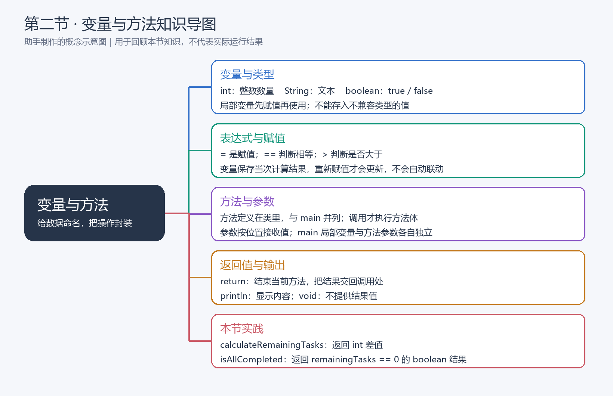
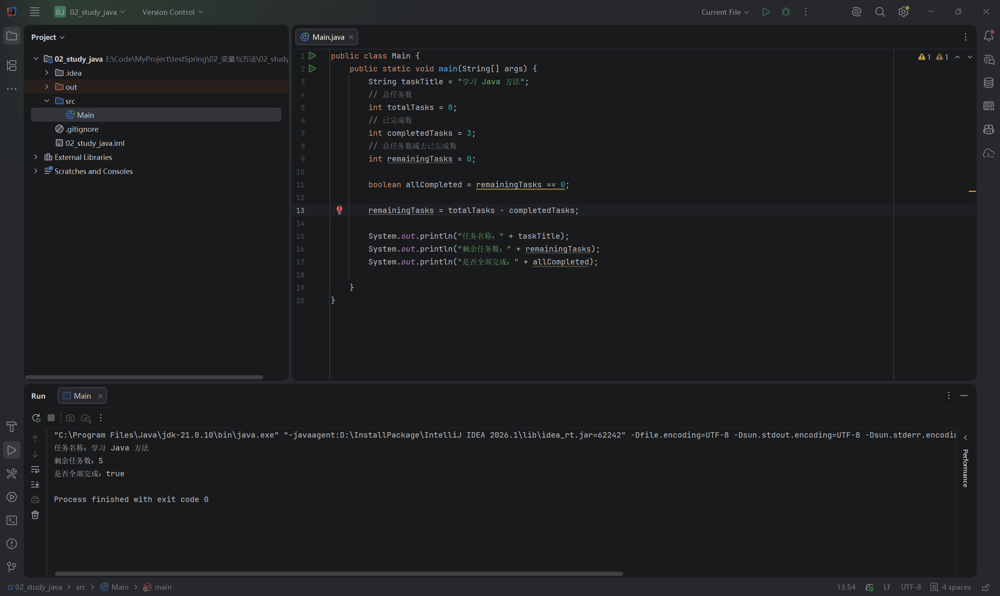
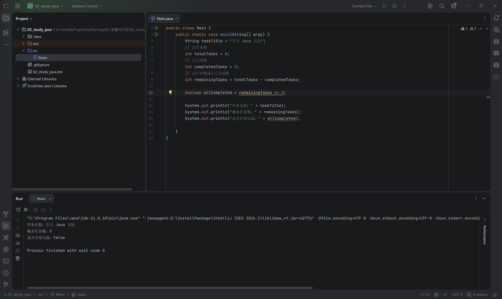
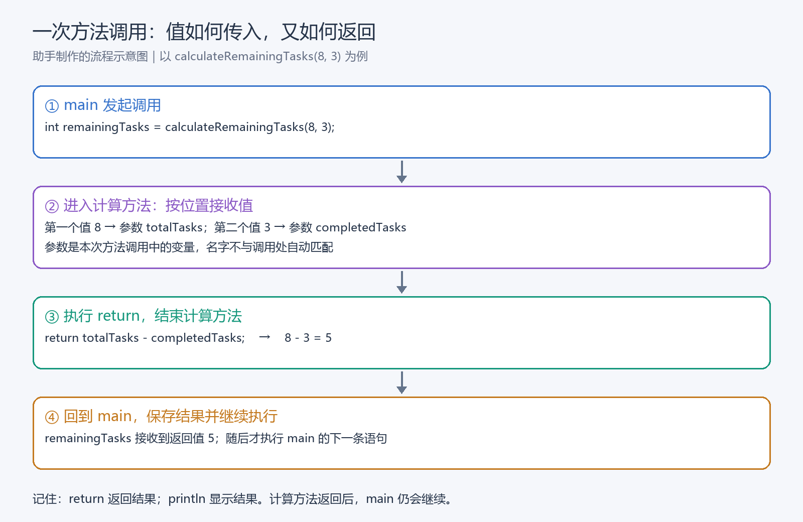
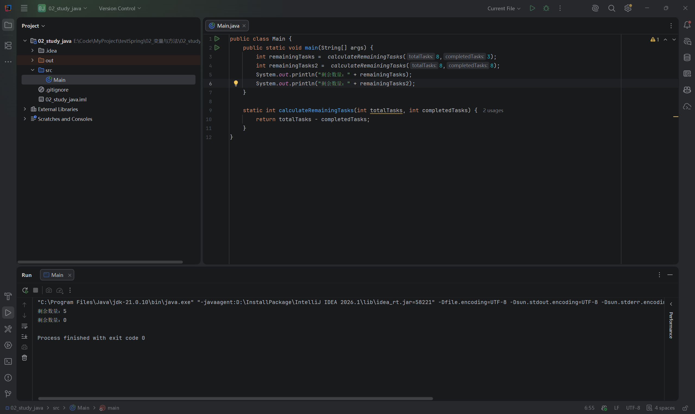
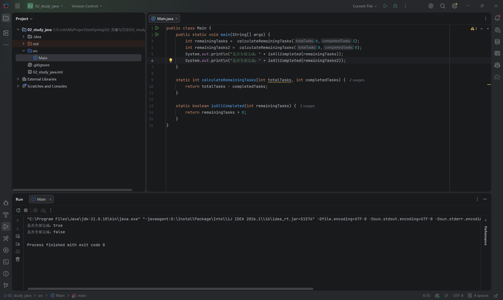
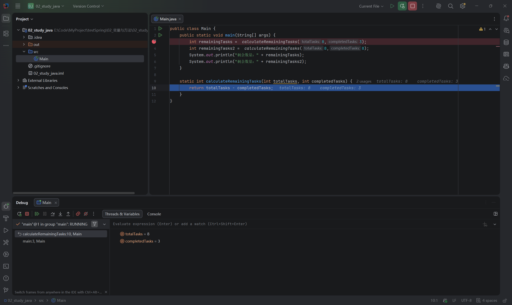

# 第二节：变量与方法

## 学习目标

- 使用 int、String、boolean 声明变量，理解表达式与赋值顺序。
- 自己定义和调用带参数、带返回值的方法。
- 区分 return 与控制台输出，使用调试观察方法参数。

环境：Windows、IDEA、JDK 21。工程为 `02_study_java/`，源码为 `02_study_java/src/Main.java`。本节没有新增依赖。

## 本节知识导图

【插图 1：在这里上传 `images/知识导图_变量与方法.png`】



助手制作的知识示意图。先从左侧主题看五条分支，再结合下文的代码和实际截图理解；这张图用于回顾概念，不是运行验证截图。

## 变量、类型与表达式

```java
String taskTitle = "学习 Java 方法";
int totalTasks = 8;
int completedTasks = 3;
int remainingTasks = totalTasks - completedTasks;
boolean allCompleted = remainingTasks == 0;
```

int 表示整数，String 表示文本，boolean 表示 true 或 false。Java 变量不能接收不兼容类型的值。方法中的局部变量必须先赋值才能使用；写 `int remainingTasks = 0;` 是显式初始化，不是依赖默认值。

`=` 用于赋值；`==` 判断是否相等。减法表达式得到整数，相等判断得到布尔值。

## 赋值不会建立自动联动

学习时曾认为 allCompleted 会随着 remainingTasks 自动变化。普通 Java 变量保存的是赋值当时计算的值，与普通 JavaScript 变量一样，不是响应式计算属性。

```java
int remainingTasks = 0;
boolean allCompleted = remainingTasks == 0;
remainingTasks = 5;
```

此时 remainingTasks 为 5，allCompleted 仍为 true。要更新判断结果，需再次执行 `allCompleted = remainingTasks == 0;`。

【插图 2：在这里上传 `images/变量练习_先判断后修改.png`】



实际截图显示剩余数为 5，完成状态却为 true：状态保存了之前的判断结果。退出码为 0 只能说明正常结束，不能证明逻辑正确。

【插图 3：在这里上传 `images/变量练习_正确计算顺序.png`】



恢复为先计算剩余数、再判断完成状态后，实际输出为 5 和 false。学习者已解释清楚变量不会自动联动。

## 方法：输入、计算与返回

以下是学习者实际编写的方法：

```java
static int calculateRemainingTasks(int totalTasks, int completedTasks) {
    return totalTasks - completedTasks;
}
```

- static：当前允许 main 直接调用；结合对象的机制以后学习。
- int：声明返回一个整数。
- calculateRemainingTasks：方法名，说明操作的用途。
- 两个 int 参数：接收每次调用传入的整数值。
- return：结束当前方法，把结果交回调用处；main 随后继续执行。

定义方法不会立即执行方法体，调用才会执行。方法定义在 Main 类内，与 main 并列，不能定义在 main 内部。

```java
int remainingTasks = calculateRemainingTasks(8, 3);
```

执行过程：调用 → 参数分别接收 8、3 → 计算差值 → 返回 5 → remainingTasks 保存 5。

【插图 4：在这里上传 `images/流程图_方法调用与返回.png`】



助手制作的执行流程示意图。沿箭头从 main 的调用处进入计算方法，再通过 return 回到 main。重点看返回结果何时存入 remainingTasks，以及方法返回后 main 继续执行的位置。

【插图 5：在这里上传 `images/方法练习_两次调用结果.png`】



实际截图确认调用 (8, 3)、(8, 8) 分别输出 5、0，退出码为 0。

## 参数按位置传入

Java 按位置传参，不按调用处的变量名匹配。main 的局部变量和计算方法里的同名参数是不同变量，各自属于所在方法。

```java
int completedTasks = 3;
int totalTasks = 8;
int result = calculateRemainingTasks(completedTasks, totalTasks);
```

这个讲解示例等同于调用 (3, 8)：方法的 totalTasks 接收 3，completedTasks 接收 8，计算结果为 -5。两个参数均为 int，传反仍满足类型要求，因此不会报编译错误。编译器不判断数量的业务含义。

IDEA 灰色的 `totalTasks:` 等文字是参数提示，不属于源码，不表示 Java 支持这里的命名传参。

学习者要求跳过重复验证并表示理解；反序调用未实际调试验证，以上数值是代码推导。

## return 与 println

| 写法 | 作用 |
| --- | --- |
| return 表达式; | 结束当前方法，把值交回调用处 |
| System.out.println(表达式); | 显示内容，继续执行后续语句 |
| void | 方法不提供结果值，可以用 return; 提前结束 |

当前这些正常执行并结束的非 void 方法必须返回与声明类型兼容的结果。只打印内容不能替代返回值。异常等特殊路径以后再深入。

学习者最终源码中的布尔方法：

```java
static boolean isAllCompleted(int remainingTasks) {
    return remainingTasks == 0;
}
```

曾写成 `remainingTasks > 0`，表达的是“还有未完成任务”，与方法名相反。修改为等于零后，源码逻辑正确。

【插图 6：在这里上传 `images/布尔方法_判断条件写反.png`】



这是修复前的实际截图：剩余数 5、0 得到 true、false。最终条件已从源码确认修正。2026-10-12，助手使用 JDK 21.0.10 实际运行最终源码，两次输出分别为“是否全部完成：false”和“是否全部完成：true”，退出码为 0；此次为命令行验证，没有新增 IDEA 截图。

返回值可以直接用在表达式中，不一定要先保存到变量：

```java
System.out.println("是否全部完成：" + isAllCompleted(remainingTasks));
```

先调用方法得到 boolean，再与文本拼接，最后输出。

## IDEA 调试与快捷键

1. 点击调用行左侧行号区域设置断点，启动 Debug。
2. 使用 Step Into 进入自己编写的方法。
3. 查看方法参数及调用栈。
4. 执行 return 回到调用处，赋值行执行完成后再查看接收结果的变量。

Windows 默认键位常用 F7（Step Into）、F8（Step Over）、F9（Resume）。若键位方案不同，使用菜单 `Run → Debugging Actions` 下的对应操作，并查看菜单显示的快捷键。

【插图 7：在这里上传 `images/方法调试_进入计算方法.png`】



实际截图停在 return 行：参数为 8、3；左侧调用栈显示来自 main 第 3 行。返回到 main 后的变量观察未提供验证截图。

## 自测与后续内容

1. 修改 remainingTasks 为什么不会自动更新 allCompleted？
2. 两个 int 参数传反为什么能编译，但结果可能错误？
3. return 与 println 分别把结果交给谁？
4. boolean 方法只打印内容、不返回值，为什么不符合当前方法声明？

本节变量与方法练习已完成，最终源码无必须修复的问题。学习者已解释赋值顺序及返回类型要求。最终布尔方法的修复后运行结果已由助手使用 JDK 21.0.10 确认：false、true，退出码为 0。

负数、已完成数大于总数等输入如何处理，留到第三节“条件判断与输入校验”；本节不提前引入复杂设计。

## 图片位置与语雀上传说明

笔记已使用标准 Markdown 将图片引用放到对应讲解位置，本地支持相对图片路径的预览器可以直接显示。复制文字到语雀通常不会同时上传本地图片。

手动迁移时：复制或导入笔记文字，在各个“【插图 N】”标记处上传对应文件。图片显示成功后，删除该位置的插图提示及未生效的本地图片引用，保留中文图注。如果导入方式已经正确带入图片，无需重复上传。

| 编号 | 所在内容 | 对应文件（在 images 目录中） |
| --- | --- | --- |
| 1 | 本节知识导图 | 知识导图_变量与方法.png |
| 2 | 赋值不会自动联动：错误顺序 | 变量练习_先判断后修改.png |
| 3 | 赋值不会自动联动：正确顺序 | 变量练习_正确计算顺序.png |
| 4 | 方法调用的执行过程 | 流程图_方法调用与返回.png |
| 5 | 两组计算方法调用的实际结果 | 方法练习_两次调用结果.png |
| 6 | boolean 判断条件的实际易错点 | 布尔方法_判断条件写反.png |
| 7 | IDEA 进入方法与参数观察 | 方法调试_进入计算方法.png |

课程 images 目录中另外保留了早期练习截图，未引用的图片不需要插入本篇笔记。

