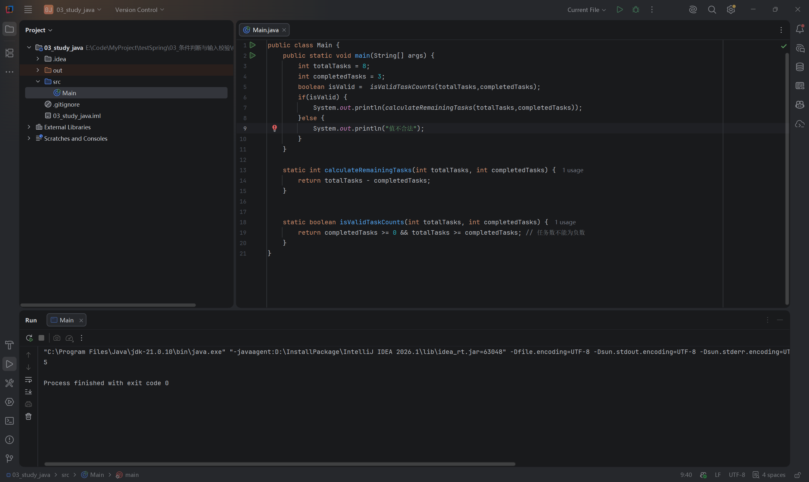
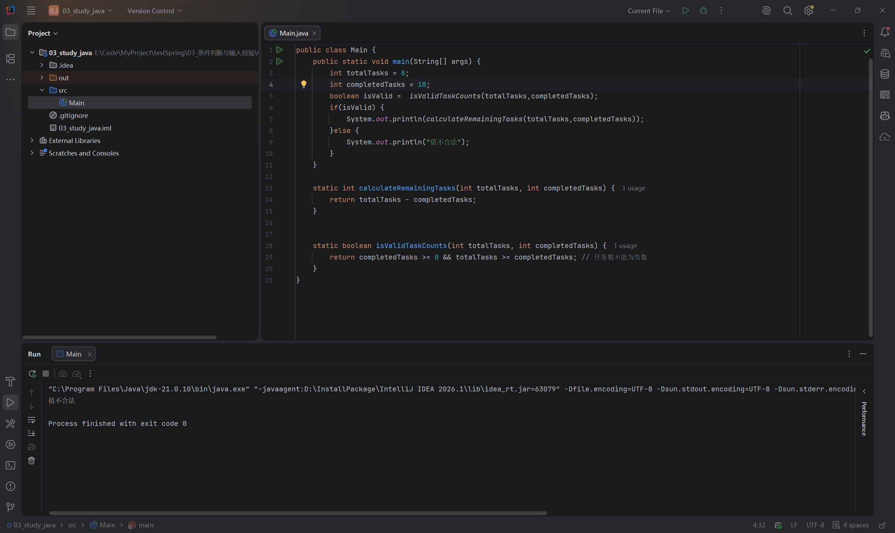

# 第三节：条件判断与输入校验

## 学习目标

- 根据业务规则判断任务数量是否合法，避免非法数据进入计算。
- 区分分支结束与方法结束。
- 重点了解 Java 与 JavaScript 的差异，熟悉的运算符和分支语法快速回顾。

工程：`03_study_java/`；源码：`03_study_java/src/Main.java`。环境为 Windows、IDEA、JDK 21，本节未新增依赖。

## 与前端经验的区别

| 内容 | Java 要点 |
| --- | --- |
| 整数除法 | `5 / 2` 得到 `2`；`5 / 2.0` 得到 `2.5`。这两个结果是语义示例，未另行运行验证。 |
| if 条件 | 必须为 boolean，不能写 `if (count)` 或 `if (title)` 依赖 truthy/falsy。 |
| 相等判断 | 没有 `===`；基本类型通常使用 `==`，字符串内容比较使用 `.equals()`。 |
| 逻辑运算 | `&&`、`||` 具有短路行为，两侧必须为 boolean，结果也是 boolean，不能用 `title || "默认标题"` 选择文本。 |
| 方法结束 | `return;` 结束当前 void 方法；方法也可以执行到末尾自然结束。 |

`"done".equals(status)` 比较字符串内容，status 为 null 时返回 false。引用与对象的细节留到下一节。

## 类型校验与业务校验

`int` 只约束参数为整数，不保证数量符合业务规则。总任务数为 8、完成数为 10 可以通过编译，但业务上必须拒绝。

前端校验用于及时反馈；后端也必须校验，因为请求可以绕过前端直接发送。当前以代码参数模拟输入，没有引入键盘输入或 HTTP。

学习者实际编写的校验方法：

```java
static boolean isValidTaskCounts(int totalTasks, int completedTasks) {
    return completedTasks >= 0 && totalTasks >= completedTasks;
}
```

两个条件同时保证：完成数非负、完成数不超过总数。因为总数不小于一个非负数，总数也必然非负，无需强制补一个重复判断。

按条件推导，(0, 0) 合法；负总数、负完成数均不合法。这些边界未单独运行，不记为实际验证。

## 先校验，再决定是否计算

实际 main 中的关键代码：

```java
boolean isValid = isValidTaskCounts(totalTasks, completedTasks);
if (isValid) {
    System.out.println(calculateRemainingTasks(totalTasks, completedTasks));
} else {
    System.out.println("值不合法");
}
```

执行过程：取得校验结果 → 根据结果选择分支 → 合法时调用计算方法，非法时显示提示 → 分支结束后继续执行后续语句。

校验方法负责返回判断结果，main 负责决定下一步行为。计算方法仍负责减法；本练习由调用处保证只有合法数据进入它。

## 实际运行结果

【插图 1：在这里上传 `images/输入校验_合法数量.png`】



学习者的 IDEA 截图：总数 8、完成数 3，输出 5，退出码 0。

【插图 2：在这里上传 `images/输入校验_完成数超限.png`】



学习者的 IDEA 截图：总数 8、完成数 10，输出“值不合法”，退出码 0。计算调用位于合法分支，本次非法数据不会进入计算。

两次运行均使用 JDK 21.0.10。助手已读取实际源码，没有代改练习，也没有额外运行第三节程序。

## 本节问题：main 没有 return 是否正确

学习者采用 if / else，没有在 main 中使用 return。这是正确实现：计算语句只在合法分支内执行，非法分支没有计算。

提前 return 是另一种组织方式，可在发现非法输入时结束当前方法，适用于希望让后续正常流程少一层嵌套的情况；不要求为此重写当前练习。

关键区别：if / else 结束不等于方法结束。如果在整个分支后、main 内增加输出，无论进入哪个分支，正常执行后都会到达该输出。学习者已准确解释这一点。

boolean 方法里的 `return false;` 只结束校验方法，返回调用处；不会自动结束调用它的 main。

## 运行与调试

在 IDEA 打开 `03_study_java`，修改 main 中的数量，运行 Main，观察输出和退出码。可以在 if 行设置断点，查看 isValid，再单步观察进入哪个分支。

Windows 默认键位通常为 F8（Step Over）、F7（Step Into）、F9（Resume）；以当前键位方案为准，也可从 `Run → Debugging Actions` 菜单操作。本节未新增调试截图，不将这些操作记为已验证。

## 自测

1. 为什么参数都是 int，仍需要业务校验？
2. 两个条件为什么已经保证总数非负？
3. 在 if / else 后增加输出，非法输入时为什么仍会执行？
4. 在校验方法中 return false，会自动结束 main 吗？

本节源码检查通过，两组实际运行结果正确，学习者已解释分支结束后继续执行。条件判断与输入校验的核心目标完成；更详细的错误原因、异常处理及接口参数校验后续再学习。

## 语雀图片上传

复制 Markdown 文本通常不会自动上传本地图片。在对应插图标记处上传课程 images/ 中的两张图片，显示成功后删除上传提示及未生效的本地图片引用，保留中文说明。也可使用语雀支持的导入方式，但本次未验证自动带图。
