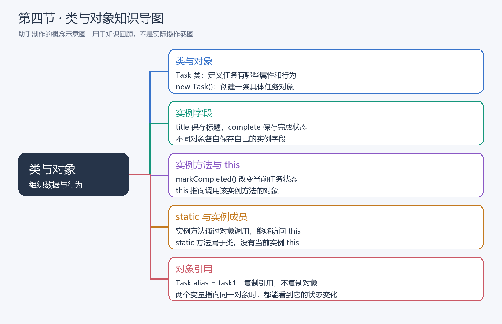
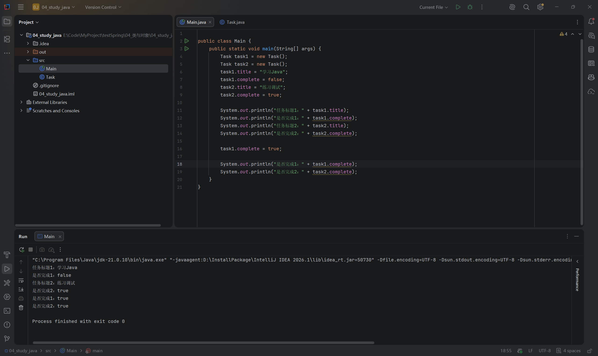
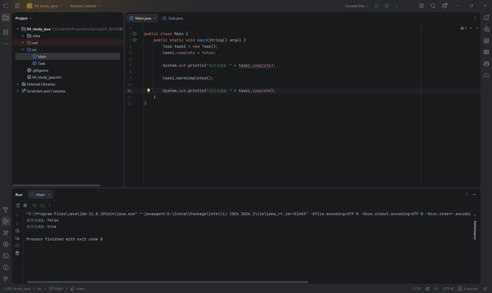
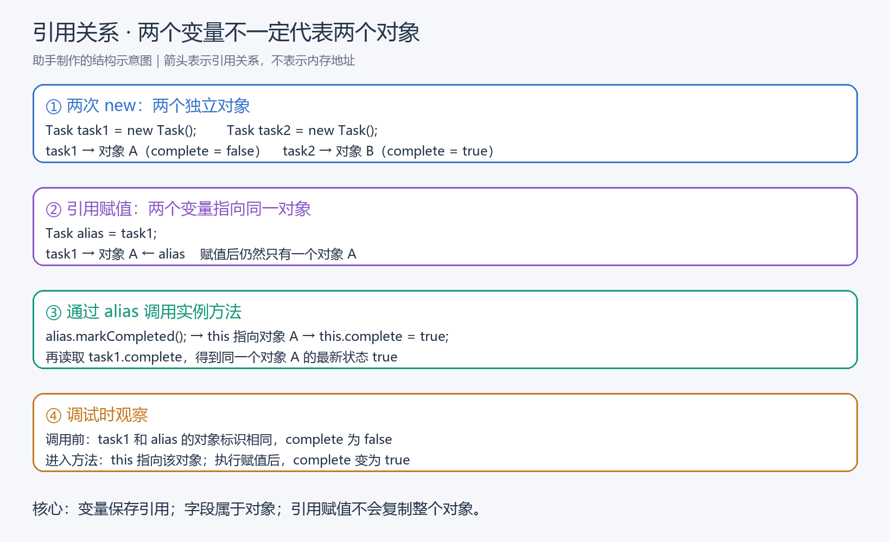
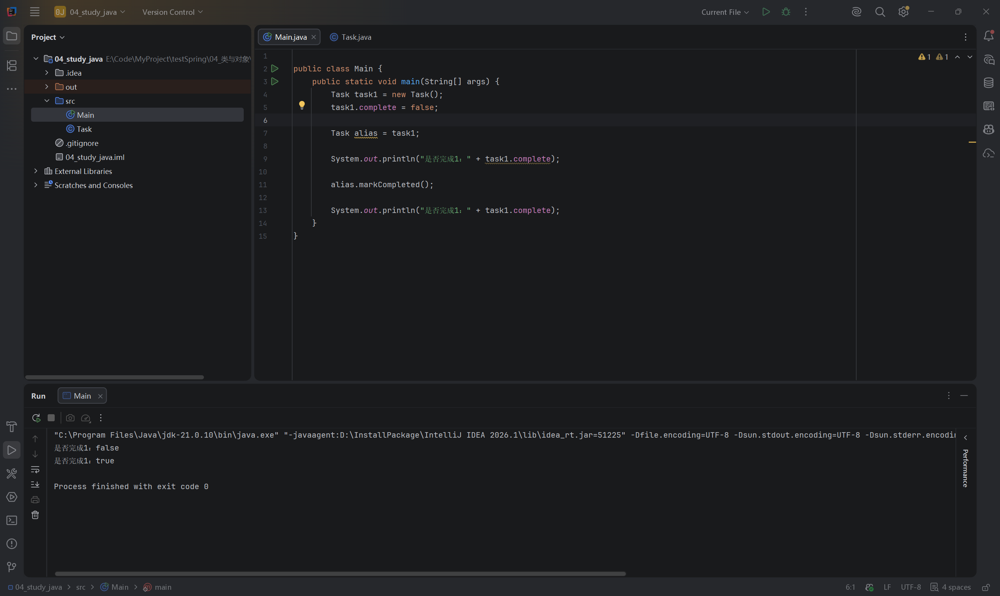

# 第四节：类与对象

## 学习目标

用 Task 类把一条任务的数据与行为放在一起，创建对象、调用实例方法，并理解变量、对象引用和 this 的关系。

工程：`04_study_java/`；源码：`04_study_java/src/Main.java`、`04_study_java/src/Task.java`。使用 JDK 21，无新增依赖。

## 知识导图

【插图 1：在这里上传 `images/知识导图_类与对象.png`】



助手制作的概念示意图。阅读顺序：类定义结构 → 创建具体对象 → 用字段保存状态 → 用实例方法改变状态 → 理解引用关系。

## 类、对象与实例字段

以前用独立变量表示任务数量；现在要表示一条具体任务，将标题和完成状态组织到 Task 类里。

| 概念 | 本节用途 |
| --- | --- |
| 类 Task | 定义任务有哪些属性和行为 |
| 对象 | 按 Task 创建的一条具体任务 |
| 实例字段 | 每个对象各自保存的数据 |
| 引用变量 | 保存指向对象的引用，用于访问对象 |

```java
Task task1 = new Task();
task1.title = "学习Java";
task1.complete = false;
```

左侧 Task 是变量类型，task1 是变量名；右侧 new Task() 创建对象。task1 保存该对象的引用，点号用于访问字段或调用方法。Java 字段需要先在类内声明类型，不能像 JavaScript 对象那样临时添加未声明属性。

两次 new Task() 创建两个不同对象。本节的 boolean 字段分别保存状态，修改第一条不会修改第二条。不要把这一结论扩大成“所有对象永远互不影响”：多个变量可以指向同一个对象，对象也可以引用其他共享对象。

【插图 2：在这里上传 `images/两个任务对象_独立状态.png`】



学习者实际 IDEA 截图：第一条初始为 false，第二条为 true；修改第一条后，两条分别为 true、true，退出码 0。两次 new 与实例字段的定义已通过源码检查。

## 实例方法：让任务执行自己的行为

学习者最终编写的 Task.java：

```java
public class Task {
    String title;

    boolean complete;

    void markCompleted() {
        this.complete = true;
    }
}
```

markCompleted 表达“标记完成”的行为。void 表示不返回结果值；方法通过改变当前对象的字段实现行为。本方法没有 static，是实例方法。

```java
task1.markCompleted();
```

调用时，this 指向 task1 所引用的对象。因此 this.complete = true 修改的是那条任务。当前方法没有同名局部变量或参数，complete = true 与 this.complete = true 等价。

| 方法形式 | 获取数据的方式 |
| --- | --- |
| 前几节 static calculateRemainingTasks(...) | 通过传入的参数计算，不需要当前任务对象 |
| 本节 markCompleted() | 通过 this 访问当前任务对象的状态 |

static 方法属于类，没有当前实例 this，所以不能直接使用 this 或直接访问实例字段。但它可以通过一个明确的对象引用访问实例成员，如 main 中的 task1.markCompleted()。不需要为了能调用方法就把所有方法都写成 static。

Java 普通实例方法的 this 由调用对象确定，不能像 JavaScript 普通函数那样使用 call、apply 改绑。

【插图 3：在这里上传 `images/实例方法_标记任务完成.png`】



实际截图确认调用前 false、调用后 true，退出码 0。学习者准确解释由调用对象决定修改哪条任务，并主动删除 task2 简化本轮代码；上一轮验证已保留，不要求恢复。

## 引用赋值：复制引用，不复制对象

```java
Task alias = task1;
alias.markCompleted();
System.out.println(task1.complete);
```

alias = task1 将 task1 保存的引用复制给 alias，两个变量指向同一个对象。通过 alias 修改对象，再通过 task1 读取，就能看到新状态。这与 JavaScript 的对象引用赋值相似。

学习者解释：“没有 new，指向同一个 Task 对象。”本例解释正确，关键依据是 alias = task1 这次引用赋值。不能单凭一个表达式没有 new 就断言它与另一个变量指向相同对象，例如方法也可能返回其他对象。

【插图 4：在这里上传 `images/结构图_对象引用与实例调用.png`】



助手制作的结构示意图。对比两次 new 与引用赋值：前者创建不同对象，后者增加一个访问同一对象的变量。箭头表示引用关系，不表示内存地址。

本轮实际 Main.java：

```java
public class Main {
    public static void main(String[] args) {
        Task task1 = new Task();
        task1.complete = false;

        Task alias = task1;

        System.out.println("是否完成1：" + task1.complete);

        alias.markCompleted();

        System.out.println("是否完成1：" + task1.complete);
    }
}
```

【插图 5：在这里上传 `images/对象引用_别名修改同一任务.png`】



实际截图确认通过 alias 调用方法后，读取 task1.complete 得到 true，调用前为 false，退出码 0。变量数量不等于对象数量。

## 运行与调试

在 IDEA 打开 `04_study_java`，运行 Main。调试时：

1. 在 alias.markCompleted() 行设置断点，启动 Debug。停在这行时，它尚未执行。
2. 展开 task1 与 alias，观察相同的对象标识和 complete=false。调试器对象标识不是内存地址。
3. Step Into 进入方法，观察 this 指向同一个对象。
4. Step Over 执行赋值，观察 complete=true，然后继续运行。

学习者已实际调试，并文字确认结果与上述预期一致，未提供调试截图。结构图是教学示意，不作为实际调试截图。三次运行截图均使用 JDK 21.0.10；助手检查源码，未额外编译运行，也未修改练习实现。

Windows 默认键位通常为 F7（Step Into）、F8（Step Over）、F9（Resume）；以当前键位方案为准，也可使用调试工具栏或 Run → Debugging Actions 菜单。

## 本节易错点与后续内容

- 不把“两个变量”当成“两个对象”；先看是 new 还是引用赋值。
- this 表示当前对象，不是当前类，也不是变量名。
- void 方法可以改变对象状态，不必返回一个值才能产生作用。
- 状态字段建议命名 completed，更清楚地表达“已完成”；实际代码保留 complete，不影响当前正确性，不强制修改。
- 当前直接访问字段用于建立基础认识；private、构造方法与封装在第五节学习，不要求提前补齐 getter/setter。
- 堆栈布局、垃圾回收、深拷贝及更复杂的共享状态以后再深入。

## 自测题

1. Task 类、new Task() 创建的对象、task1 变量各是什么？
2. 两次 new 与 Task alias = task1 有什么区别？
3. alias.markCompleted() 中 this 指向谁？
4. 为什么 main 是 static，仍然可以调用 task1.markCompleted()？

参考要点：类定义结构；new 创建对象；变量保存引用。两次 new 创建不同对象，引用赋值不会复制对象。this 指向 alias 引用的对象。static 方法可以通过明确的对象引用调用实例方法。

核心练习、源码检查、运行与解释题完成；调试由学习者文字确认。本节结课，下一节为“构造方法与封装”。

## 语雀图片上传清单

复制 Markdown 文本通常不会自动上传本地图片。请在对应插图标记处上传以下文件，确认显示成功后删除上传提示和未生效的本地图片引用，保留图片说明。也可使用语雀支持的导入方式，本次未验证自动带图。

| 插图 | 相对文件位置 |
| --- | --- |
| 1 | images/知识导图_类与对象.png |
| 2 | images/两个任务对象_独立状态.png |
| 3 | images/实例方法_标记任务完成.png |
| 4 | images/结构图_对象引用与实例调用.png |
| 5 | images/对象引用_别名修改同一任务.png |
