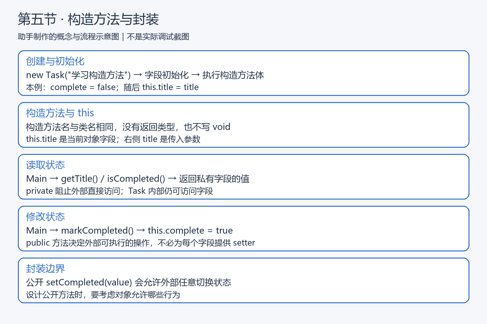
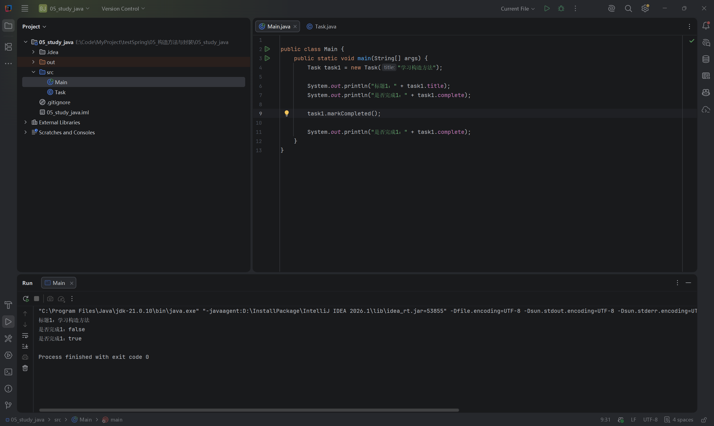
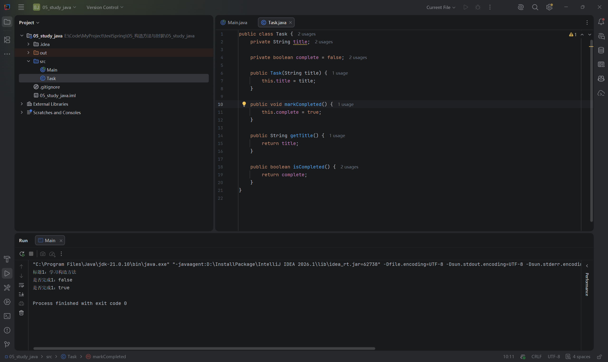
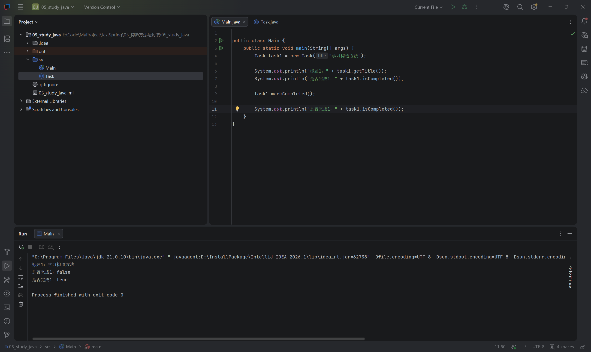

# 第五节：构造方法与封装

## 学习目标

创建 Task 时初始化标题，用私有字段保存内部状态，通过公开方法读取和操作任务。

工程：`05_study_java/`；源码：`05_study_java/src/Task.java`、`05_study_java/src/Main.java`。使用 JDK 21，无新增工程依赖。

## 知识与执行流程

【插图 1：在这里上传 images/知识与流程图_构造方法与封装.png】



助手制作的教学示意图，不是实际调试截图。从上到下回顾创建时初始化、字段与参数、读取、修改及公开方法的边界。

## 构造方法：创建时初始化

```java
Task task1 = new Task("学习构造方法");
```

本例创建对象后，先完成实例字段初始化，再执行构造方法体，构造调用正常完成后将对象引用赋给 task1。构造方法负责初始化，不能写成普通方法的形式：名字必须与类名相同，没有返回类型，连 void 也不写。

```java
public Task(String title) {
    this.title = title;
}
```

this.title 是当前对象的字段；右侧 title 是调用时传入的参数。每个对象各自保存标题，不是整个类共享一份数据。写成 title = title 只会给参数自身赋值，字段不会得到传入值。

JavaScript 使用 constructor 作为构造方法名，Java 使用类名。Java 类中没有声明任何构造方法时，编译器才提供默认无参构造方法；本例声明带参数的构造方法后，new Task() 将不能使用，除非另外声明无参构造方法。

学习者把 complete = false 写在字段声明处，写法正确，无需强制移入构造方法。boolean 实例字段默认就是 false，显式赋值有助于表达初始状态。引用类型字段默认是 null。

【插图 2：在这里上传 images/构造方法_初始化任务与完成状态.png】



实际 IDEA 截图：创建时传入标题“学习构造方法”，输出标题正确，调用 markCompleted() 前为 false、后为 true，退出码 0。

## 封装：由 Task 决定对外提供的操作

private 阻止外部代码直接访问字段，Task 内部仍可读写。public 方法允许外部调用；方法体写在 Task 类内，因此仍能访问该类的私有字段。

学习者最终 Task.java：

```java
public class Task {
    private String title;

    private boolean complete = false;

    public Task(String title) {
        this.title = title;
    }

    public void markCompleted() {
        this.complete = true;
    }

    public String getTitle() {
        return title;
    }

    public boolean isCompleted() {
        return complete;
    }
}
```

getTitle() 返回标题，isCompleted() 返回完成状态。布尔读取方法常用 is... 命名，不要求字段也采用相同名称。这里没有同名参数，return title 与 return this.title 等价。

【插图 3：在这里上传 images/封装_Task私有字段与公开方法.png】



实际代码截图：观察两个 private 字段，以及用于初始化、读取和标记完成的 public 成员。private 限制直接访问，不意味着外部完全无法获得字段值。

最终 Main.java：

```java
public class Main {
    public static void main(String[] args) {
        Task task1 = new Task("学习构造方法");

        System.out.println("标题1：" + task1.getTitle());
        System.out.println("是否完成1：" + task1.isCompleted());

        task1.markCompleted();

        System.out.println("是否完成1：" + task1.isCompleted());
    }
}
```

【插图 4：在这里上传 images/封装_通过方法读取与修改状态.png】



实际 IDEA 截图：Main 已改用方法读取字段，运行仍输出正确标题、false、true，退出码 0。封装改变访问方式，当前业务结果保持一致。

## 为什么不自动给所有字段添加 setter

如果公开 setCompleted(boolean value)，并直接将参数赋给字段，外部就能传 true 或 false 任意切换状态。学习者已准确解释：公开方法让外部能够间接修改内部字段。

因此封装不只是添加 private，还需要设计合适的公开操作。当前只需要 markCompleted()，无需增加 setter；将来可在这个行为方法中加入完成时间等规则。并非所有 setter 都错误，是否提供取决于业务允许的操作。

## 运行与调试

在 IDEA 打开本节工程 05_study_java，运行 Main。调试步骤：

1. 在构造方法 this.title = title 处打断点，Debug 运行。
2. 停住时赋值尚未执行：参数 title 为“学习构造方法”，this.title 为 null，complete 为 false。
3. Step Over 执行赋值，观察 this.title 变为传入的标题。
4. 继续运行，确认正常结束。

Windows 默认键位通常为 F8（Step Over）、F9（Resume），以实际键位方案为准；也可使用调试工具栏，或 Run → Debugging Actions 菜单。

学习者文字确认调试完成且与预期一致，未提供调试截图；助手未直接观察调试界面。运行截图使用 JDK 21.0.10，助手检查实际源码，未额外编译运行，未代改实现。私有字段直接访问的编译报错未提供实际观察确认，不记为已验证。

## 本节理解确认与后续内容

- 已区分 this.title 字段与 title 参数，并补充字段属于当前对象。
- 已解释 Task 内部方法能够访问私有字段，即使该方法本身是 public。
- 已解释公开 setter 会允许外部间接修改状态。
- 实际源码无必须修复的问题，运行截图与调试文字确认完成。
- 构造方法重载、this(...)、final、继承及反射以后再深入；当前不需要引入这些概念。

## 自测题

1. 构造方法为什么不能写 void？
2. this.title = title 两侧分别是什么？写成 title = title 会怎样？
3. 字段是 private，为什么 public markCompleted() 仍能修改它？
4. 添加一个直接赋值的 public setter，会给外部增加什么能力？

参考要点：构造方法没有返回类型；左侧是当前对象字段，右侧是参数；访问代码位于 Task 类内；setter 会开放对应状态的修改能力。

## 语雀图片上传清单

复制 Markdown 文本通常不会自动上传本地图片。请在插图标记处上传以下文件，确认显示成功后删除上传提示及未生效的本地引用，保留图片说明；也可使用语雀支持的导入方式，本次未验证自动带图。

| 插图 | 相对文件位置 |
| --- | --- |
| 1 | images/知识与流程图_构造方法与封装.png |
| 2 | images/构造方法_初始化任务与完成状态.png |
| 3 | images/封装_Task私有字段与公开方法.png |
| 4 | images/封装_通过方法读取与修改状态.png |

第五节已结课，下一节为第六节“集合与任务列表”，学习使用集合管理多条任务。
