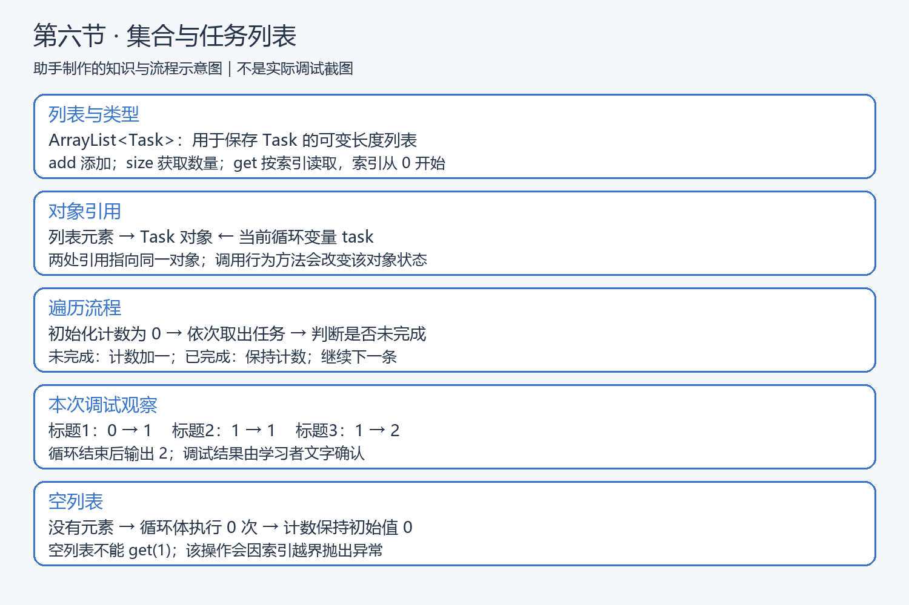
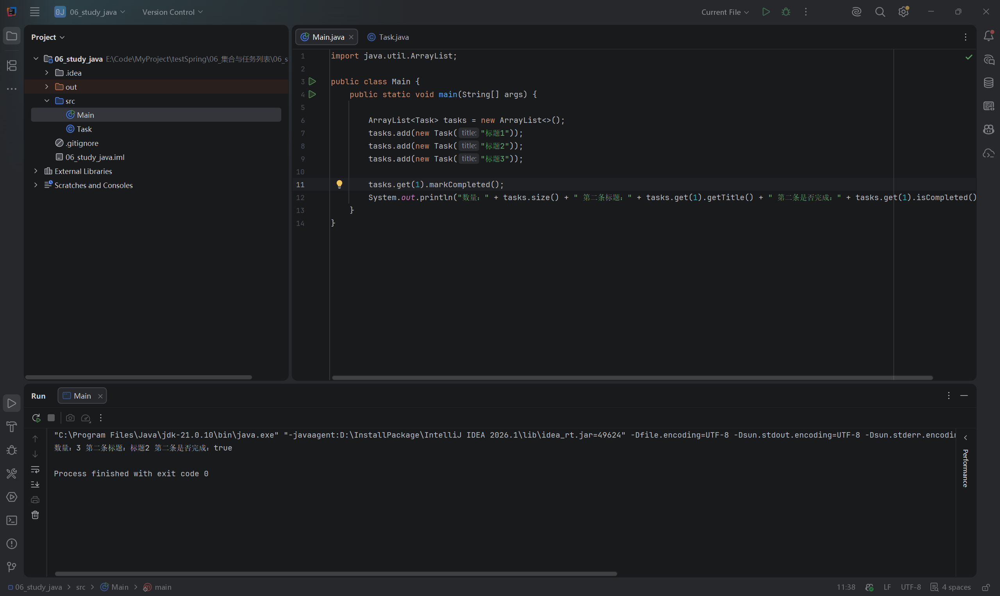
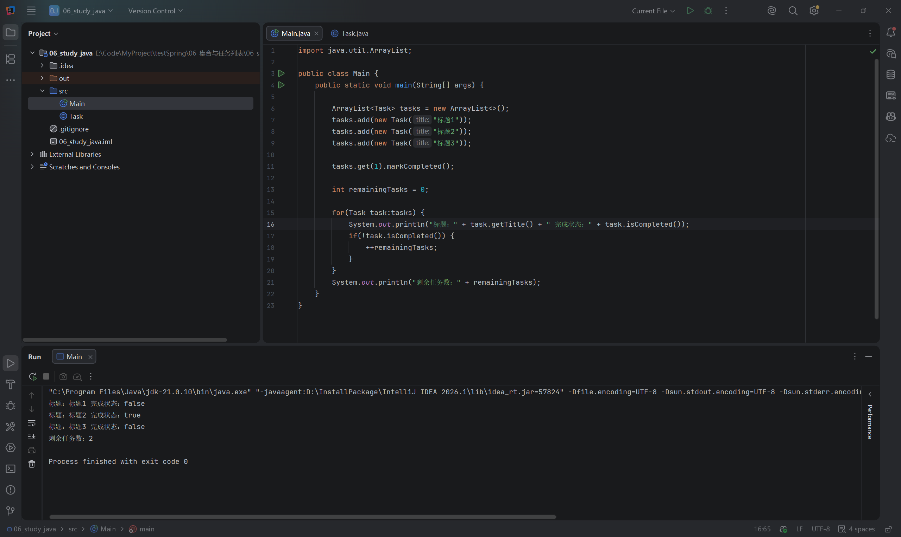

# 第六节：集合与任务列表

## 学习目标

用 ArrayList 管理多条 Task，按索引读取、遍历展示，并统计未完成任务数量。

工程：`06_study_java/`；源码：`06_study_java/src/Main.java` 和 `Task.java`。使用 JDK 21，无新增依赖，Task 沿用第五节的封装实现。

## 知识与执行流程

【插图 1：在这里上传 images/知识与流程图_集合与任务列表.png】



助手制作的教学示意图，不是实际调试截图。重点观察对象引用关系，以及判断状态后计数的变化。

## 用列表保存多条任务

任务数量变化时，不必不断添加 task1、task2 等变量，可以用一个列表组织任务。

```java
import java.util.ArrayList;

// 以下语句放在 main 内
ArrayList<Task> tasks = new ArrayList<>();
tasks.add(new Task("标题1"));
tasks.add(new Task("标题2"));
tasks.add(new Task("标题3"));
```

ArrayList 属于 JDK。import 让当前文件能使用简写类名，不是安装依赖。`<Task>` 约束元素类型，编译器会检查加入的元素；右侧 `<>` 根据左侧推断类型。

| Java 写法 | 用途 | JavaScript 类比 |
| --- | --- | --- |
| tasks.add(task) | 在末尾添加 | push(task) |
| tasks.size() | 获取元素数量 | length |
| tasks.get(1) | 读取第二个元素 | tasks[1] |

索引从 0 开始，三个元素的有效索引为 0、1、2。Java 列表不能用 tasks[1] 读取，越界的 get 会抛出异常，而不是返回 undefined。

```java
tasks.get(1).markCompleted();
```

先取出第二条任务的引用，再对这个对象调用 markCompleted()。列表保存对象引用，加入列表不会复制 Task。

【插图 2：在这里上传 images/集合_添加与读取第二条任务.png】



实际 IDEA 截图：数量 3，第二条标题“标题2”，完成状态 true，退出码 0。学习者准确解释第二条索引为 1。

## 增强 for：逐条读取并统计

学习者实际练习的核心代码（空格排版作了整理）：

```java
int remainingTasks = 0;

for (Task task : tasks) {
    System.out.println("标题：" + task.getTitle() + " 完成状态：" + task.isCompleted());
    if (!task.isCompleted()) {
        ++remainingTasks;
    }
}
System.out.println("剩余任务数：" + remainingTasks);
```

`for (Task task : tasks)` 表示依次取出列表中的元素，用局部变量 task 引用当前对象，再执行循环体。类似 JavaScript 的 for...of，Java 明确声明元素类型。

`!task.isCompleted()` 表示未完成，仅这时计数加一。计数器放在循环前初始化，才能累计多轮结果；如果放在循环体内，每轮会重新初始化。作为独立语句，++remainingTasks 和 remainingTasks++ 都使计数加一；嵌入表达式时的区别以后按需学习。

学习者准确解释：循环变量与列表元素指向同一个 Task，因此通过 task.markCompleted() 修改对象，随后从列表读取时也能看到该状态。这里是修改对象字段，不是复制对象。

【插图 3：在这里上传 images/集合_遍历任务与统计未完成数量.png】



实际 IDEA 截图：标题1、标题2、标题3 的状态依次为 false、true、false，剩余任务数 2，退出码 0。

## 调试观察

在 IDEA 打开本节工程，在循环体第一行输出语句设置断点，Debug 运行。停住后展开 task，观察标题、状态和 remainingTasks；逐行执行判断和递增，再继续到下一轮断点。

| 当前任务 | 本轮开始 | 本轮结束 |
| --- | --- | --- |
| 标题1，未完成 | 0 | 1 |
| 标题2，已完成 | 1 | 1 |
| 标题3，未完成 | 1 | 2 |

Windows 默认键位通常为 F8（Step Over）和 F9（Resume），以实际键位方案为准；也可使用调试工具栏或 Run → Debugging Actions 菜单。

学习者文字确认调试与预期一致，助手未直接观察调试界面。两张运行截图使用 JDK 21.0.10；助手检查实际源码，未额外编译运行，未代改实现。

## 空列表与当前易错点

学习者正确解释：空列表没有元素，增强 for 循环体执行 0 次，循环外初始化的 remainingTasks 保持 0。该解释假设不执行前面的 get(1)，因为空列表的 get(1) 会越界。空列表实际运行未执行，不记为运行验证。

本节未出现必须修复的代码问题。需要记住：数量不是最后一个索引；task 是引用；统计结果是本次遍历计算出的整数，之后修改任务状态不会自动更新已保存的计数，需要重新统计。

当前掌握 add、size、get、增强 for 和基本泛型用法即可。接口 List、集合实现选择、删除时的遍历规则、迭代器、Stream 和泛型原理以后再深入。

## 自测题

1. 三条任务的最后一个有效索引是多少？为什么不能 get(size())？
2. 为什么计数器要在循环前初始化？
3. 通过循环变量修改任务，为什么从列表读取也能看到变化？
4. 空列表的循环体执行几次？计数是多少？

参考要点：最后索引为 2，size 为 3；计数需跨轮累计；两处引用指向同一对象；执行 0 次，计数保持 0。

## 语雀图片上传清单

复制 Markdown 文本通常不会自动上传本地图片。请在插图标记处上传下列文件，确认显示后删除上传提示及未生效的本地引用，保留图片说明；也可使用语雀支持的导入方式，本次未验证自动带图。

| 插图 | 相对文件位置 |
| --- | --- |
| 1 | images/知识与流程图_集合与任务列表.png |
| 2 | images/集合_添加与读取第二条任务.png |
| 3 | images/集合_遍历任务与统计未完成数量.png |

第六节已结课，下一节为第七节“异常与任务输入校验”，学习如何表达和处理非法输入。
