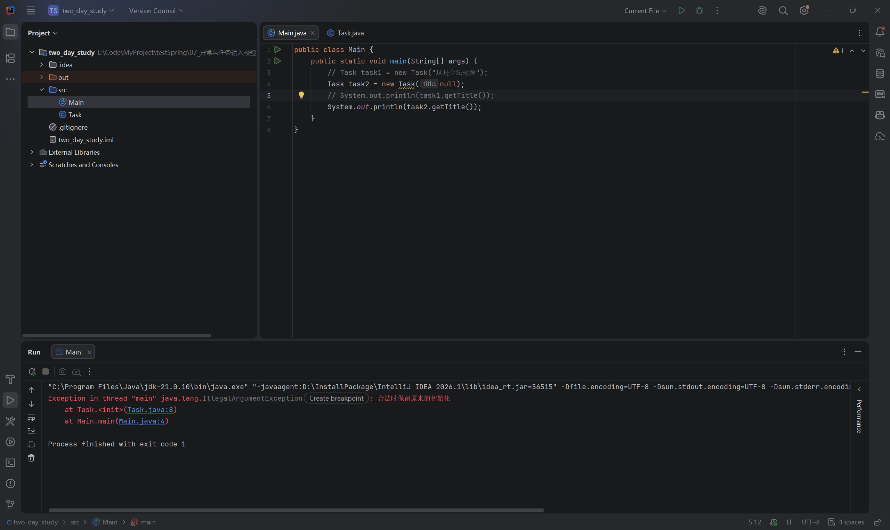
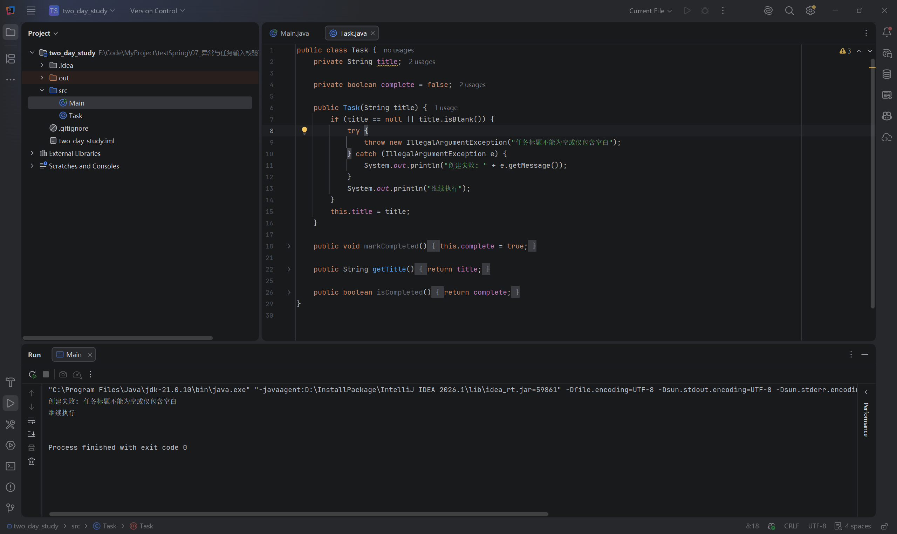
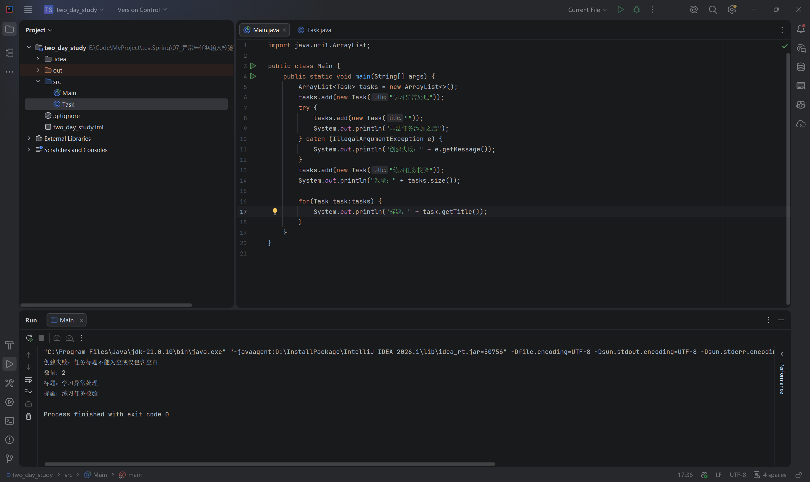

# 第七节：异常与任务输入校验

## 学习目标

拒绝非法任务标题，在调用处处理失败，让合法任务仍能进入列表。

工程：`two_day_study/`；源码：`two_day_study/src/Task.java`、`two_day_study/src/Main.java`。使用 JDK 21，无新增依赖。

## 知识与执行流程

【插图 1：在这里上传 images/知识与流程图_异常与任务输入校验.png】


助手制作的教学示意图，不是实际运行或调试截图。重点观察：创建先于添加，失败后跳到 catch，随后继续执行整个 try/catch 后面的代码。

## Task 负责拒绝非法参数

第三节用 boolean 表达校验结果；本节构造方法需要表达“输入不合法，创建失败”。构造方法不能返回 false，可以抛出异常。

```java
public Task(String title) {
    if (title == null || title.isBlank()) {
        throw new IllegalArgumentException("任务标题不能为空或仅包含空白");
    }
    this.title = title;
}
```

先校验，后保存。`isBlank()` 能识别空字符串和纯空白字符串。必须先判断 null：`||` 左侧为 true 时不执行右侧，避免在 null 上调用方法。

`new IllegalArgumentException(...)` 创建异常对象，字符串说明失败原因；`throw` 抛出对象，中断当前正常执行路径。IllegalArgumentException 表示参数不符合要求，是 JDK 自带的运行时异常，编译器不强制声明或捕获。

与 JavaScript 的 throw 思路相近，但 Java 的 catch 要声明异常类型。受检异常、throws、finally、自定义异常及框架统一异常处理以后深入。

【插图 2：在这里上传 images/异常_null标题未捕获.png】



实际 IDEA 截图：null 触发 IllegalArgumentException，定位 Task.java:8 和 Main.java:4，退出码 1。堆栈中的 `<init>` 表示构造方法。异常从构造方法传播到 main，无人捕获，本例 main 线程结束，后续输出不执行。图中消息“合法时保留原来的初始化”误用了练习提示，后续已改为准确原因。

## main 负责处理失败

学习者曾把 try/catch 放在构造方法内部。这种写法捕获后仍执行 this.title = title，导致非法标题进入对象。

【插图 3：在这里上传 images/异常_构造方法内部捕获导致继续初始化.png】



实际错误写法截图：输出失败原因及“继续执行”，退出码 0；但这并不代表校验有效。关键是 catch 后仍执行字段赋值。按学习者明确要求，助手示范修正：构造方法直接抛出，main 捕获。

```java
try {
    Task task = new Task("");
    System.out.println("标题：" + task.getTitle());
    System.out.println("创建成功");
} catch (IllegalArgumentException e) {
    System.out.println("创建失败：" + e.getMessage());
}
System.out.println("继续执行后续代码");
```

e 是捕获到的异常对象，getMessage() 读取失败原因。非法输入跳过 try 内剩余语句，执行 catch，然后执行整个 try/catch 后面的输出；不会回到抛出位置继续执行。合法输入输出标题和成功消息，跳过 catch，再输出后续消息。

## 接回任务列表

学习者实际实现（仅整理排版）：

```java
ArrayList<Task> tasks = new ArrayList<>();
tasks.add(new Task("学习异常处理"));
try {
    tasks.add(new Task(""));
    System.out.println("非法任务添加之后");
} catch (IllegalArgumentException e) {
    System.out.println("创建失败：" + e.getMessage());
}
tasks.add(new Task("练习任务校验"));
System.out.println("数量：" + tasks.size());

for (Task task : tasks) {
    System.out.println("标题：" + task.getTitle());
}
```

Main.java 顶部需要 `import java.util.ArrayList;`。调用方法前先计算参数，所以 tasks.add(new Task("")) 先执行构造方法；构造失败，add 不执行。已经加入的第一条任务不会被撤销，后面的合法添加仍可执行。

【插图 4：在这里上传 images/异常_非法任务未入列表并继续添加.png】



实际 IDEA 截图确认：失败原因、数量 2、两条合法标题，未输出“非法任务添加之后”，退出码 0。

## 调试与验证记录

在 main 非法添加行和 catch 输出行设置断点，Debug 运行。进入 Task 构造方法观察空 title，执行 throw 后继续至 catch，检查列表仍有 1 条；第二条合法任务添加后变为 2 条。

Windows 默认键位通常为 F7（Step Into）、F8（Step Over）、F9（Resume），以实际键位方案为准；也可使用调试工具栏或 Run → Debugging Actions 菜单。

学习者文字确认调试与预期一致，助手未直接观察该调试界面。null 未捕获和最终列表结果有截图；空字符串、纯空白及修正后合法/非法创建路径由学习者文字确认。助手曾编译运行修正后的空标题 main，退出码 0，终端中文存在乱码；未额外运行最终列表源码。最终实际源码检查通过，无必须修复问题。

## 易错点与自测

- 异常消息应说明失败原因，不要把练习提示当作消息。
- 抛出异常后跳过 try 剩余语句，捕获不会让程序回到失败位置。
- 构造方法自己捕获后继续初始化，可能保存非法状态。
- 创建失败时 add 未执行；异常不会自动撤销之前的列表修改。
- “创建成功”应放在创建之后的 try 内；需继续执行的操作放在整个 try/catch 后面。

1. 为什么 null 判断必须放在 isBlank() 前面？
2. 为什么构造失败后列表没有多一条元素？
3. 把第二条合法任务添加移到 try 内、非法添加之后，会怎样？
4. 退出码 0 是否能证明非法任务被正确拒绝？

参考要点：短路防止 null 方法调用；参数求值失败导致 add 未执行；后续添加被跳过，最终只有第一条任务；不能，构造方法内部捕获的错误示例也退出 0。

学习者正确回答第 3 题，并文字确认调试。本节核心目标已完成。

## 语雀图片上传清单

复制 Markdown 通常不会自动上传本地图片。请在插图标记处上传以下文件，确认显示后删除上传提示及未生效的本地引用，保留说明；也可使用语雀支持的导入方式，本次未验证自动带图。

| 插图 | 相对文件位置 |
| --- | --- |
| 1 | images/知识与流程图_异常与任务输入校验.png |
| 2 | images/异常_null标题未捕获.png |
| 3 | images/异常_构造方法内部捕获导致继续初始化.png |
| 4 | images/异常_非法任务未入列表并继续添加.png |

下一节：第八节“接口与任务服务”，用接口表达任务管理能力，并区分接口约定与实现。
