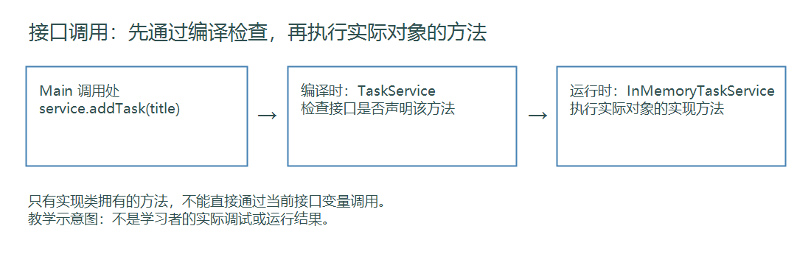
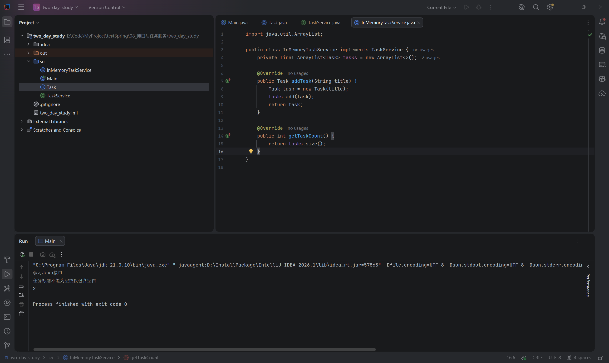
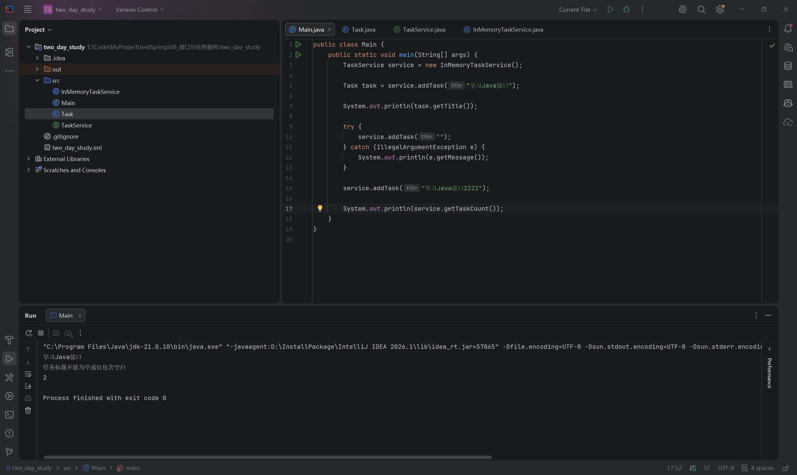
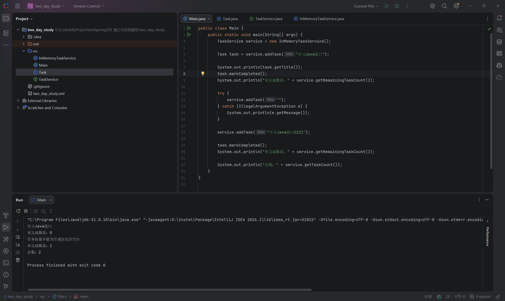

# 第八节：接口与任务服务

## 学习目标

用接口约定任务管理能力，把列表管理和统计放进服务对象，由 main 调用。工程为 `two_day_study/`，使用 JDK 21，没有引入框架或依赖。

## 职责与接口

| 文件（相对工程目录） | 职责 |
| --- | --- |
| src/Task.java | 单条任务的标题、完成状态、标题校验和完成行为 |
| src/TaskService.java | 声明服务提供的方法 |
| src/InMemoryTaskService.java | 用内存列表实现任务添加与统计 |
| src/Main.java | 调用服务、捕获异常、展示结果 |

本节的接口是 Java interface，不是 HTTP 接口。服务也是普通 Java 对象，尚未使用 Spring。内存列表在程序退出后不会保存，数据库持久化后续学习。

学习者实际接口：

```java
public interface TaskService {
    Task addTask(String title);
    int getTaskCount();
    int getRemainingTaskCount();
}
```

这些方法只有声明，以分号结尾，默认 public。实现类使用 `implements TaskService`，提供 public 方法体。`@Override` 帮助编译器检查是否正确实现接口方法。对于本节这种没有方法体的接口方法，普通非抽象实现类必须全部实现，否则无法编译。default、static 方法和抽象类以后深入。

与 TypeScript 类比：接口描述约定；Java 类通常必须明确声明 implements，不能只凭方法形状相同自动视为该接口的实现。

## 声明类型与实际对象

```java
TaskService service = new InMemoryTaskService();
```

service 声明类型是 TaskService，实际对象类型是 InMemoryTaskService；接口本身不能直接 new。

【插图 1：在这里上传 images/示意图_接口编译检查与运行调用.png】



助手制作的教学示意图，不是实际调试截图。观察两个阶段：编译时按声明类型检查可调用的方法；运行时对允许的实例方法执行实际对象的实现。

学习者曾认为“实际类型是实现类，所以可以调用实现类新增的方法”。需要先通过编译检查：假设 clearTasks 仅声明在实现类中，当前 service.clearTasks() 会编译报错。若在接口新增 void clearTasks()，普通实现类也必须实现它。学习者已正确回答后一题。

## 为什么需要接口：课后补讲

学习者反馈：普通类直接写方法同样能实现功能，接口的作用仍模糊。这个判断正确：当前只有一个简单实现，直接声明 InMemoryTaskService 类型也可以正常完成任务管理，并非每个类都必须配接口。

实现类本身也是普通类，只是明确实现了某个接口。Task 表示单条任务；TaskService 约定任务服务的能力；InMemoryTaskService 使用列表实现这些能力；Main 是普通类，main 是程序入口方法，其方法体负责创建对象、组织调用和展示结果。

把列表管理从 main 移到服务类，与使用接口是两件事：前者整理职责，即使不用接口也有价值；后者提供共同类型和约定，让调用方按相同方式使用不同实现。

以后可以让内存实现和数据库实现都实现 TaskService。调用方通过 service.addTask 使用能力，无须了解实际任务保存在列表还是数据库中。对象创建处仍需选择实现，接口不会自动消除这一步，也不会自动存储数据。

接口主要用来明确能力、提供共同类型和支持替换实现；单一简单实现时收益可能较小，应按需要使用。方法签名由编译器检查，业务约定还需实现者遵守，例如非法标题如何报告、计数含义是什么。

学习者正确解释：main 只是调用，存储位置由实现类确定，只要约定实现类能做什么即可。用途已初步理解；后续数据库课程再结合真实替换场景巩固，不要求现在新增第二套实现或进行调试。

## 添加顺序与返回对象

学习者实际实现的关键代码：

```java
private final ArrayList<Task> tasks = new ArrayList<>();

@Override
public Task addTask(String title) {
    Task task = new Task(title);
    tasks.add(task);
    return task;
}
```

文件顶部需要 `import java.util.ArrayList;`。列表是实例字段，以保留多次服务调用添加的任务。final 限制 tasks 重新指向另一个列表，不限制当前列表添加、删除元素。

先构造，再添加，再返回。非法标题让构造方法抛出异常，后面的 add 和 return 不执行；异常经过服务方法传到 main 的 catch。服务没有把异常吞掉，因此非法任务不会进入列表。

返回的 task 和列表元素引用同一个对象，不会自动复制。main 对返回对象调用 markCompleted，会改变列表中对应对象的状态。学习者对此解释正确。

【插图 2：在这里上传 images/接口_内存任务服务实现与运行.png】



实际 IDEA 截图：观察 private final 列表、implements、两个 Override 方法，以及控制台合法标题、异常原因、数量 2 和退出码 0。截图是第一轮实现，尚未增加未完成统计。

【插图 3：在这里上传 images/接口_Main调用服务与异常处理.png】



实际 IDEA 截图：main 用接口类型保存服务对象，接住 addTask 返回对象；捕获非法输入异常后，继续添加另一条合法任务。

## 统计计数器必须每次重新初始化

最终修复后的实际方法（仅整理空格）：

```java
@Override
public int getRemainingTaskCount() {
    int remainingTaskCount = 0;
    for (Task task : tasks) {
        if (!task.isCompleted()) {
            remainingTaskCount++;
        }
    }
    return remainingTaskCount;
}
```

学习者起初把计数器放在实例字段上，每次查询都继续累加。第一次结果正确不能证明方法正确：保持列表不变，重复查询可能得到不同结果。

列表是需要跨调用保留的数据；计数器是本次计算的中间结果，应放在方法内部，每次从 0 开始。学习者已自行删除计数器字段并完成修复。

【插图 4：在这里上传 images/接口_统计首次结果与计数器问题.png】



实际修复前截图：输出未完成数量 0、1，总数 2，退出码 0。这组结果正确，但当时统计方法使用字段计数器，截图没有覆盖重复查询问题，不能用它证明最终修复通过。

该截图的执行顺序：第一条任务添加并完成后，未完成为 0；空标题创建失败，不入列表；第二条合法任务添加后，未完成为 1。第二次 task.markCompleted 仍操作第一条任务，不会完成第二条。最终两条任务，只有一条未完成。

最初练习要求在两条合法任务都添加后，先统计，再完成第一条，对应 2 → 1。学习者改变统计位置后对应 0 → 1，应按实际执行顺序判断。

## 运行与验证记录

在 IDEA 打开 `two_day_study` 工程，运行 `src/Main.java` 的 main。修复后的 main 连续调用两次 getRemainingTaskCount，预期均为 1，总数为 2。

助手读取实际源码，使用本机 JDK 21.0.10 编译四个源码文件到系统临时目录并运行：两次统计均为 1，总数为 2，退出码 0。终端中文显示乱码，数字结果可确认；不是学习者 IDEA 运行截图。最终源码无必须修复问题，助手未代改练习代码。

学习者明确跳过本次调试，未将调试记为已执行。以后仅在理解新执行流程或排查实际问题时按需安排，不作为每节固定步骤。本节没有新增必须掌握的快捷键；如需调试，Windows 默认 F7 为 Step Into，也可使用调试工具栏，具体以 IDEA 键位方案为准。

## 自测

1. service 的声明类型和实际对象类型分别是什么？
2. 为什么仅实现类拥有的 clearTasks 不能直接通过当前 service 调用？
3. 本节接口新增无方法体的方法，但普通实现类没有实现，会怎样？
4. 为什么计数器应是局部变量，列表应是实例字段？
5. 为什么 main 修改返回对象会影响服务统计？

参考要点：TaskService 与 InMemoryTaskService；编译时按声明类型检查；编译失败；计数每次重新计算，列表跨调用保留；返回对象与列表元素引用同一个对象。

## 语雀图片上传清单

复制 Markdown 通常不能自动上传本地图片。请在插图标记处上传以下文件，确认显示后删除上传提示及未生效的本地引用，保留中文说明。也可使用语雀支持的导入方式，本次未验证自动带图。

| 插图 | 相对文件位置 |
| --- | --- |
| 1 | images/示意图_接口编译检查与运行调用.png |
| 2 | images/接口_内存任务服务实现与运行.png |
| 3 | images/接口_Main调用服务与异常处理.png |
| 4 | images/接口_统计首次结果与计数器问题.png |

下一节：第九节“Maven 与工程管理”，先理解构建工具的用途、标准工程目录和 pom.xml，再为后续 Spring Boot 做准备。
