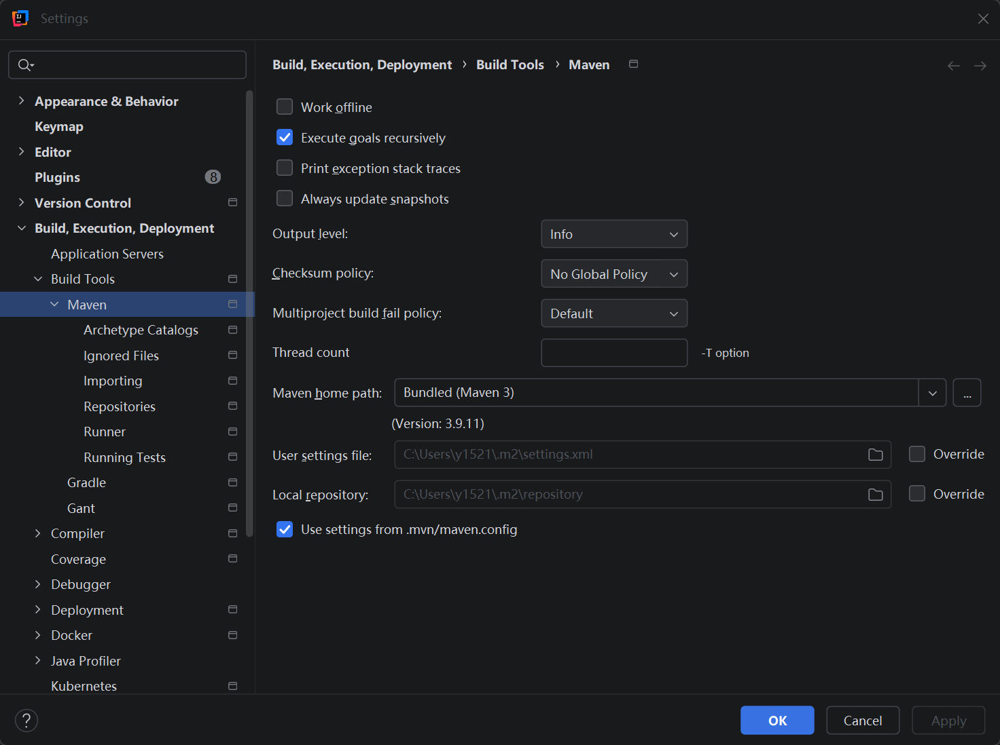
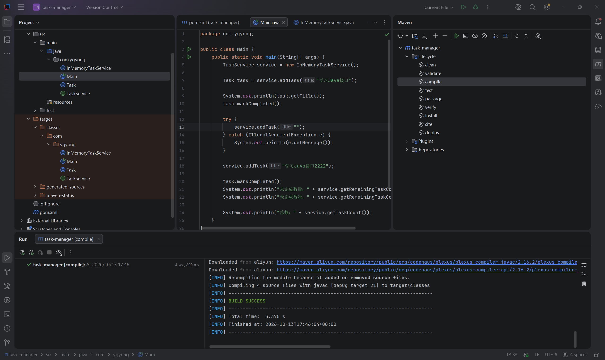
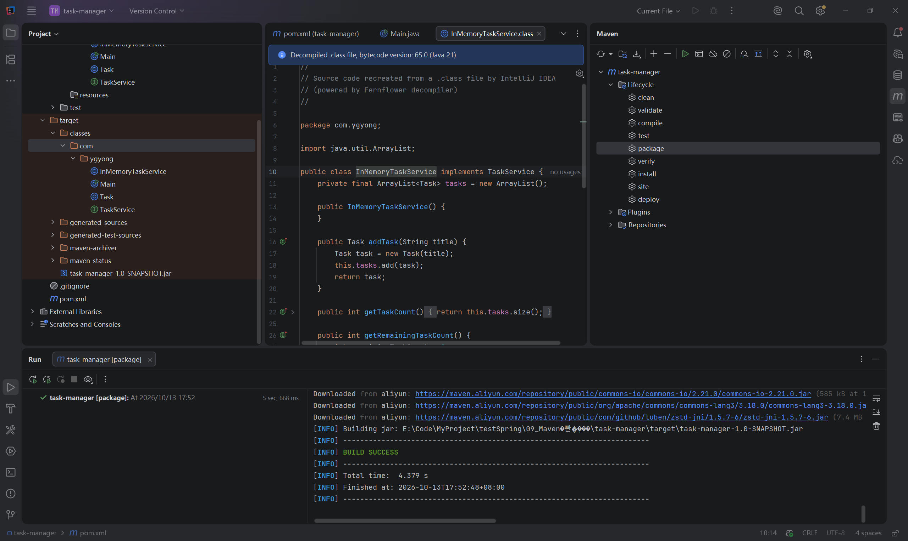
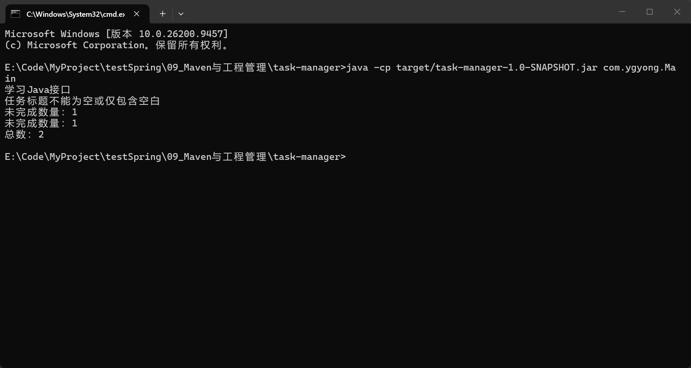

# 第九节：Maven 与工程管理

## 学习目标

把上一节任务程序迁入 Maven 工程，理解工程配置、源码与构建产物的关系，完成编译、打包及 JAR 运行。

实际工程目录：`task-manager/`。本节使用 JDK 21、现有 Maven 3.9.14；没有加入第三方项目依赖。

## Maven 与 JDK 分工

Maven 管理依赖，并组织编译、测试、打包等构建工作。编译时，Maven 通过编译插件使用 JDK 的编译器；运行程序则由 JVM 执行字节码。

学习时曾认为“只有 JDK 17，也可以编译配置为 Java 21 的工程”，原因是认为 Maven 只管理依赖。纠正：旧编译器不支持未来版本，配置写成 21 不会安装或切换 JDK。当前工程使用 JDK 21。

## 工程目录与 Java 包

```text
task-manager/
├── pom.xml
├── src/
│   ├── main/
│   │   ├── java/com/ygyong/  四个程序源码文件
│   │   └── resources/       配置等资源
│   └── test/java/           测试源码，本节为空
└── target/                  构建产物
```

学习者自行复制第八节的 Main、Task、TaskService、InMemoryTaskService，在四个文件顶部添加：

```java
package com.ygyong;
```

包声明放在 import 和类声明前。包名组织 Java 类，与 Maven 的 groupId 各有用途，不要求相同。本节两者都使用 com.ygyong。

## pom.xml 的关键配置

实际工程坐标：

```xml
<groupId>com.ygyong</groupId>
<artifactId>task-manager</artifactId>
<version>1.0-SNAPSHOT</version>
```

| 字段 | 用途 |
| --- | --- |
| groupId | 所属组织或个人的命名空间 |
| artifactId | 工程产物名称 |
| version | 版本；SNAPSHOT 表示开发中的版本 |

三个字段一起标识工程的具体版本。当前打包产物为 `target/task-manager-1.0-SNAPSHOT.jar`。

```xml
<properties>
    <maven.compiler.source>21</maven.compiler.source>
    <maven.compiler.target>21</maven.compiler.target>
    <project.build.sourceEncoding>UTF-8</project.build.sourceEncoding>
</properties>
```

分别指定源码语言版本、目标字节码版本和源码编码。它们不会替你安装或选择 JDK。本节保留 IDEA 生成配置；以后再深入 release 配置及插件版本管理。

## Maven 设置与本地仓库

IDEA 菜单入口：File → Settings → Build, Execution, Deployment → Build Tools → Maven。

| 设置 | 本节实际值与用途 |
| --- | --- |
| Maven home path | `E:\InstallPackage\Maven\apache-maven-3.9.14`，Maven 工具安装目录 |
| User settings file | 安装目录下的 `conf\settings.xml`，显式 Override 使用现有配置 |
| Local repository | `E:\InstallPackage\Maven\repository`，Override 复用已有缓存 |

这些路径记录本机配置；笔记核心概念不依赖此机器才能理解。现有 settings.xml 的有效镜像为阿里云，mirrorOf 为 central；没有生效的自定义 localRepository，因此在 IDEA 单独指定本地仓库。

默认本地仓库是用户目录下的 `.m2/repository`，不自定义也可以使用。镜像决定去哪里下载，本地仓库决定下载后缓存在哪里。



实际配置前截图：使用 Bundled Maven 3.9.11 与默认仓库路径。该图不代表最终配置；后续实际工程配置文件确认改为上述 E 盘路径。

## 编译、打包与运行

IDEA 菜单入口：View → Tool Windows → Maven，展开 task-manager → Lifecycle。

| 操作 | 作用 |
| --- | --- |
| compile | 编译程序源码，生成 target/classes 中的字节码 |
| test | 执行相应测试代码，不自动运行 Main.main |
| package | 执行前面的必要阶段，再生成 JAR |
| clean | 当前标准配置下清理 target，不删除源码、pom 和本地仓库 |

执行 package 不必先手动点击 compile；前面的阶段会按流程执行。本节无测试源码，经过 test 阶段不代表业务已经被测试。



实际截图：日志显示 javac 编译四个源码文件，目标 21，输出到 target/classes，BUILD SUCCESS；项目树显示四个对应编译产物。



实际截图：package 显示 BUILD SUCCESS，并生成 JAR。编辑器此时打开的是 .class 的反编译视图，提示字节码版本 65.0（Java 21）；这是 IDEA 根据字节码重建的可读代码，不是原始 .java 文件。

运行命令的执行位置：`task-manager/` 工程目录。

```powershell
java -cp target/task-manager-1.0-SNAPSHOT.jar com.ygyong.Main
```

java 启动 JVM，-cp 指定寻找类的 JAR，com.ygyong.Main 指定包含入口方法的完整类名。当前普通 JAR 没配置默认入口，因此明确指定 Main；java -jar 的入口配置以后再学。



实际截图确认输出：

```text
学习Java接口
任务标题不能为空或仅包含空白
未完成数量：1
未完成数量：1
总数：2
```

输出后返回命令提示符。截图没有展示退出码，不据此编造退出码。

## 本节易错点与验证记录

- 曾认为 package 经过测试阶段就运行了 main。纠正：标准构建配置不会自动启动业务入口；本节 main 由终端 java 命令启动。
- 学习者正确解释：main 中有运行时除零异常且没有测试调用它，package 仍可成功；启动 main 执行到该语句时抛出 ArithmeticException。
- target 是当前工程生成结果，本地 repository 是可跨工程复用的依赖与插件缓存。学习者正确解释 clean 不要求重新下载已缓存的库。
- 学习者文字确认执行 clean → package，target 先消失后重新生成，结果符合预期；助手没有直接观察这轮操作。
- 四个迁移源码已实际检查，包声明、引用与实现正确，无必须修复问题。IDEA 原程序运行成功由学习者文字确认；Maven 编译、打包、JAR 运行由实际截图确认。助手未另行构建运行或代改源码。

修改程序应编辑 src 下的 .java，构建产物可以重新生成，不修改 target 中的文件。

## 依赖与构建插件

项目依赖为程序提供能力，例如数据库驱动；构建插件帮助 Maven 完成工作，例如编译、JAR 打包。插件也需要下载，并可能依赖其他库，所以没有声明项目依赖也可能看到下载日志。

下面仅为结构示意，不能原样作为有效依赖使用，本节未添加：

```xml
<dependencies>
    <dependency>
        <groupId>库所属的组织</groupId>
        <artifactId>库的名称</artifactId>
        <version>库的版本</version>
    </dependency>
</dependencies>
```

Maven 根据依赖坐标查找和下载库。import 只让源码可以通过简短名称引用类型，不负责下载。ArrayList、String、IllegalArgumentException 属于 Java 标准库，无须额外声明 Maven 依赖。

学习者正确回答：import 不会下载缺少的第三方库；数据库驱动属于项目依赖。

## 操作入口与自测

本节没有新增必须记忆的快捷键，使用上述菜单与 Maven 工具窗口即可；不安排非必要调试。

1. Maven 和 JDK 在编译中各负责什么？
2. groupId、artifactId、version 为什么一起使用？
3. package 成功为何不能证明 main 的行为正确？
4. clean 清理什么？本地仓库与 target 有什么区别？
5. import 能否下载依赖？数据库驱动和编译插件分别属于什么？

参考要点：Maven 组织构建，JDK 提供编译器；坐标标识具体版本；默认不运行 main，测试覆盖也需实际检查；clean 清理构建产物，本地仓库保留共享缓存；import 不下载，驱动为项目依赖，编译插件为构建插件。

## 语雀图片上传

复制 Markdown 通常不能自动上传本地图片。请在对应图片位置上传课程 images/ 中的以下文件，保留中文说明；也可以使用语雀支持的导入方式，本次未验证自动带图。

| 图片 | 文件 |
| --- | --- |
| 配置前设置 | images/Maven_IDEA默认仓库设置.png |
| 编译验证 | images/Maven_compile成功与字节码目录.png |
| 打包验证 | images/Maven_package成功与JAR产物.png |
| JAR 运行验证 | images/Maven_JAR终端运行结果.png |

官方参考：[Maven 入门](https://maven.apache.org/guides/getting-started/maven-in-five-minutes.html)、[标准目录](https://maven.apache.org/guides/introduction/introduction-to-the-standard-directory-layout.html)、[配置文件](https://maven.apache.org/settings.html)。

下一节：第十节“Spring Boot 起步与第一个 HTTP 接口”。实际选用版本时先核实官方 JDK 21 兼容性，再指导学习者自己创建工程和编写接口。
