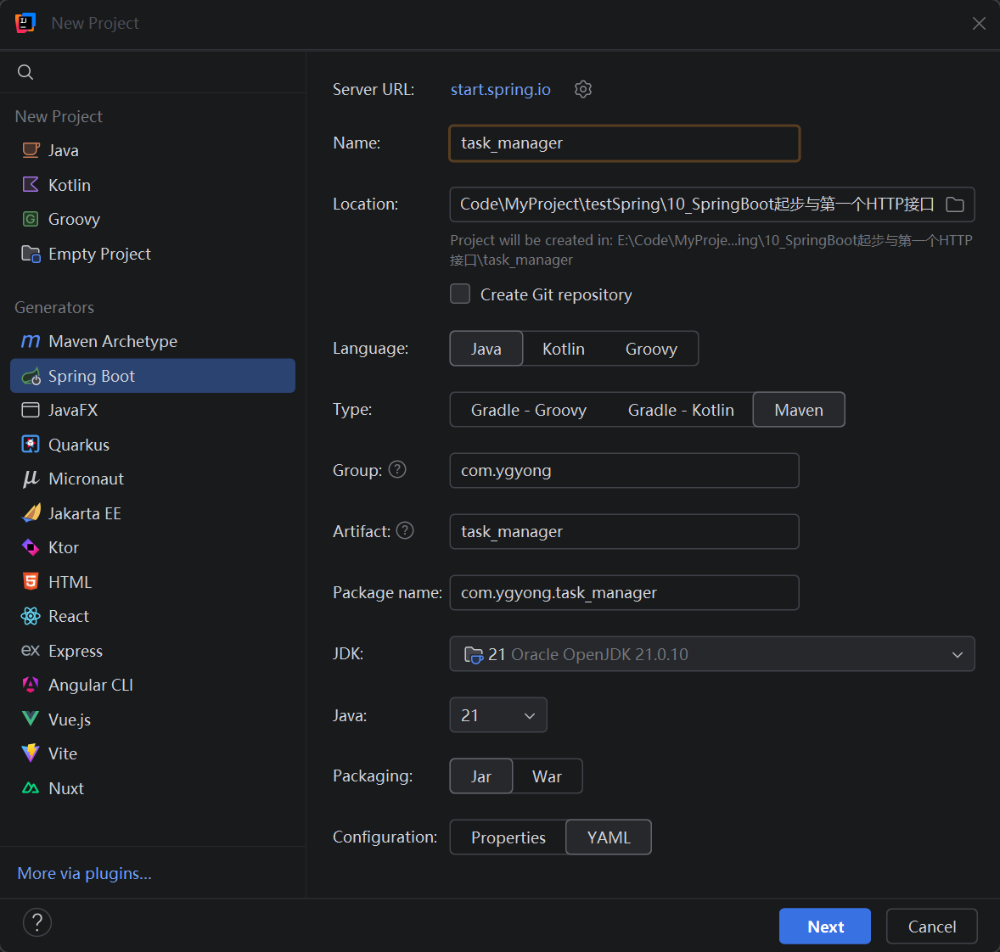
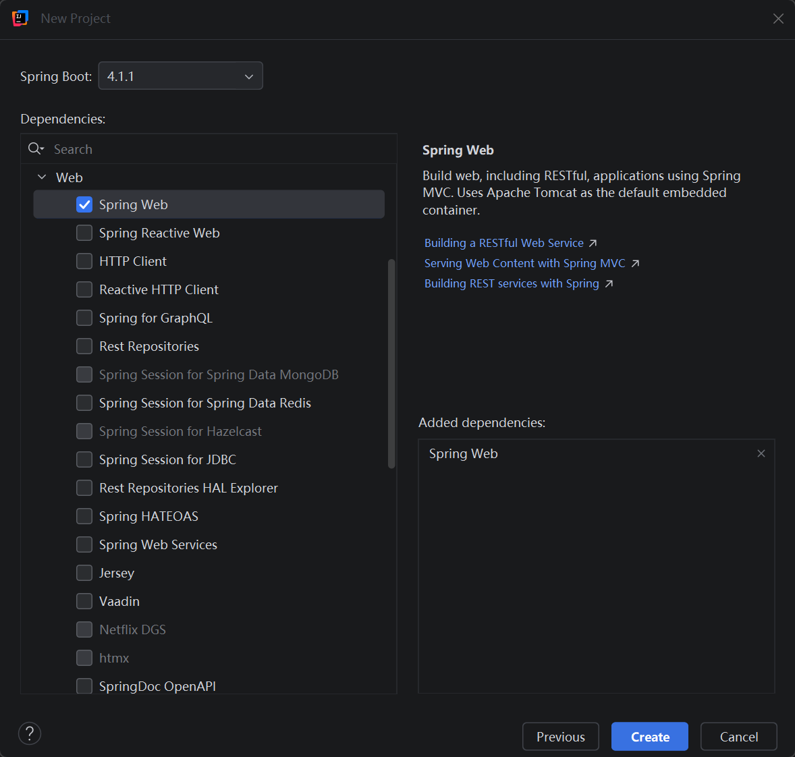
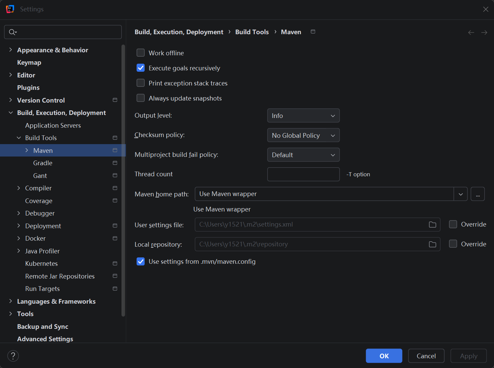
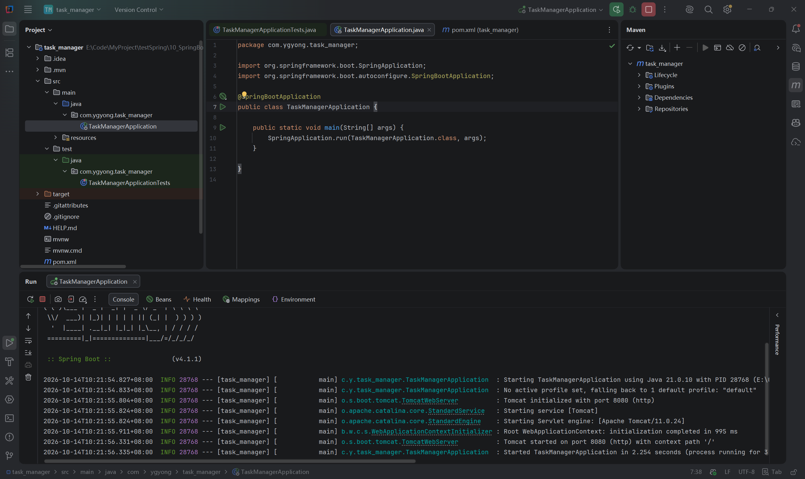
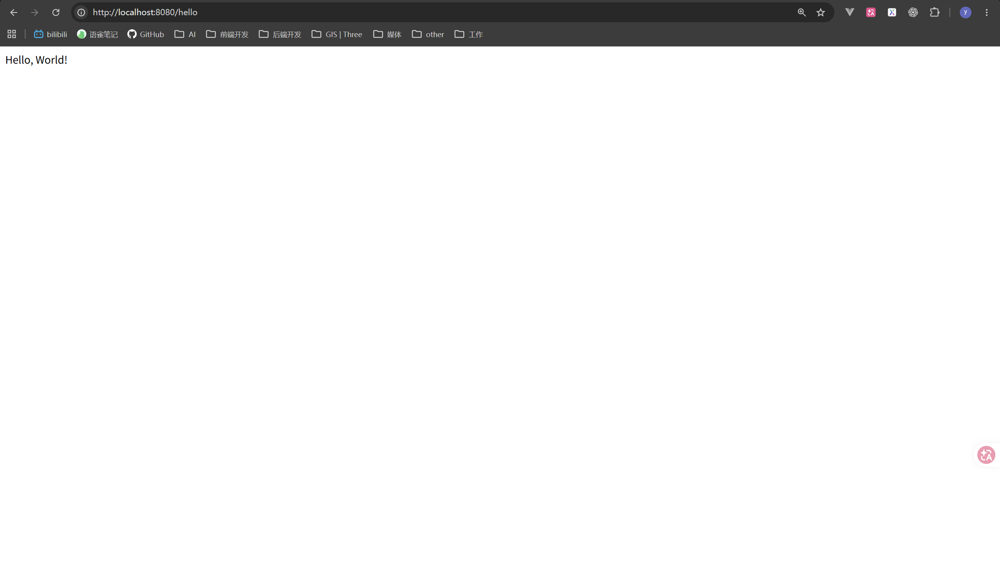

# 第十节：Spring Boot 起步与第一个 HTTP 接口

## 学习目标与实际环境

自行创建 Spring Boot Web 工程，编写 GET `/hello` 接口，通过浏览器验证响应，理解启动入口、请求映射及连接失败与 HTTP 状态码的区别。

实际工程为 `task_manager/`，使用 JDK 21.0.10、Spring Boot 4.1.1。官方系统要求支持 Java 17～26、Maven 3.6.3 及以上，兼容现有环境。本节原计划使用 3.5.16，实际创建后核实 4.1.1 兼容性，沿用生成工程。

## 创建工程与依赖

学习者通过 IDEA 的 Spring Boot 向导创建工程，选择 Maven、Java 21、Jar、YAML，只勾选 Spring Web。



真实截图：Type 选择 Maven，JDK 与 Java 均为 21。JDK 选择本机编译运行工具，Java 指定工程目标语言版本，两个选项职责不同。



真实截图：Boot 为 4.1.1，依赖为 Spring Web。实际 pom.xml 中生成了 `spring-boot-starter-webmvc`、测试范围的 `spring-boot-starter-webmvc-test` 和 `spring-boot-maven-plugin`。前者提供 Web 能力，测试依赖服务于测试代码，插件用于 Spring Boot 的构建工作。本节没有执行生成的测试，也没有增加额外依赖。

主要目录：

```text
task_manager/
├── pom.xml
├── src/main/java/com/ygyong/task_manager/
│   ├── TaskManagerApplication.java
│   └── controller/HelloController.java
├── src/main/resources/application.yaml
└── src/test/java/com/ygyong/task_manager/TaskManagerApplicationTests.java
```

`task_manager` 中的下划线与使用 YAML 均不是本次导入问题的原因。

## IDEA 导入与 Maven 设置问题

创建后曾提示 Setup JDK，且没有 Maven 工具窗口。检查生成文件发现 pom 和启动类存在；配置中已有名为 21 的 SDK 记录，但未见 Maven 工程关联记录。这只能提示可能未完成导入，不能凭配置文件确定实时界面的全部原因。

排查入口：

1. 右键 pom.xml → Add as Maven Project。也可以 File → Open，选 pom.xml → Open as Project。
2. File → Project Structure → Project，选择已有 JDK 21；Modules → Dependencies → Module SDK 选择 Project SDK。
3. View → Tool Windows → Maven，查看工程是否导入。

Setup JDK 是检查当前项目或模块关联，不表示必须重新安装 JDK。学习者随后确认前置工作完成，启动截图确认问题已解除；未记录每一步设置的实际执行细节。



真实截图：当前选择 Use Maven wrapper，settings 与 repository 为默认路径，Override 未勾选。此图是调整前状态，不代表最终配置。

学习者询问为什么每次都要重新配置。当前工程 Settings 与新工程默认设置分开：通过 File → New Projects Setup → Settings for New Projects（部分版本显示 Preferences for New Projects）→ Build, Execution, Deployment → Build Tools → Maven 设置后续工程的默认值。

本机复用配置：

| 配置项 | 路径 |
| --- | --- |
| Maven home path | `E:\InstallPackage\Maven\apache-maven-3.9.14` |
| User settings file | 勾选 Override，选择上述安装目录的 `conf\settings.xml` |
| Local repository | 勾选 Override，选择 `E:\InstallPackage\Maven\repository` |

已有工程仍需在其 Settings 中调整。带 Maven Wrapper 的工程可能自动选择 Wrapper；它按工程声明的版本使用 Maven，而仓库路径可以独立设置。学习者确认前置配置完成，但没有用新建另一个工程验证默认设置继承，不将其记为已验证。

## 启动入口与组件扫描

Spring 提供 Web 请求处理等基础能力；Spring Boot 帮助组织常用依赖、自动配置及启动过程。当前 Web 工程启动内嵌 Tomcat，不需要另装 Tomcat。

生成的启动类核心代码：

```java
@SpringBootApplication
public class TaskManagerApplication {
    public static void main(String[] args) {
        SpringApplication.run(TaskManagerApplication.class, args);
    }
}
```

`main` 仍是 Java 入口。`SpringApplication.run` 启动 Spring 应用，当前配置也会启动 Web 服务器。`TaskManagerApplication.class` 表示类的类型信息，不是在创建实例。

`@SpringBootApplication` 标记配置入口、启用自动配置，并默认从启动类所在包向下扫描组件。Controller 放在 `com.ygyong.task_manager.controller` 中，可以被发现。组件管理、自动配置细节以后深入。



真实截图：日志显示 Java 21.0.10、Tomcat started on port 8080、Started TaskManagerApplication，右侧 Maven 工程窗口正常。服务持续运行等待请求，启动成功后不立即退出是正常行为。

## 学习者实际编写的接口

文件：`task_manager/src/main/java/com/ygyong/task_manager/controller/HelloController.java`。

```java
package com.ygyong.task_manager.controller;

import org.springframework.web.bind.annotation.GetMapping;
import org.springframework.web.bind.annotation.RestController;

@RestController
public class HelloController {
    @GetMapping("/hello")
    public String hello() {
        return "Hello, World!";
    }
}
```

注解是供工具或框架读取的标记，框架读取标记后建立请求处理关系。

| 写法 | 作用 |
| --- | --- |
| `@RestController` | 标记控制器，方法返回值用于响应正文 |
| `@GetMapping("/hello")` | 将 GET /hello 请求映射到该方法 |
| `return` | 将字符串返回给框架，供其写入响应 |

方法是实例方法，无须 static；框架管理 Controller 对象并调用其方法。`System.out.println` 打印到后端控制台，不等于给浏览器返回正文。

当前 HTTP 接口指外部访问地址、请求与响应约定，与 Java 的 interface 不同。学习者正确解释：仅修改 hello 方法名、保持映射不变，不需要改变浏览器路径。

## 运行与响应观察

修改代码后，本节采用停止旧程序、重新运行 TaskManagerApplication 的方式。浏览器访问：

```text
http://localhost:8080/hello
```

localhost 为当前电脑，8080 为端口，/hello 为映射路径。

```text
浏览器发送 GET /hello
    ↓
服务器接收，Spring 找到对应映射
    ↓
调用 Controller 对象的 hello()
    ↓
返回字符串，框架写入响应正文
    ↓
浏览器显示 Hello, World!
```

上面是执行流程示意，不是实际调试记录。



真实截图：地址为 /hello，正文为 Hello, World!。截图未显示状态码和响应头；以下网络信息来自学习者文字报告。

在 Chrome 按 F12 → Network，刷新页面，点击 hello 请求。Headers 可查看请求方法、状态码与响应头；Response 可查看正文。

| 请求 | 学习者报告的结果 |
| --- | --- |
| /hello | 200，正文 Hello, World!；Content-Type 为 `text/html;charset=UTF-8` |
| /hello-test | 404，未配置该路径映射 |

状态码描述处理结果，响应头描述正文等信息，响应正文包含实际内容。上述 Content-Type 表示按 HTML 类型声明、使用 UTF-8；纯文字也能作为 HTML 正文显示，不能只凭页面外观猜测类型。未提供 Network 截图，助手未独立请求接口核验响应头。

## 实际易错点：404 与连接失败

学习者最初认为服务没启动时访问已有路径也会得到 404。纠正后准确回答为连接失败。

| 场景 | 结果与原因 |
| --- | --- |
| 服务启动，访问已映射的 /hello | 收到 HTTP 200 响应 |
| 服务启动，访问未映射的 /hello-test | 服务收到请求后返回 HTTP 404 |
| 服务停止，且没有其他程序监听 8080 | 无法连接，通常为 ERR_CONNECTION_REFUSED；没有 HTTP 响应状态码 |

404 是服务器作出的响应；连接失败是未能建立连接。服务停止场景通过解释题确认，未实际执行停止后浏览器验证。

## 自测与当前掌握范围

1. main 与 SpringApplication.run 分别做什么？
2. 为什么 Controller 放在启动类的子包中？
3. 修改方法名但保留 GetMapping，访问地址需要变吗？
4. println 与 Controller 方法的 return 有什么区别？
5. 200、404 与连接失败分别代表什么？

参考要点：main 是入口，run 启动 Spring 应用；默认向下扫描组件；本例路径不变；控制台输出与响应正文不同；200 成功、404 服务返回资源未找到、连接失败没有收到 HTTP 响应。

本节实际源码检查通过、IDEA 启动和浏览器正文由截图确认、网络状态码及响应类型由学习者报告，映射改名和连接失败区别由解释题确认。助手未修改练习实现、额外构建启动或执行测试；未安排非必要调试。不将未提问的全部概念记为逐项验证通过。

下一节学习依赖注入与 Controller/Service 分层，将前面任务服务的职责与 Spring 管理对象联系起来。

## 语雀图片上传与参考

本笔记使用标准 Markdown 和相对图片路径。复制文字通常不会自动上传图片；请在对应位置上传本节 images/ 中的五张 PNG，或使用语雀支持的导入方式。本次未验证自动带图。

- `images/工程创建_JDK与Maven选项.png`
- `images/工程创建_Boot版本与Web依赖.png`
- `images/Maven_新工程默认Wrapper设置.png`
- `images/启动成功_Java21与Tomcat8080.png`
- `images/接口_hello浏览器响应.png`

官方参考：[Spring Boot 系统要求](https://docs.spring.io/spring-boot/system-requirements.html)、[Web 服务入门](https://spring.io/guides/gs/rest-service/)、[IDEA Maven 配置](https://www.jetbrains.com/help/idea/maven-support.html)、[IDEA 项目设置](https://www.jetbrains.com/help/idea/configure-project-settings.html)。版本兼容性依据本节查询时的 4.1.1 文档。
