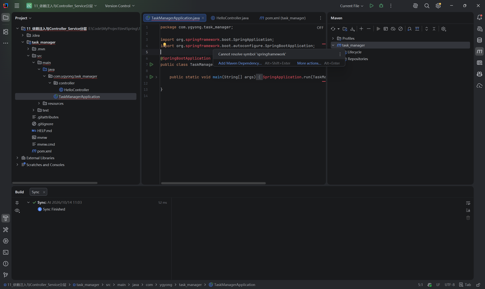
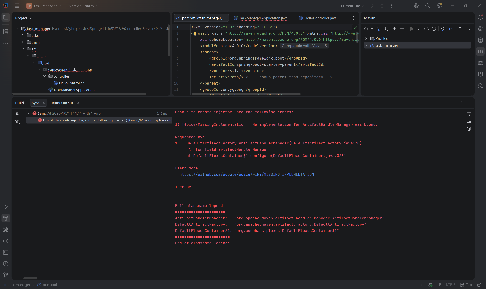

# 第十一节：依赖注入与 Controller/Service 分层

## 学习目标与完成情况

将请求处理与业务职责分开，由 Spring 通过构造方法提供服务对象。工程为 task_manager/，沿用 JDK 21、Spring Boot 4.1.1 和已有 Web 依赖。

学习者自行编写 Service 与 Controller，源码检查通过；修改控制器注解后，学习者文字确认运行与访问正常。助手没有额外启动、构建或请求接口，没有恢复后的响应截图或状态码记录。当前服务返回 0 是占位实现，尚未查询真实任务集合或数据库。

## 分层的用途

| 组成 | 本节职责 |
| --- | --- |
| TaskController | 接收 GET /tasks/count，调用服务，返回结果 |
| TaskService | 提供查询任务数量的业务方法 |

包名帮助组织文件，职责划分才是分层的核心。后续任务统计、业务校验和数据库查询可以放入服务，而不堆积在请求处理方法中。

## 实际代码

文件：task_manager/src/main/java/com/ygyong/task_manager/service/TaskService.java。

```java
package com.ygyong.task_manager.service;

import org.springframework.stereotype.Service;

@Service
public class TaskService {
    public int getTaskCount() {
        return 0;
    }
}
```

@Service 标记服务组件。该包在启动类 com.ygyong.task_manager 的扫描范围内。这里 TaskService 是普通类，与第八节同名的 Java interface 是不同工程中的定义。

文件：task_manager/src/main/java/com/ygyong/task_manager/controller/TaskController.java。

```java
package com.ygyong.task_manager.controller;

import com.ygyong.task_manager.service.TaskService;
import org.springframework.web.bind.annotation.GetMapping;
import org.springframework.web.bind.annotation.RestController;

@RestController
public class TaskController {
    private final TaskService taskService;

    public TaskController(TaskService taskService) {
        this.taskService = taskService;
    }

    @GetMapping("/tasks/count")
    public int getTaskCount() {
        return taskService.getTaskCount();
    }
}
```

## 依赖注入与执行过程

Controller 调用 Service，需要一个服务对象，这就是依赖。Spring 创建 Controller 时，通过构造方法传入所需服务对象，这就是注入。Spring 管理的对象称为 Bean。

构造方法仍是普通 Java 语法；参数接收对象引用，this.taskService 保存引用供实例方法使用。final 限制字段不能重新指向另一个对象，不表示服务对象内部状态不可改变。本例只有一个构造方法，可以省略 @Autowired。

```text
启动阶段：
扫描组件 → 创建 TaskService Bean
         → 通过构造方法传给 TaskController → 保存到字段

请求阶段：
GET /tasks/count → Controller 方法 → Service 方法
                → 返回数量 → 框架写入响应正文
```

这是教学流程示意，并非实际调试记录。当前默认单例组件正常完成初始化后，后续请求使用已有对象，不为每次请求重新调用构造方法。生命周期与并发问题以后深入。

学习者正确解释：字段保存引用是供内部使用。也正确判断：本例删除 @Service、没有其他注册方式时，类依然存在，但容器缺少服务 Bean，创建 Controller 时无法满足构造方法依赖，应用启动失败。此题通过口头解释确认，未实际删除注解做实验。

## 实际问题一：复制工程后导入失败

复制后删除 target 和 .idea，无须主动创建缺失的 .iml；IDEA 导入时管理工程配置。最初打开的是课程外层目录，而实际 Maven 工程位于 task_manager/。



真实截图：Spring import 报红，右侧已有 Maven 项目，但 Sync Finished 并不能单独证明依赖已正确关联。

使用 File → Open，打开 task_manager/pom.xml 作为工程；Project Structure 中选择已有 JDK 21。之后 Reload 暴露了 Maven 初始化错误。



真实截图：Guice/MissingImplementation，No implementation for ArtifactHandlerManager was bound。这是 Maven 导入工具的错误，当时尚未运行到业务代码；其中 injector 不是本节学习者写的 Spring 注入代码。

实际检查发现 Wrapper 指向 Maven 3.10.0；开发邮件中存在 IDEA 使用 3.10 候选版本出现相同错误的报告，这是排查线索，不能单凭此断定本机根因。学习者最终确认当前工程 Maven home 未设置，配置后恢复。

当前工程 Settings → Build, Execution, Deployment → Build Tools → Maven 中复用：

| 设置 | 路径 |
| --- | --- |
| Maven home | E:\InstallPackage\Maven\apache-maven-3.9.14 |
| User settings file（Override） | E:\InstallPackage\Maven\apache-maven-3.9.14\conf\settings.xml |
| Local repository（Override） | E:\InstallPackage\Maven\repository |

不同工程窗口应检查各自设置；本次未独立确认默认设置为何没有继承。助手仅执行现有 Maven 的 mvn -v，确认版本为 3.9.14、Java 为 21.0.10、退出码 0，这不等于构建验证。

## 实际问题二：接口返回 500

学习者初次使用 @Controller，构造方法注入及服务调用代码正确，但方法返回 int，未启用响应正文处理。

| 注解 | 当前理解 |
| --- | --- |
| @Controller | 标记控制器，常用于页面处理；本例不会自动把 int 写入正文 |
| @RestController | 包含 @Controller 与 @ResponseBody 的作用，将返回值用于响应正文 |

普通 Controller 下，该 int 返回值无法按当时的返回值规则处理，是明确需要修复的问题。助手未读取当时异常栈，不编造具体运行时异常。学习者改为 @RestController 及对应 import，停止旧程序、重新启动后，文字确认访问正常。

500 表示服务器处理请求发生错误，具体原因看后端异常日志；404 表示未找到对应资源，与停止服务后的连接失败不同。

## 运行方法与 IDEA 入口

修改后停止旧应用，再运行 TaskManagerApplication.main；浏览器访问：

```text
http://localhost:8080/tasks/count
```

当前源码预期返回 0。学习者确认访问正常，但未单独提供最终正文截图及状态码，不将其记录为独立观察。

- 打开工程：File → Open → 选择 task_manager/pom.xml。
- 检查 SDK：File → Project Structure → Project。
- 同步 Maven：Maven 工具窗口 → Reload All Maven Projects。
- 查看异常：Run 工具窗口中的应用控制台。
- 本节没有新验证的快捷键，以菜单和工具窗口入口为准；Windows 默认键位中 Alt+Enter 可帮助处理 import，实际取决于当前键位方案。

## 自测

1. Controller 与 Service 各负责什么？
2. 构造方法参数为什么要保存到字段？
3. 谁创建本例中的服务对象，并将它传给 Controller？
4. 删除 @Service 后，为何编译仍可能通过，应用却不能正常启动？
5. 为什么返回数量的接口使用 @RestController？

参考要点：请求处理与业务职责分开；字段保存引用供实例方法调用；Spring 创建和提供 Bean；Java 类存在不等于容器有该 Bean；返回值需要写入 HTTP 响应正文。

当前掌握重点是分层、Bean 与构造方法注入。接口多个实现的选择、容器内部原理、真实数据统计、并发与数据库留待后续。

## 语雀图片与参考

复制 Markdown 通常不会自动上传本地图片。请在对应位置上传 images/ 中两张 PNG，或使用语雀支持的导入方式；本次未验证自动带图。

- images/工程导入_Spring依赖未解析.png
- images/Maven同步_ArtifactHandlerManager初始化错误.png

参考：[构造方法注入](https://docs.spring.io/spring-framework/reference/core/beans/annotation-config/autowired.html)、[Controller 返回值处理](https://docs.spring.io/spring-framework/reference/web/webmvc/mvc-controller/ann-methods/return-types.html)、[Maven 导入错误的开发邮件报告](https://www.mail-archive.com/dev%40maven.apache.org/msg137877.html)。
