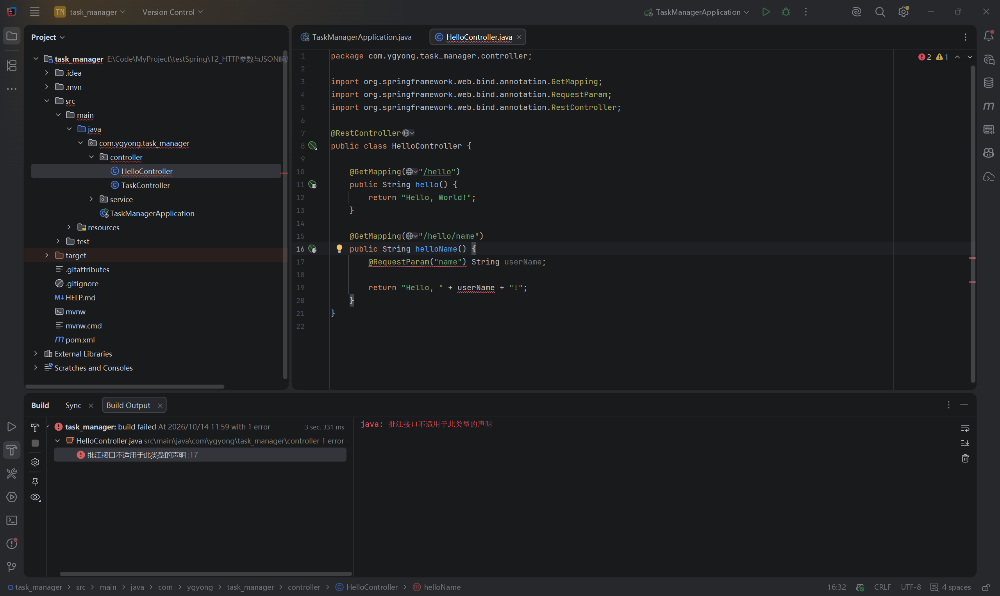
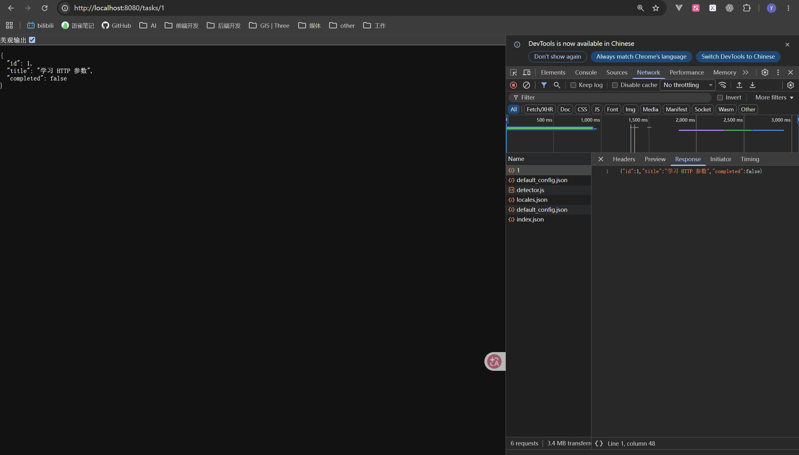

# 第十二节：HTTP 参数与 JSON 响应

## 学习目标与完成情况

接收查询参数与路径参数，通过 Controller 调用 Service，返回结构化 JSON。工程位于 `task_manager/`，沿用 JDK 21、已有 Spring Boot 与 Web 依赖，未新增依赖。

学习者自行完成全部练习，助手只读检查源码通过，没有代改、构建、启动或独立请求接口。查询参数、默认值和路径编号变化由学习者文字确认；两种非法请求的 400 由学习者报告。`/tasks/1` 的 JSON 正文有真实截图，`/tasks/2` 与预期一致由学习者文字确认。Content-Type 为 application/json 由学习者报告；成功请求的具体状态码未单独报告，截图未展示 Headers，不将其写为已验证的 200。

## 请求数据放在哪里

| 请求示例 | 数据位置 | 接收注解 | 常见用途 |
| --- | --- | --- | --- |
| `/hello/name?name=Alice` | 查询参数 | `@RequestParam` | 筛选条件、可选配置 |
| `/tasks/1` | 路径中的一段 | `@PathVariable` | 标识某个资源 |

URL 参数的原始值是文本；Java 方法参数具有明确类型，Spring 在调用方法前执行参数绑定与必要的类型转换。

## 查询参数与默认值

文件：`task_manager/src/main/java/com/ygyong/task_manager/controller/HelloController.java`。

实际方法：

```java
@GetMapping("/hello/name")
public String helloName(@RequestParam(name = "name", defaultValue = "访客") String userName) {
    return "Hello, " + userName + "!";
}
```

`name = "name"` 指定读取 URL 中的键；`userName` 是 Java 参数名，两者可以不同。这是绑定参数值，不是接收后重新命名变量。

`@RequestParam("name")` 是 `@RequestParam(value = "name")` 的简写。在这个注解中，value 与 name 是别名。配置多个属性时显式写出属性名。

未配置默认值时参数默认必填：学习者观察缺少 name 返回 400。设置 defaultValue 后，参数缺失或值为空均使用“访客”，并自动变为非必填。空字符串与空格字符串不同，本节未安排空格输入验证。

学习者确认以下访问均符合预期：

```text
http://localhost:8080/hello/name
http://localhost:8080/hello/name?name=
http://localhost:8080/hello/name?name=Alice
```

前两次使用“访客”，第三次使用 Alice。

## 实际易错点：把注解放在方法体中



真实截图：第 17 行在方法体中声明局部变量，编译提示“批注接口不适用于此类型的声明”。这是 Java 编译错误，尚未进入 HTTP 请求处理。

错误位置：

```java
public String helloName() {
    @RequestParam("name") String userName;
    // ...
}
```

方法参数应声明在圆括号内；局部变量声明在方法体中，需要在内部赋值。RequestParam 用于方法参数，不能标在这里的局部变量上。原局部变量也没有赋值便被使用。

修复由学习者完成：将声明移入方法参数列表，删除方法体中原声明，保留 return。首次教学提示未明确展示位置，本次已补清楚。

## 路径参数与类型转换

文件：`task_manager/src/main/java/com/ygyong/task_manager/controller/TaskController.java`。

最终方法：

```java
@GetMapping("/tasks/{id}")
public TaskResponse getTaskById(@PathVariable("id") int taskId) {
    return taskService.getTaskById(taskId);
}
```

映射中的 `{id}` 是占位符，PathVariable 的 "id" 对应它，taskId 是 Java 参数名。Controller 保留原有构造方法注入和 `/tasks/count` 接口。

学习者先用 String 返回编号，确认 `/tasks/1`、`/tasks/2` 分别显示 1、2；访问 `/tasks/abc` 返回 400。学习者正确解释 abc 无法转换为 int。

```text
/tasks/1   → 提取文本 "1"   → 转为 int 1 → 调用方法
/tasks/abc → 提取文本 "abc" → 转换失败  → 400，方法不会执行
```

这是教学示意，不是实际断点截图。参数转换成功也不代表业务数据合法，例如负数仍能转换为 int；业务校验以后结合真实任务实现。

## 响应数据类与 Service

DTO 是用于传递数据的对象。本节 TaskResponse 定义接口响应的三个属性，普通响应对象用 new 创建，不需要组件注解。

文件：`task_manager/src/main/java/com/ygyong/task_manager/dto/TaskResponse.java`。

```java
public class TaskResponse {
    private int id;
    private String title;
    private boolean completed;

    public TaskResponse(int id, String title, boolean completed) {
        this.id = id;
        this.title = title;
        this.completed = completed;
    }

    public int getId() {
        return id;
    }

    public String getTitle() {
        return title;
    }

    public boolean isCompleted() {
        return completed;
    }
}
```

代码节选省略包声明，仅统一展示逗号空格，未修改学习者源码。公开 getter 让默认序列化器读取属性；isCompleted 对应 JSON 属性 completed。当前只返回对象，不需要 setter。

文件：`task_manager/src/main/java/com/ygyong/task_manager/service/TaskService.java`，新增方法：

```java
public TaskResponse getTaskById(int taskId) {
    return new TaskResponse(taskId, "学习 HTTP 参数", false);
}
```

Controller 接收参数并调用服务；Service 准备结果；Spring 的消息转换器处理响应。服务仍是 @Service Bean，响应数据对象是普通对象。

当前是演示数据：任意能转换为 int 的编号都会创建响应对象，尚未查询集合或数据库，不能据此认为任务实际存在。getTaskCount 仍返回占位值 0，与本次演示对象没有实际统计关系。

## Java 对象、引用与 JSON

return 返回 Java 对象的引用，供调用方访问对象。引用不是 String 类型的“一串地址”，也不会作为内存地址发给浏览器。Spring 使用消息转换器读取属性值并序列化为 JSON 文本；RestController 已包含响应正文处理的作用。

```text
请求 → Spring 绑定与转换参数 → Controller → Service 创建对象
     → 返回对象引用 → 消息转换器序列化 → HTTP 响应中的 JSON 文本
     → 前端 response.json() 解析 → JavaScript 对象
```

教学示意：前后端对象之间通过 JSON 传递数据，不共享内存对象。这与 JavaScript 中对象引用和 JSON.stringify 得到的字符串是不同东西的区别类似。



真实截图：地址为 `/tasks/1`，页面和 Network 的 Response 均显示 id=1、title="学习 HTTP 参数"、completed=false。页面格式化显示与右侧紧凑正文表达相同数据。截图不是 Headers 视图，不能据此确认状态码或 Content-Type。

学习者文字报告 Content-Type 为 application/json，并确认 `/tasks/2` 结果符合预期，不要求重复截图。前端解析后修改 title 只改变前端对象，不会直接改变后端 Java 对象；若要改变后端数据，需要发送相应请求并由后端执行修改。此区别已经通过解释题确认。

## 运行与观察方法

在 IDEA 打开 `task_manager/pom.xml`，沿用已有 JDK 21、Maven 3.9.14 配置。修改源码后停止旧应用，运行本节 TaskManagerApplication，避免访问的仍是旧进程。

浏览器访问：

```text
http://localhost:8080/tasks/1
http://localhost:8080/tasks/2
http://localhost:8080/tasks/abc
```

在开发者工具 Network 中刷新，选择对应请求：Headers 查看状态码与 Content-Type，Response 查看正文。不要把其他请求的响应头当成本接口的结果。

调试时可以在 Controller 方法内设置断点，查看绑定后的参数值；本节没有新增断点验证记录。

快捷键：Windows IDEA 默认键位下 Alt+Enter 可辅助添加 import，Ctrl+Alt+L 可格式化代码，实际以当前 Keymap 为准。菜单入口为 Code → Reformat Code；运行可用启动类旁的绿色图标。这些快捷键未在本节截图中验证。

## 自测与当前掌握范围

1. URL 用 name，Java 参数用 userName，值为什么仍能传入？
2. RequestParam 为什么写在方法圆括号内？
3. defaultValue 在哪些输入情况下生效？
4. `/tasks/abc` 为什么返回 400，方法体是否执行？
5. return 和 JSON 序列化各负责什么？
6. 前端修改解析后的对象，为什么不会直接改变后端对象？

要点：按注解指定的名称绑定；注解目标是方法参数；缺省与空值使用默认值；int 转换失败发生在调用前；return 返回引用，消息转换器生成 JSON；前后端分别持有自己的对象。

当前掌握查询参数、路径参数、默认值、类型转换和对象响应。JSON 请求体、POST 创建任务、业务校验、统一异常与序列化配置后续学习。

## 语雀图片与参考

笔记使用标准 Markdown 相对路径。直接复制文本到语雀通常不会上传本地图片，请在对应位置上传 images/ 内两张 PNG，或使用语雀支持的导入方式；未验证自动带图。

- images/查询参数_RequestParam误放在方法体.png
- images/JSON响应_任务编号1与Network正文.png

参考：[RequestParam 属性](https://docs.spring.io/spring-framework/docs/current/javadoc-api/org/springframework/web/bind/annotation/RequestParam.html)、[PathVariable](https://docs.spring.io/spring-framework/docs/current/javadoc-api/org/springframework/web/bind/annotation/PathVariable.html)、[响应正文与消息转换器](https://docs.spring.io/spring-framework/reference/web/webmvc/mvc-controller/ann-methods/responsebody.html)。
