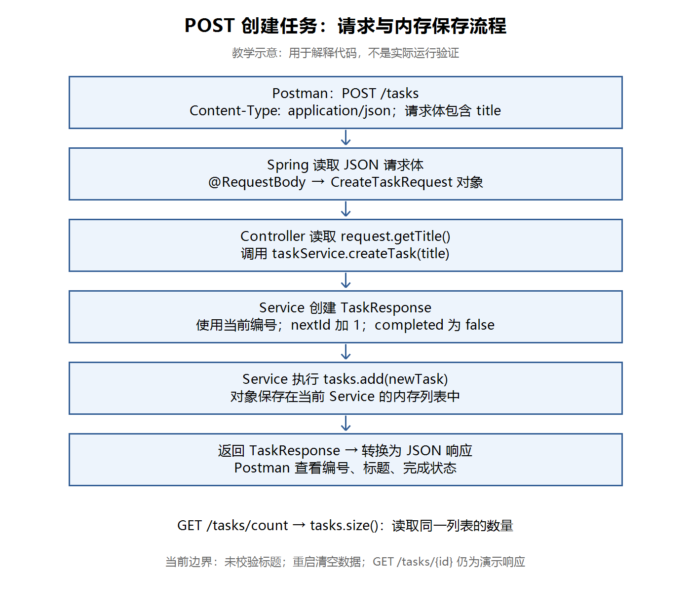
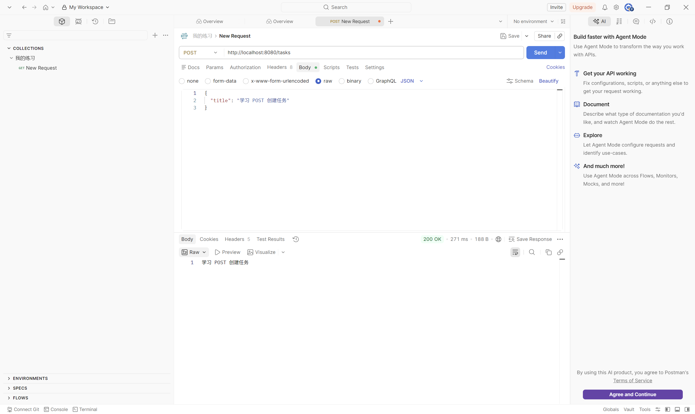
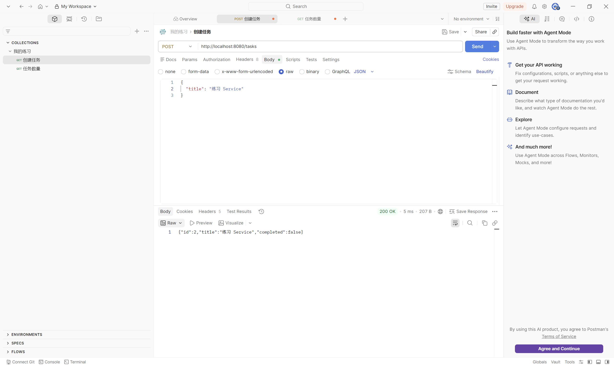
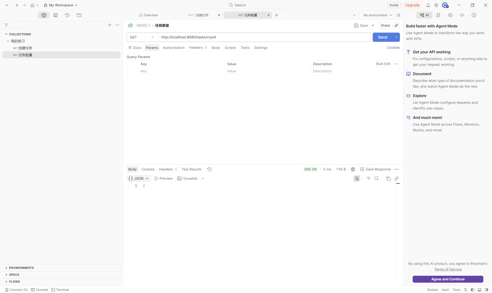

# 第十三节：JSON 请求体与 POST 创建任务

## 学习目标与完成情况

在 JDK 21 和原有 Spring Boot 工程中，接收 JSON 请求体，通过 Controller 调用 Service，在内存列表中保存新任务并返回 JSON。工程位置：`task_manager/`。本节未增加依赖。

学习者自行编写全部练习代码。助手只读检查源码通过，未代改、编译、启动或独立请求接口。Postman 真实截图确认标题回显、第二条任务的 JSON 响应及数量 2；初始数量 0、第一条任务编号 1 等其余正常步骤由学习者文字确认。学习者另行实际发送 `{}`，报告 title 为 null 且创建成功，无该请求截图。

## 请求、转换与保存流程

【图片 1：请在语雀此处上传 images/POST创建任务流程图.png】



观察：请求体先被转换为 Java 请求对象，Controller 读取标题，Service 负责生成编号和保存，返回对象再转换为 JSON。底部的数量接口读取同一个列表。此图为教学示意，不是实际运行验证。

## 请求体与请求 DTO

本节约定 POST `/tasks` 用于创建任务。与上一节 URL 查询参数、路径参数不同，JSON 数据放在请求体中。

```http
POST /tasks
Content-Type: application/json

{
  "title": "学习 POST 创建任务"
}
```

Content-Type 描述请求正文的格式，响应正文的 Content-Type 则应查看响应头，两者不能混为一谈。

请求 DTO 定义客户端这次提交的数据；响应 DTO 定义返回给客户端的数据。创建请求只有 title，编号和初始完成状态由后端决定。

文件：`task_manager/src/main/java/com/ygyong/task_manager/dto/CreateTaskRequest.java`。

```java
public class CreateTaskRequest {
    private String title;

    public String getTitle() {
        return title;
    }

    public void setTitle(String title) {
        this.title = title;
    }
}
```

这是类主体，省略了实际文件已有的 package。没有声明任何构造方法时，Java 提供默认无参构造方法。本节用普通 JavaBean 写法，通过无参构造和 setter 支持接收属性，用 getter 供业务代码读取。

JSON 文本转成 Java 对象叫反序列化；Java 对象转成 JSON 叫序列化。请求不是将前端对象的引用传到 Java 中。

## Controller 接收请求

文件：`task_manager/src/main/java/com/ygyong/task_manager/controller/TaskController.java`。

实际新增方法：

```java
@PostMapping("/tasks")
public TaskResponse createTask(@RequestBody CreateTaskRequest request) {
    return taskService.createTask(request.getTitle());
}
```

- `@PostMapping` 选择请求方法与路径。
- `@RequestBody` 放在方法圆括号中的参数前，让 Spring 读取请求体并转换成指定类型。
- `request` 是 Java 方法参数名。改成 input，并同步修改方法体中的引用，不影响 JSON 的 title 键。
- 本节普通类的 title 属性及相应访问方法用于属性绑定；不能理解为 JSON 按 Controller 参数名绑定。自定义映射规则以后再深入。
- Controller 将标题交给 Service，返回服务结果；原有构造方法注入保持不变。

本节先暂时返回 `request.getTitle()` 验证绑定，成功后才改为上面的创建流程。

【图片 2：请在语雀此处上传 images/Postman_POST请求体与标题回显成功.png】



观察：POST 请求使用 Body → raw → JSON，正文包含 title，响应为 200 OK 和同一标题。这是早期的回显阶段，只证明接收成功，当时尚未保存任务。

## Service 创建与内存保存

文件：`task_manager/src/main/java/com/ygyong/task_manager/service/TaskService.java`。以下为学习者实际实现的字段与相关方法，省略包名、导入及仍保留的演示查询方法。

```java
@Service
public class TaskService {
    private final List<TaskResponse> tasks = new ArrayList<>();
    private int nextId = 1;

    public int getTaskCount() {
        return tasks.size();
    }

    public TaskResponse createTask(String title) {
        TaskResponse newTask = new TaskResponse(nextId++, title, false);
        tasks.add(newTask);
        return newTask;
    }
}
```

`List` 和 `ArrayList` 来自 java.util，TaskResponse 来自本工程 dto 包，Service 注解来自 Spring。

执行过程：

1. 使用当前 nextId 创建任务，标题使用入参，completed 初始化为 false。
2. 后置自增 `nextId++` 先提供旧值，再加 1。例如第一次使用 1，之后 nextId 为 2。
3. 将新对象加入 tasks，再返回该对象。
4. 后续 GET `/tasks/count` 返回列表的实际 size。

若在方法内部每次执行 `new ArrayList<>()`，每次调用都会得到新列表，不能跨请求积累任务。实例字段在每个 Service 对象创建时初始化一次；当前 Spring 默认以单例方式管理此 Service，在同一应用上下文中复用它，多次请求使用同一个列表。不是说所有 Service 方法只执行一次。

`final` 限制 tasks 重新指向其他列表，不阻止 `tasks.add()` 修改列表内容。内存保存只持续到当前应用停止；重启会重新初始化列表和编号。重启清空未安排为本节实际验证步骤。

当前暂用 TaskResponse 存储任务，后续再区分业务对象与响应 DTO。普通整数自增和 ArrayList 的并发处理不在本节范围内。

## 使用 Postman 验证

学习者在浏览器 Console 无法粘贴，希望使用 Postman 或本地前端。本节改用现有 Postman，并已把后续优先使用 Postman 的约定写入根目录 AGENTS.md。

1. IDEA 启动本节工程，修改后停止旧程序再重新运行。
2. Postman 设置 POST `http://localhost:8080/tasks`。
3. Body → raw → JSON，填写 title。
4. 在请求 Headers 检查 Content-Type: application/json。
5. Send 后查看状态码和响应正文。

本节正常验证顺序及证据：

| 操作 | 结果 | 证据 |
| --- | --- | --- |
| GET /tasks/count | 初始 0 | 学习者文字确认 |
| POST，title 为学习 POST | id=1，标题正确，completed=false | 学习者文字确认 |
| POST，title 为练习 Service | 200 OK，id=2，标题正确，completed=false | 真实截图 |
| GET /tasks/count | 200 OK，正文 2 | 真实截图 |

【图片 3：请在语雀此处上传 images/Postman_创建第二条任务_JSON响应.png】



观察：请求标题为“练习 Service”，响应 id 为 2、标题对应、completed 为 false，状态 200 OK。截图左侧收藏显示旧的 GET 标记，当前请求编辑区实际为 POST；保存修改后的请求有助于下次复用。

【图片 4：请在语雀此处上传 images/Postman_创建后任务数量为2.png】



观察：GET `/tasks/count` 返回 2 和 200 OK，结合源码确认任务已加入当前 Service 的列表。现有 GET `/tasks/{id}` 仍生成上一节的演示对象，不能用它声称已经实现真实查询。

浏览器地址栏直接访问发起 GET；Postman 可明确选择 POST 并设置请求体，无需额外前端工程。

### 断点与快捷键

需要观察对象时，在 Controller 的 return 行旁点击行号左侧设置断点，通过 IDEA 的 Debug 操作启动，再用 Postman 发请求；展开 request 查看 title，继续执行后客户端才会收到响应。

Windows 的 IntelliJ 默认键位通常为 Alt+Enter 导入类、Shift+F9 调试运行、F8 单步跳过、F9 继续。以当前键位方案为准；可通过 Run 菜单或工具栏 Debug/Resume 操作，断点也可直接点击行号左侧。本节未收到断点截图，不将该流程记录为已验证。

## 实际发现：空对象也会被保存

学习者实际发送：

```json
{}
```

报告 title 为 null 且创建成功。原因是 title 为 String 实例字段，没有初始化时默认值为 null；请求缺少 title 时，本例保留该值。实例字段有默认值，不代表未赋值的 Java 局部变量也可直接使用。

当前 Service 没有校验 title，仍会创建对象并执行 `tasks.add(newTask)`。因此 JSON 结构可转换与标题满足业务要求是两件事。

`@RequestBody` 不自动要求 title 有值；它默认要求存在请求体，也不代表请求体中的每个属性都必填。`{}` 与完全不发送请求体不同，本节只实际验证了 `{}`。

下一节解决空标题校验与 HTTP 错误响应；不要把当前实现当作已具备完整输入保护的创建接口。

## 自测与已确认理解

1. request 改成 input，JSON 的键要改吗？不用；同步修改 Java 内部引用即可，键仍为 title。
2. 为什么列表放在 Service 字段中？同一个 Service 对象可跨调用保留列表；方法内每次新建不能累积。
3. `{}` 为什么创建成功？title 保持默认 null，当前实现未做标题校验。
4. nextId++ 与先加再用的区别是什么？当前后置自增先使用旧编号，再加 1。此题为复习，未另行收取回答。
5. 当前 GET /tasks/{id} 能验证真实保存吗？不能，仍是演示响应。此题为复习，未另行收取回答。

## 图片清单与语雀上传

复制 Markdown 通常不能自动上传本地图片。请同时保留本笔记和 images 目录，按每处可见提示在语雀上传对应图片，或使用已验证支持图片的导入方式。

| 编号 | 名称 | 相对路径 |
| --- | --- | --- |
| 1 | POST 创建任务流程图（教学示意） | images/POST创建任务流程图.png |
| 2 | 请求体与标题回显 | images/Postman_POST请求体与标题回显成功.png |
| 3 | 创建第二条任务 | images/Postman_创建第二条任务_JSON响应.png |
| 4 | 创建后任务数量为 2 | images/Postman_创建后任务数量为2.png |
