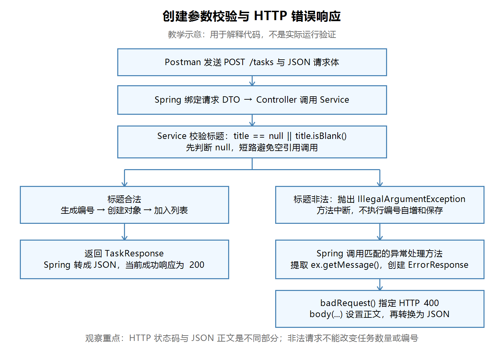

# 第十四节：创建参数校验与 HTTP 错误响应

## 学习目标与本节成果

拒绝 null、空串和纯空白任务标题；非法任务不保存、不消耗编号；向调用方返回 HTTP 400 和清楚的错误 JSON。

本节源码检查通过。学习者文字报告 Postman 全部结果与预期一致，两个 IDEA 断点均停住且观察正确。没有本轮真实截图；助手未独立构建、启动、请求或调试，不将教学图作为运行证据。

## 掌握要求：业务规则自己写，框架代码允许参考

学习者反馈：按步骤写出异常处理，但新概念过多，无法独立重写或理解。教学调整后，不要求默写框架代码。

| 内容 | 当前要求 |
|---|---|
| 拒绝哪些标题、校验位置、阻止保存 | 理解原因，能够独立编写 |
| 异常处理注解与 ResponseEntity | 理解用途，参考模板编写、修改和调试 |
| Spring 内部如何查找处理方法、响应构建器内部实现 | 以后深入 |

类似使用 Axios，先掌握输入、输出和错误处理，不要求先实现底层通信。统一异常处理通常在项目里集中编写，已有项目可以沿用，新增业务按需要扩展。

## 请求处理流程

【图片 1：请在语雀此处上传 images/参数校验与错误响应流程图.png】



观察说明：从 Service 的校验处分为合法与非法两条路径。非法路径不会执行编号自增和列表保存，而由 Spring 调用异常处理方法。图中 400 属于 HTTP 状态码，错误对象用于响应正文。此图为教学示意，不是实际运行验证。

## 保存前校验

工程：`task_manager/`。Java 文件均位于 `src/main/java/com/ygyong/task_manager/`。

`service/TaskService.java` 的创建方法：

```java
public TaskResponse createTask(String title) {
    if (title == null || title.isBlank()) {
        throw new IllegalArgumentException("任务标题不能为空");
    }
    TaskResponse newTask = new TaskResponse(nextId++, title, false);
    tasks.add(newTask);
    return newTask;
}
```

`isBlank()` 对空串、纯空白字符串返回 true。先判断 null，利用 || 的短路规则：左边为 true，就不执行右边，避免在 null 上调用方法。

throw 中断当前方法的正常执行，异常向外传播。本例校验在 nextId++ 和 tasks.add 之前，因此非法输入不会改变数量或编号。Controller 保持接收请求并调用 Service 的职责。

## 错误正文的数据结构

`dto/ErrorResponse.java`：

```java
public class ErrorResponse {
    private String message;

    public ErrorResponse(String message) {
        this.message = message;
    }

    public String getMessage() {
        return message;
    }
}
```

由后端通过构造方法创建对象，再由 getter 提供响应属性。本次用途不需要 setter 或无参构造方法。它本身没有指定 HTTP 状态码。

## 将 Java 异常转换为 HTTP 响应

`exception/GlobalExceptionHandler.java` 位于启动类包的子包中，代码为：

```java
package com.ygyong.task_manager.exception;

import com.ygyong.task_manager.dto.ErrorResponse;
import org.springframework.http.ResponseEntity;
import org.springframework.web.bind.annotation.ExceptionHandler;
import org.springframework.web.bind.annotation.RestControllerAdvice;

@RestControllerAdvice()
public class GlobalExceptionHandler {
    @ExceptionHandler(IllegalArgumentException.class)
    public ResponseEntity<ErrorResponse> handleIllegalArgumentException(
            IllegalArgumentException ex) {
        ErrorResponse errorResponse = new ErrorResponse(ex.getMessage());
        return ResponseEntity.badRequest().body(errorResponse);
    }
}
```

| 写法 | 本例用途 |
|---|---|
| @RestControllerAdvice | 提供统一接口异常处理，返回值写入响应正文 |
| @ExceptionHandler(IllegalArgumentException.class) | 声明处理的异常类型；.class 表示类型，不是创建对象 |
| 参数 ex | Spring 传入这次抛出的异常对象 |
| ex.getMessage() | 读取创建异常时传入的原因文字 |
| ResponseEntity<ErrorResponse> | 响应包含状态码等信息，正文类型为 ErrorResponse |
| badRequest() | 设置 HTTP 状态码 400 |
| body(errorResponse) | 设置响应正文 |

没有在 Controller 手动调用处理方法；异常传播出来后由 Spring 调用匹配的方法。badRequest() 返回可以继续配置的对象，再调用 body(...)，这是链式调用。当前只需理解它的用途。

方法体第一行可以拆成已熟悉的两步：

```java
String message = ex.getMessage();
ErrorResponse errorResponse = new ErrorResponse(message);
```

错误对象由 Spring 转换为 JSON。参考：[Spring MVC 异常处理官方说明](https://docs.spring.io/spring-framework/reference/web/webmvc/mvc-controller/ann-exceptionhandler.html)。

## Postman 实际验证

先停止旧工程，在 IDEA 启动本节 TaskManagerApplication。本轮连续操作期间不重启，避免内存数据清空。

POST 配置：方法 POST，URL `http://localhost:8080/tasks`，Body → raw → JSON，确认 Content-Type: application/json。

学习者文字确认以下结果全部一致：

| 顺序 | 请求 | 实际报告结果 |
|---|---|---|
| 1 | GET /tasks/count | 0 |
| 2 | POST，正文 {"title":"学习参数校验"} | 200、id=1、标题一致、completed=false |
| 3 | POST，正文 {} | 400 与错误 JSON |
| 4 | POST，正文 {"title":""} | 400 与错误 JSON |
| 5 | POST，正文 {"title":"   "} | 400 与错误 JSON |
| 6 | GET /tasks/count | 仍为 1 |
| 7 | POST，正文 {"title":"练习错误响应"} | 200、id=2 |

错误正文：

```json
{
  "message": "任务标题不能为空"
}
```

数量未增加、下一条合法任务编号为 2，说明这些非法请求没有保存或消耗编号。上述为学习者操作报告，无对应截图。

## IDEA 断点观察

1. 在 TaskService 的 throw 行设置断点。
2. 在异常处理方法的 ErrorResponse 创建行设置断点。
3. 用 Debug 启动本节工程，Postman 发送 POST /tasks，正文 {}。
4. 第一次停住，title=null。停在 throw 行时，该行尚未执行。
5. 点击 Resume Program 继续，停在异常处理方法；展开 ex，观察 detailMessage 中的原因文字。
6. 再继续，Postman 收到 400 和错误 JSON。

学习者确认两个断点均停住、观察结果与预期一致。暂停时 Postman 等待响应是正常的。

Windows 操作：可点击编辑器行号旁设置断点、使用 Run 菜单中的 Debug、使用调试工具栏的 Resume Program。Default 键位通常为 Ctrl+F8 切换行断点、Shift+F9 调试、F9 继续；如键位方案不同，以菜单和工具栏为准。

## 易错点与已确认理解

- 抛出 IllegalArgumentException 不表示已经指定 HTTP 400；本例由异常处理方法设置。
- 只创建或返回 ErrorResponse 不等于选择了 400。
- 正文写 {"status":400} 只是数据；如果实际 HTTP 状态码为 200，仍不是 HTTP 400。学习者已准确解释 badRequest() 决定本例的真实状态码。
- 校验放在编号自增或保存之后，会留下副作用，应先校验。
- 不必通过默写注解和框架链式调用证明掌握，重点是理解职责、会修改并验证行为。

## 当前边界与以后深入

当前数据仅保存在内存，重启清空。GET /tasks/{id} 仍返回演示对象，下一节改为真实查询。当前 IllegalArgumentException 的统一映射适合本练习，后续按业务需要细分异常；不要把所有 Exception 都当成请求错误。注解校验、长度限制、并发与更完整错误格式后续学习。

## 自测题

1. 为什么 title 为 null 时不会执行 title.isBlank()？
2. 为什么校验必须在 nextId++ 和 tasks.add 之前？
3. 哪个方法负责设置本例的真实 HTTP 400？
4. Service 抛出异常后，谁调用异常处理方法？
5. 如何用数量和下一次编号验证非法请求没有副作用？

## 图片上传清单

| 编号 | 名称 | 相对文件路径 |
|---|---|---|
| 1 | 参数校验与错误响应流程图（教学示意） | images/参数校验与错误响应流程图.png |

复制 Markdown 到语雀时，本地相对图片通常不会自动上传。请按正文上传提示手动上传图片，或使用语雀支持的导入方式；保留本笔记及 images 目录。
