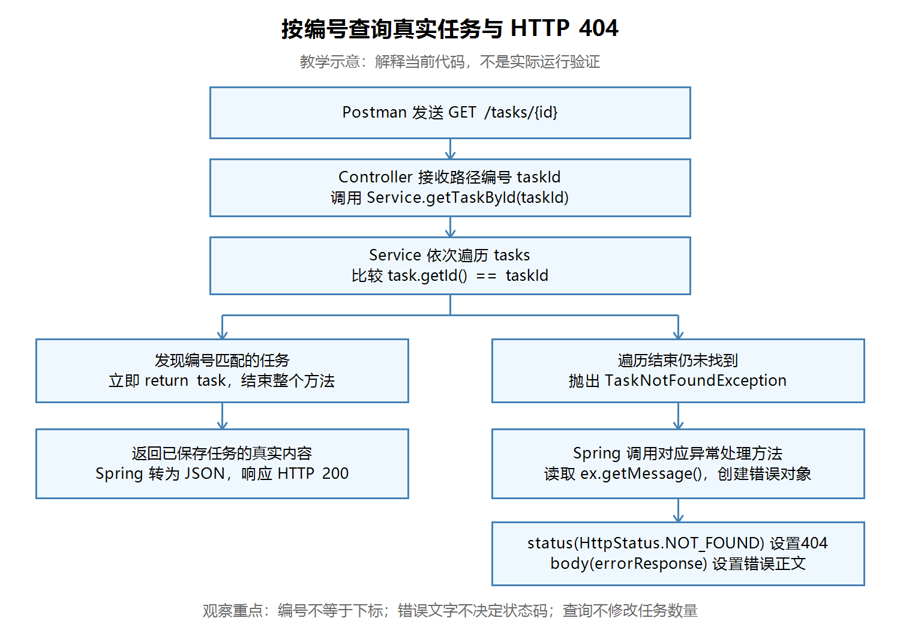

# 第十五节：按编号查询真实任务与 HTTP 404

## 学习目标与实际成果

将演示查询改为从内存列表查询真实任务；找到返回任务 JSON，没有找到返回 HTTP 404 和错误 JSON，保留创建标题校验的 HTTP 400。

源码检查通过。学习者文字报告：Postman 八步验证全部符合预期，两个断点依次停住、观察正确，并能解释换回 IllegalArgumentException 为什么会得到400。本节没有收到真实截图；助手未独立构建、启动、发请求或调试。下方流程图仅作教学示意。

## 当前掌握要求

| 内容 | 要求 |
|---|---|
| 遍历任务、比较编号、找到返回、全部未找到再抛出异常 | 理解并自己编写 |
| 自定义异常与404处理 | 理解用途，允许参考已有模板 |
| Spring 查找异常处理方法的内部机制、并发访问列表 | 以后深入 |

当前数据仍存在内存中，重启程序会清空任务并重新从1生成编号。本节没有引入数据库或新依赖。

## 查询流程

【图片 1：请在语雀此处上传 images/按编号查询与404流程图.png】



观察说明：查到任务时立即返回原对象；只有检查完整个列表仍未找到，才进入异常路径。404由异常处理方法设置，查询本身不会修改数量。此图为教学示意，不是实际运行验证。

## 从列表查找真实任务

工程目录：`task_manager/`。下述 Java 文件路径相对于 `src/main/java/com/ygyong/task_manager/`。

`service/TaskService.java` 中的核心实现（按实际代码整理格式，省略旧演示注释）：

```java
public TaskResponse getTaskById(int taskId) {
    for (TaskResponse task : tasks) {
        if (task.getId() == taskId) {
            return task;
        }
    }
    throw new TaskNotFoundException("任务不存在：" + taskId);
}
```

增强 for 类似 JavaScript 的 for...of，依次取出列表中的元素；Java 需要声明元素类型 TaskResponse。getId() 与 taskId 都是 int，可以使用 == 比较。

编号属于对象数据，不是列表下标。例如编号1当前位于下标0，不能把 tasks.get(taskId) 当作按编号查询。

return task 会结束整个方法，返回已保存的对象。若把“未找到”的处理写在循环内，可能只检查第一条任务便提前失败。空列表不进入循环，会直接抛出异常。

第一轮曾暂时使用循环后的 return null，只用于分步实现。null 不会自动转换为404；最终方案已改为抛出专门的异常。旧代码直接 new TaskResponse，无论查什么编号都构造演示内容，不能证明任务存在。

## 用异常表达“任务不存在”

`exception/TaskNotFoundException.java`：

```java
public class TaskNotFoundException extends RuntimeException {
    public TaskNotFoundException(String message) {
        super(message);
    }
}
```

extends 表示继承。super(message) 调用父类构造方法，让父类保存错误文字，后续可通过 getMessage() 读取。Service 中需要导入该类：

```java
import com.ygyong.task_manager.exception.TaskNotFoundException;
```

throw 会中断当前方法的正常执行并让异常向外传播，不需要在后面补 return。定义了异常类，还需要在正确位置实际抛出它。

## 将异常转换成404响应

在 `exception/GlobalExceptionHandler.java` 已有的 @RestControllerAdvice 类中新增方法，保留原400处理：

```java
@ExceptionHandler(TaskNotFoundException.class)
public ResponseEntity<ErrorResponse> handleTaskNotFoundException(
        TaskNotFoundException ex) {
    ErrorResponse errorResponse = new ErrorResponse(ex.getMessage());
    return ResponseEntity.status(HttpStatus.NOT_FOUND).body(errorResponse);
}
```

新增导入：

```java
import org.springframework.http.HttpStatus;
```

@ExceptionHandler 指定该方法处理的异常类型，Spring 在异常传播出来后调用匹配的处理方法。当前 TaskNotFoundException 和 IllegalArgumentException 是不同的异常类型，分别有自己的处理方法。

status(HttpStatus.NOT_FOUND) 设置真实的 HTTP 404，body(errorResponse) 设置响应正文，已有 ErrorResponse 的 getter 用于输出 message 属性。Controller 继续接收路径参数并调用 Service，不必自己遍历列表或捕获异常。

| 业务情况 | 异常类型 | 当前处理方法设置的状态码 |
|---|---|---|
| 创建标题为空、null或纯空白 | IllegalArgumentException | badRequest() → 400 |
| 查询任务不存在 | TaskNotFoundException | status(HttpStatus.NOT_FOUND) → 404 |

错误文字本身不决定状态码。在本接口中，400表达创建参数不符合要求，404表达所查询的任务不存在。

参考：[Spring ResponseEntity 官方 API](https://docs.spring.io/spring-framework/docs/6.2.1/javadoc-api/org/springframework/http/ResponseEntity.html)。

## 本节实际易错点

学习者正确创建了 TaskNotFoundException，但首次查询失败处仍然 new IllegalArgumentException。抛出位置和文字正确，异常类型却仍匹配上一节的400处理方法。随后已自行改为 TaskNotFoundException，并补齐导入。

学习者最终正确解释：换回 IllegalArgumentException 会返回400，因为当前处理该异常的方法调用了 badRequest()。

源文件还有注释“参数名不正确返回400”，更准确的说法是“任务标题校验失败，返回400”：当前检查的是标题值，不是 Java 参数名。这是可选的注释修正，不影响当前实现。查询方法末尾旧演示代码的注释也可自行清理。

## Postman 验证记录

先停止旧工程，启动本节工程。创建和查询期间保持同一个进程，避免重启清空内存。

POST 使用 Body → raw → JSON，确认 Content-Type: application/json。示例请求正文：

```json
{
  "title": "学习真实查询"
}
```

GET 不需要请求 Body。下表结果均依据学习者文字报告确认，没有对应真实截图，也不是助手独立请求的结果。

| 顺序 | 请求（基础地址 http://localhost:8080） | 学习者确认结果 |
|---|---|---|
| 1 | GET /tasks/1（初始空列表） | 404，任务不存在 |
| 2 | POST /tasks，标题“学习真实查询” | 200，编号1 |
| 3 | POST /tasks，标题“练习 HTTP 404” | 200，编号2 |
| 4 | GET /tasks/1 | 200，标题“学习真实查询” |
| 5 | GET /tasks/2 | 200，标题“练习 HTTP 404” |
| 6 | GET /tasks/999 | 404，message为“任务不存在：999” |
| 7 | GET /tasks/count | 200，数量2 |
| 8 | POST /tasks，正文{}，随后再查数量 | 创建响应400，数量仍2 |

成功响应状态码当前沿用200。本节不调整创建接口的成功状态码。

## IDEA Debug：观察异常传播

1. 停止程序，以 Debug 启动本节工程。重启后列表为空，999仍不存在。
2. 在 Service 的 throw new TaskNotFoundException 行设置断点。
3. 在 handleTaskNotFoundException 内创建 ErrorResponse 的行设置第二个断点。
4. Postman 发 GET http://localhost:8080/tasks/999。
5. 首个断点停住时观察 taskId=999。停在某行表示该行尚未执行。
6. 使用 Resume Program 继续，进入第二个断点；观察异常类型为 TaskNotFoundException，ex.getMessage() 为“任务不存在：999”。
7. 再次继续，Postman 收到404与错误JSON。暂停期间请求等待响应属于正常现象。

学习者文字确认两个断点依次停住，观察及响应均符合预期。没有本轮调试截图。

Windows 默认 IntelliJ IDEA 键位中：切换行断点通常为 Ctrl+F8，Debug 通常为 Shift+F9，继续执行通常为 F9。若键位不同，使用编辑器行号旁的断点区域、运行配置的 Debug 按钮，以及 Debug 工具窗口的 Resume Program 按钮；可在 Settings → Keymap 查看实际绑定。

## 自测与后续

1. 为什么“未找到”的异常应在循环之后抛出？
2. 为什么不能使用列表下标代替任务编号？
3. 若只改变错误文字，不改变异常类型和处理方法，状态码会随之改变吗？
4. 当前代码换回 IllegalArgumentException 会得到什么响应？（本节已回答通过：400，因为处理方法使用 badRequest()。）
5. 为什么重启后查询先前创建的任务会得到404？

本节核心目标完成。下一节计划“修改任务完成状态与 PATCH 请求”：复用按编号查找能力，学习更新已有任务及不存在时的404处理。数据库、并发访问与框架内部机制后续安排。

## 语雀图片上传清单

复制 Markdown 文本通常不会自动上传本地图片。请将本笔记与 images 目录一起保留，在语雀的可见提示处上传对应图片，或使用语雀支持的导入方式；尚未验证导入能自动带图。

| 编号 | 名称 | 相对文件路径 |
|---|---|---|
| 图片1 | 按编号查询与404流程图（教学示意） | images/按编号查询与404流程图.png |
