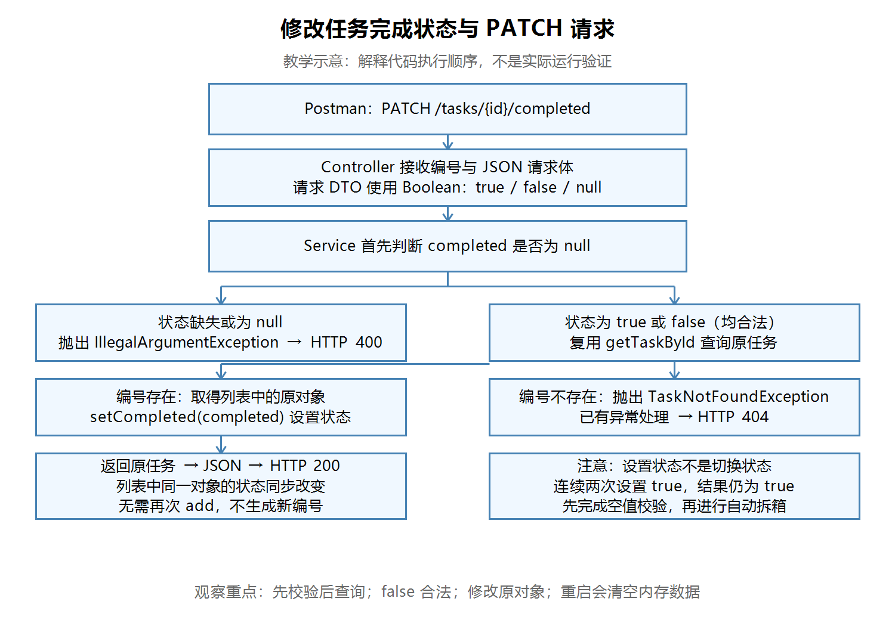

# 第十六节：修改任务完成状态与 PATCH 请求

## 学习目标与验证依据

通过 PATCH /tasks/{id}/completed 修改已有任务的完成状态，支持设为 true 与 false；状态缺失返回400，任务不存在返回404。

源码检查通过。Postman九步验证及合法请求、缺失字段的断点观察均由学习者文字报告确认；学习者正确解释了 Boolean 与 boolean 的选择，以及重复设置 true 不会切换状态。本节未收到实际截图，助手未独立构建、启动、请求或调试。流程图仅用于教学。

## 当前掌握要求

- 需要理解并自己编写：空值校验、复用查询、修改原对象、返回任务。
- 理解用途，允许参考模板：PATCH 映射、路径参数、请求体注解、已有400与404异常处理。
- 以后深入：并发访问、数据库持久化、框架内部机制、通用 PATCH 文档格式。本例使用普通 JSON DTO，并未实现 JSON Patch 等通用格式。

## 请求处理流程

【图片 1：请在语雀此处上传 images/修改完成状态与PATCH流程图.png】



观察说明：先校验状态是否为 null，再查找任务。查到后修改列表中的原对象；400、404分支不修改任务。此图是教学示意，不是实际运行验证。

## PATCH 的用途

PATCH 表达对已有资源的局部修改。本接口只设置 completed，编号和标题保持不变。

```http
PATCH /tasks/1/completed
Content-Type: application/json
```

```json
{"completed": true}
```

这是“设为已完成”，不是“切换状态”。连续两次传 true，结果仍为 true。这是本接口赋值逻辑的性质，不能据此断言所有 PATCH 操作都具有相同性质。

## Boolean 与 boolean

| 使用位置 | 类型 | 原因 |
|---|---|---|
| 请求 DTO | Boolean | 用 null 区分没有提供有效状态与合法 false |
| Service 入参 | Boolean | 在自动拆箱前检查 null |
| 任务对象字段与 setter 参数 | boolean | 保存的任务必须有明确状态 |

Boolean 是包装类型，可取 true、false、null；boolean 是基本类型，只有 true、false。实例字段中，前者默认 null，后者默认 false，不要把这个规则套到未初始化的局部变量上。

JSON 为 {} 或 {"completed":null} 时，本请求 DTO 的 completed 为 null；{"completed":false} 是合法输入。这里不需要区分“省略字段”和“显式null”，两者都拒绝。

工程目录为 task_manager/。以下 Java 文件路径相对于 src/main/java/com/ygyong/task_manager/。

## 请求 DTO 与生成方法

文件 dto/UpdateTaskCompletedRequest.java：

```java
public class UpdateTaskCompletedRequest {
    private Boolean completed;

    public Boolean getCompleted() {
        return completed;
    }

    public void setCompleted(Boolean completed) {
        this.completed = completed;
    }
}
```

常规 JavaBean 命名：基本类型 boolean 可用 isCompleted()；包装类型 Boolean 使用 getCompleted()。字段不写修饰符表示包访问权限，不等于 private。

学习者询问手写 getter/setter 是否麻烦，并已使用 IDEA 生成功能。先写字段，再将光标放在类内部、方法外部，使用 Code → Generate（代码 → 生成），选择 Getter and Setter 并勾选字段。Windows 默认 IntelliJ IDEA 键位通常为 Alt+Insert；自定义键位到 Settings → Keymap 查询 Generate。已有的方法不必重复生成。

## 任务 setter 与 Service

文件 dto/TaskResponse.java 中新增的方法：

```java
public void setCompleted(boolean completed) {
    this.completed = completed;
}
```

setter 负责赋值，本次不需要返回结果。最初写成 boolean 返回类型并 return completed 可以编译，但没有必要，已由学习者改为 void。

文件 service/TaskService.java 中的最终实现：

```java
public TaskResponse updateTaskCompleted(int taskId, Boolean completed) {
    if (completed == null) {
        throw new IllegalArgumentException("完成状态不能为空");
    }

    TaskResponse task = getTaskById(taskId);
    task.setCompleted(completed);
    return task;
}
```

把 Boolean 传给接受 boolean 的 setter 时，Java 会自动拆箱。null 不能拆箱，否则会抛出 NullPointerException；所以必须先检查 null。不要用“值是否为 true”代替完整性校验，false 也是合法状态。

getTaskById 返回列表中已有对象的引用，与 JavaScript 通过引用修改对象属性类似。task 与列表元素指向同一个对象，修改字段后无需再次 add，也不应生成新编号。当前任务对象兼作响应 DTO，后续根据工程需要再细分职责。

学习者最初先查询后校验，已自行调整。原顺序不是空指针错误，但当编号不存在且状态缺失时，会先得到404；本节最终约定先校验输入，再查询任务。该组合错误优先顺序来自代码，并未单独进行请求验证。

## Controller 与错误响应

文件 controller/TaskController.java 中新增的方法（仅整理换行）：

```java
@PatchMapping("/tasks/{id}/completed")
public TaskResponse updateTaskCompleted(
        @PathVariable("id") int taskId,
        @RequestBody UpdateTaskCompletedRequest request) {
    return taskService.updateTaskCompleted(taskId, request.getCompleted());
}
```

导入 com.ygyong.task_manager.dto.UpdateTaskCompletedRequest。@PatchMapping 匹配请求方法和路径，@PathVariable 取得编号，@RequestBody 将 JSON 转为请求 DTO。

复用已有 GlobalExceptionHandler：IllegalArgumentException 对应 badRequest() 返回400；TaskNotFoundException 对应 NOT_FOUND 返回404。错误文字本身不设置 HTTP 状态码。正常返回任务对象，由 Spring 输出 JSON，当前响应为200。

## Postman 实际验证记录

由学习者操作并文字确认，未收到截图。先启动本节工程，POST http://localhost:8080/tasks 创建任务；以下编号按实际响应填写，记录中使用1。重启进程会清空内存数据，需要重新创建。

POST、PATCH 使用 Body → raw → JSON，检查 Content-Type: application/json。基础地址为 http://localhost:8080。

| 步骤 | 请求 | 已报告结果 |
|---|---|---|
| 前置 | POST /tasks，提供合法标题 | 创建成功 |
| 1 | PATCH /tasks/1/completed，{"completed":true} | 200，true |
| 2 | 重复同一请求 | 200，仍true |
| 3 | GET /tasks/1 | 状态true |
| 4 | PATCH，{"completed":false} | 200，false |
| 5 | PATCH，{} | 400，完成状态不能为空 |
| 6 | PATCH，{"completed":null} | 400，同上 |
| 7 | GET /tasks/1 | 仍false，编号标题未变 |
| 8 | PATCH /tasks/999/completed，{"completed":true} | 404，任务不存在 |
| 9 | GET /tasks/count | 数量仍1 |

本轮没有测试损坏的 JSON、错误字段类型、空请求正文等情况，不将其记为验证通过。

## IDEA 断点观察

学习者文字确认以下观察均符合预期：

1. 用 Debug 启动，有需要时重新创建任务。
2. 在 Service 的 if(completed == null) 与 task.setCompleted(completed) 行设断点。
3. 发 completed=true 的 PATCH，首个断点观察编号与参数true。
4. 继续到 setter 行，执行前 task.completed 仍为false；Step Over 后变为true，this → tasks 中对应对象也变为true。
5. 继续执行，Postman 收到响应。
6. 再发 {}，首个断点中 completed=null；单步进入 throw，不执行查询与setter，继续后收到400。

断点所在行尚未执行；程序暂停期间 Postman 等待响应属于正常现象。本轮没有实际调试截图。

| IDEA 操作 | Windows 默认 IntelliJ IDEA 键位 | 菜单或替代入口 |
|---|---|---|
| 生成 getter/setter | Alt+Insert | Code → Generate |
| 导入未识别类 | Alt+Enter | 类名处的快速修复菜单 |
| 切换行断点 | Ctrl+F8 | 点击行号旁断点区域 |
| Debug 当前配置 | Shift+F9 | 运行配置的 Debug 按钮 |
| 单步跳过 | F8 | Debug 工具栏 Step Over |
| 继续运行 | F9 | Debug 工具栏 Resume Program |

快捷键以实际 Keymap 为准，不要求更换键位方案。

## 理解确认与自测

学习者已正确解释：Boolean 可以用 null 区分没传状态，任务本身只需要 true/false；连续两次 true 都是设为已完成，而不是切换状态。

可用于复习的问题：

1. 为什么 false 不能当作参数缺失？
2. 为什么 null 校验必须在自动拆箱之前？
3. 为什么修改任务后不需要再次向列表 add？（断点已观察原对象与列表元素同步变化，未单独要求口头回答。）
4. 为什么重复设置 true 不会反转状态？
5. 状态缺失和编号不存在分别由什么异常及处理方法产生400、404？

本节已完成。下一节计划：第十七节“删除任务与 DELETE 请求”，复用编号查询和404，学习删除列表元素并验证数量变化。

## 语雀图片上传清单

复制 Markdown 文本通常不会自动上传本地图片。保留笔记与 images/ 目录，在语雀提示位置上传图片，或使用其支持的导入方式；未验证自动带图。

| 编号 | 图片名称 | 相对路径 |
|---|---|---|
| 图片1 | 修改完成状态与PATCH流程图（教学示意） | images/修改完成状态与PATCH流程图.png |
