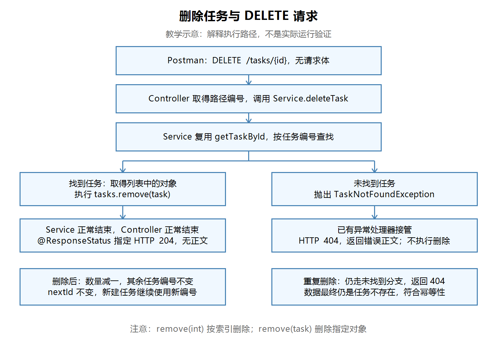

# 第十七节：删除任务与 DELETE 请求

## 学习目标与完成情况

通过 DELETE /tasks/{id} 删除指定任务，成功返回204且无响应正文，任务不存在返回404。删除后数量减少，其余任务编号保持不变，新任务继续使用递增编号。

Service与Controller源码检查通过。Postman八步结果由学习者文字确认，无本节实际截图；助手未独立构建、启动或发送请求。按学习者要求跳过断点，不记录为断点验证通过。学习者已正确解释索引与编号的区别，以及幂等性。

## 请求处理流程

【图片 1：请在语雀此处上传 images/删除任务与DELETE流程图.png】



观察说明：查到任务后才移除对象，正常结束返回204；查不到则抛异常，由已有处理器返回404，不执行删除。此图是教学示意，不是实际运行验证。

## 删除指定对象，而不是指定索引

任务编号代表任务身份；列表索引代表元素当前的位置，从0开始。删除中间元素后，后面的索引会变化，任务编号保持不变。

| 删除编号2前的索引 | 任务编号 | 删除后的索引 |
|---|---|---|
| 0 | 1 | 0 |
| 1 | 2 | 已删除 |
| 2 | 3 | 1 |

Java的List提供不同参数类型的remove方法，这是方法重载：

```java
items.remove(1);       // int参数：按索引删除第二个元素
items.remove(item);    // 对象参数：移除匹配的对象
```

本节tasks保存TaskResponse对象，taskId是int，直接remove(taskId)会按索引处理，可能删错元素或索引越界。这个Java重载规则需要单独注意，不能套用JavaScript数组操作习惯。

## Service：复用查询再删除

工程目录为task_manager/，以下Java文件路径相对于src/main/java/com/ygyong/task_manager/。

文件service/TaskService.java中，学习者完成的实现：

```java
public void deleteTask(int taskId) {
    TaskResponse task = getTaskById(taskId);
    tasks.remove(task);
}
```

getTaskById返回列表中保存的原对象，因此可以用它删除对应元素。查找失败时抛出TaskNotFoundException，当前方法随之异常结束，后续remove不会执行；无需重复写查找循环或在这里捕获异常。

删除只改变列表内容，不修改nextId。编号不等于数量，也不保证连续。当前项目重启会清空列表并重新初始化编号，尚未持久化到数据库。

void表示方法不返回值，本身不会指定HTTP状态码。

## Controller：声明DELETE与204

文件controller/TaskController.java：

```java
import org.springframework.http.HttpStatus;
```

```java
@DeleteMapping("/tasks/{id}")
@ResponseStatus(HttpStatus.NO_CONTENT)
public void deleteTask(@PathVariable("id") int taskId) {
    taskService.deleteTask(taskId);
}
```

@DeleteMapping匹配请求方法与路径；@PathVariable从路径取得编号。当前接口没有请求体，不需要新增请求DTO或@RequestBody。

正常执行结束时，@ResponseStatus指定204 No Content，配合void不返回响应正文。204正文为空是正常结果，不需要再返回“删除成功”的JSON。

当Service抛出TaskNotFoundException时，已有GlobalExceptionHandler接管，通过ResponseEntity指定404及错误正文；不会因为Controller标注204就把异常响应变为成功。

## Postman验证记录

先停止旧工程，启动本节工程。以下验证在全新进程、同一运行期间完成，结果均来自学习者文字确认。

基础地址：http://localhost:8080。前置操作为三次POST /tasks，分别创建任务A、B、C，得到编号1、2、3。POST使用Body → raw → JSON，并检查Content-Type: application/json，例如：

```json
{"title": "任务A"}
```

DELETE请求Body选择none，编号放在URL中。

| 步骤 | 请求 | 已报告结果 |
|---|---|---|
| 1 | GET /tasks/count | 200，数量3 |
| 2 | DELETE /tasks/2 | 204，正文为空 |
| 3 | GET /tasks/count | 200，数量2 |
| 4 | GET /tasks/2 | 404，任务不存在 |
| 5 | 再次DELETE /tasks/2 | 404 |
| 6 | GET /tasks/1与GET /tasks/3 | 均200，编号标题保持原样 |
| 7 | POST /tasks，创建任务D | 200，新编号4 |
| 8 | GET /tasks/count | 200，数量3 |

中途重启会清空内存数据，需要重新创建任务。源码检查与HTTP验证是不同证据；本节没有进行断点观察，也未验证其他未列出的输入场景。

## 幂等性：看重复操作的效果

学习者正确解释：幂等性指重复操作对服务器数据的最终效果相同，不要求每次响应相同。

在本节场景中，第一次删除后任务不存在，再次删除后仍然不存在。第一次返回204、第二次返回404，与幂等性并不冲突。重复请求不会继续删除别的任务。

## 易错点与IDEA操作

本节提交的删除实现没有必须修复的问题。以下是教学中强调的易错点，并非学习者实际犯错记录：

- 把任务编号传给remove(int)，误当列表索引。
- 删除后重排编号或回退nextId，混淆身份、位置与数量。
- 认为void会自动产生204，忘记声明响应状态。
- 期待204带JSON正文，或认为幂等要求每次状态码相同。

Windows默认IntelliJ IDEA键位中，Alt+Enter可打开快速修复以导入HttpStatus；也可点击类名处提示图标。Shift+F10通常运行当前配置，也可使用运行配置旁Run按钮。快捷键以Settings → Keymap中的实际配置为准；运行前确认选中第十七节工程的启动配置。

## 自测与后续内容

已确认的理解：学习者能解释remove(taskId)选择索引删除，以及重复删除204/404与幂等性的关系。

复习题：

1. 删除编号2后，编号3的任务为何可能位于索引1？
2. getTaskById抛出异常后，remove是否还会执行？
3. 204与404分别由哪里指定？
4. 为什么删除后不修改nextId？

以后深入：集合匹配中的equals、遍历时删除的限制、并发访问及数据库删除。本节无需提前引入这些实现。

下一节：第十八节“任务列表查询与可选条件筛选”，先学习查询任务列表，再逐步加入完成状态筛选。

## 语雀图片上传清单

复制Markdown文本通常不会自动上传本地图片。请同时保留笔记和images/目录，在语雀提示位置上传图片，或使用其支持的导入方式；未验证自动带图。

| 编号 | 图片名称 | 相对路径 |
|---|---|---|
| 图片1 | 删除任务与DELETE流程图（教学示意） | images/删除任务与DELETE流程图.png |
