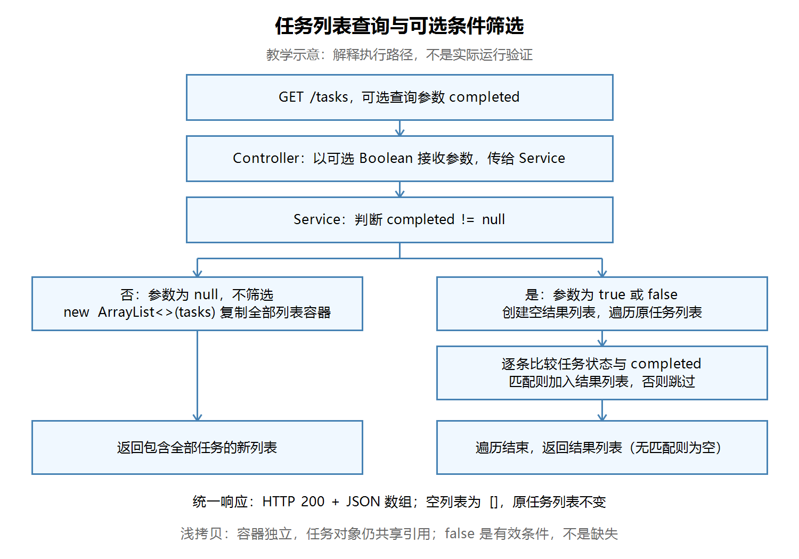

# 第十八节：任务列表查询与可选条件筛选

## 学习目标

将按编号查询扩展为列表查询，通过同一个 GET /tasks 接口按完成状态筛选。理解可选 Boolean 参数、列表 JSON 响应、空结果和浅拷贝。

工程位置：`task_manager/`。本节沿用现有工程依赖及 JDK 21，没有新增依赖。

## 一、接口用途与参数语义

| 请求 | completed 参数 | 含义 |
|---|---|---|
| GET /tasks | null | 返回全部任务 |
| GET /tasks?completed=true | true | 只返回已完成任务 |
| GET /tasks?completed=false | false | 只返回未完成任务 |

Boolean 能表示 null、true、false；boolean 只能表示 true 和 false。这里的 null 表示没有指定筛选条件，false 是有效条件，不能当成缺失。

上一节修改状态时，null 是缺少必须字段，需要拒绝；本节查询时，null 表示不筛选。是否允许为空取决于业务用途。

## 二、Controller 接收查询条件

文件：`task_manager/src/main/java/com/ygyong/task_manager/controller/TaskController.java`。

```java
@GetMapping("/tasks")
public List<TaskResponse> getTasks(
        @RequestParam(value = "completed", required = false) Boolean completed) {
    return taskService.getTasks(completed);
}
```

- @RequestParam 从 URL 查询参数接收条件，required = false 允许不传。
- Controller 负责接收、传递参数，筛选规则放在 Service。
- 不设置 defaultValue = "false"：否则不传条件也会只查未完成任务，改变“默认查询全部”的含义。
- 一个 GET 映射即可处理三种情况；POST /tasks 与 GET /tasks 通过 HTTP 方法区分。
- 返回类型是 List<TaskResponse>，Spring 将它序列化为 JSON 数组，无需自己拼接 JSON。

## 三、Service 筛选与执行顺序

文件：`task_manager/src/main/java/com/ygyong/task_manager/service/TaskService.java`。以下为学习者实际实现：

```java
public List<TaskResponse> getTasks(Boolean completed) {
    if (completed != null) {
        List<TaskResponse> filteredTasks = new ArrayList<>();
        for (TaskResponse task : tasks) {
            if (task.isCompleted() == completed) {
                filteredTasks.add(task);
            }
        }
        return filteredTasks;
    }

    return new ArrayList<>(tasks);
}
```

先判断非 null 再筛选，与先处理 null 并提前返回都可以，当前实现正确。

传 true 或 false 时，新建空结果列表，遍历原任务，只有状态相同的任务才加入结果。return 放在循环之后，才能检查全部任务。查询不会删除不匹配任务，也不会修改状态或消耗编号。

比较表达式中，isCompleted() 返回 boolean，Boolean 参数会自动拆箱。比较只发生在非 null 分支，因此不会因该参数为 null 发生拆箱空指针。

【图片 1：请在语雀此处上传 images/任务列表查询与可选筛选流程图.png】



观察说明：左侧是没有条件时复制全部列表容器；右侧是 true/false 条件下逐条匹配。两条路径都返回列表，原任务集合不变。本图为教学示意，不是实际运行验证截图。

## 四、新容器与共享对象

new ArrayList<>(tasks) 创建独立列表容器，但不会复制每个 TaskResponse 对象。类似 JavaScript 的 [...tasks]，属于浅拷贝；Java 使用集合构造方法完成。

- 对返回列表调用 clear() 或 remove()，不会清空或删掉 Service 内部列表中的元素。
- 两个容器里的任务对象仍是同一引用，通过对象的 setter 修改状态仍可能影响原任务。
- 筛选结果同样保存原任务对象的引用，没有创建新任务对象。

学习者已正确解释“容器独立、对象引用共享”。当前掌握这一层区别即可，深拷贝和更严格的对象隔离后续按需要学习。

## 五、没有匹配项为什么返回 []

列表查询成功但没有匹配任务，应返回 HTTP 200 和空数组 []。这与 GET /tasks/{id} 找不到指定任务返回404不同。

列表接口始终返回数组结构，让调用方可以统一遍历和判断长度，不必为“无数据”单独处理 null 或对象结构。

## 六、Postman 验证记录

操作前停止旧工程，在 IDEA 启动本节工程。内存数据会随重启清空，同一轮验证应保持同一进程。地址前缀为 http://localhost:8080。

GET 请求 Body 选择 none。创建和修改请求使用 Body → raw → JSON，检查 Content-Type: application/json。

创建请求示例：POST /tasks。

```json
{"title":"学习列表查询"}
```

修改请求示例：PATCH /tasks/{实际任务编号}/completed。

```json
{"completed":true}
```

第一轮五步：空列表为200及[]；创建两条任务；查询数组包含正确标题、不同编号和false状态；数量接口返回2。学习者文字确认全部符合预期。

筛选轮验证：

| 步骤 | 操作 | 学习者确认的结果 |
|---|---|---|
| 1 | 新进程创建两条任务 | 均为 false |
| 2 | GET /tasks?completed=true | 200，[] |
| 3 | 将第一条任务 PATCH 为 true | 状态修改成功 |
| 4 | GET /tasks | 两条任务 |
| 5 | GET /tasks?completed=true | 仅第一条 |
| 6 | GET /tasks?completed=false | 仅第二条 |
| 7 | GET /tasks/count | 仍为2 |

结果来自学习者的文字报告，无本节实际操作截图；助手已检查源码，未独立构建、启动或发送请求。未额外验证空字符串、非法参数或其他输入，不推测其结果。

## 七、IDEA 断点观察

在 Service.getTasks 的 if (completed != null) 行设置断点，以 Debug 模式运行，准备一条true、一条false任务。

1. 请求 GET /tasks：参数为null，跳过筛选，返回全部任务的新列表。
2. 请求 GET /tasks?completed=false：参数为false，但非null判断成立，进入筛选。
3. 单步观察只有未完成任务被添加；循环结束时结果列表1条，原列表仍2条。
4. 继续运行后，Postman 才能收到响应，断点期间等待属正常现象。

学习者文字确认上述观察均符合预期。此为学习者调试报告，不是助手独立调试或截图验证。

Windows 默认 IntelliJ IDEA 键位通常为 F8（Step Over，单步跳过）、F9（Resume Program，继续运行）；可用 Debug 窗口对应按钮，自定义键位以 Settings → Keymap 为准。

## 八、本节检查与易错点

本节两轮源码检查均通过，没有发现必须修复的问题，未代改练习实现。以下为教学提醒，不代表学习者实际犯过这些错误：

- 使用 boolean 接收条件会失去 null 这一“不筛选”状态。
- 只判断条件是否为 true，会漏掉 false 这一合法筛选条件。
- 默认值false会将默认查询全部改为默认查询未完成。
- 直接删除原列表中的不匹配任务，会把查询变成数据修改。
- 复制列表容器不等于复制内部对象。

本节不要求提前引入 Stream、数据库查询或复杂设计；先能解释普通循环和返回结果。

## 九、自测题

1. 不传completed与传false分别进入哪个分支？
2. 为什么查询参数允许null，而修改完成状态时需要拒绝null？
3. 对返回列表clear为何不影响原列表？对其中对象调用setter呢？
4. 为什么空结果返回200和[]，而不是404？
5. 在哪里保证了Boolean比较前不会为null？

答案要点：null返回全部，false筛选未完成；业务用途不同；容器独立但对象引用共享；集合查询成功且无匹配；非null分支保护自动拆箱。

## 图片上传清单

| 编号 | 名称 | 相对路径 |
|---|---|---|
| 1 | 任务列表查询与可选筛选流程图（教学示意） | images/任务列表查询与可选筛选流程图.png |

复制Markdown到语雀通常不会自动上传本地图片。请保留笔记及images目录，并在上方上传提示处手动上传对应PNG，或使用语雀支持的导入方式；不保证相对图片路径自动带图。
