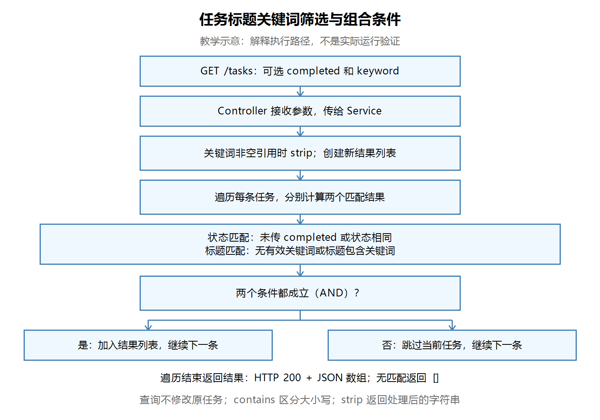

# 第十九节：任务标题关键词筛选与组合条件

## 学习目标

让 GET /tasks 支持可选标题关键词 keyword，并与 completed 同时筛选。理解字符串处理、短路判断与 AND 组合。工程目录：`task_manager/`；沿用 JDK 21 和现有依赖。

## 一、查询条件的用途

```http
GET /tasks?completed=false&keyword=Java
```

查询“未完成，并且标题包含 Java”的任务。Controller 接收条件，Service 负责筛选。

| 条件 | 含义 |
|---|---|
| completed 不传 | 不限制状态 |
| completed=false | 仅未完成；false 是有效条件 |
| keyword 不传、空字符串或纯空白 | 不限制标题 |
| keyword 为 ` Java ` | 去掉首尾空白后匹配 Java |

contains 区分大小写，匹配连续文本；本节不做分词或忽略大小写处理。无匹配返回200和空数组，不是404。

## 二、Controller 接收与传递

文件：`task_manager/src/main/java/com/ygyong/task_manager/controller/TaskController.java`。实际代码按多行排版展示：

```java
@GetMapping("/tasks")
public List<TaskResponse> getTasks(
        @RequestParam(value = "completed", required = false) Boolean completed,
        @RequestParam(value = "keyword", required = false) String keyword) {
    return taskService.getTasks(completed, keyword);
}
```

两个参数均可选，不设置默认false。新增关键词后，必须传给Service；传固定null时，URL中的关键词不会参与筛选。学习者的实际接入代码检查通过，未发现此问题；此前传null是第一轮练习的临时安排。

## 三、Service 的实际实现

文件：`task_manager/src/main/java/com/ygyong/task_manager/service/TaskService.java`。省略源码中保留的旧代码注释：

```java
public List<TaskResponse> getTasks(Boolean completed, String keyword) {
    if (keyword != null) {
        keyword = keyword.strip();
    }
    List<TaskResponse> filteredTasks = new ArrayList<>();
    for (TaskResponse task : tasks) {
        boolean matchesCompleted = (completed == null || task.isCompleted() == completed);
        boolean matchesKeyword = (keyword == null || keyword.isBlank() || task.getTitle().contains(keyword));

        if (matchesCompleted && matchesKeyword) {
            filteredTasks.add(task);
        }
    }
    return filteredTasks;
}
```

先在循环前处理关键词，再逐条计算两个条件；同时匹配才加入结果。即使completed为null，也需要继续检查关键词，因此不能沿用“状态未传就直接返回全部”的旧分支。

`||` 从左向右短路：completed为null时不执行右侧比较，避免Boolean拆箱空指针；keyword为null时不调用isBlank和contains。

String不可变。strip返回处理后的字符串，只调用`keyword.strip();`而不使用结果，不会改变keyword保存的值。重新赋值的是本方法的局部参数，不会改写任务标题。

`&&` 要求同时满足；改成 `||` 就变成任意一个条件满足即可。本节三条测试数据在“未完成或包含Java”的规则下会全部返回。

查询只向新结果容器添加任务，原tasks不变；其中的任务对象仍共享引用，延续上节浅拷贝知识。

【图片 1：请在语雀此处上传 images/任务标题关键词与组合筛选流程图.png】



观察说明：重点看“分别计算两个匹配结果”和“两个条件都成立”的衔接。两条分支都继续检查下一条任务，全部遍历完才返回。此图为教学示意，不是学习者实际运行截图。

## 四、Postman 实际验证

在IDEA启动本节工程；所有请求保持同一进程，重启会清空内存任务。创建任务使用POST /tasks，Body → raw → JSON，检查Content-Type: application/json。例如：

```json
{"title":"学习 Java 基础"}
```

创建“学习 Java 基础”“学习 Java 接口”“整理笔记”，用PATCH /tasks/{id}/completed将第二条改为已完成，正文如下（id使用实际创建返回值）：

```json
{"completed":true}
```

查询使用GET /tasks，Body选none，在Params添加查询条件。基础URL沿用现有Postman地址。

| 查询条件 | 结果 |
|---|---|
| 不传条件 | 三条 |
| keyword=Java | 前两条 |
| completed=false，keyword=Java | 学习 Java 基础 |
| completed=true，keyword=Java | 学习 Java 接口 |
| keyword=不存在 | 空数组 |
| keyword=java | 空数组 |
| keyword值为首尾有空格的 ` Java ` | 前两条 |
| keyword值为空字符串或三个空格 | 三条 |

学习者文字确认各项与预期一致，状态码200，最后GET /tasks/count仍为3。无本轮截图；助手未独立启动、构建或发送请求。

## 五、断点观察

在 `if (matchesCompleted && matchesKeyword)` 设置断点，用Postman查询completed=false、keyword=Java。以Debug模式重启后需重新准备三条任务。

| 当前任务 | 状态匹配 | 标题匹配 | 加入结果 |
|---|---|---|---|
| 学习 Java 基础，未完成 | true | true | 是 |
| 学习 Java 接口，已完成 | false | true | 否 |
| 整理笔记，未完成 | true | false | 否 |

学习者文字确认断点符合预期，结果列表1条，原列表3条；没有实际截图，助手未独立调试。

IDEA操作入口：点击代码行号旁的边栏切换断点；通过运行配置菜单选择Debug；调试窗口使用Resume Program继续到下一个断点。Windows默认键位通常为Ctrl+F8切换断点、Shift+F9调试、F9继续；若键位方案不同，以菜单和按钮提示为准。

## 六、本节疑问与后续内容

学习者担心每增加查询字段都要写@RequestParam，方法签名太长。当前可按参数换行；条件更多时可定义专门查询DTO，使用 `@ModelAttribute TaskQueryRequest query` 接收。Spring把URL参数绑定到对象对应属性；普通JavaBean方式提供getter/setter。字段不必逐个写@RequestParam。

@ModelAttribute可接收URL查询参数；之前的@RequestBody用于读取JSON请求正文。不要为了缩短参数列表就改变接口请求方式。查询DTO本节仅作概念说明，尚未实现或验证，下一节实际练习。

参考：[Spring MVC 对象参数绑定官方说明](https://docs.spring.io/spring-framework/reference/web/webmvc/mvc-controller/ann-methods/modelattrib-method-args.html)。

本节源码无必须修复问题。旧筛选实现的注释可自行清理，非功能问题；无需引入Stream、复杂条件框架或新依赖。

## 七、自测与已确认理解

1. 两个匹配结果之间为什么使用&&？学习者已准确说明，换成||会让任意条件满足的任务加入，本例返回三条。
2. strip为什么要接收返回值？学习者已准确说明String不可变，忽略返回值不会改变原keyword。
3. completed为null、keyword为Java时为何不能直接返回全部？仍需要按标题筛选。
4. 查询后总数为什么保持3？筛选创建新容器，没有删除原tasks的任务。

前两题为学习者本轮实际回答；后两题用于课后复习，不另记为本轮口头验证。

## 图片清单与语雀上传

| 编号 | 名称 | 相对路径 |
|---|---|---|
| 1 | 任务标题关键词与组合筛选教学流程图 | images/任务标题关键词与组合筛选流程图.png |

复制Markdown到语雀后，本地相对路径通常不能自动变成图片。请保留课程images目录，并在图片上传提示位置手动上传对应PNG，或使用语雀支持的导入方式；未验证自动带图导入。
