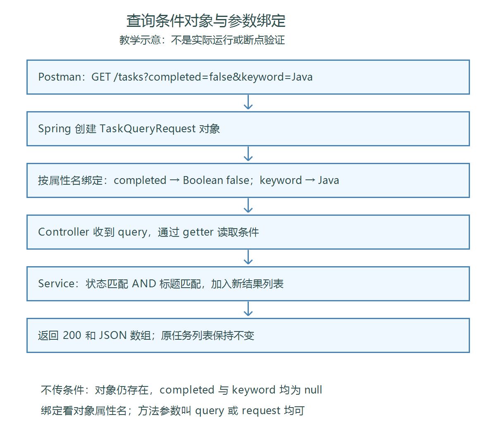

# 第二十节：查询条件对象与参数绑定

## 学习目标

将 GET /tasks 的 completed、keyword 集中到查询DTO，使用 @ModelAttribute 接收，保持第十九节的组合筛选行为。工程为 `task_manager/`，沿用 JDK 21 与现有依赖。

## 一、为什么使用查询对象

学习者上节提出：每增加一个查询字段都要添加@RequestParam，方法签名会越来越长。专门的 TaskQueryRequest 将相关条件组织在一起，让Controller接收一个对象。DTO用于传递数据，不需要@Component。

Java类在运行时真实存在，Spring会创建实例；TypeScript的interface在运行时被擦除，不能直接承担同样的实例创建职责。

## 二、实际查询类与封装

文件：`task_manager/src/main/java/com/ygyong/task_manager/dto/TaskQueryRequest.java`。

```java
package com.ygyong.task_manager.dto;

public class TaskQueryRequest {
    private Boolean completed;
    private String keyword;

    public Boolean getCompleted() {
        return completed;
    }

    public void setCompleted(Boolean completed) {
        this.completed = completed;
    }

    public String getKeyword() {
        return keyword;
    }

    public void setKeyword(String keyword) {
        this.keyword = keyword;
    }
}
```

completed使用Boolean，null表示不限制状态，false表示只查未完成。没有字段初始化值时，两个引用类型字段默认都是null。类没有显式声明构造方法，因此Java提供默认无参构造方法。

首次检查发现两个字段未写private，实际为包级访问权限，同包其他类可以直接访问。学习者自行补上private后复查通过；公开getter/setter作为读写入口。字段不需要逐个添加@RequestParam。

## 三、Controller如何接收对象

文件：`task_manager/src/main/java/com/ygyong/task_manager/controller/TaskController.java`。

```java
import com.ygyong.task_manager.dto.TaskQueryRequest;
```

现有列表查询方法改为：

```java
@GetMapping("/tasks")
public List<TaskResponse> getTasks(@ModelAttribute TaskQueryRequest query) {
    return taskService.getTasks(query.getCompleted(), query.getKeyword());
}
```

实际Controller已有 `org.springframework.web.bind.annotation.*` 导入，覆盖ModelAttribute。替换原有方法参数即可，不另外创建同路径GET方法。Service继续接收Boolean和String，保持原有strip、contains和AND筛选逻辑；本节先聚焦Web层绑定。

```http
GET /tasks?completed=false&keyword=Java
```

在当前无参构造方法加setter的方案中，Spring先创建查询对象，按属性名匹配参数，将文本false转换成Boolean并通过setter写入属性，再调用Controller方法。Controller读取属性并传给Service。

URL写completed和keyword，不需要query.completed。方法参数变量从query改为request不影响URL，因为绑定对应对象属性名。即使不传条件，对象仍存在，只是两个属性均为null。

| 接收方式 | 本课程用途 |
|---|---|
| @RequestParam | 单独接收URL查询参数 |
| @ModelAttribute | 把URL查询条件绑定到对象；也支持表单参数，本节未练习 |
| @RequestBody | 读取请求正文；之前用于JSON创建或修改请求 |

不要仅因为Java方法参数改成对象，就把GET请求改成JSON Body。

参考：[Spring MVC对象参数绑定官方说明](https://docs.spring.io/spring-framework/reference/web/webmvc/mvc-controller/ann-methods/modelattrib-method-args.html)。构造器绑定、自定义转换、绑定错误处理以后按需要深入。

## 四、参数绑定教学流程图

【图片 1：请在语雀此处上传 images/查询条件对象与参数绑定流程图.png】



观察请求到Controller之前的对象创建与属性绑定，再看Controller如何把条件交给Service。底部说明不传条件和变量改名两种情况。此图为教学示意，不是学习者实际运行或断点截图。

## 五、Postman运行验证

在IDEA停止旧工程，启动第二十节工程。数据保存在内存中，重启后需要重新创建。使用同一进程，通过已有POST请求创建“学习 Java 基础”“学习 Java 接口”“整理笔记”，再用已有PATCH请求把第二条改为已完成，编号使用实际创建返回值。

GET请求Body选none，在Params配置条件。默认端口下基础地址为 `http://localhost:8080`；如本地修改过端口，沿用实际配置。

| 路径及查询参数 | 结果 |
|---|---|
| /tasks | 三条任务 |
| /tasks?completed=false | Java基础、整理笔记 |
| /tasks?keyword=Java | 两条Java任务 |
| /tasks?completed=false&keyword=Java | 仅Java基础 |
| /tasks?keyword=不存在 | 空数组[] |
| /tasks?completed=false&keyword= | 两条未完成任务 |
| /tasks/count | 3 |

学习者文字确认以上各项均符合预期，状态码200。无本轮截图，助手未独立构建、启动或发送请求。不将本轮结果扩展为已验证非法Boolean、纯空白关键词等额外场景。

不传参数时要在Params取消勾选；勾选但留空与完全不传不同，不能仅看输入框是否为空。

## 六、执行过程与IDEA操作

学习者明确要求跳过断点，本节未做断点验证。下面仅为以后回顾时的观察方法，不属于本次已完成验证：在Controller调用Service那行设断点，Debug启动，分别发送不带参数和带completed=false、keyword=Java的GET请求，展开query查看对象及字段。

Windows常见默认键位：Alt+Insert打开Generate菜单生成getter/setter；也可用Code → Generate。Ctrl+F8切换断点，Shift+F9调试，F9继续；键位方案不同时以菜单或按钮提示为准。本节实际未确认使用了上述快捷键。

## 七、自测与理解确认

1. 不传查询参数，query是否为null？学习者已正确回答：对象存在，两个字段都是null。
2. query改名为request，URL是否需要改？学习者已正确回答：不影响，绑定看对象属性名，不看方法参数变量名。
3. completed为什么不用boolean？课后复习：需要用null保留“不限制状态”的语义。
4. 为什么不用@RequestBody接收当前查询？课后复习：接口条件仍放在URL查询参数中。

前两题为本轮实际回答，后两题供复习，不记录为额外口头验证。结合实际源码检查及Postman文字确认，本节目标完成；按要求跳过断点，无必须修复问题。未修改学习者练习实现，未增加依赖。

## 图片清单与语雀上传

| 编号 | 名称 | 相对路径 |
|---|---|---|
| 1 | 查询条件对象与参数绑定教学流程图 | images/查询条件对象与参数绑定流程图.png |

交付包括本笔记和课程images目录。复制Markdown到语雀通常不会自动上传本地图片，请在提示位置上传对应PNG，或使用语雀支持的导入方式；未验证自动带图导入。
