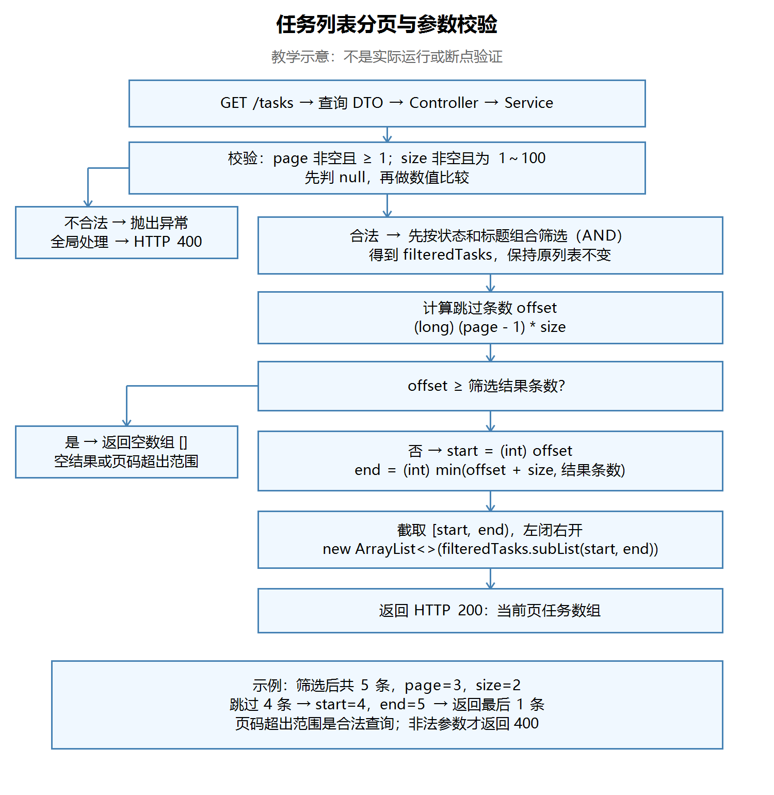

# 第二十一节：任务列表分页与参数校验

## 学习目标与完成情况

在现有 GET /tasks 组合筛选基础上增加 page、size，先筛选再分页，对非法参数返回 HTTP 400，对超出结果范围的合法页码返回空数组。工程位于 `task_manager/`，沿用 JDK 21 和已有依赖。

实际源码检查通过；学习者文字确认本节 Postman 用例全部符合预期，并正确解释短路判空、分页区间与先筛选的原因。无本轮操作截图，助手未独立编译、启动或请求。按学习者要求跳过断点，不记录为已调试验证。

## 一、分页参数与默认值

分页让调用方每次只获取一部分任务。页码从1开始，Java列表下标从0开始。

文件：`task_manager/src/main/java/com/ygyong/task_manager/dto/TaskQueryRequest.java`。保留 completed、keyword，增加以下字段及公开 getter/setter：

```java
private Integer size = 10;
private Integer page = 1;
```

不传参数时使用默认值1、10。默认值解决“不传时用什么”；校验解决“收到的值是否合法”。Service仍要检查null，因为它也可能被其他Java代码直接调用。当前列表最多返回默认10条，已不同于之前无分页时返回全部匹配任务。

Controller文件：`task_manager/src/main/java/com/ygyong/task_manager/controller/TaskController.java`。

```java
@GetMapping("/tasks")
public List<TaskResponse> getTasks(@ModelAttribute TaskQueryRequest query) {
    return taskService.getTasks(query.getCompleted(), query.getKeyword(), query.getPage(), query.getSize());
}
```

条件仍从URL查询参数绑定，不改成JSON Body。

## 二、Service先校验，再筛选

文件：`task_manager/src/main/java/com/ygyong/task_manager/service/TaskService.java`。

```java
public List<TaskResponse> getTasks(Boolean completed, String keyword, Integer page, Integer size) {
    if (page == null || page < 1 || size == null || size < 1 || size > 100) {
        throw new IllegalArgumentException("分页参数不合法");
    }
    // 后续继续已有的关键词处理与组合筛选，再分页。
}
```

以上为校验片段，不是完整方法。合法范围：page至少1，size为1～100。首次提交遗漏size<1，导致0和负数也能通过；学习者自行补齐后复查通过。合并条件、统一错误提示可接受，不必强制拆成两个if。

`Integer`参与数值比较需要自动拆箱。先判断null，利用||短路跳过后面的比较，避免空指针异常。JavaScript的值转换规则与此不同，不能直接套用。

已有 `GlobalExceptionHandler` 接住 IllegalArgumentException，返回400及以下正文：

```json
{"message":"分页参数不合法"}
```

本节验证的是合法整数及数值范围，不将结果扩大为已验证非数字、空字符串或Service显式null入参；类型转换错误发生在绑定阶段，和Service数值校验的路径不同。

原有筛选逻辑保持：关键词非null时strip，状态条件与标题条件使用AND；匹配项加入新建的filteredTasks。先筛选再分页，否则当前页不匹配项被排除后，无法用后面的匹配项补足。

## 三、起始位置、结束位置与越界

以下是实际最终分页片段，放在筛选循环结束后：

```java
long offset = (long) (page - 1) * size;

if (offset >= filteredTasks.size()) {
    return new ArrayList<>();
}

int start = (int) offset;
int end = (int) Math.min(offset + size, filteredTasks.size());

List<TaskResponse> paginatedTasks = new ArrayList<>(filteredTasks.subList(start, end));
return paginatedTasks;
```

- offset是跳过的匹配记录条数；乘法前转long，避免大页码乘法发生int溢出。page已校验至少1，因此page-1安全。
- offset大于等于筛选结果长度时直接返回空列表，覆盖空结果、恰好到末尾和超过末尾。页码过大不等于参数非法。
- 判断后offset小于列表长度，转int安全。
- end用long加法，再取“期望结束位置”和“列表长度”的较小值，最后转int。首次使用start+size，仍是int运算，学习者自行修正。
- subList使用[start,end)，左闭右开。与JavaScript slice类似，但Java这里需要自己防止越界。

筛选后有5条、page=3、size=2时，offset=4、start=4、end=5，只返回下标4的一条。第4页offset=6，提前返回空数组。

subList返回视图，new ArrayList包装后列表容器独立。当前视图的来源是本次局部筛选列表，并非内部tasks，不能误称直接返回它就会修改内部tasks。新容器仍共享任务对象引用，不是深拷贝。

## 四、请求处理流程图

【图片 1：请在语雀此处上传 images/任务列表分页与参数校验流程图.png】



观察两处分支：参数非法返回400；参数合法但无结果或页码超出范围返回200及空数组。主路径始终先筛选，再计算分页区间。此图是教学示意，不是实际运行或断点验证。

## 五、Postman实际验证记录

在IDEA停止旧工程并启动本节工程。默认基础地址为 `http://localhost:8080`。GET请求Body选none，在Params设置参数；不传时取消勾选，不能仅清空输入框。数据在内存中，重启后需要重新准备。

### 参数校验

| page | size | 预期及学习者文字确认结果 |
|---|---|---|
| 不传 | 不传 | 200 |
| 1 | 1 | 200 |
| 1 | 100 | 200 |
| 0 | 10 | 400，分页参数不合法 |
| -1 | 10 | 400，分页参数不合法 |
| 1 | 0 | 400，分页参数不合法 |
| 1 | -1 | 400，分页参数不合法 |
| 1 | 101 | 400，分页参数不合法 |

本轮校验通过时，分页截取尚未实现；随后完成分页代码并做了下述验证，不能把前轮结果当作已验证翻页。

### 翻页与组合筛选

先验证空进程GET /tasks为200及[]。再在同一进程依次POST创建：学习 Java 基础、整理笔记、学习 Java 接口、学习 Java 集合、学习 Java 异常。POST用Body → raw → JSON，Content-Type为application/json，例如：

```json
{"title":"学习 Java 基础"}
```

将第三条“学习 Java 接口”通过已有PATCH接口设为已完成，编号使用实际创建响应，不假定固定编号。

| 路径 | 预期及学习者文字确认结果 |
|---|---|
| /tasks | 200，全部五条 |
| /tasks?page=1&size=2 | 200，基础、整理笔记 |
| /tasks?page=2&size=2 | 200，接口、集合 |
| /tasks?page=3&size=2 | 200，异常 |
| /tasks?page=4&size=2 | 200，[] |
| /tasks?page=2147483647&size=100 | 200，[] |
| /tasks?completed=false&keyword=Java&page=1&size=2 | 200，基础、集合 |
| /tasks?completed=false&keyword=Java&page=2&size=2 | 200，异常 |
| /tasks?keyword=不存在&page=1&size=2 | 200，[] |
| /tasks/count | 200，5 |
| /tasks?page=0&size=2 | 400，分页参数不合法 |

学习者确认全部符合预期，无实际截图；助手未独立请求。count=5表示内部全部任务数，不代表任意查询的匹配总数；当前返回值也不包含分页元数据，下一节再扩展。

## 六、实际问题、工具与后续内容

学习者询问实际开发是否需要手写分页：前端分页组件负责交互和发送条件；后端数据库分页工具可负责分页SQL与总数查询；业务筛选、权限、参数限制和响应约定仍需开发者处理。例子包括[PageHelper](https://pagehelper.github.io/)与[MyBatis-Plus分页插件](https://baomidou.com/plugins/pagination/)。本节未安装或引入这些工具，也未选择其实际版本。

当前内存列表分页用于理解过程。接入数据库后，应学习让数据库筛选和分页，而非把所有数据查入Java再截取。复杂分页性能问题以后再深入，不阻塞当前学习。

IDEA Windows常见默认键位：Alt+Insert打开生成菜单，可生成getter/setter；也可通过Code → Generate。具体以个人键位方案为准，未确认本轮实际使用该快捷键。

学习者要求非必要不每节安排断点，接入数据库后再详细观察；本节跳过断点。后续按源码、请求结果与解释题确认理解，必要排错时再调试。

## 七、自测与理解确认

本节实际确认：

1. page=3、size=2为什么跳过4条？学习者正确解释(page-1)×size。
2. 为什么先判断size为null？学习者正确解释||短路，避免自动拆箱空指针。
3. 五条匹配记录的第3页为何是[4,5)？学习者正确解释从下标4开始，列表长度限制结束位置为5。
4. 为什么先筛选再分页？学习者正确解释先分页会排除页内不匹配记录，无法从后续匹配任务补足。

课后复习（不记作额外已验证回答）：为什么Math.min不能补救已经发生的int加法溢出？new ArrayList包装是否会复制每个任务对象？

## 图片清单与语雀上传

| 编号 | 名称 | 相对路径 |
|---|---|---|
| 1 | 任务列表分页与参数校验教学流程图 | images/任务列表分页与参数校验流程图.png |

本笔记与images目录一起保留。复制Markdown文本到语雀通常不会自动上传本地图片，请在标记位置手动上传PNG，或使用语雀支持的导入方式；未验证自动带图导入。
