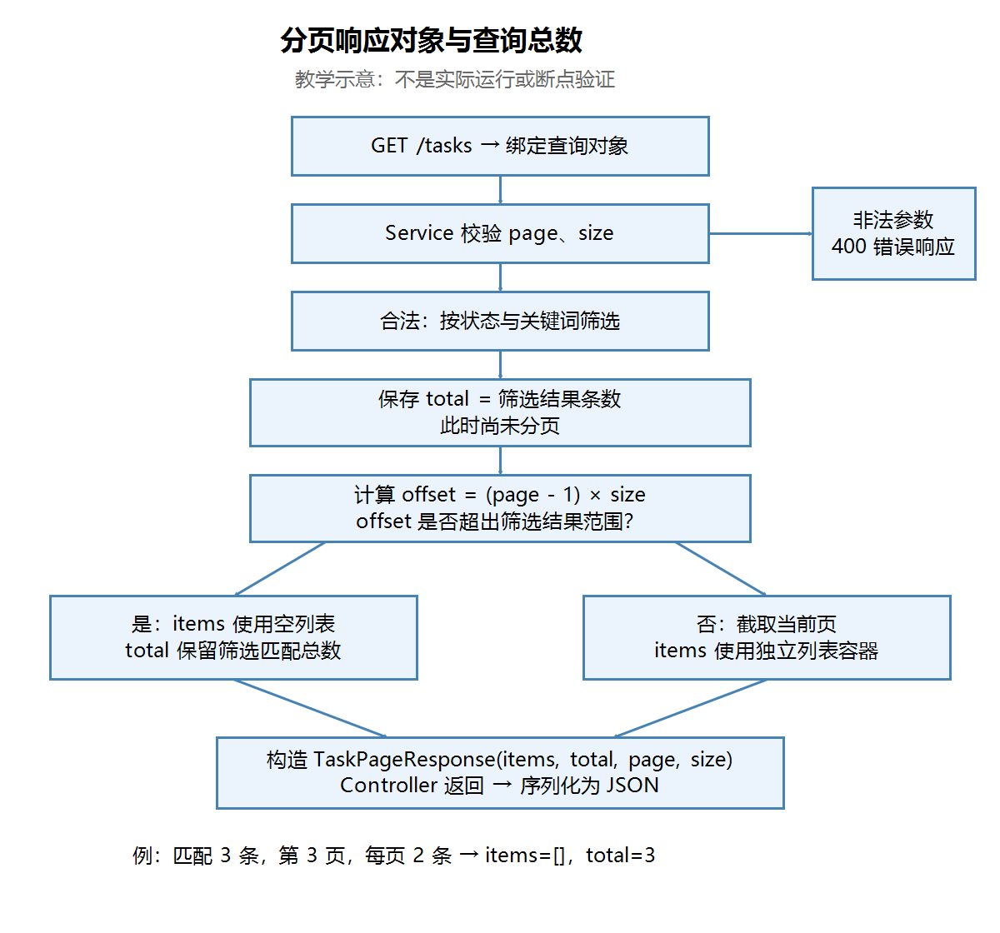

# 第二十二节：分页响应对象与查询总数

## 学习目标与完成情况

让 GET /tasks 同时返回当前页任务、筛选匹配总数、页码及每页条数，供前端展示分页信息。工程位于 `task_manager/`，沿用 JDK 21 和已有依赖。

本节实际源码检查通过，学习者文字确认全部 Postman 用例符合预期，并准确解释 total 与当前页条数的区别。没有本轮实际操作截图；助手未独立编译、启动或发送请求，未进行断点验证。所有业务代码及修复由学习者完成。

## 一、为什么需要分页响应对象

只有任务数组时，前端无法从当前页条数确定全部匹配记录数。因此用对象包裹任务数组，并提供分页信息。

| 字段 | 类型 | 含义 |
|---|---|---|
| items | List<TaskResponse> | 当前页任务 |
| total | long | 筛选后、分页前的匹配总数 |
| page | int | 本次请求页码 |
| size | int | 本次请求的每页容量，不是实际条数 |

三个数量必须区分：内部 tasks.size() 是全部任务数；filteredTasks.size() 是匹配总数；paginatedTasks.size() 是当前页条数。原有 GET /tasks/count 仍统计内部全部任务，不随筛选条件变化。

内部5条、筛选3条、page=2、size=2时，total=3，items有1条，size仍为2。学习者已正确回答。

## 二、创建响应类

文件：`task_manager/src/main/java/com/ygyong/task_manager/dto/TaskPageResponse.java`。

```java
package com.ygyong.task_manager.dto;

import java.util.List;# 第二十二节：分页响应对象与查询总数

## 学习目标与完成情况

让 GET /tasks 同时返回当前页任务、筛选匹配总数、页码及每页条数，供前端展示分页信息。工程位于 `task_manager/`，沿用 JDK 21 和已有依赖。

本节实际源码检查通过，学习者文字确认全部 Postman 用例符合预期，并准确解释 total 与当前页条数的区别。没有本轮实际操作截图；助手未独立编译、启动或发送请求，未进行断点验证。所有业务代码及修复由学习者完成。

## 一、为什么需要分页响应对象

只有任务数组时，前端无法从当前页条数确定全部匹配记录数。因此用对象包裹任务数组，并提供分页信息。

| 字段 | 类型 | 含义 |
|---|---|---|
| items | List<TaskResponse> | 当前页任务 |
| total | long | 筛选后、分页前的匹配总数 |
| page | int | 本次请求页码 |
| size | int | 本次请求的每页容量，不是实际条数 |

三个数量必须区分：内部 tasks.size() 是全部任务数；filteredTasks.size() 是匹配总数；paginatedTasks.size() 是当前页条数。原有 GET /tasks/count 仍统计内部全部任务，不随筛选条件变化。

内部5条、筛选3条、page=2、size=2时，total=3，items有1条，size仍为2。学习者已正确回答。

## 二、创建响应类

文件：`task_manager/src/main/java/com/ygyong/task_manager/dto/TaskPageResponse.java`。

```java
package com.ygyong.task_manager.dto;

import java.util.List;

public class TaskPageResponse {
    private List<TaskResponse> items;
    private long total;
    private int page;
    private int size;

    public TaskPageResponse(List<TaskResponse> items, long total, int page, int size) {
        this.items = items;
        this.total = total;
        this.page = page;
        this.size = size;
    }

    public List<TaskResponse> getItems() { return items; }
    public long getTotal() { return total; }
    public int getPage() { return page; }
    public int getSize() { return size; }
}
```

构造方法负责创建时保存四个值；getter 提供读取属性的方式，现有 JSON 序列化配置会将这些属性转换为响应内容。本轮响应类无需 setter，也无需为了返回 JSON 特意添加无参构造方法。

List<TaskResponse> 约束列表元素类型。当前先使用专用任务分页类，通用泛型分页对象是后续内容。total 用 long；列表 size() 返回 int，赋给 long 会自动扩大数值类型。

## 三、Service 在分页前统计，在两个分支返回对象

文件：`task_manager/src/main/java/com/ygyong/task_manager/service/TaskService.java`。getTasks 返回类型改为 TaskPageResponse，并导入该类。原有参数校验、关键词处理和组合筛选保留。

筛选循环结束后的实际核心代码：

```java
long total = filteredTasks.size();
long offset = (long) (page - 1) * size;

if (offset >= filteredTasks.size()) {
    return new TaskPageResponse(new ArrayList<>(), total, page, size);
}

int start = (int) offset;
int end = (int) Math.min(offset + size, filteredTasks.size());
List<TaskResponse> paginatedTasks = new ArrayList<>(filteredTasks.subList(start, end));

return new TaskPageResponse(paginatedTasks, total, page, size);
```

new 先调用构造方法创建响应对象，return 再把该对象交给调用方。参数按构造方法声明的位置传入：items、total、page、size。new ArrayList<>() 创建空列表，作为超出范围时的 items。

总数必须在筛选完成后、分页前统计，且放在提前 return 的判断之前。页码超出范围只是这一页没有任务，不表示没有匹配任务。筛选后3条、page=3、size=2时，响应为：

```json
{
  "items": [],
  "total": 3,
  "page": 3,
  "size": 2
}
```

如果筛选本身没有匹配结果，则 items=[]、total=0。两种情况都返回200，保留请求页码，不自动改为末页。page=0 等非法参数仍走原有400错误响应。

## 四、Controller 与执行流程

文件：`task_manager/src/main/java/com/ygyong/task_manager/controller/TaskController.java`。

```java
@GetMapping("/tasks")
public TaskPageResponse getTasks(@ModelAttribute TaskQueryRequest query) {
    return taskService.getTasks(query.getCompleted(), query.getKeyword(), query.getPage(), query.getSize());
}
```

Controller 的返回类型与 Service 一致，并导入响应类。查询参数仍通过 URL 绑定到查询对象；其他接口保持原有职责。Controller 返回 Java 对象后，由现有框架转换成 JSON，无需自己拼接 JSON 字符串。类似前端把数组放进包含分页信息的对象，但 Java 必须事先声明类及字段类型，不能直接照搬 JavaScript 对象字面量。

【图片 1：请在语雀此处上传 images/分页响应对象与查询总数流程图.png】



观察总数统计位置及两个分页分支：无论当前页是否为空，都将匹配总数装入响应。非法参数单独返回400。此图是教学示意，不是实际运行或断点验证。

## 五、Postman 验证记录

在 IDEA 停止旧工程并启动第二十二节工程。基础地址为 http://localhost:8080。GET 请求 Body 选择 none；Params 不传的参数取消勾选。重启会清空内存任务，因此数据准备后保持同一个进程。

先请求空库 GET /tasks，确认200及 items=[]、total=0、page=1、size=10。

通过 POST /tasks 依次创建“学习 Java 基础”“整理笔记”“学习 Java 接口”“学习 Java 集合”“学习 Java 异常”。Body → raw → JSON，检查 Content-Type: application/json，例如：

```json
{"title":"学习 Java 基础"}
```

通过 PATCH /tasks/{id}/completed 将第三条设为完成，id 使用创建响应的实际值，JSON Body 为：

```json
{"completed":true}
```

下表均为学习者文字确认符合预期的结果，无截图，助手未独立发送请求：

| GET 路径 | 状态码及结果 |
|---|---|
| /tasks | 200；items五条，total=5，page=1，size=10 |
| /tasks?completed=false&keyword=Java&page=1&size=2 | 200；基础、集合，total=3，page=1，size=2 |
| /tasks?completed=false&keyword=Java&page=2&size=2 | 200；异常，total=3，page=2，size=2 |
| /tasks?completed=false&keyword=Java&page=3&size=2 | 200；items=[]，total=3，page=3，size=2 |
| /tasks?keyword=不存在&page=1&size=2 | 200；items=[]，total=0，page=1，size=2 |
| /tasks?page=2147483647&size=100 | 200；items=[]，total=5，保留请求page和size |
| /tasks/count | 200；数字5 |
| /tasks?page=0&size=2 | 400；message为“分页参数不合法” |

## 六、本节实际问题与修复

1. 学习者不清楚两个返回位置如何构造对象：结合已写的构造方法，说明 new 创建对象、按位置传参、return 返回整个对象，再分别传正常列表和空列表。
2. Service 改造时末尾缺少一个右花括号：方法与类各有自己的代码块，必须分别闭合。学习者补齐，复查通过。该问题修复前不能编译；助手未实际执行编译命令。
3. Controller 留有未使用的 java.util.List 导入：属于可选清理，不影响本节业务逻辑；未把它作为必须修复项。

IDEA Windows 常见默认键位：Alt+Insert，菜单 Code → Generate，可生成构造方法和 getter；Ctrl+Alt+L，菜单 Code → Reformat Code，可整理缩进。以个人键位方案为准，不记录为本轮实际操作验证。

## 七、自测与理解确认

已实际确认：

- 内部5条、匹配3条、page=2、size=2：学习者回答 total=3、items有1条，正确。
- 为什么不能用 paginatedTasks.size() 作为 total：学习者解释它只是当前页条数，total 应为筛选后、分页前的总条数，正确。

复习题（不记为额外已验证回答）：超出页码时为什么不能把 total 写死为0？size 与 items.size() 为什么可能不同？Controller 改返回类型后，Service 为什么也要同步？

当前必须掌握的是四个响应字段的语义、统计位置、两个返回分支及调用衔接。通用泛型分页类、数据库计数与分页查询后续再学，不为本节新增依赖或复杂测试框架。

## 图片清单与语雀上传

| 编号 | 名称 | 相对路径 |
|---|---|---|
| 1 | 分页响应对象与查询总数教学流程图 | images/分页响应对象与查询总数流程图.png |

请将笔记和 images 目录一起保留。复制 Markdown 到语雀通常不会自动上传本地图片，请在标记处手动上传 PNG，或使用语雀支持的导入方式；未验证自动带图导入。

public class TaskPageResponse {
    private List<TaskResponse> items;
    private long total;
    private int page;
    private int size;

    public TaskPageResponse(List<TaskResponse> items, long total, int page, int size) {
        this.items = items;
        this.total = total;
        this.page = page;
        this.size = size;
    }

    public List<TaskResponse> getItems() { return items; }
    public long getTotal() { return total; }
    public int getPage() { return page; }
    public int getSize() { return size; }
}
```

构造方法负责创建时保存四个值；getter 提供读取属性的方式，现有 JSON 序列化配置会将这些属性转换为响应内容。本轮响应类无需 setter，也无需为了返回 JSON 特意添加无参构造方法。

List<TaskResponse> 约束列表元素类型。当前先使用专用任务分页类，通用泛型分页对象是后续内容。total 用 long；列表 size() 返回 int，赋给 long 会自动扩大数值类型。

## 三、Service 在分页前统计，在两个分支返回对象

文件：`task_manager/src/main/java/com/ygyong/task_manager/service/TaskService.java`。getTasks 返回类型改为 TaskPageResponse，并导入该类。原有参数校验、关键词处理和组合筛选保留。

筛选循环结束后的实际核心代码：

```java
long total = filteredTasks.size();
long offset = (long) (page - 1) * size;

if (offset >= filteredTasks.size()) {
    return new TaskPageResponse(new ArrayList<>(), total, page, size);
}

int start = (int) offset;
int end = (int) Math.min(offset + size, filteredTasks.size());
List<TaskResponse> paginatedTasks = new ArrayList<>(filteredTasks.subList(start, end));

return new TaskPageResponse(paginatedTasks, total, page, size);
```

new 先调用构造方法创建响应对象，return 再把该对象交给调用方。参数按构造方法声明的位置传入：items、total、page、size。new ArrayList<>() 创建空列表，作为超出范围时的 items。

总数必须在筛选完成后、分页前统计，且放在提前 return 的判断之前。页码超出范围只是这一页没有任务，不表示没有匹配任务。筛选后3条、page=3、size=2时，响应为：

```json
{
  "items": [],
  "total": 3,
  "page": 3,
  "size": 2
}
```

如果筛选本身没有匹配结果，则 items=[]、total=0。两种情况都返回200，保留请求页码，不自动改为末页。page=0 等非法参数仍走原有400错误响应。

## 四、Controller 与执行流程

文件：`task_manager/src/main/java/com/ygyong/task_manager/controller/TaskController.java`。

```java
@GetMapping("/tasks")
public TaskPageResponse getTasks(@ModelAttribute TaskQueryRequest query) {
    return taskService.getTasks(query.getCompleted(), query.getKeyword(), query.getPage(), query.getSize());
}
```

Controller 的返回类型与 Service 一致，并导入响应类。查询参数仍通过 URL 绑定到查询对象；其他接口保持原有职责。Controller 返回 Java 对象后，由现有框架转换成 JSON，无需自己拼接 JSON 字符串。类似前端把数组放进包含分页信息的对象，但 Java 必须事先声明类及字段类型，不能直接照搬 JavaScript 对象字面量。

【图片 1：请在语雀此处上传 images/分页响应对象与查询总数流程图.png】


观察总数统计位置及两个分页分支：无论当前页是否为空，都将匹配总数装入响应。非法参数单独返回400。此图是教学示意，不是实际运行或断点验证。

## 五、Postman 验证记录

在 IDEA 停止旧工程并启动第二十二节工程。基础地址为 http://localhost:8080。GET 请求 Body 选择 none；Params 不传的参数取消勾选。重启会清空内存任务，因此数据准备后保持同一个进程。

先请求空库 GET /tasks，确认200及 items=[]、total=0、page=1、size=10。

通过 POST /tasks 依次创建“学习 Java 基础”“整理笔记”“学习 Java 接口”“学习 Java 集合”“学习 Java 异常”。Body → raw → JSON，检查 Content-Type: application/json，例如：

```json
{"title":"学习 Java 基础"}
```

通过 PATCH /tasks/{id}/completed 将第三条设为完成，id 使用创建响应的实际值，JSON Body 为：

```json
{"completed":true}
```

下表均为学习者文字确认符合预期的结果，无截图，助手未独立发送请求：

| GET 路径 | 状态码及结果 |
|---|---|
| /tasks | 200；items五条，total=5，page=1，size=10 |
| /tasks?completed=false&keyword=Java&page=1&size=2 | 200；基础、集合，total=3，page=1，size=2 |
| /tasks?completed=false&keyword=Java&page=2&size=2 | 200；异常，total=3，page=2，size=2 |
| /tasks?completed=false&keyword=Java&page=3&size=2 | 200；items=[]，total=3，page=3，size=2 |
| /tasks?keyword=不存在&page=1&size=2 | 200；items=[]，total=0，page=1，size=2 |
| /tasks?page=2147483647&size=100 | 200；items=[]，total=5，保留请求page和size |
| /tasks/count | 200；数字5 |
| /tasks?page=0&size=2 | 400；message为“分页参数不合法” |

## 六、本节实际问题与修复

1. 学习者不清楚两个返回位置如何构造对象：结合已写的构造方法，说明 new 创建对象、按位置传参、return 返回整个对象，再分别传正常列表和空列表。
2. Service 改造时末尾缺少一个右花括号：方法与类各有自己的代码块，必须分别闭合。学习者补齐，复查通过。该问题修复前不能编译；助手未实际执行编译命令。
3. Controller 留有未使用的 java.util.List 导入：属于可选清理，不影响本节业务逻辑；未把它作为必须修复项。

IDEA Windows 常见默认键位：Alt+Insert，菜单 Code → Generate，可生成构造方法和 getter；Ctrl+Alt+L，菜单 Code → Reformat Code，可整理缩进。以个人键位方案为准，不记录为本轮实际操作验证。

## 七、自测与理解确认

已实际确认：

- 内部5条、匹配3条、page=2、size=2：学习者回答 total=3、items有1条，正确。
- 为什么不能用 paginatedTasks.size() 作为 total：学习者解释它只是当前页条数，total 应为筛选后、分页前的总条数，正确。

复习题（不记为额外已验证回答）：超出页码时为什么不能把 total 写死为0？size 与 items.size() 为什么可能不同？Controller 改返回类型后，Service 为什么也要同步？

当前必须掌握的是四个响应字段的语义、统计位置、两个返回分支及调用衔接。通用泛型分页类、数据库计数与分页查询后续再学，不为本节新增依赖或复杂测试框架。

## 图片清单与语雀上传

| 编号 | 名称 | 相对路径 |
|---|---|---|
| 1 | 分页响应对象与查询总数教学流程图 | images/分页响应对象与查询总数流程图.png |

请将笔记和 images 目录一起保留。复制 Markdown 到语雀通常不会自动上传本地图片，请在标记处手动上传 PNG，或使用语雀支持的导入方式；未验证自动带图导入。