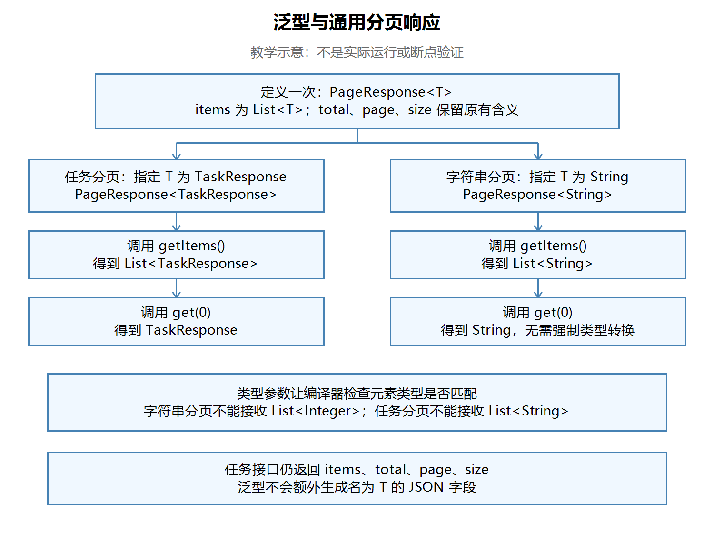

# 第二十三节：泛型与通用分页响应

## 学习目标与完成情况

将只能返回任务的 TaskPageResponse 改为可复用的 PageResponse<T>，并保持 GET /tasks 的分页语义和 JSON 字段。实际工程为 `task_manager/`，沿用 JDK 21 与已有依赖。

本节DTO、Service、Controller及独立复用练习源码检查通过。学习者文字确认Postman回归符合预期，GenericPractice输出“学习泛型”和2；助手未独立编译、启动或发送请求。没有实际截图，未安排断点，不记录为调试验证。

## 一、为什么需要泛型

任务分页和其他数据分页都需要items、total、page、size。变化的是列表中每一项的类型。泛型让我们定义一次分页结构，在使用时指定元素类型，同时让编译器检查类型是否匹配。

可以把T理解为“留给使用者填写的类型位置”。它不是一个数据变量，而是类型参数。T是常见命名，也可以使用其他合适的名称。

| 类 | 职责 |
|---|---|
| TaskResponse | 一条任务：id、title、completed |
| TaskPageResponse | 专用任务分页，暂时保留，任务列表接口已不再使用 |
| PageResponse<T> | 通用分页结构，使用时确定列表元素类型 |

定义时留位置，使用时填类型。PageResponse<String>装字符串列表，PageResponse<TaskResponse>装任务列表。类型的“代入”是理解方法，不表示Java运行时修改源码。

与JavaScript普通数组相比，List<String>明确约束元素类型；与TypeScript的Array<string>在编译期类型检查的用途上相近，但不能由此推断两种语言的全部运行机制相同。

## 二、通用分页类

文件：`task_manager/src/main/java/com/ygyong/task_manager/dto/PageResponse.java`。

```java
public class PageResponse<T> {
    private List<T> items;
    private long total;
    private int page;
    private int size;

    public PageResponse(List<T> items, long total, int page, int size) {
        this.items = items;
        this.total = total;
        this.page = page;
        this.size = size;
    }

    public List<T> getItems() { return items; }
    public long getTotal() { return total; }
    public int getPage() { return page; }
    public int getSize() { return size; }
}
```

以上省略package及import；实际类位于dto包并导入java.util.List。文件名为PageResponse.java，类声明带<T>，构造方法名称不带<T>。字段、构造参数和getter统一使用List<T>，保证类型约束贯穿整个类。

泛型实参使用引用类型：例如Integer，不能写PageResponse<int>。当前先掌握泛型类、具体类型实参和类型推断；泛型方法、通配符、类型边界及类型擦除以后再深入。

## 三、接入任务接口

Service与Controller的getTasks都声明返回PageResponse<TaskResponse>。不要在没有声明T的普通调用方随意写PageResponse<T>。

Service保留原有筛选、校验和分页计算，仅替换两个响应构造位置：

```java
if (offset >= filteredTasks.size()) {
    return new PageResponse<>(new ArrayList<>(), total, page, size);
}
// 中间保留原有分页截取
return new PageResponse<>(paginatedTasks, total, page, size);
```

new PageResponse<>()中的<>称为菱形语法，编译器根据上下文推断类型。这里写new PageResponse<TaskResponse>(...)也可以。直接写new PageResponse(...)使用的是原始类型，会丢掉相应泛型检查，不建议使用。

Controller把Service返回的对象交给框架转换为JSON。响应仍只有items、total、page、size，不会额外出现T字段。total仍是筛选后、分页前的匹配数，超出页码时仍保留该总数。

## 四、同一个类用于字符串分页

文件：`task_manager/src/main/java/com/ygyong/task_manager/GenericPractice.java`。学习者实际核心代码：

```java
List<String> lists = new ArrayList<>();
lists.add("学习泛型");
lists.add("整理笔记");
PageResponse<String> pageResponse = new PageResponse<>(lists, 2, 1, 10);
String str = pageResponse.getItems().get(0);
System.out.println(str);
System.out.println(pageResponse.getTotal());
```

在IDEA运行GenericPractice的main，不需要启动Spring Boot。学习者报告输出“学习泛型”和2，源码与报告一致，助手没有独立运行。lists、str可选改为titles、firstTitle，让用途更清楚，不属于必须修复项。

为什么无需强制类型转换？PageResponse<String>的getItems返回List<String>，该列表的get(0)返回String。编译器在读取之前就知道类型。只说“返回List”遗漏了最关键的元素类型信息。

【图片 1：请在语雀此处上传 images/泛型类型传递流程图.png】



观察左右两条类型链：同一个类，通过不同的类型实参，得到不同的列表和元素类型。图中展示编译时类型关系，是教学示意，不是实际运行或断点验证。图片已打开检查，文字及箭头清楚。

## 五、实际问题与解决原因

1. 起初将分页实现写进TaskResponse<T>，并注释原有任务字段：混淆了单条任务与分页容器职责，会破坏Service的任务创建和读取。学习者自行恢复TaskResponse，在新的PageResponse<T>中放置分页结构，复查通过。
2. 回答返回类型时多次简称PageResponse、List：需要写成`PageResponse<String>`、`List<String>`等完整形式。Markdown正文中的尖括号可能被当成标签，讲解和笔记用行内代码或代码块保留准确类型。判断元素类型的依据是具体类型实参，而非类名本身。
3. 未使用的旧DTO导入、List导入及Service的filteredTasks成员字段属于可选清理。分页实际使用方法内的filteredTasks；未把这些清理项记为已执行。

所有练习与修复由学习者完成，未添加依赖或测试框架。

## 六、Postman回归记录

停止旧工程，在IDEA启动第二十三节工程，使用http://localhost:8080。同一进程中准备数据，重启会清空内存任务。

| 验证 | 学习者文字确认的结果 |
|---|---|
| 空数据GET /tasks | items为空，total=0 |
| 创建三条任务，size=2查第1、2、3页 | 分别2、1、0条，total均3 |
| 无匹配关键词 | items为空，total=0 |
| page=0 | 400 |
| 响应结构 | 保留items、total、page、size |

GET请求不需要JSON Body；创建任务沿用POST /tasks，Body → raw → JSON，Content-Type为application/json。本轮没有新增实际操作截图，助手未独立验证HTTP。

## 七、快捷键与自测

IDEA Windows常见默认键位：Alt+Insert（Code → Generate）生成构造方法或getter；Ctrl+Alt+O（Code → Optimize Imports）清理导入；Ctrl+Alt+L（Code → Reformat Code）格式化。以个人键位方案为准，不记为本轮已验证操作。

已确认的理解：字符串分页不能接收整数元素；任务分页不能接收List<String>；PageResponse<TaskResponse>取出第一项应使用TaskResponse接收。

复习时写出完整类型链：

```text
PageResponse<String> → getItems() → List<String> → get(0) → String
PageResponse<TaskResponse> → getItems() → List<TaskResponse> → get(0) → TaskResponse
```

自测：T在哪里声明？构造方法名称为什么不带<T>？为什么单独写List不能说清元素类型？把分页用于其他类型时，哪些字段和逻辑可以保持不变？这些复习题不额外记为已回答。

## 图片清单与语雀上传

| 编号 | 名称 | 相对路径 |
|---|---|---|
| 1 | 泛型类型传递教学流程图 | images/泛型类型传递流程图.png |

保留笔记及images目录。复制Markdown通常不会自动上传本地图片，请在标记处逐张上传PNG或使用语雀支持的导入方式；未验证自动带图导入。
