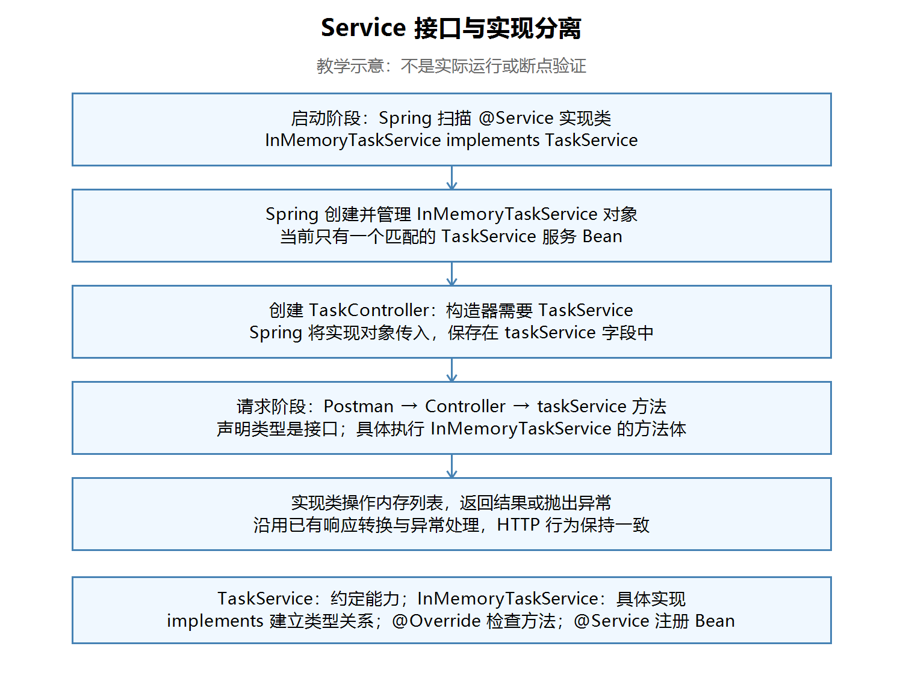

# 第二十四节：Service 接口与实现分离

## 学习目标与完成情况

将业务契约与内存实现分开，让 Controller 通过 TaskService 接口调用服务，保持现有 HTTP 行为，为后续数据库学习作准备。

实际工程：`task_manager/`，沿用 JDK 21 和已有依赖。接口、实现类、Controller 源码检查通过；学习者文字确认本轮 Postman 全部符合预期，并准确解释接口类型与实现对象、显式 implements 的作用。助手未独立编译、启动或发送请求，没有本轮实际截图，未安排断点。

## 一、为什么拆分

原 TaskService 同时定义对外方法并用 ArrayList 保存和操作任务。拆分后，接口说明可以做什么，实现类负责具体怎样做，Controller 通过接口调用能力。

| 文件（相对 src/main/java/com/ygyong/task_manager/） | 职责 |
|---|---|
| service/TaskService.java | 声明业务方法契约 |
| service/InMemoryTaskService.java | 保存任务列表，执行原有校验及增删改查 |
| controller/TaskController.java | 接收 HTTP 请求，通过接口调用服务 |

接口分离不等于必须为每个类创建接口。本节借已有任务服务练习接口与 Spring 注入。以后替换为满足相同契约的实现时，Controller 的业务调用可以保持不变；仍需配置 Spring 选择实际使用的实现。

## 二、接口声明能力

文件：`task_manager/src/main/java/com/ygyong/task_manager/service/TaskService.java`。

```java
public interface TaskService {
    int getTaskCount();
    TaskResponse getTaskById(int taskId);
    TaskResponse createTask(String title);
    TaskResponse updateTaskCompleted(int taskId, Boolean completed);
    void deleteTask(int taskId);
    PageResponse<TaskResponse> getTasks(Boolean completed, String keyword,
                                        Integer page, Integer size);
}
```

省略 package 和 import，实际文件导入 PageResponse、TaskResponse。这些方法声明以分号结束，没有方法体，默认是 public abstract。这里不放 tasks、nextId 等实例状态。分页返回值继续为 PageResponse<TaskResponse>，不丢失泛型约束。

## 三、实现类履行约定

文件：`task_manager/src/main/java/com/ygyong/task_manager/service/InMemoryTaskService.java`。以下只展示关键片段，其余业务逻辑保留原样。

```java
@Service
public class InMemoryTaskService implements TaskService {
    private final List<TaskResponse> tasks = new ArrayList<>();
    private int nextId = 1;

    @Override
    public int getTaskCount() {
        return tasks.size();
    }
    // 其余五个实现方法省略
}
```

- implements TaskService：显式建立实现关系，具体类需要履行接口方法约定。
- @Override：让编译器检查方法是否确实实现或重写了已有方法；它本身不建立接口实现关系，也不负责 Spring 注入。
- @Service：当前项目通过组件扫描让 Spring 创建并管理实现类对象；接口本身不加此注解。

与 TypeScript 常见的结构类型检查不同，Java 不能仅因为方法同名、参数相同，就自动把该类当成 TaskService。学习者准确解释：删除 implements 后，即使保留全部同名方法，该类也不再是 TaskService 的实现，不能满足该接口类型的注入要求。本节仅做解释题，没有实际删除验证。

## 四、Controller 依赖接口

文件：`task_manager/src/main/java/com/ygyong/task_manager/controller/TaskController.java`。

```java
private final TaskService taskService;

public TaskController(TaskService taskService) {
    this.taskService = taskService;
}

@GetMapping("/tasks/count")
public int getTaskCount() {
    return taskService.getTaskCount();
}
```

Controller 导入 TaskService。声明类型为 TaskService，实际接收的是 InMemoryTaskService 对象；调用方法时执行实现类的方法体。接口不会自己执行一份业务逻辑。

启动时，Spring 扫描到实现类的 @Service，创建并管理它的对象。创建 Controller 时，构造器需要 TaskService；当前只有一个匹配的实现 Bean，Spring 将该对象传入构造器。当前 Controller 只有一个构造器，不需要额外添加 @Autowired，也不用在 Controller 手动 new 服务对象。

【图片 1：请在语雀此处上传 images/Service接口与实现注入流程图.png】



观察说明：上半部分说明启动阶段如何提供实现对象，下半部分说明请求阶段如何通过接口调用实现方法。接口声明类型与实际对象类型不同，但引用的是同一个实现对象。此图为教学示意，不是实际运行或断点验证。

## 五、本节操作与实际注意点

1. 将上一节必要工程文件复制到本节目录，排除 target、.idea、iml，保留上一节代码。
2. 使用 IDEA Refactor → Rename 将原 TaskService 类重命名为 InMemoryTaskService。
3. 新建同包 TaskService 接口，提取六个 public 方法签名。
4. 实现类添加 implements，每个实现方法添加 @Override。
5. 将 Controller 的导入、字段和构造参数改成接口类型，调用统一通过 taskService。

本节没有必须修复的实现错误。IDEA 重命名后自动将 Controller 引用改成了实现类，这是中间步骤，学习者随后正确调整为接口。

可选清理：Controller 中旧实现类导入及注释掉的旧字段、构造器；实现类未使用的 filteredTasks 成员字段。getTasks 内的同名局部变量实际参与筛选，必须保留。助手没有代改这些代码，不将可选清理作为结课阻塞。

## 六、Postman 回归记录

先停止旧工程，在 IDEA 启动本节工程。以下 URL 以当前默认端口 `http://localhost:8080` 为基础，id 使用实际创建响应中的编号。

POST、PATCH：Body → raw → JSON，检查 Content-Type: application/json；观察状态码和响应正文。

| 请求 | 预期与学习者确认结果 |
|---|---|
| GET /tasks | 初始 items=[]、total=0 |
| POST /tasks，正文 {"title":"学习 Java 接口"} | 返回新建任务 |
| GET /tasks/{id} | 返回创建的任务 |
| PATCH /tasks/{id}/completed，正文 {"completed":true} | completed=true |
| GET /tasks?completed=true&keyword=Java&page=1&size=2 | 返回该任务，total=1 |
| DELETE /tasks/{id} | 204，无响应正文 |
| 再 GET /tasks/{id} | 404 |
| GET /tasks?page=0 | 400 |

学习者文字确认全部符合预期；无实际响应截图，助手未独立复测。重构后 HTTP 行为保持符合本轮预期；未例行安排断点，不记为调试验证。

## 七、IDEA 功能与快捷键

- 重命名：右键 Refactor → Rename；Windows 默认键位通常为 Shift+F6，以当前键位方案和菜单显示为准。
- 格式化：Code → Reformat Code；默认键位通常为 Ctrl+Alt+L。
- 清理导入：Code → Optimize Imports；默认键位通常为 Ctrl+Alt+O。

这些是可使用的入口，不表示本节已逐项实际操作验证。

## 八、自测与后续内容

1. taskService 声明类型是什么，实际对象属于哪个类？答：TaskService；InMemoryTaskService。
2. 删除 implements，只保留同名方法是否仍满足接口注入？答：不满足，Java 要求显式接口实现关系。
3. 三者分别负责什么？implements 建立类型关系；@Override 检查方法；@Service 让当前组件扫描发现并管理实现类。

前两题由学习者回答通过；第三题作为课后复习，没有额外记录为独立作答验证。

当前必须掌握：接口契约、显式实现、实现对象与接口引用、构造器注入。多个实现的选择、@Qualifier、@Primary、动态代理等以后按需深入。

下一节：第二十五节“Repository 分层与内存数据访问”，先拆出内存数据访问职责，再逐步接入数据库。本节没有创建下一节目录或代写其实现。

## 图片上传清单

| 编号 | 名称 | 相对路径 |
|---|---|---|
| 1 | Service 接口与实现注入流程图（教学示意） | images/Service接口与实现注入流程图.png |

复制 Markdown 到语雀通常不会自动上传本地图片。请同时保留本笔记与 images/ 目录，按图片提示逐张上传，或使用语雀支持的导入方式；未验证自动带图。
