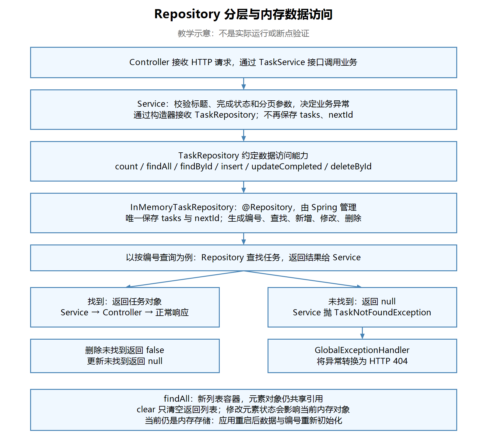

# 第二十五节：Repository 分层与内存数据访问

## 学习目标与完成情况

将内存存储和数据访问从 Service 拆到 Repository，Service 保留业务校验与处理流程，保持原有 HTTP 行为。

实际工程：`task_manager/`，沿用 JDK 21 与原有依赖。接口、Repository 实现、Service 和 Controller 源码复查通过；学习者文字确认本轮 Postman 全部符合预期，并正确回答异常转换、业务职责与列表浅复制问题。无本轮实际截图，助手未独立编译、启动或发送请求，未安排断点。练习代码均由学习者编写和修复。

## 一、为什么需要 Repository

此前 InMemoryTaskService 同时负责业务校验、保存列表和编号、查找及修改数据。拆分后，业务处理与数据访问分别有自己的位置，后续接入数据库时可以替换数据访问实现。

| 文件（相对 task_manager/src/main/java/com/ygyong/task_manager/） | 职责 |
|---|---|
| controller/TaskController.java | 接收 HTTP 请求，通过 TaskService 调用业务 |
| service/TaskService.java | 保持原有业务接口契约 |
| service/InMemoryTaskService.java | 校验参数、决定业务异常、组织查询和处理流程 |
| repository/TaskRepository.java | 约定数据访问方法及返回值 |
| repository/InMemoryTaskRepository.java | 保存 tasks、nextId，执行内存增删改查 |
| exception/GlobalExceptionHandler.java | 将约定的异常转换成 HTTP 错误响应 |

Repository 是数据访问层的命名约定，使用这个名称不代表已经接入数据库。本节不引入数据库依赖，暂时沿用 TaskResponse 作为内存任务对象；领域对象与响应 DTO 分离以后再学。

## 二、接口先约定结果，再编写实现

文件：`task_manager/src/main/java/com/ygyong/task_manager/repository/TaskRepository.java`。以下省略 package、import。

```java
public interface TaskRepository {
    int count();
    List<TaskResponse> findAll();
    TaskResponse findById(int taskId);
    TaskResponse insert(String title, boolean completed);
    TaskResponse updateCompleted(int taskId, boolean completed);
    boolean deleteById(int taskId);
}
```

| 方法 | 返回值约定 |
|---|---|
| count | 内部保存的任务总数 |
| findAll | 全部任务的新列表容器 |
| findById | 找到返回任务，未找到返回 null |
| insert | 返回保存后的新任务 |
| updateCompleted | 返回更新后的任务，未找到返回 null |
| deleteById | 删除成功 true，未找到 false |

这里的 boolean 是基本类型，不能接收 null。Service 接收请求中的 Boolean 后先校验不为 null，再传给更新方法，调用时会自动拆箱。

## 三、内存实现管理存储与编号

文件：`task_manager/src/main/java/com/ygyong/task_manager/repository/InMemoryTaskRepository.java`。关键片段：

```java
@Repository
public class InMemoryTaskRepository implements TaskRepository {
    private final List<TaskResponse> tasks = new ArrayList<>();
    private int nextId = 1;

    @Override
    public TaskResponse insert(String title, boolean completed) {
        TaskResponse task = new TaskResponse(nextId++, title, completed);
        tasks.add(task);
        return task;
    }
    // 其余实现省略
}
```

- implements 建立 Java 接口实现关系，@Override 用于检查方法实现是否匹配。
- @Repository 导入自 org.springframework.stereotype.Repository。在当前组件扫描配置下，Spring 发现并管理实现类对象；只有 implements 不会自动注册 Bean。
- nextId++ 使用当前编号构造任务，再递增供下一次使用；不要求删除后补回旧编号。
- 任务与编号保存在进程内存中，重启应用后重新初始化，没有持久化。

标题是否合法由 Service 判断；新任务默认未完成也由 Service 传入 false。Repository 按收到的数据执行保存。

## 四、Service 通过构造器使用 Repository

文件：`task_manager/src/main/java/com/ygyong/task_manager/service/InMemoryTaskService.java`。

```java
private final TaskRepository taskRepository;

public InMemoryTaskService(TaskRepository taskRepository) {
    this.taskRepository = taskRepository;
}

@Override
public TaskResponse getTaskById(int taskId) {
    TaskResponse task = taskRepository.findById(taskId);
    if (task == null) {
        throw new TaskNotFoundException("任务不存在：" + taskId);
    } else {
        return task;
    }
}
```

字段声明类型是 TaskRepository，当前提供的实现是 InMemoryTaskRepository。Service 保留 @Service 和 implements TaskService，不手动 new Repository。Controller 仍然注入 TaskService，不需要知道数据存在哪里。

Service 不再保存 tasks、nextId；getTasks 中的 tasks 是调用 findAll 得到的局部变量。筛选用的 filteredTasks 局部变量仍然需要保留，与之前未使用的同名成员字段不同。

| Service 方法 | 接入后的流程 |
|---|---|
| getTaskCount | 调用 count |
| getTaskById | findById；null 转换为任务不存在异常 |
| createTask | 标题非空校验；insert(title, false) |
| updateTaskCompleted | completed 非 null 校验；updateCompleted；null 转换为任务不存在异常 |
| deleteTask | deleteById；false 转换为任务不存在异常 |
| getTasks | 校验分页参数，从 findAll 获取数据，再筛选、统计和分页 |

本节筛选分页暂留 Service，保留先筛选、再统计 total、最后分页的顺序；数据库课程再学习如何把查询交给数据库执行。类名 InMemoryTaskService 暂时保留，不影响此次职责拆分。

## 五、业务异常如何转换成 HTTP 状态码

Repository 报告数据访问结果；Service 判断业务含义；GlobalExceptionHandler 决定 HTTP 错误响应。

```text
findById 返回 null
    → Service 抛 TaskNotFoundException
    → GlobalExceptionHandler 返回 HTTP 404
```

更新未找到返回 null，删除未找到返回 false，同样由 Service 抛 TaskNotFoundException。

标题、完成状态、分页参数不合法仍抛 IllegalArgumentException，由已有处理器返回 400。异常消息相同也不意味着状态码相同，当前映射取决于抛出的异常类型。

【图片 1：请在语雀此处上传 images/Repository分层与内存数据访问流程图.png】



观察说明：从上到下追踪请求如何经过 Controller、Service 和 Repository，重点看 Service 中的规则与 Repository 中的存储职责；下方分支说明查找未命中时，null 如何最终变成 404。此图为教学示意，不是实际运行或断点验证。

## 六、新列表容器不等于新任务对象

实际实现：

```java
@Override
public List<TaskResponse> findAll() {
    return new ArrayList<>(tasks);
}
```

新列表和内部 tasks 是不同容器，但其中元素指向同一个任务对象。这是浅复制。

以下两个例子分别从有任务的 Repository 获取结果，作为概念说明；未实际执行这两个实验：

```java
List<TaskResponse> result = taskRepository.findAll();
result.clear(); // 只清空返回的列表，不清空内部 tasks
```

```java
List<TaskResponse> result = taskRepository.findAll();
result.get(0).setCompleted(true); // 会影响当前内存中保存的同一个任务对象
```

学习者已正确解释这一区别。业务更新仍通过 Repository 的 updateCompleted 方法表达。未来接数据库后，修改 Java 对象并不自动代表数据库数据已经更新，还需要相应的数据更新操作。

## 七、本节实际问题与修复原因

| 实际问题 | 原因与修复 |
|---|---|
| 实现类最初缺少 @Repository | Java 实现关系不等于 Spring Bean 注册；补齐注解及导入 |
| insert 使用 nextId，没有递增 | 多次新增会得到相同编号；改为 nextId++ |
| 更新、删除不存在时抛 IllegalArgumentException | 当前处理器将其映射为400；改为 TaskNotFoundException，保持404 |
| getTaskById 调用了两次 findById | 重复遍历；保存一次查询结果，再判断和返回 |

上述问题均由学习者自行修复，最终源码复查通过。deleteById 找到任务后 remove 并返回 true，在本节当前实现中成立；直接返回 remove 的 boolean 结果属于可选简化，不作为结课条件。

## 八、运行与 Postman 验证记录

在 IDEA 中停止旧工程，启动本节 task_manager 中的 TaskManagerApplication。请求基础地址为 http://localhost:8080；编号使用实际创建响应中的值，同一组操作保持同一个应用进程。

POST、PATCH 配置 Body → raw → JSON，检查 Content-Type: application/json；观察状态码和响应正文。

| 操作 | 预期与学习者文字确认结果 |
|---|---|
| GET /tasks，初始空库 | 200，items=[]、total=0 |
| POST /tasks，依次创建“学习 Java 接口”“整理笔记”“学习 Java 集合” | 编号不同且依次递增，completed 均 false |
| GET /tasks/count；GET /tasks/{第一条编号} | 数量3；能查询第一条任务 |
| PATCH 第一条状态为true，再GET该任务 | 更新成功，重查仍为true |
| GET /tasks?completed=false&keyword=Java&page=1&size=1 | 仅“学习 Java 集合”，total=1 |
| 上述查询改page=2 | items=[]，total仍1 |
| DELETE第二条，再查count | 204且无正文，数量2 |
| 已删除编号分别GET、PATCH、DELETE | 均404；PATCH传合法状态正文 |
| POST空白标题 | 400，任务标题不能为空 |
| PATCH第一条，正文{} | 400，完成状态不能为空 |
| GET /tasks?page=0 | 400，分页参数不合法 |
| 最后GET /tasks/count | 仍为2，非法新增未保存 |

创建请求示例：

```json
{"title":"学习 Java 接口"}
```

状态修改正文：

```json
{"completed":true}
```

学习者文字确认全部符合预期，无实际响应截图，助手未独立复测。未安排断点，不记为调试验证。

## 九、IDEA 功能与快捷键

- 实现接口方法：Code → Implement Methods；Windows默认键位通常为 Ctrl+I。
- 格式化：Code → Reformat Code；默认通常为 Ctrl+Alt+L。
- 整理导入：Code → Optimize Imports；默认通常为 Ctrl+Alt+O。

以学习者当前键位方案及菜单显示为准；以上为可用入口，不表示本节已逐项操作验证。

## 十、自测与后续内容

本节已回答通过：

1. 标题不能为空放在哪里？Service，因为这是业务规则。
2. findAll 的结果 clear 会清空内部列表吗？不会，新列表容器独立。
3. 谁将不存在变成404？Service抛TaskNotFoundException，GlobalExceptionHandler将其转换为HTTP404。
4. 修改返回列表中的任务对象会影响内部任务吗？会，浅复制仍共享元素对象引用。

当前必须掌握：分层职责、Repository接口与实现、构造器注入、返回值与业务异常衔接、列表浅复制。持久化对象与DTO分离、数据库更新、并发访问和事务后续逐步学习。本节内存实现不作为生产并发存储方案。

下一节：第二十六节“MySQL 数据库与任务表设计”，先确认现有 MySQL 与 Navicat 环境，再认识数据库、表、主键及任务字段，由学习者自己设计和创建任务表；不自动安装软件或提前代写实现。

## 图片上传清单

| 编号 | 名称 | 相对路径 |
|---|---|---|
| 1 | Repository分层与内存数据访问流程图（教学示意） | images/Repository分层与内存数据访问流程图.png |

复制Markdown文本到语雀通常不会自动上传本地图片。请同时保留本笔记与images目录，在图片提示位置手动上传，或使用语雀支持的导入方式；未验证自动带图。
