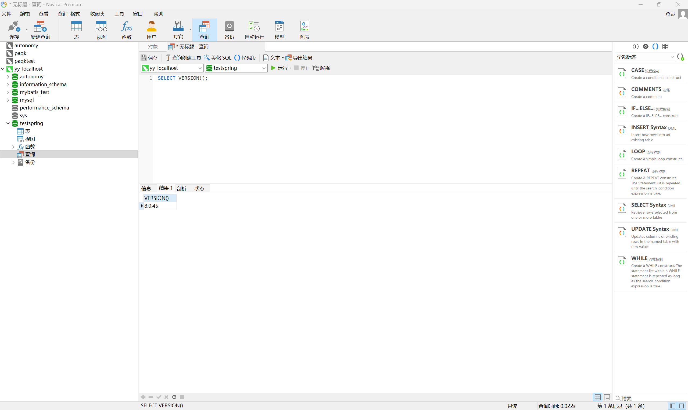
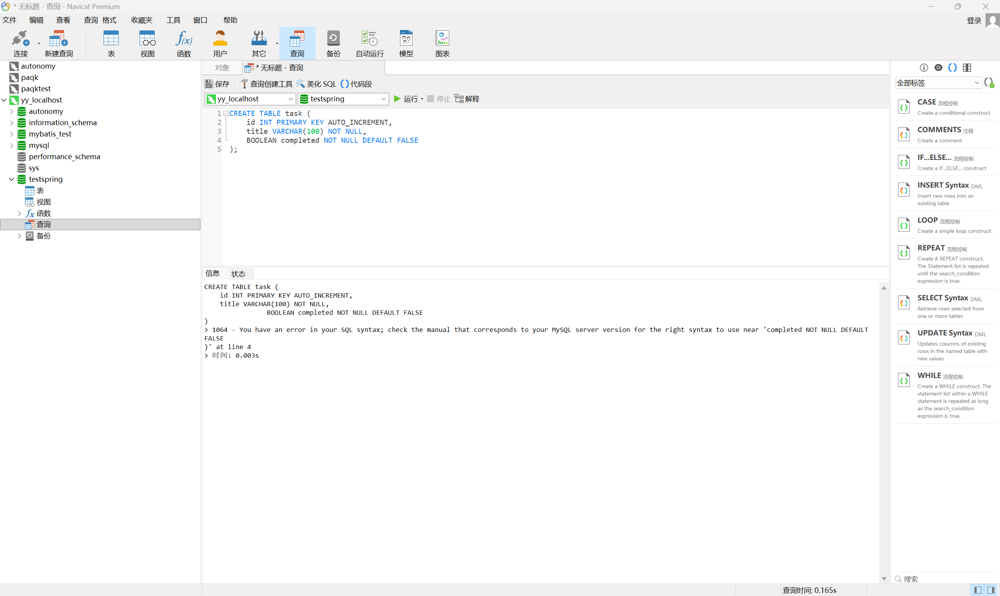
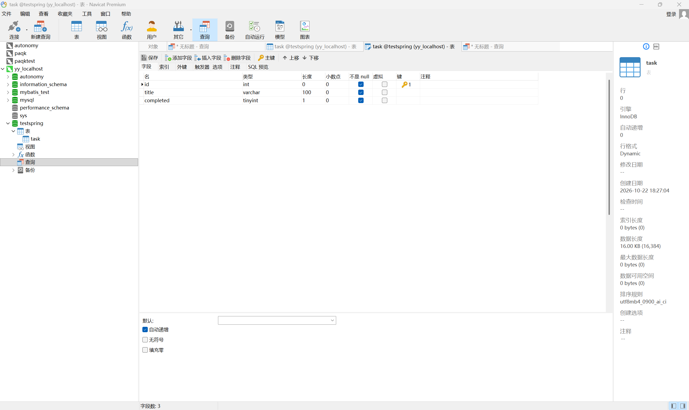
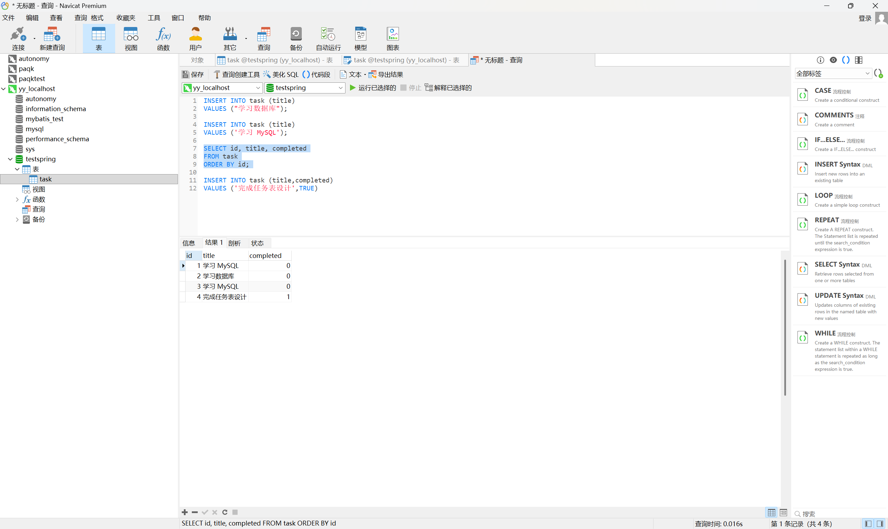
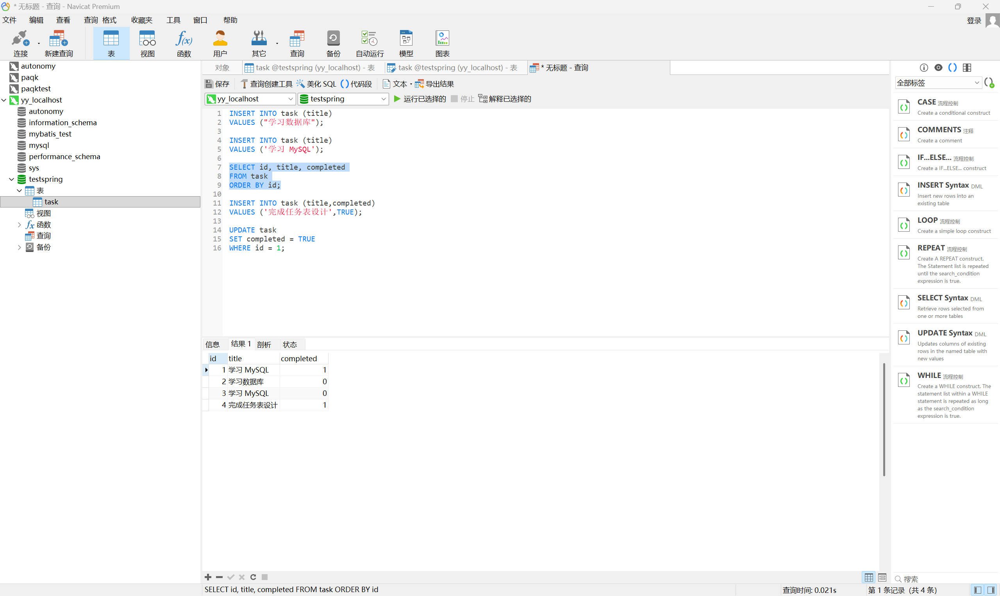
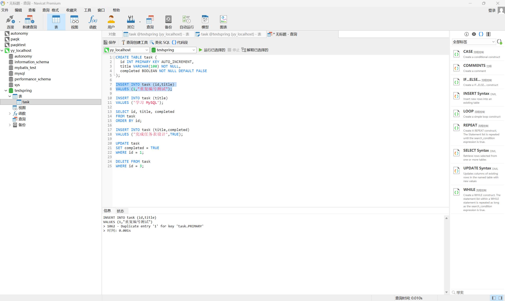
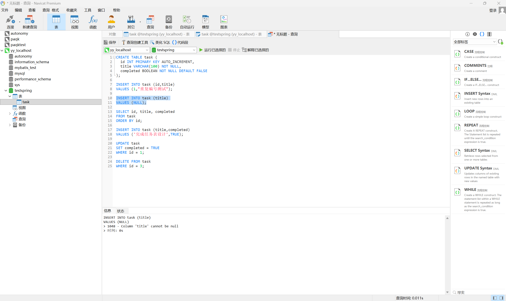
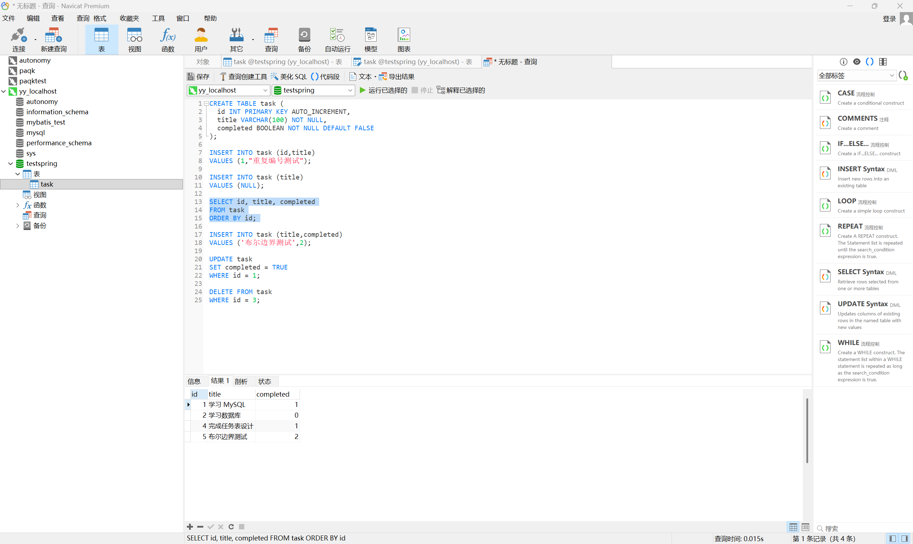
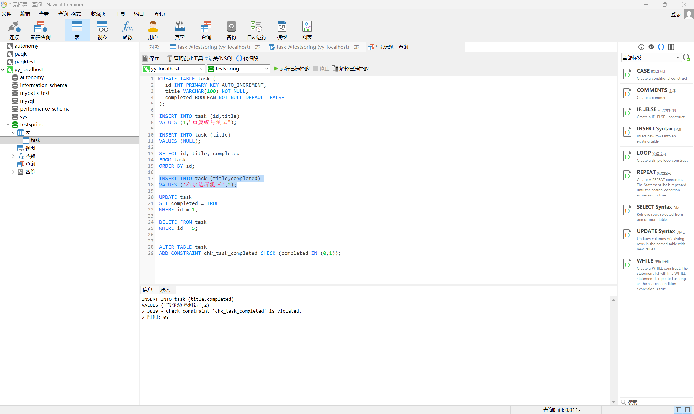
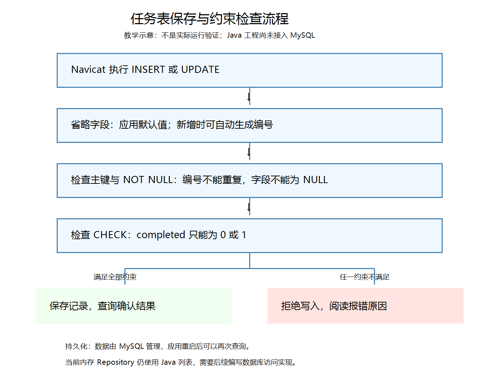

# 第二十六节：MySQL 数据库与任务表设计

## 学习目标与验证情况

在 Navicat 中创建任务表，用 SQL 完成增删改查，并验证主键、非空与完成状态范围约束。实际环境为 MySQL 8.0.45，数据库显示名称为 `testspring`，表名为 `task`。本节未新增 Java 工程或依赖，原工程仍使用内存 Repository。

学习者自行编写并执行 SQL。助手依据实际截图检查结果，没有独立连接数据库或执行 SQL。主键、非空、CHECK 拒绝写入均有截图；清理编号 5、合法 FALSE 更新由学习者文字确认。解释题通过，未安排断点。

## 一、数据库、Navicat 与 Java 对象

MySQL 是保存和查询数据的数据库服务；Navicat 是连接它的客户端。Java 列表中的任务随进程退出而丢失，数据库用于持久保存数据。但创建数据库不会自动改变 Java 程序，仍需后续编写数据库访问实现。

| Java 中的结构 | 表中的对应概念 |
|---|---|
| 一个任务对象 | 一行记录 |
| id、title、completed | 三个字段（列） |
| 多个任务组成的集合 | 多行任务记录 |

这只是结构类比，数据库有独立的类型和约束。

在 Navicat 的查询窗口执行版本查询：

```sql
SELECT VERSION();
```

【图片 1：请在语雀此处上传 images/MySQL版本与数据库连接.png】


观察下方结果为 8.0.45，上方当前库为 testspring，说明连接和版本查询成功。

## 二、任务表设计

以下为学习者完成的初始建表定义。在 Navicat 的 `testspring` 查询窗口执行，已存在的表不要重复创建。

```sql
CREATE TABLE task (
    id INT PRIMARY KEY AUTO_INCREMENT,
    title VARCHAR(100) NOT NULL,
    completed BOOLEAN NOT NULL DEFAULT FALSE
);
```

| 设置 | 用途与边界 |
|---|---|
| INT | 本节与 Java int 对应 |
| PRIMARY KEY | 唯一标识记录，不能重复，也不能为 NULL |
| AUTO_INCREMENT | 新增时可省略 id，由数据库生成；不保证编号连续 |
| VARCHAR(100) | 最多保存 100 个字符的标题 |
| NOT NULL | 拒绝 NULL，不排除空字符串或空格 |
| DEFAULT FALSE | 本节插入时省略 completed，使用默认值 0 |
| BOOLEAN | MySQL 中为 TINYINT(1) 的同义写法，本身不限制只能存 0、1 |

Java 写 `boolean completed`，SQL 定义字段则写 `completed BOOLEAN`。本次曾把顺序写反，产生 1064 语法错误；改正后成功。文本提交与截图不一致时，要检查实际执行内容。

【图片 2：请在语雀此处上传 images/建表报错_字段名与类型顺序写反.png】


观察第三个字段为 BOOLEAN completed，报错在 completed 附近。阅读报错位置时也要检查前面的语法。

【图片 3：请在语雀此处上传 images/任务表创建成功_字段结构.png】


观察三个字段的类型、非空勾选、id 主键与自增。completed 默认值为 0 由学习者文字确认。右侧显示 InnoDB 和 utf8mb4_0900_ai_ci 排序规则。

查看实际结构的方法：

```sql
SHOW CREATE TABLE task;
SHOW FULL COLUMNS FROM task;
```

## 三、插入、查询、修改和删除

以下是本节实际学过的语句，供复习；不是让整段重新执行的脚本。

```sql
-- 省略 id 和 completed：生成编号，使用默认完成状态
INSERT INTO task (title) VALUES ('学习 MySQL');

-- 列和值按位置对应，字符串用单引号，TRUE 不加引号
INSERT INTO task (title, completed)
VALUES ('完成任务表设计', TRUE);

SELECT id, title, completed FROM task ORDER BY id;

UPDATE task SET completed = TRUE WHERE id = 1;

SELECT id, title, completed FROM task WHERE id = 1;

DELETE FROM task WHERE id = 3;
```

`ORDER BY id` 默认按编号升序。`SET` 指定修改字段，`WHERE` 指定目标行；省略 UPDATE 的 WHERE，会对所有行设置该值。DELETE 删除整行，同样需要明确条件。

同名任务可以存在，因为只要求 id 唯一。按标题删除可能匹配多行，按主键可准确定位。删除后编号无需重排，最大编号也不是任务总数。

【图片 4：请在语雀此处上传 images/插入任务_自增编号与默认状态.png】


实际截图有四行，编号 1～4，前三行状态为 0，第四行为 1；并非文字最初描述的两行。以实际截图确定下一步操作编号。

【图片 5：请在语雀此处上传 images/按编号修改_仅目标任务完成.png】


编号 1 改为 1，编号 2、3 仍为 0，说明只修改目标行。

【图片 6：请在语雀此处上传 images/按编号删除_保留同名任务.png】


删除编号 3 后仅剩 1、2、4，编号 1 的同名任务仍在。

## 四、用实际失败验证约束

以下语句用于测试拒绝写入，应逐条选中执行并观察报错。

```sql
INSERT INTO task (id, title) VALUES (1, '重复编号测试');
INSERT INTO task (title) VALUES (NULL);
```

自增不禁止显式指定编号，但指定的编号仍需满足主键约束。NULL 表示空值，`'NULL'` 是普通字符串。

【图片 7：请在语雀此处上传 images/主键约束_拒绝重复编号.png】


1062 Duplicate entry '1' 表示编号重复，PRIMARY 指向主键。

【图片 8：请在语雀此处上传 images/非空约束_拒绝NULL标题.png】


1048 Column 'title' cannot be null 明确指出 title 不允许 NULL。学习者文字确认重查仍只有编号 1、2、4。

## 五、BOOLEAN 与 CHECK 约束

Java boolean 只有 true、false；MySQL BOOLEAN 实际是整数类型。本节先执行下面的边界测试，成功存入 2，说明仅声明 BOOLEAN 不足以限制业务状态。TINYINT(1) 的括号不是取值范围限制。

```sql
INSERT INTO task (title, completed) VALUES ('布尔边界测试', 2);
```

【图片 9：请在语雀此处上传 images/布尔边界_BOOLEAN允许保存2.png】


观察编号 5 的 completed 确实为 2，这是添加范围约束前的实际结果。

先清理不合规测试记录，再添加约束：

```sql
DELETE FROM task WHERE id = 5;

ALTER TABLE task
ADD CONSTRAINT chk_task_completed CHECK (completed IN (0, 1));
```

ALTER TABLE 修改已有表；CONSTRAINT 后面是约束名称；IN 表示值属于指定集合。已有数据也必须满足新增规则，不能把现存的 2 留下再直接添加。

【图片 10：请在语雀此处上传 images/CHECK约束_拒绝完成状态2.png】


添加约束后重试相同插入，返回 3819，明确指出 chk_task_completed 被违反。合法 FALSE 更新成功由学习者文字确认；编号 2 原本已为 0，不误称发生状态变化。

三个规则共同发挥作用：DEFAULT 在本节插入省略字段时提供值，NOT NULL 排除空值，CHECK 限制范围。不要删除 NOT NULL 后假定 CHECK 会代替它处理 NULL。更新时没写到的字段保持原值，不会自动重新套用默认值。

MySQL 从 8.0.16 起支持执行 CHECK 约束，本机 8.0.45 可使用。[MySQL 官方说明](https://dev.mysql.com/blog-archive/mysql-8-0-16-introducing-check-constraint/)

## 六、教学流程图

【图片 11：请在语雀此处上传 images/任务表保存与约束检查流程图.png】


这是教学示意，不是 MySQL 内部执行顺序或实际运行验证。图中的“省略字段使用默认值”针对 INSERT；UPDATE 未指定的字段保持原值。任一检查失败会拒绝本节普通单行写入，满足全部约束才保存。当前 Java 列表仍与此流程分离，后续才接入数据库。

## 七、操作习惯与当前必须掌握的内容

- Navicat：在正确数据库下打开“新建查询”，选中单条语句后点击“运行已选择的”；快捷键以本机菜单或工具提示为准，本节未验证具体键位。
- 不把建表、重复插入、修改、删除整段反复运行；每次观察实际执行语句和结果。
- 错误编号与字段名可帮助定位，失败不等于学习失败，本节用预期报错确认约束有效。
- Service 继续校验标题空白；NOT NULL 并不能替代业务校验。数据库负责维护保存数据的基本约束。
- 事务、索引优化和数据库驱动的具体机制留待后续；本节未接入 Java，也未安排数据库调用断点。

## 八、自测题与本次理解确认

1. 为什么 title 有 NOT NULL，Service 仍需检查空白？——空字符串和空格不是 NULL。
2. UPDATE 省略 WHERE 会怎样？——本节语句会把所有任务设置为已完成。
3. 显式传 completed=NULL 会自动变为 FALSE 吗？——不会，本节 NOT NULL 拒绝它。
4. 为什么 BOOLEAN 还需 CHECK？——其整数存储类型本身允许 2，需额外限制为 0、1。
5. 重启原 Spring Boot 工程会自动读取这些任务吗？——不会，当前实现仍为内存 Repository，没有接入 MySQL。

学习者已正确解释第 1、2、3、5 题；第 4 题通过边界测试与约束前后实际结果确认。最后可确认的正常记录为编号 1、2、4；清理编号 5 与合法更新由文字确认，未提供最终全表截图。

## 图片上传清单

复制 Markdown 到语雀通常不会自动上传本地图片，请保留本笔记及 images 目录，按就地提示逐张上传，或使用语雀支持的导入方式。

| 编号 | 名称 | 相对路径 |
|---|---|---|
| 1 | 版本与连接 | images/MySQL版本与数据库连接.png |
| 2 | 字段顺序错误 | images/建表报错_字段名与类型顺序写反.png |
| 3 | 字段结构 | images/任务表创建成功_字段结构.png |
| 4 | 自增与默认值 | images/插入任务_自增编号与默认状态.png |
| 5 | 按编号修改 | images/按编号修改_仅目标任务完成.png |
| 6 | 按编号删除 | images/按编号删除_保留同名任务.png |
| 7 | 主键约束 | images/主键约束_拒绝重复编号.png |
| 8 | 非空约束 | images/非空约束_拒绝NULL标题.png |
| 9 | 布尔边界 | images/布尔边界_BOOLEAN允许保存2.png |
| 10 | CHECK 约束 | images/CHECK约束_拒绝完成状态2.png |
| 11 | 教学流程图 | images/任务表保存与约束检查流程图.png |
