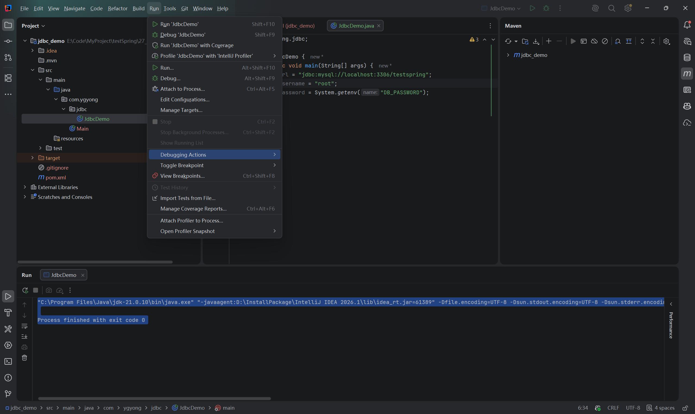
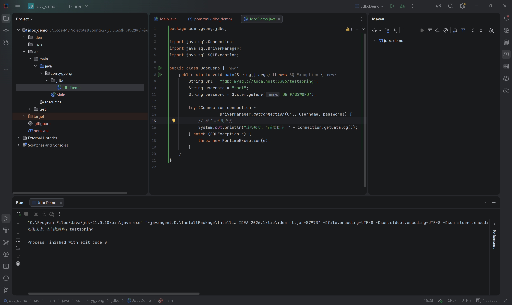
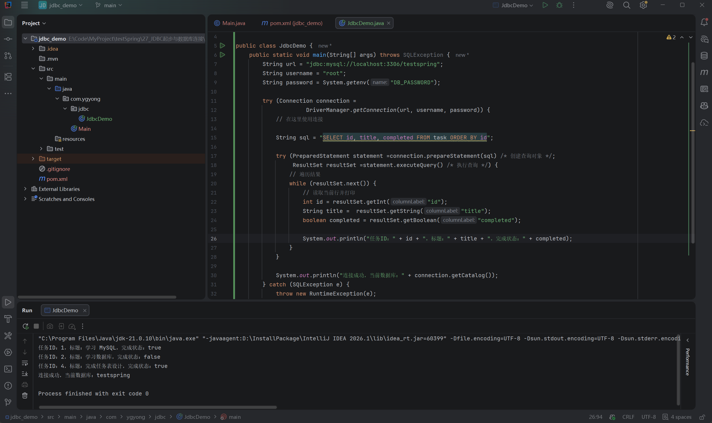
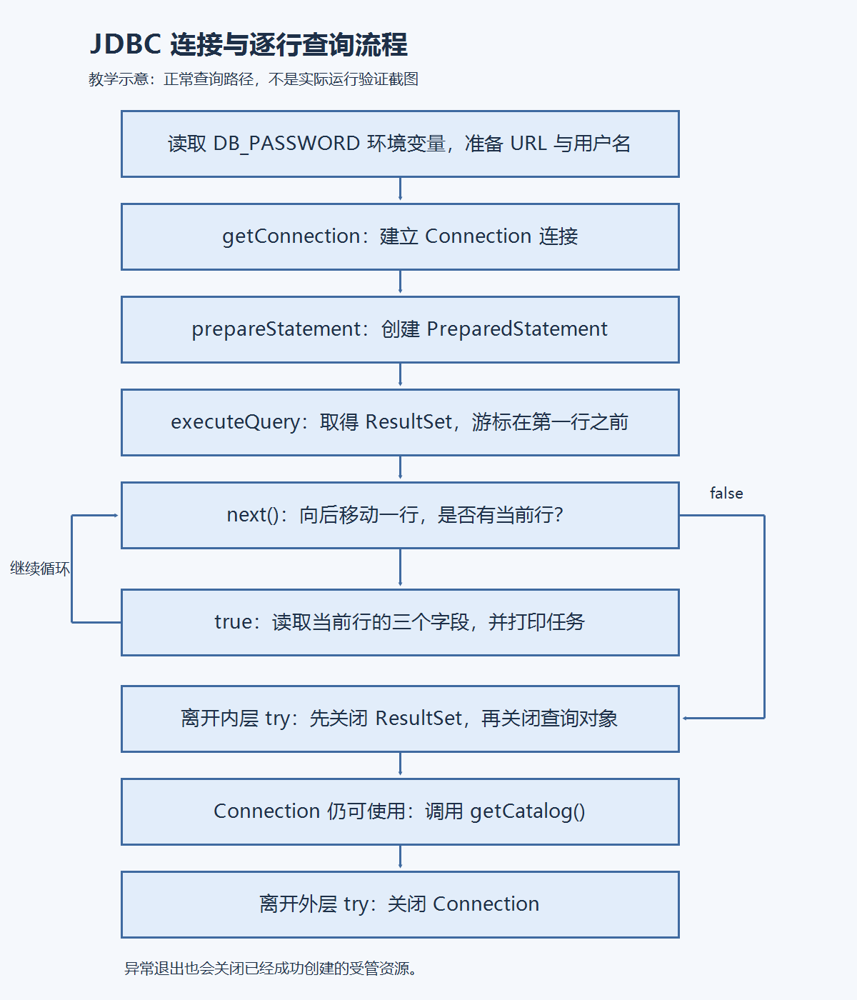

# 第二十七节：JDBC 起步与数据库连接

## 学习目标与实际验证

通过独立 Java main 连接 MySQL，执行 SELECT 并逐行读取已有任务，理解游标及数据库资源关闭。本节没有接入 Spring Boot 或替换内存 Repository。

- 工程：`jdbc_demo/`，入口：`src/main/java/com/ygyong/jdbc/JdbcDemo.java`。
- 环境：JDK 21.0.10、MySQL 8.0.45，数据库 `testspring`，表 `task`。
- 驱动：`com.mysql:mysql-connector-j:9.7.0`。选用时核实官方兼容性：该系列支持 MySQL 8.0 及以上、JRE 8 及以上，覆盖本节环境。[官方兼容性说明](https://docs.oracle.com/cd/E17952_01/connector-j-en/connector-j-versions.html)
- 助手检查了实际源码；连接与查询成功依据学习者的真实截图。助手未独立连接数据库或运行查询。
- 学习者文字确认完成 Debug：前两次读到 id1“学习 MySQL”、id2“学习数据库”，并准确解释断点重复命中的原因；未提供此次调试截图。
- 游标、空结果和资源作用域解释题通过。本节已结课。

## 一、Java 如何访问数据库

Navicat 和 Java 程序都可以作为 MySQL 的客户端。Navicat 连接成功不会让 Java 自动获得连接，Java 需要自己的连接参数和访问代码。

| 名称 | 用途 |
|---|---|
| JDBC | Java 的数据库访问标准 API |
| MySQL Connector/J | 实现 JDBC 的 MySQL 驱动依赖 |
| Connection | 已建立的数据库连接 |
| PreparedStatement | 承载 SQL 并执行，本节使用固定 SELECT |
| ResultSet | 查询返回的结果，供程序逐行读取 |

JDK 提供 JDBC API，MySQL 驱动通过 Maven 添加。可以联系前面学习的“接口与实现”：业务代码使用标准 API，驱动完成与具体数据库的通信。

在 `jdbc_demo/pom.xml` 的 dependencies 中添加：

```xml
<dependency>
    <groupId>com.mysql</groupId>
    <artifactId>mysql-connector-j</artifactId>
    <version>9.7.0</version>
</dependency>
```

本节 pom 的 maven.compiler.source 和 target 均为21，编码UTF-8。声明依赖后要重载 Maven；首次启动日志的 classpath 已包含驱动 jar，证明驱动进入了该次运行路径。但进程退出码0本身不能证明数据库连接成功。

## 二、连接参数与环境变量

```java
String url = "jdbc:mysql://localhost:3306/testspring";
String username = "root";
String password = System.getenv("DB_PASSWORD");
```

本节实际连接本机3306端口的testspring库。换环境时以实际主机、端口和数据库名为准。

`System.getenv` 参数是环境变量名称，不是密码。学习时曾把密码值放进参数，已自行修复。找不到指定环境变量时返回null。

IDEA操作：Run → Edit Configurations → 选择JdbcDemo → Environment variables。若字段未显示，在Modify options中启用。新增名称DB_PASSWORD，值填MySQL实际密码，不加引号，再保存。运行配置把该变量传给Java进程，无需修改Windows系统环境变量。不打印密码，不把含密码的配置截图放进笔记。

【图片 1：请在语雀此处上传 images/IDEA_Run菜单_运行配置入口.png】


观察Run菜单中的Edit Configurations入口；截图不是环境变量已填写的验证图。

## 三、建立连接与自动关闭

```java
try (Connection connection =
         DriverManager.getConnection(url, username, password)) {
    System.out.println("连接成功，当前数据库：" + connection.getCatalog());
}
```

这是课堂讲解的精简写法，配合main上的throws SQLException使用。getConnection失败会抛异常，不会进入正文打印成功。getCatalog在本节MySQL连接中用于获取当前数据库名。

try-with-resources不是方法名，而是Java语法：`try (资源声明) { 使用资源 }`。识别重点在try后面的圆括号。资源必须支持自动关闭（实现AutoCloseable），Connection支持；接口细节以后深入。

- 正常结束、return或正文抛异常离开代码块时，都会尝试关闭已成功创建的受管资源。
- catch负责异常处理，自动关闭由try-with-resources负责，二者职责不同。
- 多个资源用分号分隔，按声明的逆序关闭。
- 关闭连接是释放资源，不是删除数据库或任务记录。

【图片 2：请在语雀此处上传 images/JDBC连接成功_当前数据库testspring.png】


观察控制台“连接成功，当前数据库：testspring”与退出码0，说明这次实际建立连接并取得当前库名。

## 四、执行SELECT并逐行读取

下面是学习者已完成查询的关键代码，排版作了整理，逻辑与实际实现一致。它位于外层Connection的try正文内：

```java
String sql = "SELECT id, title, completed FROM task ORDER BY id";

try (PreparedStatement statement = connection.prepareStatement(sql);
     ResultSet resultSet = statement.executeQuery()) {
    while (resultSet.next()) {
        int id = resultSet.getInt("id");
        String title = resultSet.getString("title");
        boolean completed = resultSet.getBoolean("completed");

        System.out.println("任务ID：" + id + "，标题：" + title
                + "，完成状态：" + completed);
    }
}
```

prepareStatement创建查询对象，executeQuery执行SELECT并返回ResultSet。参数绑定留到下一节，本节没有拼接用户输入。

ResultSet不是Java List，不能把它当成已经创建好的任务对象集合：

1. 初始游标在第一行之前。
2. next向后移动一行，存在当前行返回true。
3. 在循环体中读取当前行字段并打印。
4. 下一轮next继续向后移动，没有下一行返回false。

零行结果第一次next就返回false，不进入循环。读取第一行之前必须先调用next。getBoolean把本节受约束的0/1状态读取为false/true。

【图片 3：请在语雀此处上传 images/JDBC查询成功_逐行读取三条任务.png】


实际输出为id1“学习 MySQL”/true、id2“学习数据库”/false、id4“完成任务表设计”/true，随后显示当前库testspring，退出码0。与上一节已确认记录一致；未独立核对此时Navicat界面。

当前源码把getCatalog输出放在内层try之后，仍然正确：此时ResultSet和PreparedStatement已关闭，外层Connection尚未关闭。

## 五、查询执行流程

【图片 4：请在语雀此处上传 images/JDBC连接与逐行查询流程图.png】


这是正常查询路径的教学示意，不是实际运行截图。重点观察next的循环回路、false分支以及内外层资源关闭时机。异常路径未逐项展开；异常发生时也会尝试关闭已成功创建的受管资源。

## 六、本节Debug观察

在JdbcDemo循环内`int id = resultSet.getInt("id");`设置断点，用Debug启动：

- 第一次停住表示next已返回true，但当前getInt赋值尚未执行。
- 用Step Over执行三个赋值，观察当前行的id、title、completed。
- Resume后再次命中同一断点，再逐步读取下一行。
- 学习者文字确认前两次分别读到id1与id2；因为next移动后仍返回true，循环再次执行到断点。未收集此次调试截图，不记为截图验证。

无需Step Into进入驱动源码，也无需展开密码变量。

## 七、实际易错点与可选整理

1. **空main退出码0不代表连接成功。** 首次只有参数声明，没有执行getConnection。
2. **getenv读取的是变量名。** 代码写DB_PASSWORD，实际密码在运行配置中设置。
3. **try-with-resources靠圆括号声明资源。** 只有普通try或catch并不会自动关闭连接。
4. **当前异常处理合法，但可以简化。** 实际源码保留catch(SQLException e)并throw new RuntimeException(e)，异常原因没有丢失；main同时声明throws SQLException在当前结构下多余。可以保留main的throws并去掉catch包装，也可以保留catch并去掉多余声明。本节未代改，也不把它判为连接逻辑错误。
5. **SQL下的编辑器提示不等于执行失败。** 本次实际SELECT已成功。截图未展开提示内容，未推断具体原因。
6. **Ctrl+Shift+F被输入法占用。** 学习者确认冲突，菜单能打开搜索；没有安装插件或更改键位方案。

## 八、IDEA操作与快捷键

Windows快捷键以实际Keymap为准，可在File → Settings → Keymap搜索操作名核对。

| 操作 | 常见快捷键或菜单入口 |
|---|---|
| 当前工程全文搜索 | Ctrl+Shift+F；Edit → Find → Find in Files |
| 搜索文件、类、操作等 | 连续按两次Shift，Search Everywhere |
| 配置环境变量 | Run → Edit Configurations → JdbcDemo |
| 运行 / 调试 | Run菜单中的Run / Debug JdbcDemo |
| 单步跳过 | 通常F8；Debug工具栏Step Over |
| 继续执行 | 通常F9；Debug工具栏Resume Program |

搜索无反应时先用菜单确认功能，再核对Keymap及输入法冲突。本节实际冲突已解决。[JetBrains快捷键说明](https://www.jetbrains.com/help/idea/mastering-keyboard-shortcuts.html)

## 九、自测题

1. JDBC和MySQL驱动分别负责什么？
2. getenv("DB_PASSWORD")的参数和值分别在哪里设置？
3. 为什么ResultSet必须先next再读取？空结果时循环执行几次？
4. 内层try结束后，为什么还能调用connection.getCatalog？
5. 三个资源按什么顺序关闭？如果正文抛异常会怎样？
6. 为什么同一循环断点可以先读到id1，再读到id2？
7. 独立JdbcDemo查询成功后，之前Spring Boot内存Repository是否会自动变成数据库实现？

第3、4、6题已由学习者准确解释；其余可用于复习，不声称均已独立作答。原Spring Boot实现不会自动变化。

## 图片上传清单

复制Markdown到语雀通常不会自动上传本地图片。请将本笔记与images目录一起保留，在语雀对应提示处逐张上传，或使用其支持的导入方式；未验证自动带图。

| 编号 | 名称 | 相对路径 |
|---|---|---|
| 1 | IDEA运行配置入口 | images/IDEA_Run菜单_运行配置入口.png |
| 2 | 数据库连接成功 | images/JDBC连接成功_当前数据库testspring.png |
| 3 | 查询三条任务成功 | images/JDBC查询成功_逐行读取三条任务.png |
| 4 | JDBC查询教学流程图 | images/JDBC连接与逐行查询流程图.png |

后续路线调整（2026-10-26）：按学习者要求，结束JDBC专项学习，不再安排手写JDBC练习。下一节为第二十八节“MyBatis 起步与任务查询”，参数绑定等概念在MyBatis实际使用时讲解。此前“留到下一节”的参数绑定计划以本条为准。

