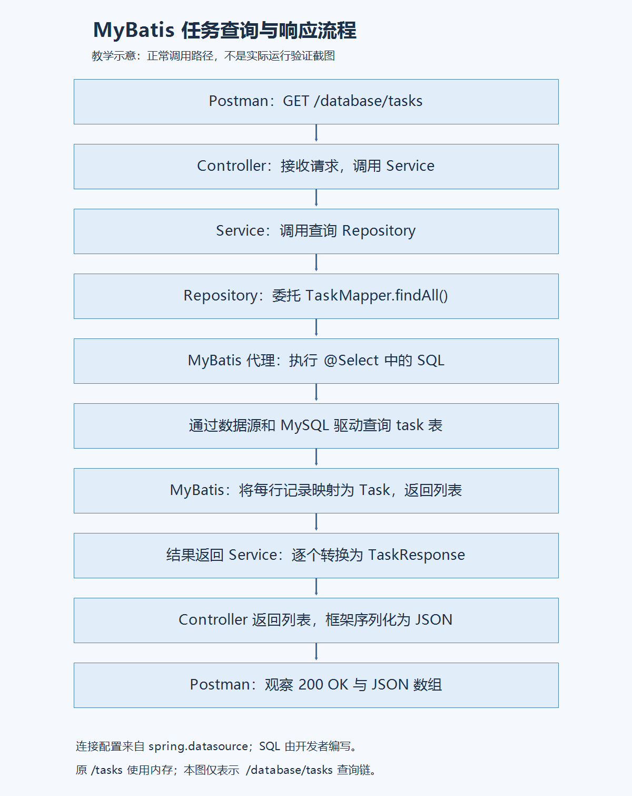
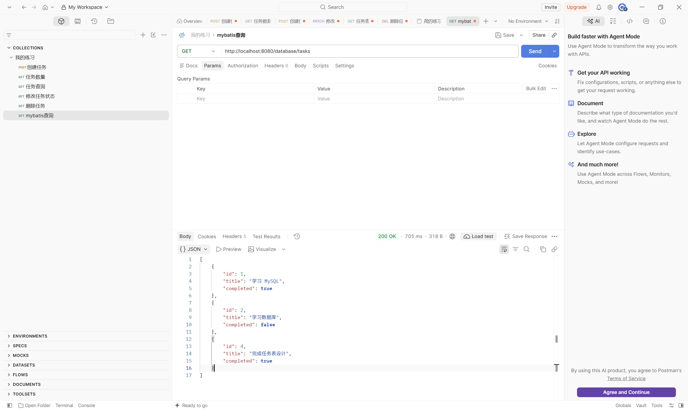
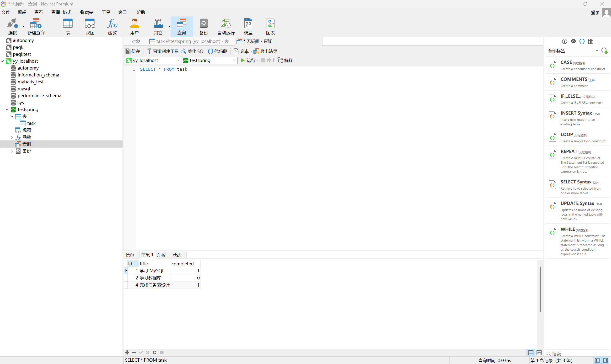

# 第二十八节：MyBatis 起步与任务查询

## 学习目标与完成情况

本节亲自完成 MyBatis 配置、任务映射对象和列表查询，将 MySQL 中的任务通过 HTTP 返回为 JSON。源码检查、Postman 与 Navicat 对照及两道理解题通过。

工程：`task_manager/`。使用 JDK 21、Spring Boot 4.1.1、MyBatis Starter 4.0.0、MySQL Connector/J 9.7.0。

MyBatis 官方兼容表说明 Starter 4.0 系列支持 Spring Boot 4.0+ 和 Java 17+；本节固定采用官方安装示例 4.0.0，不以“最新版”为选择依据。[官方兼容及安装文档](https://mybatis.org/spring-boot-starter/mybatis-spring-boot-autoconfigure/)

## MyBatis 解决什么问题

上节 JDBC 需要手动执行 SQL、遍历 ResultSet、读取字段。本节继续由开发者编写 SQL，MyBatis 负责执行及按规则映射对象，底层仍使用 JDBC 和数据库驱动。

@Mapper 标记查询接口。集成配置扫描接口，MyBatis 创建代理实现，Spring 管理并注入对应对象。因此没有手写实现类也能调用 findAll()。不能直接 new TaskMapper()。

@Select 声明查询 SQL；它不会自动替开发者设计 SQL。数据源 DataSource 提供连接，连接信息放在 spring.datasource 中。

## 查询流程与职责

【图片 1：请在语雀此处上传 images/MyBatis任务查询流程图.png】



观察从 HTTP 请求到数据库再到 JSON 响应的路径。图是教学示意，不是实际运行验证截图；实际实现中结果先返回 Repository，再回到 Service，图中合并了这一返回过程。

| 文件（相对工程 src/main/java/com/ygyong/task_manager/） | 本节职责 |
|---|---|
| entity/Task.java | 接收一行数据库任务记录 |
| mapper/TaskMapper.java | 定义查询 SQL，返回 List<Task> |
| repository/TaskQueryRepository.java | 对上提供查询入口，委托 Mapper |
| service/TaskQueryService.java | 查询并将 Task 转成 TaskResponse |
| controller/TaskQueryController.java | 接收 GET /database/tasks，返回响应列表 |
| dto/TaskResponse.java | 表达 HTTP 响应中的任务 |

本节采用独立只读查询链，避免只实现一个查询就要求补齐原 TaskRepository 的全部增删改查。TaskQueryRepository 和 TaskQueryService 当前没有实现包含完整 CRUD 的旧接口；后续完整迁移时再统一。

## 依赖与数据库配置

在工程 `pom.xml` 的 dependencies 中加入：

```xml
<dependency>
    <groupId>org.mybatis.spring.boot</groupId>
    <artifactId>mybatis-spring-boot-starter</artifactId>
    <version>4.0.0</version>
</dependency>
<dependency>
    <groupId>com.mysql</groupId>
    <artifactId>mysql-connector-j</artifactId>
    <version>9.7.0</version>
    <scope>runtime</scope>
</dependency>
```

runtime 表示驱动在运行时使用，业务源码不直接依赖驱动类。修改后在 IDEA Maven 工具窗口点击 Reload All Maven Projects。

工程 `src/main/resources/application.yaml` 的教学示例（密码已用说明文字替代，不是可直接运行的实际密码）：

```yaml
spring:
  application:
    name: task_manager
  datasource:
    url: jdbc:mysql://localhost:3306/testspring
    username: root
    password: "在本机填写实际密码"
```

datasource 与 application 同级，不重复创建 spring 节点，使用空格缩进。当前 URL 可用于识别 MySQL 驱动，不必手写驱动类名。

学习者明确选择本地练习直接填写明文密码，已知道环境变量配置方式，本节按该选择进行。另一种写法是 `password: ${DB_PASSWORD}`，需在当前 TaskManagerApplication 的运行配置设置变量；上节 JdbcDemo 的运行配置不会自动传递给新的配置。本笔记不记录真实密码，含密码的配置截图未原样收入笔记。

## 关键代码与执行过程

### 实体与映射

Task 包含 int id、String title、boolean completed，使用 public 无参构造和 getter/setter。当前按无参创建及属性填充方式理解映射。boolean 的 getter 使用 isCompleted()。

数据库列名与属性名相同，可直接匹配：id→id、title→title、completed→completed。数据库 0/1 在本次映射中变成 Java false/true。

实际 Mapper：

```java
@Mapper
public interface TaskMapper {
    @Select("SELECT id, title, completed FROM task ORDER BY id")
    List<Task> findAll();
}
```

注解来自 org.apache.ibatis.annotations，Task 来自 entity 包，List 来自 java.util。

### Repository 与 Service

Repository 使用 @Repository、final 字段及构造器注入 TaskMapper。查询方法只做委托：

```java
public List<Task> findAll() {
    return taskMapper.findAll();
}
```

Service 使用 @Service 和构造器注入 TaskQueryRepository。实际列表转换：

```java
public List<TaskResponse> getTasks() {
    List<Task> tasks = taskQueryRepository.findAll();
    List<TaskResponse> taskResponses = new ArrayList<>();
    for (Task task : tasks) {
        TaskResponse taskResponse = new TaskResponse(
                task.getId(), task.getTitle(), task.isCompleted());
        taskResponses.add(taskResponse);
    }
    return taskResponses;
}
```

Task 接收数据库记录，TaskResponse 表达响应，当前字段相同，但职责可分别演变。List<Task> 不能直接作为 List<TaskResponse> 返回。零行时预期返回空列表；本节未清空表进行验证。

### Controller

Controller 使用 @RestController 和构造器注入 TaskQueryService：

```java
@GetMapping("/database/tasks")
public List<TaskResponse> getTasks() {
    return taskQueryService.getTasks();
}
```

框架将返回列表序列化为 JSON 数组。Controller 不重复编写 SQL 或转换循环。

## Postman 与 Navicat 实际验证

1. 保存代码，停止并重新运行本节 TaskManagerApplication。
2. 等待 Started TaskManagerApplication。启动成功本身不能代替数据库查询验证。
3. Postman 选择 GET，URL 为 `http://localhost:8080/database/tasks`，Params 不填，Body 为 none，点击 Send。
4. 观察状态码、JSON，再与 Navicat 的实际查询比较。

建议在 Navicat 的 testspring 查询窗口运行：

```sql
SELECT id, title, completed FROM task ORDER BY id;
```

【图片 2：请在语雀此处上传 images/Postman_MyBatis任务查询成功.png】



观察请求路径、200 OK 和响应数组。实际三条为 id1“学习 MySQL”/true、id2“学习数据库”/false、id4“完成任务表设计”/true，字段及顺序与当前数据库结果一致。

【图片 3：请在语雀此处上传 images/Navicat_任务表查询对照.png】



观察 testspring 数据库与三行 id、title、completed，状态为1、0、1。学习者本次实际使用 SELECT * FROM task，未写 ORDER BY；本次显示顺序一致，不代表无 ORDER BY 的 SQL 保证顺序。Mapper 已显式 ORDER BY id。

验证依据为实际源码、学习者运行截图及其“一致”确认；助手未独立连接数据库、执行 SQL 或启动工程。本节未安排例行断点。

## 实际注意点与易混淆处

- 创建 Mapper 前，启动日志出现 No MyBatis mapper was found：当时没有接口可扫描，不是数据库连接失败证明。之后已创建 @Mapper 接口并完成实际查询。
- Controller.getTasks 最初省略 public，属于包访问权限；不能据此认定 Spring 必然无法映射。按本节风格建议补 public，最终源码已确认补齐。
- GET /database/tasks 查询 MySQL；原 GET/POST/PATCH/DELETE /tasks 路径仍走内存。不能用原 POST /tasks 验证数据库写入。本节没有完成数据库增删改查整体迁移。
- Repository、Service、Controller 的依赖通过构造器注入；Mapper 的实现由 MyBatis 创建。
- XML 映射、参数绑定、数据库分页、事务与完整持久化迁移以后逐步学习，本节不堆积这些概念。

## IDEA 操作入口

- 重载依赖：Maven 工具窗口 → Reload All Maven Projects。
- 生成构造器及 getter/setter：Code → Generate；Windows 常见键位为 Alt+Insert，以实际 Keymap 为准。
- 运行配置：Run → Edit Configurations。
- 全局查找：Edit → Find → Find in Files；学习者此前 Ctrl+Shift+F 与输入法冲突，按实际绑定和菜单入口使用。

## 自测与已确认理解

1. Mapper 没有手写实现类，为什么能够注入并调用？
   - 学习者回答：MyBatis 生成代理实现，Spring 注入这个对象。
2. 原 POST /tasks 创建的任务是否会出现在 /database/tasks？
   - 学习者回答：不会，前者写内存，后者查 MySQL。
3. 复习：Task 和 TaskResponse 分别负责什么？查询零行时当前循环会返回什么？
   - 用于课后自测，本轮未单独作答或做空表验证。

前两题准确，结合实际代码及运行结果，本节确认完成。

## 图片上传清单

本地图片相对路径不会保证随复制的 Markdown 自动上传到语雀。复制文字后，按各处可见提示上传图片，或使用语雀支持的导入方式。

| 编号 | 名称 | 相对路径 |
|---|---|---|
| 1 | MyBatis任务查询流程图（教学示意） | images/MyBatis任务查询流程图.png |
| 2 | Postman实际查询结果 | images/Postman_MyBatis任务查询成功.png |
| 3 | Navicat实际查询对照 | images/Navicat_任务表查询对照.png |

## 下节衔接

在同一个 testSpring 工作区新建会话，开始第二十九节：MyBatis 参数绑定与按编号查询。

```text
请先阅读根目录的 AGENTS.md 和学习进度.md，
开始第二十九节：MyBatis 参数绑定与按编号查询。按约定指导我自己写代码。
```
