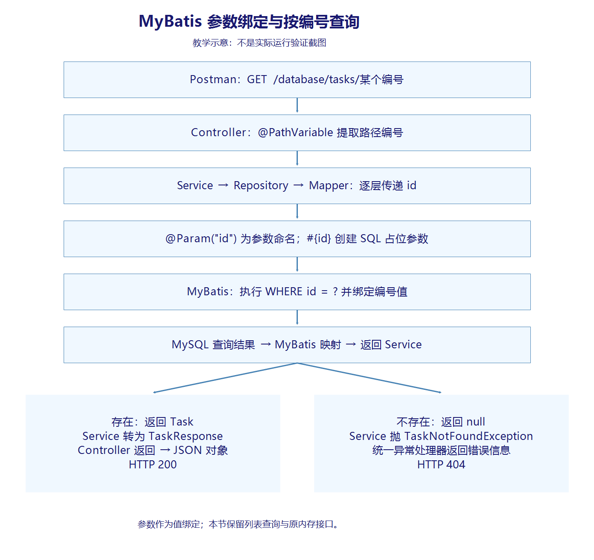

# 第二十九节：MyBatis 参数绑定与按编号查询

## 学习目标与完成情况

在上一节数据库列表查询链上增加 GET /database/tasks/{id}：存在时返回单个任务，不存在时返回404。保留 GET /database/tasks 列表接口，原 /tasks 仍使用内存。

本节代码由学习者编写，助手进行了源码检查。学习者文字确认三次Postman请求均通过：列表200、存在编号200、不存在编号404，响应内容正确；本轮未提供运行截图或完整正文，未记录具体测试编号和任务内容。助手未独立启动应用或查询数据库，也未安排断点。两道解释题已回答正确，确认参数命名与404处理链的理解。

## 查询与响应流程

【图片 1：请在语雀此处上传 images/按编号查询与404处理流程图.png】



观察说明：上半部分展示路径参数如何逐层传到SQL；下半部分区分Task与null两个结果。404由统一异常处理器生成，Mapper本身不生成HTTP响应。本图是教学示意，不是实际运行验证截图。

## 参数绑定：用途与机制

按编号查询需要把每次请求中的编号作为SQL条件值。开发者写SQL，MyBatis负责创建预处理语句、绑定值并映射结果。

文件：`task_manager/src/main/java/com/ygyong/task_manager/mapper/TaskMapper.java`。

```java
@Select("SELECT id, title, completed FROM task ORDER BY id")
List<Task> findAll();

@Select("SELECT id, title, completed FROM task WHERE id = #{id}")
Task findById(@Param("id") int id);
```

- SQL左边的id是列名；#{id}引用绑定参数。
- @Param来自org.apache.ibatis.annotations.Param，为参数指定MyBatis使用的名字。
- 调用findById(2)时，可以理解为SQL使用WHERE id = ?，参数值单独绑定为2；不是把Java变量直接拼进SQL文本。
- 不能把#{id}加上SQL字符串引号。本节编号作为值绑定，不用字符串拼接或${...}替换。
- findAll返回List<Task>，findById返回Task；按主键查询至多一条，没有匹配记录时返回null。

理解题已确认：即使Java参数改名为taskId，只要仍写@Param("id")，SQL中的#{id}仍能正确绑定。这里引用的是注解指定的名字。

参考：[MyBatis参数说明](https://mybatis.org/mybatis-3/sqlmap-xml.html)、[Mapper注解说明](https://mybatis.org/mybatis-3/java-api.html)。

## Repository：委托数据库查询

文件：`task_manager/src/main/java/com/ygyong/task_manager/repository/TaskQueryRepository.java`。

```java
public Task findById(int id) {
    return taskMapper.findById(id);
}
```

Repository接收编号并调用Mapper，返回Task或null。本节沿用已有构造器注入，不新增依赖或手写Mapper实现。

## Service：处理不存在并转换响应对象

文件：`task_manager/src/main/java/com/ygyong/task_manager/service/TaskQueryService.java`。

```java
public TaskResponse getTaskById(int id) {
    Task task = taskQueryRepository.findById(id);
    if (task != null) {
        return new TaskResponse(task.getId(), task.getTitle(), task.isCompleted());
    }
    throw new TaskNotFoundException("Task not found with id: " + id);
}
```

存在时把数据库对象Task转换为接口响应TaskResponse；不存在时抛业务异常。只有确认task非null后才调用getter，避免空指针异常。

本节实际采用“存在就返回，之后抛异常”的结构，逻辑正确，不要求机械改成先判断null。

## Controller与统一异常处理

文件：`task_manager/src/main/java/com/ygyong/task_manager/controller/TaskQueryController.java`。

最终源码为：

```java
@GetMapping("/database/tasks/{id}")
public TaskResponse getTaskById(@PathVariable int id) {
    return taskQueryService.getTaskById(id);
}
```

@PathVariable提取URL路径值，@Param为Mapper参数命名，两者位于不同层。

当前源码省略@PathVariable的显式名称，依赖编译保留参数名。学习者反馈当前环境请求成功。曾建议使用@PathVariable("id") int id明确对应路径名，但最终复核仍为省略形式，不能记录为已经修改。

已有GlobalExceptionHandler中的处理方法使用@ExceptionHandler(TaskNotFoundException.class)，构建ErrorResponse并返回HttpStatus.NOT_FOUND。Controller无需重复捕获这个异常。

完整空结果链：Mapper返回null → Repository原样返回 → Service抛TaskNotFoundException → 统一异常处理器生成404及错误信息。

## 本节实际易错点

### 将原列表方法直接改成带参数方法

首轮将findAll()改成List<Task> findAll(int id)，Repository却仍调用无参数findAll()，源码存在参数不匹配。后续已恢复原列表查询，并独立新增findById。新增功能时要检查原调用方，方法名和返回类型应表达查询用途。

### 抛普通RuntimeException

首轮Service使用new RuntimeException，不能匹配现有仅针对TaskNotFoundException的404处理方法。后续已改为现有业务异常并添加导入。

TaskNotFoundException继承RuntimeException，不意味着new RuntimeException会创建子类对象。处理器需要匹配实际抛出的异常类型。

## Postman验证方法与实际结果

在IDEA中启动本节task_manager的TaskManagerApplication，避免旧课程应用占用8080。修改代码后保存并重启，确认运行的是第二十九节工程。

Postman全部使用GET，Body选择none，无需JSON请求体。

| 请求 | 本轮学习者反馈 |
| --- | --- |
| http://localhost:8080/database/tasks | 200，任务数组内容正确 |
| http://localhost:8080/database/tasks/存在的编号 | 200，单个任务对象内容正确 |
| http://localhost:8080/database/tasks/不存在的编号 | 404，错误信息正确 |

表中“存在的编号”“不存在的编号”是操作说明，实际请求时替换为当前数据库编号。记录未提供具体编号，不编造响应示例为实际结果。

存在编号可从当前列表中选取，核对三个字段。不存在线索可在Navicat查询编辑器中运行以下只读SQL确认，无需删除数据：

```sql
SELECT id, title, completed FROM task WHERE id = 999999;
```

只有查询确实无记录时，才用这个编号测试不存在场景。本轮未单独确认学习者执行过该Navicat语句。

## IDEA操作与快捷键

本节没有引入新快捷键。保存、运行与停止可用File → Save All、Run菜单中的运行及停止入口；快捷键以Settings → Keymap中的实际绑定为准。不需要为了正常接口验证例行设置断点。

## 自测与已确认理解

1. @Param("id") int taskId配合#{id}能绑定吗？能，SQL引用注解指定的名字，与Java参数名taskId无关。
2. 谁把空结果变成404？Mapper返回null，Service抛TaskNotFoundException，统一异常处理器返回404和错误信息。
3. 为什么查询单条任务返回对象而不是数组？方法表达单条查询，Service返回单个TaskResponse。此题作为复习题，未单独记录学习者回答。

当前必须掌握的是参数绑定、单条查询返回值以及异常到HTTP响应的分工。动态SQL、多条件参数和复杂映射以后按实际场景再深入，不补做独立JDBC专项练习。

## 图片清单与语雀上传

| 编号 | 名称 | 相对文件路径 |
| --- | --- | --- |
| 1 | 按编号查询与404处理流程图（教学示意） | images/按编号查询与404处理流程图.png |

笔记与images目录一起保留。复制Markdown文字到语雀通常不会自动上传本地图片，请按文中提示逐张上传，或使用语雀支持的导入方式；未验证自动带图。本节没有新增真实运行截图。

## 下一节衔接

第二十九节已结课。下一节第三十节“MyBatis 新增任务与主键回填”，学习数据库写入、影响行数与生成编号，按约定指导学习者自己实现，不提前代写。

在同一个testSpring工作区创建新会话，复制以下内容：

```text
请先阅读根目录的 AGENTS.md 和学习进度.md，
开始第三十节：MyBatis 新增任务与主键回填。按约定指导我自己写代码。
```
