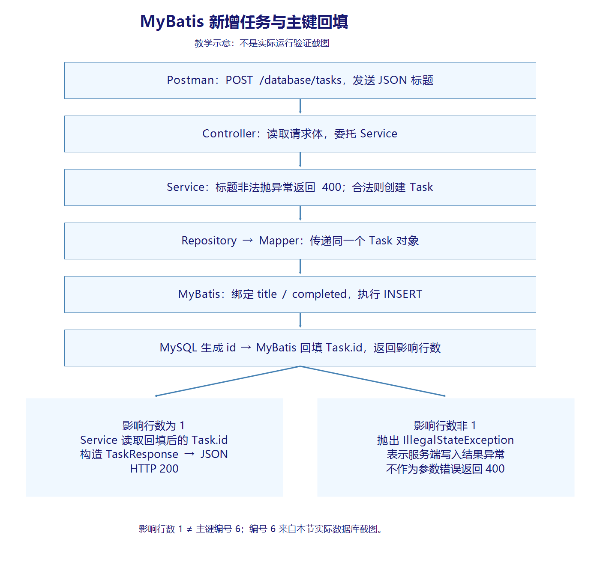

# 第三十节：MyBatis 新增任务与主键回填

## 学习目标与实际完成情况

实现 POST /database/tasks，将新任务存入 MySQL，并返回包含数据库生成编号的 TaskResponse。理解影响行数、主键回填以及各层职责。原 /tasks 接口仍操作内存，数据库查询继续使用 /database/tasks。

本节工程为 task_manager/，沿用 JDK 21 和已有依赖，没有新增依赖。学习者编写实现，助手检查源码；学习者针对 Service 第4至6步请求示范后，助手提供了局部代码。助手未独立编译、启动或访问数据库，未安排例行断点。

学习者确认新增返回200、编号非0并与数据库一致，非法标题返回400，应用重启后仍能查到。实际数据库截图显示新增任务编号6、标题“第三十节主键回填验证”、completed=0。未收到Postman完整响应或非法标题各场景明细，不将这些细节写成独立截图验证。两道核心理解题均已回答正确，本节结课。

## 新增与回填流程

【图片 1：请在语雀此处上传 images/新增任务与主键回填流程图.png】



观察说明：这是教学示意，不是实际运行验证。标题在插入之前校验；合法任务逐层传给Mapper。数据库生成编号，MyBatis写回同一个Task对象，Service再构造响应。影响行数异常与输入错误的性质不同。

## Mapper：写入数据并回填编号

文件：task_manager/src/main/java/com/ygyong/task_manager/mapper/TaskMapper.java。

```java
@Insert("INSERT INTO task (title, completed) VALUES (#{title}, #{completed})")
@Options(useGeneratedKeys = true, keyProperty = "id")
int insert(Task task);
```

- @Insert声明新增SQL；Insert、Options均来自org.apache.ibatis.annotations。
- task表的id已有AUTO_INCREMENT，SQL省略id列，让数据库生成编号。不使用内存中的编号计数器。
- 单个Task对象未加@Param，#{title}、#{completed}直接读取其属性；参数作为值绑定，不拼接SQL。
- useGeneratedKeys=true开启读取数据库生成主键；keyProperty="id"指定回填的Java属性。Task已有setId()。
- int返回值是影响行数，不是生成的编号。普通单条插入成功时，本节检查其是否为1。

注解与影响行数参考：[MyBatis官方Java API文档](https://mybatis.org/mybatis-3/java-api.html)。

## Repository：传递同一个对象

文件：task_manager/src/main/java/com/ygyong/task_manager/repository/TaskCommandRepository.java。

```java
@Repository
public class TaskCommandRepository {
    private final TaskMapper taskMapper;

    public TaskCommandRepository(TaskMapper taskMapper) {
        this.taskMapper = taskMapper;
    }

    public int insert(Task task) {
        return taskMapper.insert(task);
    }
}
```

TaskQueryRepository继续负责查询，新建TaskCommandRepository负责写入。Command在这里表示改变数据的操作，不代表本节引入复杂架构。Repository委托Mapper，不负责标题校验、HTTP响应或手动生成编号。

## Service：校验、插入、构造响应

文件：task_manager/src/main/java/com/ygyong/task_manager/service/TaskCommandService.java。该类使用@Service，通过构造器注入TaskCommandRepository。

本节实际方法：

```java
public TaskResponse createTask(String title) {
    if (title == null || title.isBlank()) {
        throw new IllegalArgumentException("任务标题不能为空");
    }
    if (title.length() > 100) {
        throw new IllegalArgumentException("任务标题不能超过100个字符");
    }

    Task task = new Task();
    task.setTitle(title);
    task.setCompleted(false);

    int num = taskCommandRepository.insert(task);
    if (num != 1) {
        throw new IllegalStateException("新增任务失败，影响行数异常");
    }

    TaskResponse taskResponse = new TaskResponse(
            task.getId(), task.getTitle(), task.isCompleted());
    return taskResponse;
}
```

先判null，再调用字符串方法，避免空指针异常。非法标题抛IllegalArgumentException，已有统一异常处理器映射为400；影响行数异常用IllegalStateException表达服务端异常，不把它误报为请求参数错误。当前未给此异常新增专用响应处理，也未人为制造异常行数测试。

本轮按title.length()>100限制输入，与表title VARCHAR(100)的上限对应。Java String.length()按UTF-16代码单元计数，含部分emoji时与数据库字符计数可能不同；当前普通中英文练习可用，精确Unicode计数以后按需求深入，不声称两者完全等价。

num是合法变量名，曾建议可选改为affectedRows以说明用途；实际源码仍为num。Service没有手动setId，必须先执行insert，再读取id构建TaskResponse。

Java按值传递对象引用：本例各层持有指向同一个Task对象的引用。MyBatis修改该对象的id后，Service通过自己的引用也能读到。不能因此把Java说成按引用传参。

## Controller：将结果写成JSON

文件：task_manager/src/main/java/com/ygyong/task_manager/controller/TaskCommandController.java。类使用@RestController，通过构造器注入TaskCommandService。

```java
@PostMapping("/database/tasks")
public TaskResponse createTask(@RequestBody CreateTaskRequest request) {
    TaskResponse taskResponse = taskCommandService.createTask(request.getTitle());
    return taskResponse;
}
```

复用现有CreateTaskRequest接收title，Controller读取请求体并委托Service。GET与POST即使路径相同，也表达不同操作，不冲突。本节沿用直接返回对象的200响应，未改为201。

实际易错点：首轮误用@Controller，且没有@ResponseBody，无法按本节要求直接输出JSON对象。后续已自行改为@RestController及正确导入。@RestController组合了@Controller与@ResponseBody，适合本节JSON接口。

## 实际数据库记录

【图片 2：请在语雀此处上传 images/Navicat_新增任务编号6.png】


观察说明：关注id=6这一行，title为“第三十节主键回填验证”，completed为0，对应Java/JSON的false。截图还显示编号1、2、4；编号不连续不代表插入失败。截图未展示SQL，不推断执行语句，也不把当前显示顺序作为无ORDER BY查询的顺序保证。接口响应编号一致来自学习者文字确认，图中没有Postman响应。

## 运行与Postman验证

在IDEA运行本节task_manager中的TaskManagerApplication；先停止旧课程应用，保存并重启。正常验证不需要例行断点。

Postman使用POST http://localhost:8080/database/tasks，Body → raw → JSON，检查Content-Type: application/json。

```json
{
  "title": "第三十节主键回填验证"
}
```

点击一次Send会新增一条记录。记录实际响应id，随后使用GET查询，不靠重复POST核对数据。

- 新增预期：200，title一致、completed=false、id为数据库生成编号。本轮学习者确认通过，数据库截图编号为6；未提供完整响应正文。
- 按编号核对：GET http://localhost:8080/database/tasks/6，Body为none。对照Navicat的同一编号。
- 在Navicat的testspring查询窗口可执行以下只读SQL；这条是核对方法，不声称截图执行的就是此SQL。

```sql
SELECT id, title, completed FROM task WHERE id = 6;
```

非法标题练习包括空白标题、缺失标题，以及101个ASCII字母组成的标题：

```json
{"title": "   "}
```

```json
{}
```

预期为400，分别由空标题或超长标题校验拒绝。学习者总体确认非法标题400，未逐项提供具体正文或记录，不能将各子场景都记为独立验证。可用列表或数据库核对没有非法新增记录。

停止并重新启动同一应用，再GET原编号，学习者确认仍能查询到，说明该任务已持久化。助手未独立操作数据库或执行上述请求。

## 本节问题与理解确认

学习者在创建Task、接收影响行数及构造响应这三步卡住。解决关键是按执行顺序区分两份结果：返回值描述SQL影响了几行，对象id保存数据库生成的编号。

已确认的解释题：

1. 本次新增一条记录，数据库编号为6，num是多少？答案为1，表示插入一条；task.getId()为6，表示数据库生成的主键。
2. Service没有setId(6)，为什么能读到6？@Options开启主键回填，MyBatis将生成编号写回传入的同一个Task对象的id属性。

复习题：为什么要在插入后构造响应？为什么非法标题应在调用Repository之前拒绝？为什么GET /tasks与GET /database/tasks的数据源仍不同？这些为课后复习题，未额外记录回答。

## IDEA操作与快捷键

本节没有新增快捷键。保存全部文件可用File → Save All；运行与停止使用Run菜单或工具栏。具体快捷键以Windows下Settings → Keymap的实际方案为准。

## 图片清单与语雀上传

| 编号 | 名称 | 相对文件路径 |
| --- | --- | --- |
| 1 | 新增任务与主键回填流程图（教学示意） | images/新增任务与主键回填流程图.png |
| 2 | Navicat新增任务编号6（实际截图） | images/Navicat_新增任务编号6.png |

请将笔记与images目录一起保留。复制Markdown到语雀通常不会自动上传本地图片，请按文中提示逐张上传，或使用语雀支持的导入方式；未经验证不承诺自动带图。

## 下一节衔接

第三十一节“MyBatis 修改任务完成状态与影响行数”，继续数据库写入，学习UPDATE与根据影响行数处理不存在的任务。本节已结课，不在当前会话自动实现下一课。

在同一个testSpring工作区创建新会话，复制：

```text
请先阅读根目录的 AGENTS.md 和学习进度.md，
开始第三十一节：MyBatis 修改任务完成状态与影响行数。按约定指导我自己写代码。
```
