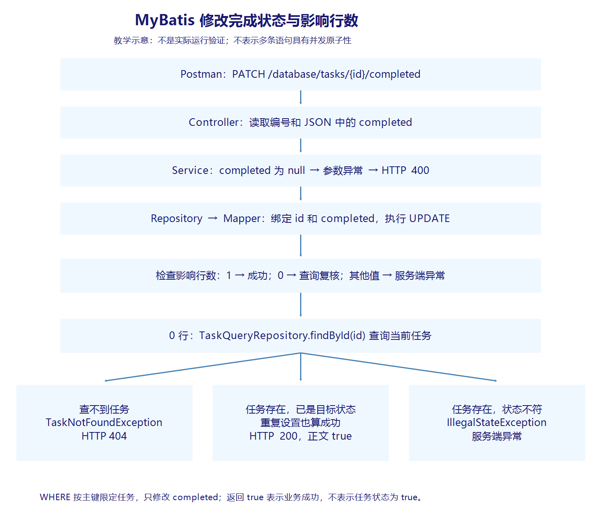

# 第三十一节：MyBatis 修改任务完成状态与影响行数

## 学习目标与实际完成情况

实现 PATCH /database/tasks/{id}/completed，把指定任务的完成状态更新到 MySQL，理解 UPDATE、多参数绑定、影响行数与业务成功的区别。

实际工程：task_manager/，沿用 JDK 21 和现有依赖。学习者自行完成 Mapper、TaskUpdateRepository、TaskUpdateService 和 TaskUpdateController，助手检查源码，没有代改练习实现。

学习者文字确认：修改和重复请求均返回200、正文true，不存在返回404，空状态返回400；数据库状态改变，标题未变。没有提供此次运行截图、完整响应或具体编号，助手未独立编译、启动或访问数据库。两道理解题回答正确，本节结课；异常行数分支未做实际故障注入验证。

## 请求处理流程

【图片 1：请在语雀此处上传 images/修改状态与影响行数流程图.png】



观察说明：这是教学示意，不是实际运行验证。合法参数才进入更新；更新1行直接成功，0行查询复核任务是否存在及是否已经达到目标状态。图中从参数校验向下的箭头表示校验通过；null分支抛异常后不会继续执行。多条数据库语句并不因此具有并发原子性，事务与并发一致性以后深入。

## Mapper：限定修改的列与记录

文件：task_manager/src/main/java/com/ygyong/task_manager/mapper/TaskMapper.java。

```java
@Update("UPDATE task SET completed = #{completed} WHERE id = #{id}")
int updateCompleted(@Param("id") int id, @Param("completed") boolean completed);
```

- UPDATE task 指定任务表。
- SET completed 只修改完成状态，不修改标题和编号。
- WHERE id 按主键定位目标，不能遗漏，否则可能更新所有任务。
- 两个独立参数分别使用 @Param 命名；占位符读取对应参数，以值绑定方式执行SQL。
- int 返回影响行数，不是编号，也不是任务的完成状态。

参考：[MyBatis 官方 Java API](https://mybatis.org/mybatis-3/java-api.html)。

Repository通过构造器注入Mapper，并原样返回计数：

```java
public int updateCompleted(int taskId, Boolean completed) {
    return taskMapper.updateCompleted(taskId, completed);
}
```

Repository当前接收Boolean，Mapper接收boolean，会发生自动拆箱。当前调用链在Service中先判null，合法后才调用，因此避免了null拆箱。Repository参数改为boolean属于可选的表达优化，本节不要求调整。

## Service：把数据库结果转成业务判断

文件：task_manager/src/main/java/com/ygyong/task_manager/service/TaskUpdateService.java。

学习者反馈这里难写，因为需要考虑的情况多。先按三件事理解，不背整段if：

1. 输入是否合法：completed不能为null。
2. 目标是否达成：更新成功，或者任务已经处于目标状态，都可以成功。
3. 失败原因是什么：资源不存在返回404；执行结果不符合预期属于服务端异常。

实际实现的关键部分：

```java
if (completed == null) {
    throw new IllegalArgumentException("Completed status cannot be null");
}

int updateCount = taskUpdateRepository.updateCompleted(taskId, completed);
if (updateCount == 1) {
    return true;
} else if (updateCount == 0) {
    Task task = taskQueryRepository.findById(taskId);
    if (task == null) {
        throw new TaskNotFoundException("Task with ID " + taskId + " not found");
    } else if (task.isCompleted() == completed) {
        return true;
    } else {
        throw new IllegalStateException("Task update failed, current state does not match target state");
    }
} else {
    throw new IllegalStateException("Unexpected update count: " + updateCount);
}
```

Service通过构造器注入TaskUpdateRepository和TaskQueryRepository。更新返回0时，才额外查询复核。

| 结果 | 业务含义 | 当前处理 |
| --- | --- | --- |
| completed为null | 输入缺失 | IllegalArgumentException，已有处理器映射400 |
| 更新1行 | 更新成功 | 返回true |
| 更新0行，查询无任务 | 找不到资源 | TaskNotFoundException，已有处理器映射404 |
| 更新0行，状态已等于目标 | 重复设置，目标已达成 | 返回true |
| 更新0行，存在但状态不符 | 更新结果异常 | IllegalStateException |
| 其他更新计数 | 不符合当前按主键单行更新的预期 | IllegalStateException |

当前GlobalExceptionHandler没有专门处理IllegalStateException；它不是400参数错误，不要把其异常类改成IllegalArgumentException来套用已有处理器。服务端异常响应细节以后统一安排。

MySQL Connector/J的useAffectedRows配置会影响更新计数的含义，默认值为false。重复设置相同值时，不能笼统认为必然返回0，也不能把0一概等同于任务不存在。本次重复请求返回200/true，并未观察到具体updateCount，不声称实际走了哪一个成功分支。参考：[Connector/J连接属性说明](https://docs.oracle.com/cd/E17952_01/connector-j-en/connector-j-connp-props-connection.html)。

不要求每个Service机械套用这些分支。先实现正常流程，再根据业务要求补齐必要边界；严格并发一致性、事务设计以后再深入。

## Controller与实际易错点

文件：task_manager/src/main/java/com/ygyong/task_manager/controller/TaskUpdateController.java。

```java
@PatchMapping("/database/tasks/{id}/completed")
public boolean updateTaskCompleted(
        @PathVariable("id") int taskId,
        @RequestBody UpdateTaskCompletedRequest request) {
    return taskUpdateService.updateCompleted(taskId, request.getCompleted());
}
```

类使用@RestController，通过构造器注入Service。请求DTO的completed使用Boolean，能区分缺失/null与合法的false。

本节遇到的问题：

- 首轮把新路径写成/tasks/{id}/completed，与原TaskController的PATCH映射重复。改为/database/tasks/{id}/completed，避免映射冲突；原接口仍操作内存。
- 首轮Service只return rowsAffected > 0，不存在时会正常返回200/false，不能表达约定的404。修复为区分不存在与服务端异常，并允许重复设置。
- 响应true表示“业务操作成功”，不表示“任务状态为true”。把状态设置为false也可以返回true。
- 修改已有记录无需@Options主键回填；本节没有生成新的任务编号。

## Postman与数据库验证方法

在IDEA保存代码并启动第三十一节工程的TaskManagerApplication，避免上一节应用占用8080。

Postman配置：

```http
PATCH http://localhost:8080/database/tasks/实际存在的编号/completed
Content-Type: application/json
```

Body → raw → JSON：

```json
{
  "completed": true
}
```

先通过GET /database/tasks查看现有数据，选一个存在编号，发送与其当前状态相反的值，再重复同一请求。观察状态码和正文；再GET /database/tasks/{id}，并在Navicat对照状态与标题。以上URL中的“实际存在的编号”需替换为当前真实编号，不预设仍是上一课编号。

| 验证场景 | 学习者反馈 |
| --- | --- |
| 修改状态 | 200，true |
| 重复相同请求 | 200，true |
| 不存在编号 | 404 |
| 空状态 | 400；未记录缺失和显式null的逐项明细 |
| 数据库对照 | 状态已改变，标题未变 |

此处为文字反馈记录，没有实际运行截图。本节未安排例行断点，未验证并发场景或异常行数故障。

IDEA操作：使用Run菜单中的运行/停止入口切换当前工程，不新增快捷键记忆要求；Windows快捷键以自己的Keymap显示为准。

## 自测与本节理解确认

1. 为什么重复把任务设置为true，即使状态没有变化也可以成功？
2. 为什么找不到任务用TaskNotFoundException，更新结果异常用IllegalStateException？
3. 设置completed=false成功后，接口返回true，两个布尔值分别表示什么？
4. UPDATE漏掉WHERE会有什么后果？

学习者已正确回答前两题：任务已经达到目标状态，重复设置也成功；不存在是资源问题返回404，行数异常是服务端执行结果问题。后两题用于复习，不记录为已回答。

## 图片清单与语雀上传

| 编号 | 名称 | 相对路径 |
| --- | --- | --- |
| 1 | 修改状态与影响行数流程图（教学示意） | images/修改状态与影响行数流程图.png |

笔记与images目录一起保留。复制Markdown到语雀不保证自动上传本地图片，请按就地提示逐张上传，或使用语雀支持的导入方式。绘制流程图.ps1保留用于重绘。
