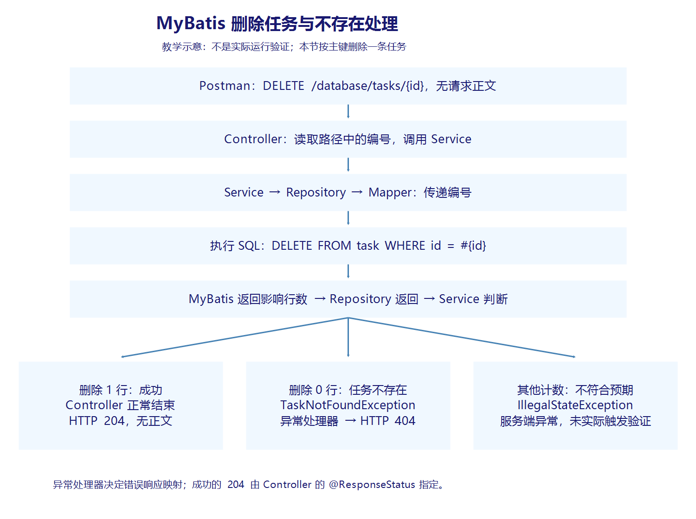

# 第三十二节：MyBatis 删除任务与不存在处理

## 学习目标与完成情况

通过 DELETE /database/tasks/{id} 删除 MySQL 任务，根据影响行数区分成功、不存在和执行结果异常。

实际工程：task_manager/，沿用 JDK 21 和现有依赖。学习者自行完成 Mapper、TaskDeleteRepository、TaskDeleteService 和 TaskDeleteController；助手检查源码，未代改实现。

学习者文字确认：首次删除204且正文为空，再次删除404，GET查询404，Navicat中目标记录消失。两道核心理解题回答正确，本节结课。未提供本次实际运行截图或具体任务编号；助手未独立编译、启动或访问数据库，未验证异常行数分支。

## 删除请求处理流程

【图片 1：请在语雀此处上传 images/删除任务与不存在处理流程图.png】



观察说明：这是教学示意，不是实际运行验证。请求向下传递编号，数据库返回影响行数，Service据此判断业务结果。只有正常返回时才由Controller生成204；不存在任务时抛异常，由异常处理器生成404，不继续走成功响应。

## Mapper与Repository：执行删除并返回计数

文件：task_manager/src/main/java/com/ygyong/task_manager/mapper/TaskMapper.java。

```java
@Delete("DELETE FROM task WHERE id = #{id}")
int deleteById(@Param("id") int id);
```

DELETE FROM指定删除的表；WHERE按主键限定目标，不能遗漏，否则可能删除整张表的数据。#{id}读取绑定参数的值。返回的int是删除行数，不是任务编号。

文件：task_manager/src/main/java/com/ygyong/task_manager/repository/TaskDeleteRepository.java。

```java
public int deleteById(int id) {
    return taskMapper.deleteById(id);
}
```

Repository通过构造器注入Mapper，在这里负责委托数据库访问并返回计数，不决定HTTP状态码。

参考：[MyBatis官方Java API](https://mybatis.org/mybatis-3/java-api.html)。

## Service：把影响行数解释成业务结果

文件：task_manager/src/main/java/com/ygyong/task_manager/service/TaskDeleteService.java。

```java
public boolean deleteTask(int id) {
    int rowsAffected = taskDeleteRepository.deleteById(id);

    if (rowsAffected == 1) {
        return true;
    } else if (rowsAffected == 0) {
        throw new TaskNotFoundException("Task with id " + id + " does not exist.");
    } else {
        throw new IllegalStateException("Unexpected number of rows affected: " + rowsAffected);
    }
}
```

按主键删除，正常预期是1行或0行。1行表示成功；0行表示执行删除时没有匹配任务，本节约定返回404。其他计数不符合当前操作的预期，使用IllegalStateException表达执行结果异常；抛出异常并不能撤销已经发生的数据库操作，事务以后深入。

与上一节UPDATE不同，删除没有“记录仍然存在，只是字段值没变”的情况，因此0行不需要再查询状态。重复删除同一编号，第一次成功，后一次按本节约定返回404。重复删除都返回204也是可选择的接口约定，不是本节实现。

## Controller：成功时204，无正文

文件：task_manager/src/main/java/com/ygyong/task_manager/controller/TaskDeleteController.java。

```java
@DeleteMapping("/database/tasks/{id}")
@ResponseStatus(HttpStatus.NO_CONTENT)
public void deleteTaskById(@PathVariable int id) {
    taskDeleteService.deleteTask(id);
}
```

使用@RestController，并通过构造器注入TaskDeleteService。@DeleteMapping声明请求方法与路径，@PathVariable取得编号；@ResponseStatus指定正常返回时的204，void表示方法不返回正文。

Service保留boolean返回值也可以，Controller调用时不使用该值。Service抛异常则调用中断，交给异常处理器，不会因为标了204就把错误也变成成功。

204表示成功且无响应内容；删除成功若约定返回结果正文，也可以选择200。本节使用204，不是所有删除接口都只能使用204。参考：[HTTP标准](https://www.rfc-editor.org/rfc/rfc9110.html#section-15.3)。

## 实际易错点与学习者疑问

### 1. 任务不存在却用了参数异常

首轮代码在0行分支抛IllegalArgumentException。现有GlobalExceptionHandler将它映射为400，所以不符合本节404要求。已由学习者改为项目自定义的TaskNotFoundException。

异常与HTTP状态并非Java自动一一对应。当前链路是：Service抛异常，GlobalExceptionHandler中相应的@ExceptionHandler接住，再创建400或404响应。

### 2. Controller的路径和返回形式

首轮路径是/database/tasks/{id}/，调整为约定的/database/tasks/{id}。首轮返回boolean且没有指定204，随后改为void和@ResponseStatus(HttpStatus.NO_CONTENT)。200加true本身可以是接口设计，但本节约定练习204无正文。

### 3. 异常名和状态码太多，怎么记

学习者反馈真实项目多用GET、POST，失败常见500。当前不要求背完异常体系；先用中文说清失败原因，再找项目已有处理方式。

| 当前场景 | 当前项目异常 | 对外结果 |
| --- | --- | --- |
| 参数不符合要求 | IllegalArgumentException | 处理器映射400 |
| 任务不存在 | TaskNotFoundException，自定义 | 处理器映射404 |
| 执行状态或结果不符合预期 | IllegalStateException | 服务端异常，当前没有专用处理器 |

Argument可理解为参数，State可理解为状态。Java异常表达程序内部失败原因；HTTP状态表达请求结果；异常处理器建立两者的映射。Java官方定义见[IllegalArgumentException](https://docs.oracle.com/en/java/javase/21/docs/api/java.base/java/lang/IllegalArgumentException.html)与[IllegalStateException](https://docs.oracle.com/en/java/javase/21/docs/api/java.base/java/lang/IllegalStateException.html)。

| 当前先熟悉的HTTP状态 | 含义 |
| --- | --- |
| 200 | 成功，当前接口通常带结果正文 |
| 204 | 成功，无响应正文 |
| 400 | 请求有问题，当前项目用于参数错误 |
| 404 | 找不到目标资源 |
| 500 | 服务端未预期的问题 |

HTTP状态与JSON正文中的业务码是两套东西。例如HTTP200、正文code为1001，可以是团队约定的业务失败。真实开发先了解团队规范；失败全部返回500会减少调用方区分参数错误、资源不存在与服务故障的能力。“接口不通”也可能根本没有HTTP响应，例如连接被拒绝。

GET与POST可以覆盖很多业务，POST /task/delete也可以被设计为删除接口；DELETE /tasks/6则直接用方法表达删除意图。GET按标准用于读取，不应拿来执行删除。参考：[HTTP请求方法与状态语义](https://www.rfc-editor.org/rfc/rfc9110.html)。

## Postman与数据库验证

先启动本节task_manager应用，使用已有POST /database/tasks接口创建专门练习任务并记录返回编号，避免删除需要保留的旧记录。新增请求配置Body → raw → JSON，Content-Type: application/json：

```json
{
  "title": "第三十二节删除练习"
}
```

随后在Postman请求以下地址，将中文部分替换成真实编号：

```text
DELETE http://localhost:8080/database/tasks/实际编号
```

删除请求Body选none，无需JSON请求体。第一次观察状态码和空正文，再重复同一请求；随后GET /database/tasks/实际编号，并在Navicat刷新任务表或按编号查询。

| 验证项 | 学习者实际文字反馈 |
| --- | --- |
| 首次删除 | 204，正文为空 |
| 再次删除同一编号 | 404 |
| GET查询该编号 | 404 |
| Navicat对照 | 目标记录已消失 |

以上没有实际运行截图，不推断具体编号、完整错误正文或启动日志。未安排例行断点，也未实际触发其他异常行数分支。

IDEA操作使用Run菜单中的运行、停止入口，确认运行的是本节工程。Windows快捷键以自己的Keymap为准，本节没有新增快捷键记忆要求。

## 自测与理解确认

1. 为什么删除0行不需要像上一节UPDATE那样再查询状态？
2. 将TaskNotFoundException换成IllegalArgumentException，当前会返回什么状态？由谁决定？
3. 如果Controller返回204，前端还应尝试把响应正文解析成任务对象吗？
4. DELETE语句漏掉WHERE会有什么后果？

前两题已由学习者正确回答：删除0行表示没有匹配任务，不存在字段值没变的情况；换成IllegalArgumentException后当前返回400，映射由GlobalExceptionHandler决定，不是异常类型自动绑定状态码。后两题用于复习，未记录为已回答。

## 图片清单与语雀上传

| 编号 | 名称 | 相对路径 |
| --- | --- | --- |
| 1 | 删除任务与不存在处理流程图（教学示意） | images/删除任务与不存在处理流程图.png |

笔记与images目录一起保留。复制Markdown到语雀不保证自动上传本地图片，请按就地提示上传图片，或使用语雀支持的导入方式。绘制流程图.ps1保留用于重绘。
