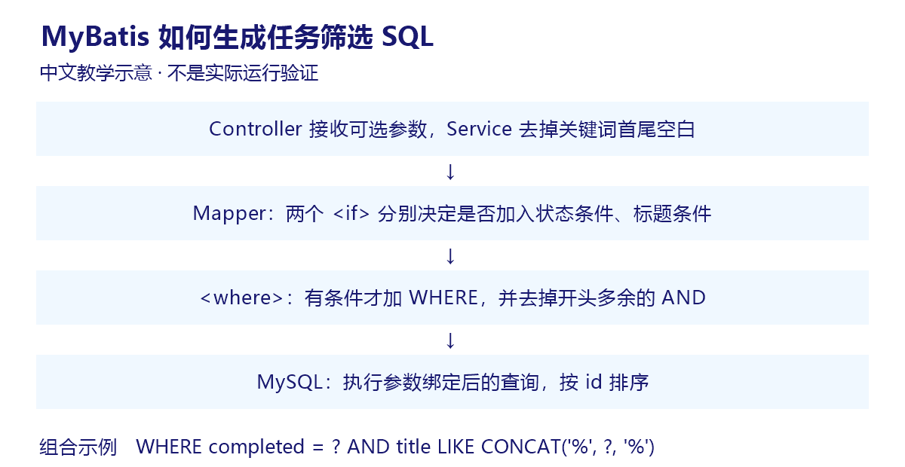

# 第三十三节 · MyBatis 任务筛选与动态 SQL

## 一页重点速记

1. 【重点记住】动态 SQL 根据请求参数决定本次查询有哪些条件，MySQL 执行筛选。
2. 【重点记住】可选状态用 `Boolean`。`null` 跳过筛选，`false` 查未完成，`true` 查已完成。
3. 【重点记住】`<if test="completed != null">` 判断是否传值，三种状态的含义才不会混淆。
4. 【重点记住】`<where>` 有内容才生成 `WHERE`，并去掉开头多余的 `AND` 或 `OR`。
5. 【重点记住】多个条件用独立的 `<if>`，同时生效时用 `AND` 取交集。
6. 【重点记住】Mapper 参数用 `@Param` 命名，SQL 值用 `#{名称}` 绑定。
7. 【常用查阅】`LIKE CONCAT('%', #{keyword}, '%')` 用于标题包含查询，空白关键词先在 Service 清理。
8. 【重点记住】SQL 片段之间保留空白。Java 文本块 `"""` 可以直接保留换行。

## 详细图文说明

### 可选参数如何变成查询条件

【图片 1：请在语雀此处上传 images/动态SQL筛选流程图.png】



观察两个 `<if>` 如何各自决定是否输出条件，再看 `<where>` 如何处理整个条件区。图中的 `?` 对应运行时绑定的参数值。

| 层 | 本节职责 |
| --- | --- |
| Controller | 用 `@RequestParam(value = "completed", required = false)` 接收可选 `Boolean`，用相同方式接收 `String keyword` |
| Service | 对非 `null` 的关键词调用 `strip()`，并把查询结果转换为 `TaskResponse` |
| Repository | 传递筛选参数并返回 Mapper 查询结果 |
| Mapper | 根据参数选择 SQL 条件，用 `#{}` 绑定值，最后按 `id` 排序 |

### 【常用查阅】注解内的动态 SQL 模板

下例用 Java 文本块展示同一查询，便于查看 SQL 的换行与缩进。

```java
@Select("""
    <script>
        SELECT id, title, completed FROM task
        <where>
            <if test="completed != null">
                AND completed = #{completed}
            </if>
            <if test="keyword != null and keyword != ''">
                AND title LIKE CONCAT('%', #{keyword}, '%')
            </if>
        </where>
        ORDER BY id
    </script>
    """)
List<Task> findByConditions(
        @Param("completed") Boolean completed,
        @Param("keyword") String keyword);
```

`<script>` 让 `@Select` 解析动态标签。`test` 决定条件是否输出，`#{}` 把值交给数据库绑定。`ORDER BY` 放在 `</where>` 后面，每次查询都排序。项目使用 Mapper XML 时，查询可以写在对应的 `<select>` 中，沿用相同的 `<if>` 和 `<where>`。 [MyBatis 官方动态 SQL 文档](https://mybatis.org/mybatis-3/dynamic-sql.html)

| 请求参数 | 生成的条件 |
| --- | --- |
| 都不传 | 无 `WHERE` |
| `completed=false` | `WHERE completed = ?` |
| `keyword=学习` | `WHERE title LIKE CONCAT('%', ?, '%')` |
| 两者都传 | `WHERE completed = ? AND title LIKE CONCAT('%', ?, '%')` |

### 【重点记住】工作中先记这些

- **语法要求**：SQL 条件片段之间要有空白。使用 Java 字符串 `+` 时换行只存在于源码中，若字符串内缺少分隔符，组合后可能出现 `?AND`。单条件成功后仍要测组合条件。
- **推荐风格**：多行 SQL 用文本块或团队约定的 Mapper XML。查询参数、Java 方法参数与 Mapper 命名保持一致，排错时容易逐层核对。
- **接口约定**：本课用 `completed`、`keyword`，空白关键词视为省略，无匹配返回 `200` 和 `[]`。`@RequestParam` 的名字决定客户端要传什么，Java 局部参数名可以不同。
- **排错方法**：Postman 先分开测两个条件，再一起测。看到 `500` 时，在 IDEA 的 Run 控制台查对应请求的 `Caused by` 和 `### SQL`（若日志有输出）。

### 【常用查阅】Windows IDEA 快捷键

以下以 Windows 默认 Keymap 为前提，可在 **File → Settings → Keymap** 查看实际绑定。找不到菜单动作时可用 **Help → Find Action**。

| 功能 | 快捷键 | 菜单或入口 |
| --- | --- | --- |
| 查找动作 | `Ctrl+Shift+A` | Help → Find Action |
| 全项目查找 | `Ctrl+Shift+F` | Edit → Find → Find in Files |
| 格式化代码 | `Ctrl+Alt+L` | Code → Reformat Code |
| 重命名符号 | `Shift+F6` | Refactor → Rename |
| 运行当前配置 | `Shift+F10` | Run 菜单 |
| 查看运行日志 | `Alt+4` | View → Tool Windows → Run |

基础回顾见 [JDBC 与 MyBatis](../Java后端知识手册/基础篇_01至32节/11_JDBC与MyBatis.md)。本课知识归入后续主题册的「MyBatis 查询与分页」。

## 独立练习

1. **画出条件组合**。用现有查询分别推导无参数、只传 `completed=false`、只传 `keyword` 和两个都传时的 SQL。验收时检查 `WHERE` 出现的位置、占位符数量、`AND` 和排序位置。
2. **为组合筛选挑选数据**。在 Navicat 找到含相同关键词、完成状态不同的两条记录，再用 Postman 分别发只带关键词和带两个参数的请求。验收时，前者包含两条记录，后者仅保留符合状态的一条。先确认样本满足题目条件。

图片清单

- 图片 1 · 动态 SQL 筛选流程图 · `images/动态SQL筛选流程图.png`
