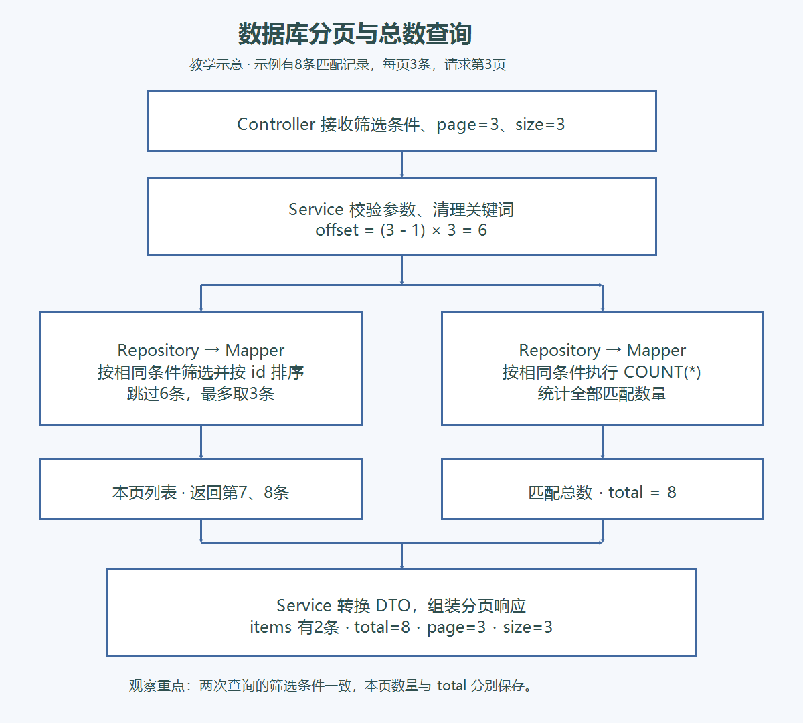

# 第三十四节 · MyBatis 数据库分页与总数查询

## 一页重点速记

1. 【重点记住】数据库分页同时解决“本页有哪些任务”和“全部匹配多少条”，分别查询列表与总数。
2. 【重点记住】页码从1开始，偏移量从0开始。Java模板为 `long offset = (page - 1L) * size;`。
3. 【重点记住】SQL模板为 `ORDER BY id LIMIT #{size} OFFSET #{offset}`，先确定排序，再取一页。
4. 【重点记住】`COUNT(*)`统计匹配行数，Mapper用`long`接收，列表与计数使用完全相同的筛选条件。
5. 【重点记住】`items.size()`是本页数量，`total`是全部匹配数量。超出末页可返回空列表并保留total。
6. 【重点记住】Service先校验page和size，再清理关键词、计算偏移量、执行查询、转换DTO并包装响应。
7. 【常用查阅】`@RequestParam(value = "page", defaultValue = "1") int page`接收页码并提供默认值。
8. 【重点记住】`PageResponse<TaskResponse>`表示分页对象中的每个列表元素是TaskResponse，`new PageResponse<>(...)`可推断泛型类型。
9. 【常用查阅】Java文本块用三双引号包围多行字符串，开头三双引号后换行，适合书写SQL。

## 详细图文说明

### 1. 分页的用途与区间

前端表格显示当前页数据，分页组件需要匹配总数计算页数。数据库通过LIMIT限制读取范围，Java接收这一页的结果。

以8条匹配记录、每页3条为教学示例。

| page | size | offset | 排序后取到的位置 | 本页条数 | total |
| --- | --- | --- | --- | --- | --- |
| 1 | 3 | 0 | 第1～3条 | 3 | 8 |
| 2 | 3 | 3 | 第4～6条 | 3 | 8 |
| 3 | 3 | 6 | 第7～8条 | 2 | 8 |
| 4 | 3 | 9 | 无记录 | 0 | 8 |

位置按排序结果计算，id可以不连续。没有匹配记录时，items为空且total为0。

【图片 1：请在语雀此处上传 images/数据库分页查询流程图.png】



观察Service如何把同一组筛选条件分别交给列表查询和计数查询，再把两份结果组装到分页响应。代码中两条SQL依次执行，图中分支用于区分两种查询职责。图中8条记录是教学示例，图片为教学示意。

### 2. Mapper中的列表与总数查询

【重点记住】分页查询保留上一节动态条件，并在排序后增加LIMIT。

```java
@Select("""
        <script>
        SELECT id, title, completed FROM task
        <where>
            <if test="completed != null">
                AND completed = #{completed}
            </if>
            <if test="keyword != null and keyword != ''">
                AND title LIKE CONCAT('%', #{keyword}, '%')
            </if>
        </where>
        ORDER BY id
        LIMIT #{size} OFFSET #{offset}
        </script>
        """)
List<Task> findPageByConditions(
        @Param("completed") Boolean completed,
        @Param("keyword") String keyword,
        @Param("size") int size,
        @Param("offset") long offset);
```

- `@Select`指定查询，MyBatis解析动态标签并绑定参数，再把SQL交给数据库。
- `@Param("size")`提供名称，与`#{size}`对应。方法调用仍按声明顺序传参。
- `Boolean`允许null、false、true，分别表达未指定状态、未完成、已完成。
- 两个独立if让状态与关键词可以同时生效，where负责生成WHERE及清理开头的AND。
- `List<Task>`返回多条任务。数据库无匹配时，MyBatis列表查询返回空列表。
- 文本块保存换行，减少字符串拼接时遗漏空白的问题。

【常用查阅】MySQL还支持`LIMIT offset, size`，注意两个数字的顺序。本课统一采用`LIMIT size OFFSET offset`。

计数方法保留相同的where，改用COUNT(*)，省略排序和分页。

```java
@Select("""
        <script>
        SELECT COUNT(*) FROM task
        <where>
            <if test="completed != null">
                AND completed = #{completed}
            </if>
            <if test="keyword != null and keyword != ''">
                AND title LIKE CONCAT('%', #{keyword}, '%')
            </if>
        </where>
        </script>
        """)
long countByConditions(
        @Param("completed") Boolean completed,
        @Param("keyword") String keyword);
```

COUNT(*)统计符合条件的行数，结果使用long接收。COUNT(列名)统计该列非NULL的数量，统计任务条数时优先使用COUNT(*)。

【重点记住】列表和计数的条件必须同步维护。例如列表按completed=false筛选时，计数也应包含相同条件。SQL中的值继续使用#{}绑定。

### 3. Repository与Service各负责什么

Repository提供数据访问入口，把调用委托给Mapper。

```java
public List<Task> findPageByConditions(
        Boolean completed, String keyword, int size, long offset) {
    return taskMapper.findPageByConditions(completed, keyword, size, offset);
}

public long countByConditions(Boolean completed, String keyword) {
    return taskMapper.countByConditions(completed, keyword);
}
```

Service组织查询过程。项目相对路径为`task_manager/src/main/java/com/ygyong/task_manager/service/TaskQueryService.java`。

```java
public PageResponse<TaskResponse> getTasks(
        Boolean completed, String keyword, int page, int size) {
    if (page < 1 || size < 1 || size > 100) {
        throw new IllegalArgumentException(
                "page 必须大于等于1，size 必须在1到100之间");
    }

    if (keyword != null) {
        keyword = keyword.strip();
    }

    long offset = (page - 1L) * size;
    List<Task> tasks = taskQueryRepository.findPageByConditions(
            completed, keyword, size, offset);
    long total = taskQueryRepository.countByConditions(completed, keyword);
    List<TaskResponse> taskResponses = new ArrayList<>();

    for (Task task : tasks) {
        TaskResponse taskResponse = new TaskResponse(
                task.getId(), task.getTitle(), task.isCompleted());
        taskResponses.add(taskResponse);
    }

    return new PageResponse<>(taskResponses, total, page, size);
}
```

- `||`表示逻辑或，任一非法条件满足就抛异常。
- `strip()`返回去掉首尾空白的新字符串。赋值后，两次查询都使用清理后的关键词。
- `1L`是long字面量，让减法与乘法都按long运算。仅将int计算结果赋给long无法补救已经发生的int溢出。
- for循环将数据库实体转成对外DTO，避免接口直接依赖实体全部字段。
- 构造器参数按位置传入，依次为items、total、page、size。

【重点记住】Java的`List<Task>`与`List<TaskResponse>`是不同的参数化类型，需要逐项转换。JavaScript普通数组通常没有这种编译期元素类型约束，TypeScript则可以通过类型声明获得类似检查。

### 4. Controller接收参数与输出响应

```java
@GetMapping("/database/tasks")
public PageResponse<TaskResponse> getTasks(
        @RequestParam(value = "completed", required = false) Boolean completed,
        @RequestParam(value = "keyword", required = false) String keyword,
        @RequestParam(value = "page", defaultValue = "1") int page,
        @RequestParam(value = "size", defaultValue = "10") int size) {
    return taskQueryService.getTasks(completed, keyword, page, size);
}
```

@RequestParam把查询参数绑定到Java参数。defaultValue在参数省略或为空字符串时生效，Spring按声明类型转换参数。

| 请求情况 | 处理 |
| --- | --- |
| 不传page、size | 使用page=1、size=10 |
| page=0或size=101 | Service抛IllegalArgumentException，已有异常处理器返回400 |
| page=abc | Spring参数类型转换失败，默认处理返回400 |
| 页码超出末页 | 返回200，items为空，total保留匹配总数 |

前两行的默认值、size上限100和超页返回空列表属于本项目接口约定。SQL参数位置和Java类型规则属于语法要求。按唯一id排序是本场景保证顺序确定的做法。

响应结构示例，数字为教学数据。

```json
{
  "items": [],
  "total": 8,
  "page": 4,
  "size": 3
}
```

### 5. 常见错误与检查方法

| 错误 | 原因与修正 |
| --- | --- |
| total总是等于本页条数 | 使用了items.size()，应读取计数查询 |
| 筛选后页数偏大 | 列表和计数使用了不同的where |
| 第1页就跳过数据 | offset误写成page * size |
| 大页码出现负偏移量 | 乘法先发生int溢出，应在计算前使用long |
| SQL片段粘连 | 字符串间缺空白，可使用文本块保留换行 |
| false查询被跳过 | 应判断completed != null，保留false分支 |

【扩展参考】两次SQL之间若有其他请求修改数据，列表和总数可能观察到不同的数据状态；事务隔离与一致性在后续主题学习。深分页的性能与游标分页也留到性能主题按需学习。

### 6. 运行与验收

在IDEA打开本课task_manager并启动应用，Postman使用GET请求`http://localhost:8080/database/tasks`，参数放在Params。若工程端口已修改，使用实际端口。

依次检查默认参数、连续两页、状态与关键词组合、超出末页、无匹配、page=0和size=101。对照Navicat查询结果检查total，连续翻页时保持测试数据不变。

如需编译，在本课`task_manager/`目录执行。

```powershell
mvn -DskipTests compile
```

该命令检查编译，HTTP与数据库结果仍需运行应用验证。

### 7. Windows IDEA常用操作

以下按默认Windows Keymap，其他键位方案请通过菜单或Find Action确认。

| 功能 | 常用快捷键 | 替代入口 |
| --- | --- | --- |
| 查找动作 | Ctrl+Shift+A | Help → Find Action |
| 查找类 | Ctrl+N | Navigate → Class |
| 当前文件查找 | Ctrl+F | Edit → Find |
| 项目查找文本 | Ctrl+Shift+F | Edit → Find → Find in Files |
| 跳转声明 | Ctrl+B | Navigate → Declaration or Usages |
| 查找引用 | Alt+F7 | Edit → Find → Find Usages |
| 返回上一位置 | Ctrl+Alt+左方向键 | Navigate → Back |
| 格式化代码 | Ctrl+Alt+L | Code → Reformat Code |
| 重命名 | Shift+F6 | Refactor → Rename |
| 运行当前上下文 | Ctrl+Shift+F10 | 入口类运行图标 |
| 运行当前配置 | Shift+F10 | Run → Run |
| 修改键位 | 通过设置查找Keymap | File → Settings → Keymap |

## 工作中先记这些

- 先写清筛选口径，再让列表和COUNT(*)使用同一组条件。
- 分页输入先校验，offset用long计算。
- 先排序再LIMIT，本页数量和匹配总数分别保存。
- Controller绑定请求，Service组织查询，Mapper执行SQL。

基础查阅可参考[筛选分页与数据对象](../Java后端知识手册/基础篇_01至32节/09_筛选分页与数据对象.md)、[JDBC与MyBatis](../Java后端知识手册/基础篇_01至32节/11_JDBC与MyBatis.md)。本课新增知识拟与第三十三节归入后续“MyBatis查询与分页”主题册。

## 独立练习

以下为可选复习练习，尚未提交时不记录为完成。

1. **修改排序。** 在练习副本中让任务按id降序显示，允许使用AI协助。验收时比较前后两页，确认顺序符合要求、同一静态数据集没有跨页重复，total保持一致，并说明应修改哪条SQL。
2. **识别总数错误。** 假设筛选后有7条记录，每页3条，逐一写出第1～4页的items数量、offset与total。验收时解释为什么第4页为空而total仍为7。

## 图片清单

| 编号 | 名称 | 相对路径 |
| --- | --- | --- |
| 1 | 数据库分页查询流程图（教学示意） | images/数据库分页查询流程图.png |

复制Markdown到语雀后，请按就地提示上传图片，或使用语雀支持的导入方式并检查图片显示。
