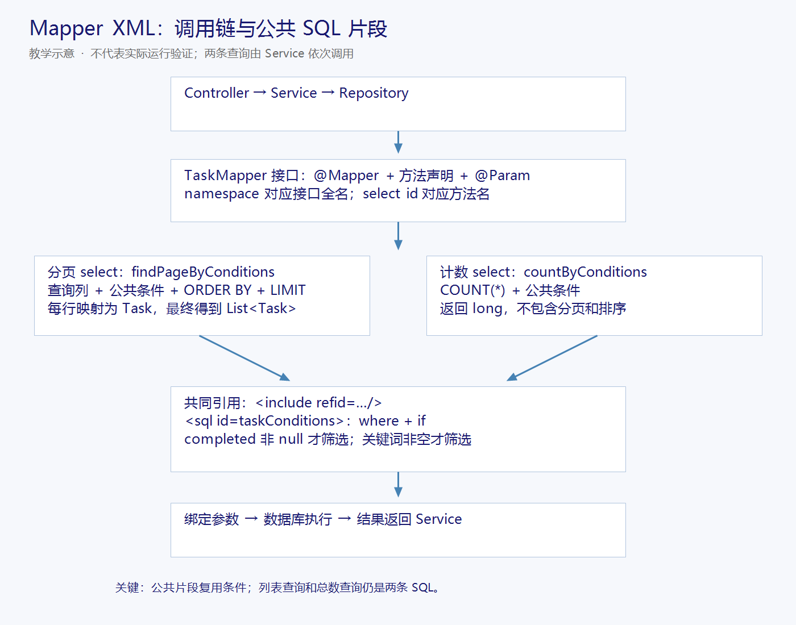

# 第三十五节 · MyBatis Mapper XML 与 SQL 复用

## 一页重点速记

1. 【重点记住】Mapper 接口声明输入输出，Mapper XML 存放 SQL；MyBatis 为接口提供运行时实现。
2. 【重点记住】`<mapper namespace="接口完整名称">` 对应 Java 接口，`<select id="方法名">` 对应方法。
3. 【重点记住】`resultType` 是每行结果类型。返回 `List<Task>` 时写 Task 的完整类名，计数用 `long`。
4. 【重点记住】`@Param("keyword")` 为方法参数命名，XML 用 `#{keyword}` 绑定值；不要用 `${}` 直接拼接用户输入。
5. 【重点记住】`<sql id="片段名">...</sql>` 定义公共片段，`<include refid="片段名"/>` 引用片段；片段不会独立访问数据库。
6. 【重点记住】列表与总数查询共享筛选条件；排序和分页留在列表查询中。复用片段不等于把两条 SQL 合成一条。
7. 【常用查阅】`mybatis.mapper-locations: classpath:mapper/*.xml` 指定 XML 资源位置，写在 application.yaml 中。
8. 【重点记住】XML 中直接写 `<if>`、`<where>`，不再包 `<script>`；`completed != null` 能保留 false 条件。
9. 【重点记住】同一个 Mapper 方法选择一处定义 SQL，迁移后删除对应 `@Select`，防止重复映射。
10. 【常用查阅】SQL 中 `<` 在 XML 文本里写成 `&lt;`；如 `id &lt; #{maxId}`。

## 详细图文说明

### 1. 为什么使用 Mapper XML

短 SQL 用注解直观；条件较多、需要公共片段时，XML 能把 Java 方法声明与 SQL 分开，使查询更容易维护。两种方式都由 MyBatis 执行，并不改变数据库访问的基本原理。

本课把查询方法迁移至 XML，新增、修改、删除仍使用已有注解。不同方法可以采用不同方式，同一个方法避免重复定义。

| 文件（相对本课 task_manager） | 职责 |
| --- | --- |
| src/main/java/com/ygyong/task_manager/mapper/TaskMapper.java | 方法签名、参数命名与 Mapper 标记 |
| src/main/resources/mapper/TaskMapper.xml | 查询 SQL、结果类型和公共片段 |
| src/main/resources/application.yaml | 配置 XML 加载位置 |

【图片 1：请在语雀此处上传 images/MapperXML调用与SQL复用流程图.png】



观察接口如何对应 XML 中的查询，以及分页和计数如何共同引用条件片段。图中的分支表示两种查询职责，实际 Service 依次调用；箭头表示调用与引用关系，不表示公共片段作为单独 SQL 执行。本图为教学示意，不是实际运行验证截图。

### 2. XML 的基本结构与对应规则

【重点记住】下面是常用查询结构模板：

```xml
<?xml version="1.0" encoding="UTF-8"?>
<!DOCTYPE mapper PUBLIC "-//mybatis.org//DTD Mapper 3.0//EN"
        "https://mybatis.org/dtd/mybatis-3-mapper.dtd">
<mapper namespace="com.ygyong.task_manager.mapper.TaskMapper">
    <select id="findById" resultType="com.ygyong.task_manager.entity.Task">
        SELECT id, title, completed FROM task WHERE id = #{id}
    </select>
</mapper>
```

对应接口：

```java
@Mapper
public interface TaskMapper {
    Task findById(@Param("id") int id);
}
```

| 部分 | 含义与规则 |
| --- | --- |
| XML 声明 | 声明 XML 版本与文件编码，文件实际保存为 UTF-8 |
| DOCTYPE | 声明使用 MyBatis Mapper 的文档结构规范，通常保留模板 |
| mapper | 一个 Mapper XML 的根元素 |
| namespace | Mapper 接口完整名称，包含包名，必须对应正确 |
| select 的 id | 对应接口方法名，在当前 namespace 中标识语句 |
| resultType | 一行结果映射成的 Java 类型，可写完整类名或已注册别名 |
| @Mapper | 标记接口，供当前 Starter 默认扫描机制识别 |
| @Param | 显式命名参数，使 SQL 能按名称绑定 |

文件通常命名为 `TaskMapper.xml`，便于查找；实际关联依靠 namespace 与语句 id，不仅依靠文件名。此类 Mapper 接口避免用同名重载方法表达不同 SQL。

### 3. 结果类型与参数绑定

【重点记住】`resultType` 不是整个 Java 方法的返回容器类型。

| Mapper 返回类型 | 本课 XML 的 resultType |
| --- | --- |
| Task | com.ygyong.task_manager.entity.Task |
| List&lt;Task&gt; | com.ygyong.task_manager.entity.Task |
| long | long |

本课列名 `id、title、completed` 与 Task 属性名一致，使用自动映射；Task 有无参构造及属性访问方法。`findById` 无匹配时返回 null，由 Service 转成业务上的未找到异常。

参数示例：

```java
List<Task> findPageByConditions(
        @Param("completed") Boolean completed,
        @Param("keyword") String keyword,
        @Param("size") int size,
        @Param("offset") long offset);
```

```xml
LIMIT #{size} OFFSET #{offset}
```

`#{size}` 等是绑定值的占位符，最终 SQL 使用类似 `?` 的参数位置。它不能作为列名或排序关键字的占位符。

【常用查阅】本例未写 `parameterType`，MyBatis 可依据实际传入参数处理；多个参数通过 @Param 按名称访问即可。

【扩展参考】列名与属性不一致时，可以使用 SQL 别名、驼峰命名映射或 resultMap。resultType 与 resultMap 用于同一个查询时二选一，具体映射安排后续课程。

### 4. 完整查询 XML 与复用方式

下面是本课查询实现；排序展示为当前文件中的升序版本。

```xml
<?xml version="1.0" encoding="UTF-8"?>
<!DOCTYPE mapper PUBLIC "-//mybatis.org//DTD Mapper 3.0//EN"
        "https://mybatis.org/dtd/mybatis-3-mapper.dtd">
<mapper namespace="com.ygyong.task_manager.mapper.TaskMapper">

    <!-- 公共查询列：列名与 Task 属性名一致，使用自动映射。 -->
    <sql id="taskColumns">
        id, title, completed
    </sql>

    <!-- 公共筛选条件：列表和总数查询必须使用同一口径。 -->
    <sql id="taskConditions">
        <where>
            <if test="completed != null">
                AND completed = #{completed}
            </if>
            <if test="keyword != null and keyword != ''">
                AND title LIKE CONCAT('%', #{keyword}, '%')
            </if>
        </where>
    </sql>

    <select id="findAll" resultType="com.ygyong.task_manager.entity.Task">
        SELECT <include refid="taskColumns"/>
        FROM task
        ORDER BY id
    </select>

    <select id="findById" resultType="com.ygyong.task_manager.entity.Task">
        SELECT <include refid="taskColumns"/>
        FROM task
        WHERE id = #{id}
    </select>

    <select id="findByConditions" resultType="com.ygyong.task_manager.entity.Task">
        SELECT <include refid="taskColumns"/>
        FROM task
        <include refid="taskConditions"/>
        ORDER BY id
    </select>

    <select id="findPageByConditions" resultType="com.ygyong.task_manager.entity.Task">
        SELECT <include refid="taskColumns"/>
        FROM task
        <include refid="taskConditions"/>
        ORDER BY id
        LIMIT #{size} OFFSET #{offset}
    </select>

    <select id="countByConditions" resultType="long">
        SELECT COUNT(*) FROM task
        <include refid="taskConditions"/>
    </select>
</mapper>
```

【重点记住】`taskColumns` 只包含公共列；`taskConditions` 包含 where 和 if，不包含 SELECT、ORDER BY 或 LIMIT。

- `<sql>` 定义片段，本身不会作为 Mapper 方法执行。
- `<include>` 引用片段，同一 namespace 内可以直接使用片段 id。
- `<if test="...">` 根据参数决定是否加入条件；test 中写的是条件表达式，不是 SQL 的 WHERE 表达式。
- `<where>` 有条件内容时补 WHERE，并清理开头多余的 AND 或 OR；没有条件时不生成 WHERE。
- `completed != null` 表示只有未传状态时不筛选，false 仍是有效状态。
- Service 先用 strip 清理关键词；null 或空字符串不会生成标题条件。

【常用查阅】XML 使用双引号包属性时，内部字符串可用单引号，如 `keyword != ''`，减少转义。

分页和计数都引用 `taskConditions`，因此新增或修改条件时可在一处维护。SQL 复用保证两条语句采用同一套条件定义，但不保证并发修改期间两次查询看到完全相同的数据快照；一致性问题留待事务主题。

`LIKE CONCAT('%', #{keyword}, '%')` 中的 `%` 与 `_` 仍具有 LIKE 通配符含义。当前功能没有新增“把这些符号当普通字符查找”的约定。

### 5. 配置与完整调用链

在 `src/main/resources/application.yaml` 已有配置之后增加：

```yaml
mybatis:
  mapper-locations: classpath:mapper/*.xml
```

【重点记住】`mybatis` 与 `spring` 是同级顶层配置，不要缩进到 datasource 中。`classpath:` 指运行时类路径，本项目的 resources 内容会进入类路径；`mapper/*.xml` 匹配该目录下的 XML 文件。

`@Mapper` 负责接口识别，mapper-locations 指定 SQL 文件位置，两者作用不同。本课不需要新增依赖，也不需要额外创建 MyBatis 总配置 XML。

完整链路：

1. Controller 接收 completed、keyword、page、size，请求参数默认 page=1、size=10。
2. Service 校验 page≥1、1≤size≤100，清理关键词，计算 `long offset = (page - 1L) * size`。
3. Repository 分别委托 Mapper 的分页方法和计数方法。
4. MyBatis 找到对应 XML 语句，应用动态条件、绑定参数并访问数据库。
5. 列表结果映射为 Task，计数返回 long。
6. Service 转换为 TaskResponse，组装 PageResponse，Controller 返回 JSON。

职责与注解：Controller 用 @RestController 处理 HTTP；Service 用 @Service 承担业务规则；Repository 用 @Repository 封装数据访问委托；Mapper 用 @Mapper 对接 SQL。已有调用链无需随 SQL 存放位置变化而改写。

### 6. 排序、边界与排错

```sql
ORDER BY id DESC
LIMIT #{size} OFFSET #{offset}
```

ASC 是升序，DESC 是降序。不写方向时默认升序。本例 id 唯一，按 id 排序能明确取哪一页；编号不要求连续。改变方向会改变本页取到的记录，不改变筛选条件，所以 total 不应随排序改变。

| 场景 | 接口规则 |
| --- | --- |
| 未传筛选条件 | 查询全部任务范围，仍然分页 |
| completed=false | 只查询未完成任务 |
| 无匹配 | items 为空，total=0 |
| 超末页 | items 为空，total 仍为全部匹配数 |
| page=0 或 size 超范围 | Service 抛参数异常，现有异常处理返回400 |

| 常见问题 | 优先检查 |
| --- | --- |
| Invalid bound statement (not found) | XML 是否加载、namespace 和 id 是否准确 |
| Parameter ... not found | @Param 名与占位符、test 中名称是否一致 |
| 重复映射相关错误 | 是否同时保留 @Select 与同名 XML 语句，或重复定义 id |
| XML 解析错误 | 标签闭合、属性引号、特殊符号转义和文档结构 |
| 返回属性异常 | resultType、查询列名与 Java 属性是否对应 |
| 列表与 total 不符 | 是否引用同一条件片段，是否误把 LIMIT 放到公共条件里 |

XML 的常用转义：`&lt;` 表示 `<`，`&amp;` 表示 `&`。不要把包含动态标签的整个查询包进 CDATA，否则标签会变成普通文本。

### 7. 运行与常用 Windows 操作

在 IDEA 打开本课 `task_manager`，使用 JDK21，停止占用相同端口的旧工程，再运行 TaskManagerApplication。若修改 XML，初期采用重启后复测，确认新资源被构建加载。

Postman 用 GET 请求访问现有服务地址，例如 `http://localhost:8080/database/tasks?completed=false&page=1&size=2`，观察状态码、items、total、page、size；需要对照数据库时在 Navicat 用同样条件查询。GET 参数放 Params 中，不需要 JSON Body。

以下快捷键以 Windows 默认 IntelliJ Keymap 为前提；其他键位方案用 Find Action 搜索功能，或到 Settings → Keymap 查询。

| 功能 | 常见快捷键 | 菜单/替代入口 |
| --- | --- | --- |
| 查找操作 | Ctrl+Shift+A | Help → Find Action |
| 查找文件 | Ctrl+Shift+N | Navigate → File |
| 跳转声明 | Ctrl+B | Navigate → Declaration or Usages |
| 查找用法 | Alt+F7 | Edit → Find → Find Usages |
| 全工程搜索 | Ctrl+Shift+F | Edit → Find → Find in Files |
| 格式化代码 | Ctrl+Alt+L | Code → Reformat Code |
| 运行当前配置 | Shift+F10 | Run → Run |
| 停止运行 | Ctrl+F2 | Run → Stop |
| 设置 | Ctrl+Alt+S | File → Settings |

### 工作中先记这些

- 语法规则：namespace 对接口，id 对方法，resultType 对每行类型，@Param 对参数引用名。
- 推荐风格：XML 放 resources/mapper，按 Mapper 命名文件；多处使用的筛选条件提取公共片段。
- 推荐风格：简单映射先用 resultType，不为当前简单表查询提前引入复杂映射。
- 本项目接口约定：page 从1开始，size 为1～100；空结果返回分页对象，超末页保留 total。
- 当前重点：会读 XML、会改条件、会核对列表与总数；复杂映射和事务一致性随后按需求学习。

## 少量独立练习

以下为可选复习，未提交不代表已完成；在独立副本中尝试，不覆盖本课成果。

### 练习1：给两条查询增加统一的最小编号条件

目标：为分页与计数查询增加可选 minId 条件，练习从 HTTP 到公共片段的参数传递。

前提：理解现有 completed 的传递方式。minId 用 Integer；未传时不限制，传入时筛选 id≥minId。本题只练习，不改变正式接口约定。

验收标准：两条查询共享新增条件；与 completed 组合后列表和 total 口径一致；未传 minId 时保持原行为。先自行定位需要修改的各层，不直接复制完整答案。

### 练习2：检查映射关系

目标：能定位接口和 XML 的对应问题。

在独立副本中临时把 findById 的 select id 改为另一个名称，重启后请求按编号查询，观察错误并恢复。

验收标准：能解释为何请求找不到语句，恢复后查询正常，并区分该问题与 SQL 拼写错误。不要求提交截图或安排断点。

## 相关知识与归属

- [第三十三节：MyBatis任务筛选与动态SQL](../33_MyBatis任务筛选与动态SQL/笔记.md)
- [第三十四节：MyBatis数据库分页与总数查询](../34_MyBatis数据库分页与总数查询/笔记.md)
- [知识手册总目录](../Java后端知识手册/README.md)

本课属于 MyBatis 查询与分页主题，主题册在后续阶段整合时建立；本篇保留按课序复习入口，不重复复制基础手册。

官方查阅：[Mapper XML](https://mybatis.org/mybatis-3/sqlmap-xml.html)、[Starter配置](https://mybatis.org/spring-boot-starter/mybatis-spring-boot-autoconfigure/)。

## 图片清单与语雀使用

| 编号 | 名称 | 相对文件路径 |
| --- | --- | --- |
| 图片1 | Mapper XML调用与SQL复用流程图（教学示意） | images/MapperXML调用与SQL复用流程图.png |

复制 Markdown 到语雀后，请在对应上传提示处手动上传 images 中图片，或使用语雀支持的导入方式；本地相对路径不保证自动转成语雀图片。
