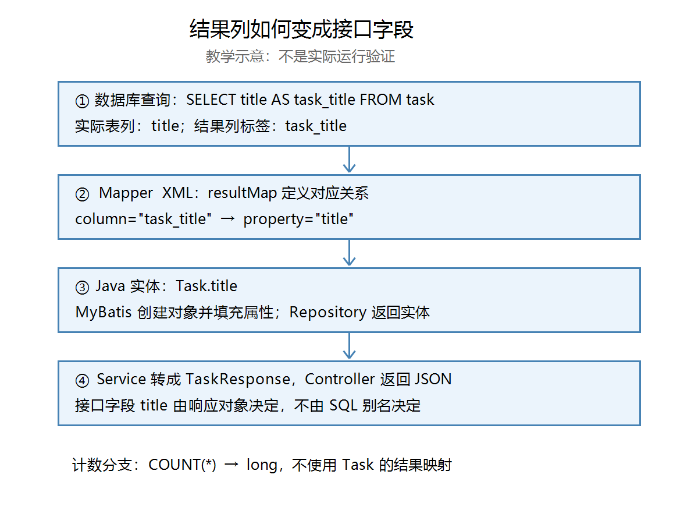

# 第三十六节 · MyBatis 结果映射与字段命名

## 一页重点速记

1. 【重点记住】结果映射解决“查询结果列 → Java 对象属性”的对应问题。
2. 【重点记住】`resultType="完整类名"` 指定结果类型；集合写元素类型，不写 List。
3. 【重点记住】`resultMap="映射规则名"` 引用显式映射；同一 select 不同时写 resultType 和 resultMap。
4. 【重点记住】`column` 写查询结果列标签，`property` 写 Java 属性名，不写 setter 方法名。
5. 【重点记住】`<id column="id" property="id"/>` 标识对象标识属性；普通属性使用 `<result>`。它不会创建表主键或生成编号。
6. 【重点记住】SQL 的 AS 只为结果列起别名，不修改实际表列；同层 WHERE 中仍使用实际列名。
7. 【常用查阅】驼峰配置 `map-underscore-to-camel-case: true` 处理 task_title → taskTitle，不能推断 task_title → title。
8. 【重点记住】MyBatis 把行转成实体；Service 把实体转成响应 DTO；JSON 字段由响应对象及序列化规则决定。
9. 【重点记住】COUNT(*) 返回计数，当前使用 resultType="long"，不套用实体映射。

## 详细图文说明

### 1. 用途与命名约定

数据库常用下划线命名，Java 属性常用小驼峰。这是常见推荐风格，不是 SQL 或 Java 强制要求；接口字段按团队约定确定。

本课实际表列仍为 title，通过别名模拟名称不一致：

```sql
SELECT id, title AS task_title, completed FROM task;
```

结果列标签变成 task_title，实际表结构没有改变。如果表里本来就叫 task_title，也可直接查询该列，再通过映射填充 Java 的 title。

【图片 1：请在语雀此处上传 images/结果映射与接口字段流程图.png】



观察实际表列、结果列标签、实体属性和接口字段四个位置。SQL 别名与响应字段属于不同阶段。本图为教学示意，不是实际运行验证。

### 2. 显式映射语法与本课代码

文件：`task_manager/src/main/resources/mapper/TaskMapper.xml`。

```xml
<resultMap id="taskResultMap" type="com.ygyong.task_manager.entity.Task">
    <id column="id" property="id"/>
    <result column="task_title" property="title"/>
    <result column="completed" property="completed"/>
</resultMap>

<sql id="taskColumns">
    id, title AS task_title, completed
</sql>

<select id="findById" resultMap="taskResultMap">
    SELECT <include refid="taskColumns"/>
    FROM task
    WHERE id = #{id}
</select>
```

| 部分 | 含义与规则 |
| --- | --- |
| resultMap 的 id | 自定义映射名称，在当前 namespace 中唯一 |
| type | 每行结果对应的 Java 类型 |
| column | 查询结果中的列标签；有 AS 时按别名对应 |
| property | Java 属性名；本课 title 有 setTitle 方法 |
| select 的 resultMap | 引用已定义的映射名称 |
| id 子标签 | 标识对象身份的属性，当前对应任务主键 |
| result 子标签 | 普通属性映射 |

Task 保留无参构造方法及访问方法，由 MyBatis 创建并填充对象。声明 Task 类型不会让框架自动理解任意不同名称的含义。

四个返回 Task 的查询共用此映射：findAll、findById、findByConditions、findPageByConditions。修改公共查询列时，要检查所有引用它的查询。

计数独立返回数字：

```xml
<select id="countByConditions" resultType="long">
    SELECT COUNT(*) FROM task
    <include refid="taskConditions"/>
</select>
```

### 3. 常用方式怎样选择

| 场景 | 常用方式 | 示例 |
| --- | --- | --- |
| 列标签与属性同名 | resultType 自动映射 | title → title |
| 少量不同名称，便于在 SQL 中统一 | AS 别名配合 resultType | task_title AS title |
| 仅下划线与小驼峰不同 | 驼峰配置配合 resultType | task_title → taskTitle |
| 名称差异或需要清晰复用对应规则 | resultMap | task_title → title |

【常用查阅】配置写入已有 mybatis 节点下，不能重复创建同名顶层节点：

```yaml
mybatis:
  mapper-locations: classpath:mapper/*.xml
  configuration:
    map-underscore-to-camel-case: true
```

这是参考写法，本课未启用。该选项默认 false，只处理命名形式，不进行含义推断。

【扩展参考】复杂结果还可使用关联、集合和构造方法映射，当前不需要引入。

### 4. 完整调用链与输入映射的区别

Postman → TaskQueryController → TaskQueryService → TaskQueryRepository → TaskMapper → XML → 数据库；查询行再经 resultMap 转为 Task，Service 转为 TaskResponse，Controller 输出 JSON。

- Controller：接收 HTTP 参数，返回响应对象。
- Service：校验分页、清理关键词、计算 offset，组装列表和总数。
- Repository：提供数据访问入口，委托 Mapper。
- Mapper/XML：执行 SQL，并把结果映射到 Java 类型。

`#{keyword}` 和 @Param 解决 Java 输入值进入 SQL 的问题；column/property 解决 SQL 输出值进入 Java 对象的问题，方向不同。

### 5. 易错点与检查顺序

- 起别名后忘改 column：名称不匹配可能导致属性未赋值。不能只看 HTTP 200，要核对具体字段。
- 默认值掩盖错误：本课 int 初始为0、boolean为false、String为null；缺少映射不一定立即报错，应对照数据库。
- 把 property 写成 setTitle：应写 title。
- 把 resultMap 引用写成 Java 类名：应引用映射 id；Java 类名放 type 中。
- 把 WHERE 中 title 改成 task_title：本课实际表列仍是 title，同层 WHERE 不能直接用 SELECT 的这个别名。
- 误以为 AS 改了 JSON 字段：接口当前返回 TaskResponse，其 title 访问方法决定该字段。

排错先依次检查：SQL 实际返回哪些列标签 → column 是否匹配 → property 是否存在 → select 是否引用正确映射 → DTO 转换是否取对属性。

### 6. 运行与常用操作

在 IDEA 打开本课 task_manager，停止旧服务再启动。Postman 用 GET 请求 `http://localhost:8080/database/tasks?page=1&size=3`，并用 `/database/tasks/实际编号` 查询单条。观察状态码、响应中的 title、分页总数，与 Navicat 查询结果对照。GET 无需添加 JSON 请求体。

以下以 Windows 默认 IntelliJ Keymap 为前提，实际以本机设置为准：

| 功能 | 常用快捷键或入口 |
| --- | --- |
| 查找动作 | Ctrl+Shift+A；Help → Find Action |
| 查找文件 | Ctrl+Shift+N |
| 当前文件查找 / 全局查找 | Ctrl+F / Ctrl+Shift+F |
| 格式化代码 | Ctrl+Alt+L |
| 跳转声明 | Ctrl+B |
| 运行当前上下文 | Ctrl+Shift+F10 |
| 再次运行 / 停止 | Shift+F10 / Ctrl+F2 |
| 查看或修改键位 | File → Settings → Keymap |

### 7. 工作中先记这些

语法要求：resultType 与 resultMap 二选一；column 对应结果列标签，property 对应 Java 属性。

推荐风格：数据库下划线、Java 小驼峰；同类查询复用清楚的映射规则。

团队接口约定：JSON 字段由接口设计确定，不随数据库列名或 SQL 别名随意改变。

## 少量独立练习

以下为可选复习，建议复制 Mapper 文件或另建练习副本；不要求重新完成课堂验收。

1. **输入与输出对照**：为 findById 写出“HTTP 参数 → Java 参数 → SQL 占位符”和“结果列 → Task 属性 → JSON 字段”两条对应链。前提：阅读现有查询链路。验收：能区分 @Param、column 与 property 的作用，不混淆方向。
2. **编号别名映射**：在练习副本为 id 设置不同的结果列别名并配好映射。前提：保持真实表结构不变。验收：分页和单条查询编号仍与 Navicat 一致，排序和筛选正常；自行完成，不附完整实现。

## 关联资料与图片清单

- 上一课：[Mapper XML 与 SQL 复用](../35_MyBatis%20Mapper%20XML与SQL复用/笔记.md)。
- 基础参考：[第1～32节手册](../Java后端知识手册/基础篇_01至32节/README.md)。本课新知识拟与动态 SQL、分页等内容归入后续 MyBatis 查询与分页主题册。
- 官方参考：[结果映射](https://mybatis.org/mybatis-3/sqlmap-xml.html#Result_Maps)、[配置项](https://mybatis.org/mybatis-3/configuration.html#settings)。

| 编号 | 图片名称 | 相对路径 |
| --- | --- | --- |
| 1 | 结果映射与接口字段流程图 | images/结果映射与接口字段流程图.png |

复制 Markdown 到语雀通常不会自动上传本地图片。请同时保留本笔记和 images 目录，在标记位置逐张上传，或使用已验证支持图片的导入方式。
