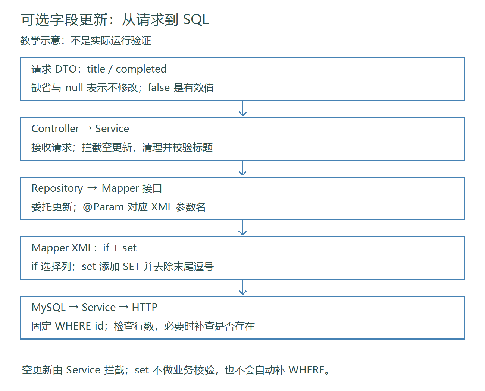

# 第三十七节：MyBatis 动态更新与 set 标签

## 一页重点速记

1. 【重点记住】部分更新用于“只修改本次提供的字段”，避免未提交的字段被默认值覆盖。
2. 【重点记住】可选状态使用 `Boolean`：`null` 不修改，`false` 改为未完成，`true` 改为已完成。
3. 【重点记住】`<if test="字段 != null">` 决定是否加入赋值；不能用状态真假代替是否提供。
4. 【重点记住】`<set>` 在内部有内容时添加 `SET`，去掉末尾多余逗号。
5. 【重点记住】Service 拦截空更新；`set` 不负责业务校验，也不能让空更新成为合法 SQL。
6. 【重点记住】固定保留 `WHERE id = #{id}`，更新范围不能依赖可选字段。
7. 【重点记住】XML 的 update id 对应 Mapper 方法名；`@Param` 对应 SQL 参数名。
8. 【常用查阅】缺省与显式 null 均表示不修改，是本接口约定；不能用它表达将数据库列清空为 NULL。
9. 【重点记住】本课当前源码标题上限为100，先 strip，再校验空白与长度；新增与更新的业务规则应保持明确。

工作中先记这些：可选字段用包装类型；先校验再更新；if 选列、set 处理语法；始终限定更新对象。

## 详细图文说明

### 1. 用途、输入输出与约定

编辑任务时，用户可能只修改标题，也可能只切换完成状态。将整个对象覆盖到数据库，容易把未提交字段覆盖成null或false，因此需要动态生成本次的赋值列表。

本课接口 `PATCH /database/tasks/{id}` 返回布尔值，成功时HTTP 200、正文为true。

```json
{"title":"整理课程代码","completed":false}
```

| 输入情况 | 本课规则 |
| --- | --- |
| 只提供title | 只修改标题 |
| 只提供completed | 只修改状态，false也有效 |
| 两者都提供 | 同时修改 |
| 字段缺省或null | 保持原值 |
| 两者均null或空对象 | 400 |
| 标题strip后为空或超过100 | 400 |
| 有效更新请求对应的任务不存在 | 404 |
| 重复设置相同值 | 成功 |

这些是接口与业务约定，不是PATCH或MyBatis强制规定的全部行为。普通Java DTO不会自动区分JSON字段缺省与显式null。

### 2. 完整调用链与职责

【图片 1：请在语雀此处上传 images/动态更新与set流程图.png】



观察图中Service和XML的分工：Service决定请求是否允许执行，XML决定如何拼出赋值列表。图为教学示意，不代表实际运行验证。

| 位置（相对task_manager/src/main） | 职责 |
| --- | --- |
| java/.../dto/UpdateTaskRequest.java | String title与Boolean completed及getter/setter |
| java/.../controller/TaskUpdateController.java | @RestController接收请求；@PatchMapping声明路由；@RequestBody绑定JSON；@PathVariable绑定编号 |
| java/.../service/TaskUpdateService.java | @Service承载校验和更新结果判断 |
| java/.../repository/TaskUpdateRepository.java | @Repository委托数据库访问 |
| java/.../mapper/TaskMapper.java | @Mapper声明Mapper接口，@Param定义绑定名 |
| resources/mapper/TaskMapper.xml | 编写动态更新SQL |

对象字段使用`Boolean`而非`boolean`，是因为基本类型默认false，无法直接表达“未提供”。`Task`实体仍可以使用boolean，因为数据库记录中的状态是实际值。

Controller核心方法：

```java
@PatchMapping("/database/tasks/{id}")
public boolean updateTask(@PathVariable("id") int taskId,
                          @RequestBody UpdateTaskRequest request) {
    return taskUpdateService.updateTask(
            taskId, request.getTitle(), request.getCompleted());
}
```

Service核心校验：

```java
if (title == null && completed == null) {
    throw new IllegalArgumentException("至少提供一个要更新的字段");
}
if (title != null) {
    title = title.strip();
    if (title.isBlank()) {
        throw new IllegalArgumentException("任务标题不能为空白");
    }
    if (title.length() > 100) {
        throw new IllegalArgumentException("任务标题不能超过100个字符");
    }
}
int updateCount = taskUpdateRepository.updateTask(taskId, title, completed);
```

`strip()`返回新字符串，要接收返回值；`isBlank()`识别空串或全空白。`String.length()`统计UTF-16代码单元，不能把它严格等同于用户看到的字符数，普通汉字、英文字母边界测试可直接使用。

影响1行返回成功；0行时用现有findById补查，不存在抛TaskNotFoundException，存在且本次指定字段都与目标相同则成功。其他结果抛IllegalStateException。已有统一异常处理器将参数错误转400、任务不存在转404。

【扩展参考】行数口径可能受连接配置影响，不能只凭0行断定不存在；当前更新与补查不是事务一致性方案，并发问题留到事务专题。

### 3. Mapper接口与动态SQL

```java
int updateTask(@Param("id") int id,
               @Param("title") String title,
               @Param("completed") Boolean completed);
```

Repository只传递参数并返回Mapper返回的int；这个int表示更新行数，不是任务编号。

在现有namespace对应TaskMapper全名的XML内添加：

```xml
<update id="updateTask">
    UPDATE task
    <set>
        <if test="title != null">
            title = #{title},
        </if>
        <if test="completed != null">
            completed = #{completed},
        </if>
    </set>
    WHERE id = #{id}
</update>
```

【重点记住】XML中的`updateTask`对应方法名；`title`与`completed`对应@Param名称。这个方法的SQL放XML后，不再给同一方法重复添加@Update。

- `<if>`的test是条件表达式，决定其内部SQL是否参与生成。
- `#{title}`等参数作为预编译参数绑定，不手工加引号，不用`${}`替换用户值。
- 每个赋值末尾保留逗号是推荐写法，交给set清理最后一个逗号。
- `set`只处理内部赋值片段；WHERE写在外部并固定按主键限定。

只改标题时，SQL结构为：

```sql
UPDATE task SET title = ? WHERE id = ?;
```

同时修改时：

```sql
UPDATE task SET title = ?, completed = ? WHERE id = ?;
```

这些是生成结构示意，不是数据库执行日志。所有if都不成立时，set不会凭空生成赋值，因此必须先拦截空更新。

【常用查阅】set可理解为以下trim写法的常用专用形式，本课优先使用set：

```xml
<trim prefix="SET" suffixOverrides=",">
    <!-- 各个可选赋值 -->
</trim>
```

### 4. 与where、结果映射的联系

| 标签/机制 | 处理对象 | 主要作用 |
| --- | --- | --- |
| if | SQL片段 | 按条件选择内容 |
| where | 查询条件 | 有内容时添加WHERE并清理开头AND/OR |
| set | 更新赋值 | 有内容时添加SET并清理末尾逗号 |
| resultMap | 查询结果 | 将结果列映射到Java属性 |

上一课查询里的`title AS task_title`只改变结果列标签；真实列仍是title。UPDATE必须写真实列，不能用查询别名task_title。resultMap不控制UPDATE的赋值。

工作中先记这些：看清真实列、结果列标签、Java属性、参数名分别属于哪里；它们可以相同，但职责不同。

### 5. 运行、排错与易错点

IDEA打开本课task_manager，停止旧课服务后启动。Postman使用PATCH和实际编号，Body → raw → JSON，检查Content-Type为application/json。每次更新后通过GET按编号查询，并在Navicat刷新确认未提供字段不变。

集中验证：只标题、只false、组合、重复相同值、null忽略、空对象、全null、空白标题、长度边界、有效正文但编号不存在。非法组合请求应整体拒绝，不能部分写入。

| 现象 | 优先检查 |
| --- | --- |
| false无法更新 | 是否误写test="completed" |
| 空对象导致SQL错误 | Service是否拦截全null |
| 末尾逗号报错 | 赋值是否包在set内 |
| 找不到绑定语句 | namespace、update id、mapper-locations |
| 找不到参数 | @Param与XML名称是否一致 |
| 修改后行为不变 | 保存文件、工程目录、启动配置与旧进程 |
| 提示长度与规则不同 | 同步修改判断数字和错误提示 |

本课不要求例行断点。确需排错时，可在Service调用Repository前停住，检查title/completed，再由Postman触发请求。

### 6. Windows常用操作

以下以IDEA默认Windows Keymap为前提，实际键位可在Settings → Keymap查询；Ctrl+Shift+A打开Find Action按功能名查找。

| 功能 | 常用键位或入口 |
| --- | --- |
| 保存全部 | Ctrl+S；File → Save All |
| 查找文件 | Ctrl+Shift+N |
| 全工程查找 | Ctrl+Shift+F |
| 跳转声明 | Ctrl+B |
| 格式化 | Ctrl+Alt+L |
| 运行当前上下文 | Ctrl+Shift+F10；Run菜单 |
| 停止进程 | Ctrl+F2；运行窗口停止按钮 |
| 切换断点（需要时） | Ctrl+F8 |
| 查找操作 | Ctrl+Shift+A |

## 少量独立练习

以下为可选复习，在单独副本操作，不提前给完整答案。

1. **独立补写动态更新。** 前提：复制本课工程后，在副本暂时移除updateTask的XML内容。目标：根据接口方法重新编写set/if。验收：只标题不改状态、只false不改标题、组合更新均正确，空对象仍由Service拒绝。
2. **调整标题长度边界。** 前提：使用练习副本和独立测试任务。目标：将更新上限设为60并同步提示。验收：60个普通字符成功、61个返回400，失败时标题与状态都不变。解释长度校验为何应在更新之前。

## 课程关联与图片清单

- 第三十三节：if/where动态筛选；第三十五节：Mapper XML与参数对应；第三十六节：结果列与Java属性映射。
- 基础参考：[知识手册总目录](../Java后端知识手册/README.md)；[笔记整理规划](../Java后端知识手册/笔记整理规划.md)。本课新知识拟归入后续MyBatis数据访问主题册，暂不重复建立主题手册。
- 图片1：动态更新与set流程图，`images/动态更新与set流程图.png`。

复制Markdown到语雀后，本地图片通常不会自动上传，请按就地提示上传images中的图片，或使用语雀支持的导入方式。
