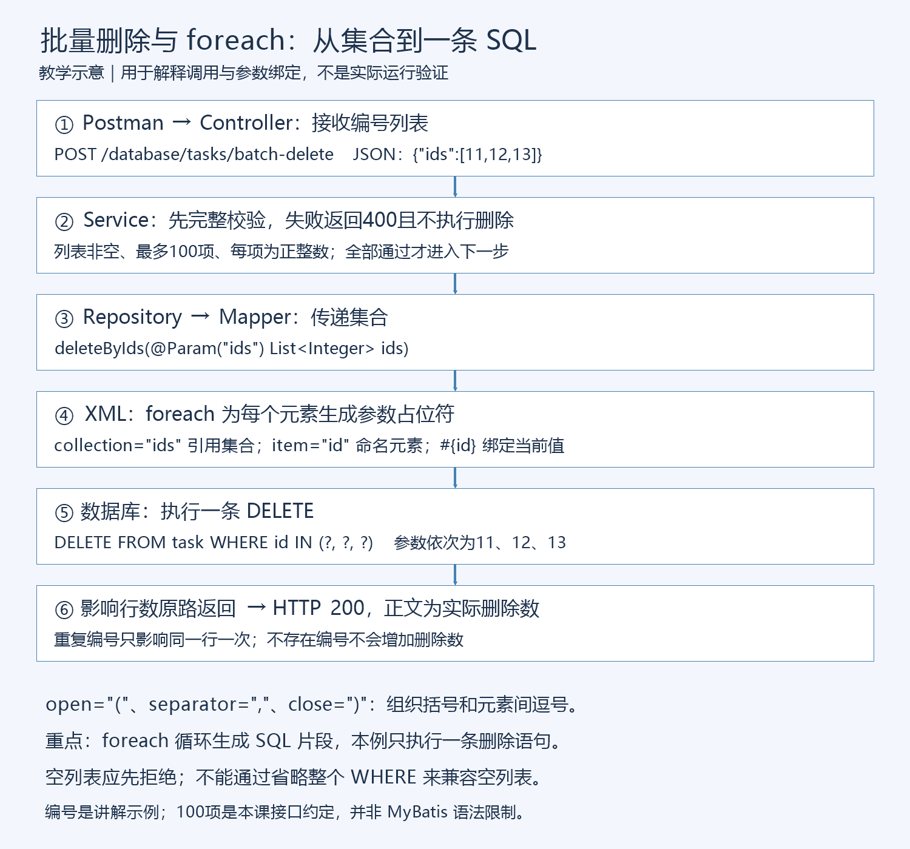

# 第三十八节：MyBatis 批量删除与 foreach 标签

## 一页重点速记

1. 【重点记住】批量删除常用 `DELETE FROM task WHERE id IN (...)`，按编号集合匹配任务。
2. Mapper 模板：`int deleteByIds(@Param("ids") List<Integer> ids);`，返回实际删除行数。
3. XML 的 `<delete id="deleteByIds">` 对应 Mapper 方法；namespace 对应接口全名。
4. `collection="ids"` 引用参数集合，`item="id"` 为当前元素命名，`#{id}` 绑定当前值。
5. `open="(" separator="," close=")"` 负责括号与元素间逗号。
6. foreach 在本例生成多个占位符，最终执行一条 SQL；不等于循环调用单条删除。
7. 删除前先校验整个集合：不为 null、不为空、项数不超限、每项是正整数。
8. 【重点记住】不能为了处理空集合而省略整个 WHERE；否则可能变成全表删除。
9. 重复编号和不存在的编号不会增加实际删除数；不要用列表长度充当删除结果。

## 详细图文说明

### 1. 功能与接口约定

用途：任务列表选中多条任务后，一次提交编号集合并删除。

```http
POST /database/tasks/batch-delete
Content-Type: application/json
```

```json
{"ids": [11, 12, 13]}
```

示例编号用于说明格式，应换成自己的测试数据。成功响应为200，正文是实际删除条数的数字；不存在的编号忽略，全不存在返回0。重复编号对应的任务只删除一次。

【常用查阅】本课用 POST 承载批量操作请求体；原单条 `DELETE /database/tasks/{id}` 保留，仍沿用原有204及不存在404的约定。批量删除忽略不存在编号是本课的接口约定，其他团队可以制定不同规则。

| 参数情况 | 本课规则 |
| --- | --- |
| ids缺省、null或空列表 | 400 |
| 超过100项 | 400，按原始列表长度计算 |
| 含null、0、负数 | 400，整个列表校验失败后不执行删除 |
| 合法编号集合 | 执行删除，返回实际影响行数 |

100是本课接口上限，不是MyBatis限制。非法JSON或请求体无法转换也属于请求错误，不能与Service业务校验混为一谈。

### 2. 完整调用链与分层职责

【图片 1：请在语雀此处上传 images/批量删除与foreach流程图.png】



观察图中的校验分支：合法集合才进入数据访问链；foreach构建占位符后只执行一条DELETE。此图为教学示意，不是实际运行验证。

以下路径均相对于本课 `task_manager/`，Java文件位于 `src/main/java/com/ygyong/task_manager/`。

| 文件与职责 | 关键内容 |
| --- | --- |
| dto/BatchDeleteTaskRequest.java | List<Integer> ids及getter/setter，承接JSON数组 |
| controller/TaskDeleteController.java | @RestController、@PostMapping与@RequestBody，接收并返回HTTP数据 |
| service/TaskDeleteService.java | @Service，检查集合与每个编号，决定本次操作能否执行 |
| repository/TaskDeleteRepository.java | @Repository，提供数据访问入口，转交Mapper |
| mapper/TaskMapper.java | @Mapper声明映射接口；@Param为XML参数命名 |
| src/main/resources/mapper/TaskMapper.xml | 定义实际SQL，namespace连接Mapper接口 |

请求对象的核心声明：

```java
private List<Integer> ids;
```

Java泛型使用引用类型，不能写 `List<int>`。Integer可以表示null，因此需要逐项检查。JSON数组转换成Java列表，不具有JavaScript数组那样任意混合类型的设计目标。

Controller新增方法：

```java
@PostMapping("/database/tasks/batch-delete")
public int deleteTasks(@RequestBody BatchDeleteTaskRequest request) {
    if (request == null) {
        throw new IllegalArgumentException("请求体不能为空");
    }
    return taskDeleteService.deleteTasks(request.getIds());
}
```

Service的完整批量方法：

```java
public int deleteTasks(List<Integer> ids) {
    if (ids == null || ids.isEmpty()) {
        throw new IllegalArgumentException("任务编号列表不能为空");
    }
    if (ids.size() > 100) {
        throw new IllegalArgumentException("一次最多提交100个任务编号");
    }
    for (Integer id : ids) {
        if (id == null || id <= 0) {
            throw new IllegalArgumentException("任务编号必须是正整数");
        }
    }
    return taskDeleteRepository.deleteByIds(ids);
}
```

【重点记住】`||`短路求值使null不会继续调用isEmpty；同理，null编号不会继续拆箱比较。循环只校验，全部通过才删除，避免循环中边检查边删除导致部分执行。

原有GlobalExceptionHandler将IllegalArgumentException转换为400。Repository转交并原样返回行数：

```java
public int deleteByIds(List<Integer> ids) {
    return taskMapper.deleteByIds(ids);
}
```

### 3. foreach语法拆解

Mapper声明：

```java
int deleteByIds(@Param("ids") List<Integer> ids);
```

对应XML：

```xml
<delete id="deleteByIds">
    DELETE FROM task
    WHERE id IN
    <foreach collection="ids" item="id" open="(" separator="," close=")">
        #{id}
    </foreach>
</delete>
```

| 部分 | 用途与规则 |
| --- | --- |
| collection | 集合表达式；本例与@Param("ids")一致 |
| item | 当前元素的临时名称，可以改名，但标签体必须同步 |
| open / close | 遍历内容的开头与结尾文本 |
| separator | 元素间分隔符，不会在最后多加一个逗号 |
| #{id} | 为当前元素创建占位符并绑定值 |

【重点记住】`item="id"`中的id是遍历变量；`WHERE id`中的id是数据库列名，两者名字相同只是便于阅读。

传入 `[11,12,13]` 时，结构可理解为：

```sql
DELETE FROM task WHERE id IN (?, ?, ?);
```

参数依次为11、12、13。不能写 `IN (#{ids})` 并期待一个占位符自动展开整个列表，也不要用 `${id}` 直接拼接参数文本。

【常用查阅】同样的foreach片段可用于 `SELECT ... WHERE id IN (...)`。常用集合来源包括List、Set与数组；使用显式@Param命名有助于避免依赖默认集合名称。当前场景不需要index；遍历列表时可用 `index="index"` 取得从0开始的迭代位置。

【扩展参考】foreach还能用于批量插入的VALUES片段等场景。生成一条多值SQL与JDBC批处理是不同机制，后续有实际需求再深入。本课不把foreach本身视为事务保证，也不涉及多条SQL的回滚。

### 4. 空集合与实际删除行数

空集合没有编号可以绑定。当前固定保留 `WHERE id IN`，空集合不能形成合法SQL，因此必须先拦截。

尤其不要把整个条件放进可被跳过的if/where组合：没有条件时where标签不会输出WHERE，这可能使最终语句变成：

```sql
DELETE FROM task;
```

这是全表删除。`nullable`等标签配置也不能替代业务层的空集合规则。

对于主键编号，`IN (11,11,99)`表示满足任意一个编号即可，不表示对11删除两次。若11存在、99不存在，实际删除数为1。这是原理示例，不是实际数据库记录。

工作中先记这些：输入先完整校验，参数逐项绑定，删除条件固定保留，返回数据库影响行数；集合为空时的业务行为必须明确。

### 5. Postman验证与排错

在IDEA打开本课工程，停止旧服务，再运行本课。使用已有创建接口准备可删除测试任务，记录编号并保留一条未选中的任务。

Postman选择POST，URL为 `http://localhost:8080/database/tasks/batch-delete`（按实际端口调整），Body → raw → JSON，检查Content-Type为application/json。

| 场景 | 检查重点 |
| --- | --- |
| 多个存在编号 | 200与实际删除条数；GET或Navicat确认目标消失 |
| 重复、混合不存在、全部不存在 | 分别观察实际行数；全部不存在应为0 |
| 空列表、缺省、null | 400 |
| 合法编号与非法项混合 | 400，合法编号对应任务仍存在 |
| 超过100项 | 400；重复编号也计入输入项数 |
| 未选中的任务 | 删除前后均保留 |

排错顺序：确认运行的是本课工程 → 检查请求方法、URL和JSON形状 → 检查Service条件 → 检查Mapper方法名、namespace及collection名称。每次删除会改变数据，后续验证要重新准备或调整编号。

| 常见错误 | 原因 |
| --- | --- |
| Parameter 'ids' not found | @Param与collection未对应 |
| 找不到映射语句 | XML未加载，或namespace/id不匹配 |
| 空集合产生SQL错误 | 校验被绕过，未生成完整IN条件 |
| 返回提交数量而非删除数量 | 用ids.size()替代数据库行数 |

### 6. Windows IDEA常用操作

以下按默认Windows Keymap；不同方案以Settings → Keymap为准，可从Help → Find Action查找动作。

| 功能 | 常用快捷键或入口 |
| --- | --- |
| 查找动作 | Ctrl+Shift+A，Help → Find Action |
| 查找类 | Ctrl+N |
| 查找文件 | Ctrl+Shift+N |
| 当前文件查找 / 全局查找 | Ctrl+F / Ctrl+Shift+F |
| 跳转声明 | Ctrl+B，Navigate → Declaration |
| 返回上一位置 | Ctrl+Alt+Left，Navigate → Back |
| 格式化代码 | Ctrl+Alt+L，Code → Reformat Code |
| 保存全部 | Ctrl+S，File → Save All |
| 运行 / 停止 | Shift+F10 / Ctrl+F2，Run菜单 |
| 修改快捷键 | File → Settings → Keymap |

## 少量独立练习

以下为可选复习，在练习副本完成；不要求修改当前课堂工程，不提供完整答案。

1. **重命名遍历变量**：前提是保留一份可运行副本。将item的名字改为taskId并同步必要引用，保持参数集合名ids。验收：合法多编号删除正常，能解释哪些id不应跟着改。
2. **批量查询**：基于现有Task结果映射，在副本新增按编号集合查询的方法与接口。明确空集合规则，返回匹配任务，不修改数据。验收：重复编号不产生重复任务，不存在编号被忽略，原有查询正常，能解释为何需要select结果映射而delete不需要。

## 关联资料与图片清单

- 上一课：[动态更新与set](../37_MyBatis动态更新与set标签/笔记.md)。
- 基础参考：[Java后端知识手册目录](../Java后端知识手册/README.md)。本课拟归入后续MyBatis数据访问主题册，尚未创建该册。
- 官方参考：[MyBatis动态SQL与foreach](https://mybatis.org/mybatis-3/dynamic-sql.html#foreach)。

| 编号 | 名称 | 相对文件路径 |
| --- | --- | --- |
| 1 | 批量删除与foreach流程图（教学示意） | images/批量删除与foreach流程图.png |

复制Markdown到语雀后，请在对应上传提示处手动上传图片，或使用语雀支持的导入方式；本地相对路径不会保证自动上传图片。
