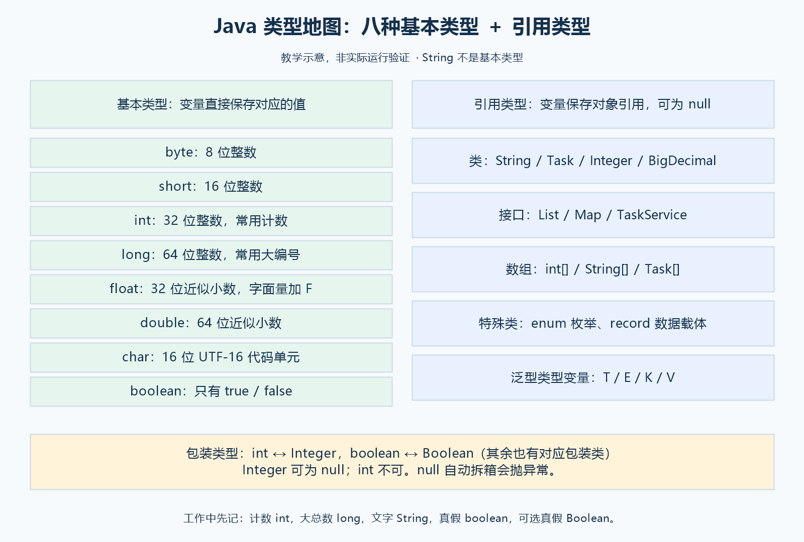

# 02 类型、变量、运算符与字符串

## 一页重点速记

| 【重点记住】 | 工作中如何选择/书写 |
| --- | --- |
| 八种基本类型 | byte、short、int、long、float、double、char、boolean |
| 高频选型 | 数量int，大总数long，文字String，真假boolean |
| 可以缺失的值 | Integer、Boolean等包装类型；null拆箱会抛异常 |
| 引用类型 | 类、接口、数组等；String不属于基本类型 |
| 判空与判空白 | `title == null`；非null时再用isBlank() |
| 字符串比较 | `"done".equals(status)`，不用==比较内容 |
| 除法与分页 | `5 / 2`是2；乘法前转long防止int先溢出 |
| 对象与变量 | final禁止重新赋值，不保证对象内部不能变化 |

**允许查阅：**具体整数范围、完整String API和少见类型转换不要求全部背诵；浮点不是精确金额类型。

## 详细图文说明

## 1. 【重点记住】Java 类型的完整基础分类

【图片 3：请在语雀此处上传 images/Java类型分类图.png】



观察说明：教学示意。先记左侧八种基本类型，再看右侧引用类型；Integer和Boolean属于引用类型中的包装类，可空性与对应基本类型不同。

Java 是静态类型语言，变量声明后有确定类型。先分为基本类型与引用类型，不能把 String 当作第九种基本类型。

### 八种基本类型

| 类型 | 位数/取值 | 示例 | 常见用途 |
| --- | --- | --- | --- |
| byte | 8 位有符号，-128～127 | `byte value = 10;` | 二进制数据、字节数组 |
| short | 16 位有符号，-32768～32767 | `short value = 1000;` | 小范围整数，业务中较少直接选用 |
| int | 32 位有符号，约 ±21 亿 | `int count = 10;` | 计数、课程中的任务编号 |
| long | 64 位有符号，约 ±9.22×10¹⁸ | `long total = 100L;` | 大编号、总数、毫秒时间戳 |
| float | 32 位 IEEE 754，约 6～7 位有效十进制数字 | `float ratio = 0.5F;` | 精度要求较低的浮点计算 |
| double | 64 位 IEEE 754，约 15～16 位有效数字 | `double ratio = 0.5;` | 一般浮点计算 |
| char | 16 位无符号 UTF-16 代码单元，0～65535 | `char grade = 'A';` | 单个代码单元 |
| boolean | 只有 true / false | `boolean done = false;` | 条件和状态 |

boolean 不写成0或1；规范没有规定所有存储场景下统一占几个字节。char 不等于“任意一个完整 Unicode 字符”，部分字符（例如许多 emoji）需要两个 char。

整数有符号范围公式：-2^(n-1) 到 2^(n-1)-1。浮点有效数字不是“小数点后固定几位”，也不保证十进制小数精确。

### 引用类型

| 分类 | 例子 | 理解方式 |
| --- | --- | --- |
| 类类型 | String、Task、Integer、BigDecimal | 变量保存对象引用 |
| 接口类型 | List、Map、TaskService | 按能力约定使用对象 |
| 数组类型 | int[]、String[]、Task[] | 固定长度的对象容器 |
| 枚举类型 | TaskStatus | 一组受限制的命名实例，本质是特殊类 |
| record 类型 | `record TaskView(int id, String title) {}` | 简洁的数据载体，本质是特殊类 |
| 注解接口类型 | Override、Service | 描述供编译器或框架读取的元数据 |
| 类型变量 | T、E、K、V | 泛型声明中的类型参数，见第05章 |

`null` 是空引用值，不是字符串，也不是基本类型的默认通用值。`void` 表示方法不返回值，不是可以声明普通变量的第九种基本类型。

## 2. 【重点记住】声明、赋值、默认值与作用域

```java
int count;            // 声明局部变量
count = 3;            // 赋值后才可以读取
String title = "学习"; // 声明并初始化
final int maxSize = 100;
```

| 位置 | 默认初始化 |
| --- | --- |
| 实例字段、静态字段、数组元素 | 数字0、char为'\u0000'、boolean为false、引用为null |
| 方法内局部变量 | 必须在读取前明确赋值，不自动给可读的默认值 |

变量在声明的作用域内可用，代码块内部声明的局部变量不能在外部直接访问。方法参数也是方法内的变量。赋值保存当时计算出的值，不会建立响应式联动。

```java
int remaining = 0;
boolean allCompleted = remaining == 0;
remaining = 5; // allCompleted 仍为 true，必须重新计算才会改变
```

`final` 限制变量不能再次赋值；引用为final不代表引用的对象不可修改。类常量通常写成 `public static final int MAX_PAGE_SIZE = 100;`。

扩展参考：`var count = 3;` 是局部变量类型推断，推断后仍为int。不是JavaScript的var，不能随意改类型；不能用作普通字段类型、普通方法参数类型，也不能仅用null让它推断。

## 3. 【重点记住】包装类型与装箱拆箱

| 基本类型 | 包装类型 |
| --- | --- |
| byte / short / int / long | Byte / Short / Integer / Long |
| float / double | Float / Double |
| char / boolean | Character / Boolean |

```java
Integer boxed = 3;   // 自动装箱：int → Integer
int value = boxed;   // 自动拆箱：Integer → int
Boolean completed = null;
// boolean done = completed; // 会因 null 拆箱而抛 NullPointerException
```

包装类型可为null，基本类型不可。可选查询条件用Boolean可表达“没传、true、false”；boolean只能表达两种状态。泛型必须使用引用类型，所以写 `List<Integer>`，不能写 `List<int>`。

包装对象比较值用equals，不依赖 `==`：某些整数缓存会让 `==` 偶尔看起来正确，超出缓存就暴露问题。

## 4. 【重点记住】类型转换与解析

```java
int count = 10;
long total = count;       // 自动扩大到 long
int small = (int) total;  // 显式窄化，超范围可能丢失数据
double average = 5 / 2.0; // 2.5
double wrong = 5 / 2;     // 先整数除法得到2，再转换为2.0
long offset = (long) (page - 1) * size; // 在乘法前转long
```

数值常见扩大路径：byte → short → int → long → float → double，char → int。扩大到浮点仍可能损失整数精度，不能简单记成“扩大就永不丢失”。byte/short/char参与普通算术运算通常先提升为int。boolean不能与数值互转。

```java
int id = Integer.parseInt("12");          // 非法文本可能抛 NumberFormatException
Integer boxedId = Integer.valueOf("12");
String text = String.valueOf(12);
boolean done = Boolean.parseBoolean("true");
```

Boolean.parseBoolean只有忽略大小写匹配true才返回true，其他文本返回false，不适合用来严格校验任意用户文本。Spring的请求参数转换是另一套机制，不等同于直接调用这些解析方法。

金额精确计算使用BigDecimal而非float/double：

```java
BigDecimal price = new BigDecimal("0.10");
BigDecimal sum = price.add(new BigDecimal("0.20"));
```

需要 `import java.math.BigDecimal;`。字符串构造保留十进制意图；不要用 `new BigDecimal(0.1)` 期待得到精确的0.1。除法还需约定精度与舍入规则，属于扩展内容。

## 5. 【重点记住】运算符速查

| 类别 | 运算符 | 注意 |
| --- | --- | --- |
| 算术 | + - * / % | 整数除法截断，整数除0抛异常 |
| 赋值 | = += -= *= /= %= | 复合赋值含隐式转换，别用它掩盖溢出 |
| 自增自减 | ++ -- | 前置先改再取值，后置先取旧值再改 |
| 比较 | > >= < <= == != | 结果是boolean；对象==比较引用 |
| 短路逻辑 | && \|\| ! | 条件必须为boolean；&&/\|\|可能跳过右边 |
| 条件表达式 | 条件 ? 值1 : 值2 | 用于根据条件选值 |
| 位运算，扩展 | & \| ^ ~ << >> >>> | 与普通逻辑运算区别，不用于替代&&/\|\|判空 |
| 类型判断，扩展 | instanceof | 判断对象能否视为某类型；null结果为false |

```java
if (title != null && !title.isBlank()) {
    System.out.println(title);
}
String label = completed ? "已完成" : "未完成";
```

短路让null时不再执行title.isBlank()。Java没有 `===`，不能写 `if (count)` 或用 `title || "默认值"`。

整数溢出通常不会自动抛异常，需根据范围选类型；扩展参考 `Math.addExact` 可检查特定算术溢出。

## 6. 【常用查阅】String 常用写法

【重点记住】内容相等用equals；null先判断；空白用isBlank；保存strip返回值；String不是可变对象。

| 操作 | 示例 | 说明 |
| --- | --- | --- |
| 内容相等 | `"done".equals(status)` | status为null也安全 |
| 可空对象比较 | `Objects.equals(a, b)` | 需要java.util.Objects |
| 空字符串 | `text.isEmpty()` | 长度为0；空格不算空 |
| 空白字符串 | `text.isBlank()` | 空或全是Java定义的空白字符；null需先判断 |
| 长度 | `text.length()` | UTF-16代码单元数，不一定是视觉字符数 |
| 去首尾空白 | `text.strip()` | 基于Unicode空白判断；返回新结果 |
| 传统去空白 | `text.trim()` | 去除首尾编码不大于U+0020的字符 |
| 包含 | `text.contains("Java")` | 区分大小写，按字面子串判断 |
| 前缀/后缀 | `startsWith` / `endsWith` | 返回boolean |
| 查找 | `text.indexOf("a")` | 找不到返回-1 |
| 截取 | `text.substring(0, 3)` | 含开始，不含结束，索引从0开始 |
| 替换字面文本 | `text.replace("a", "b")` | replaceAll的第一个参数则是正则 |
| 拆分 | `text.split(",")` | 参数为正则；点号需写"\\." |
| 拼接集合 | `String.join(",", titles)` | titles可为字符串集合 |
| 大小写 | `toLowerCase(Locale.ROOT)` | 技术标识规范化时避免受默认地区影响 |

String不可变，调用strip/replace不会修改原对象，需保存返回值。循环里大量拼接可用StringBuilder：

```java
StringBuilder builder = new StringBuilder();
builder.append("任务：").append(title);
String result = builder.toString();
```

常用转义：`\n`换行、`\t`制表、`\"`双引号、`\\`反斜杠。单引号表示char，双引号表示String。

## 独立练习：先自己完成，再按标准检查

**练习1：为字段选型。** 为“任务标题、任务总数、可能未传的完成状态、单个任务是否完成、商品金额、创建日期”各选一个Java类型，写出变量声明，并分别说明选择理由。

验收：能区分基本类型和引用类型；缺失状态不会被默认false掩盖；金额与日期不一律用double/String表示。

**练习2：文本与数值边界。** 自行写一个标题校验方法，拒绝null、空字符串和全空白；合法标题去掉首尾空白后返回。再用两个整数计算带小数的平均值，对比整数除法结果。

验收：三类非法标题都能明确拒绝，null时不发生意外空指针；去空白后的结果被保存；能解释除法在哪一步变成浮点计算。

## 工作中先记这些

数量int，大总数long，一般小数double，精确金额BigDecimal，真假boolean，可空真假Boolean，文字String，多个同类值List<T>。日期优先java.time：LocalDate是日期，LocalDateTime不带时区，Instant表示时间线上的时刻，ZonedDateTime带时区，Duration表示时长；这些是扩展参考，不要用字符串替代所有日期计算。

参考：[Java 21 类型规范](https://docs.oracle.com/javase/specs/jls/se21/html/jls-4.html)、[基本类型教程](https://docs.oracle.com/javase/tutorial/java/nutsandbolts/datatypes.html)、[String API](https://docs.oracle.com/en/java/javase/21/docs/api/java.base/java/lang/String.html)、[BigDecimal API](https://docs.oracle.com/en/java/javase/21/docs/api/java.base/java/math/BigDecimal.html)。

## 本章图片清单

| 名称 | 相对路径 |
| --- | --- |
| Java类型分类图（教学示意） | images/Java类型分类图.png |

按正文中的图片编号与上传提示在语雀上传，不依赖复制Markdown自动带图。
