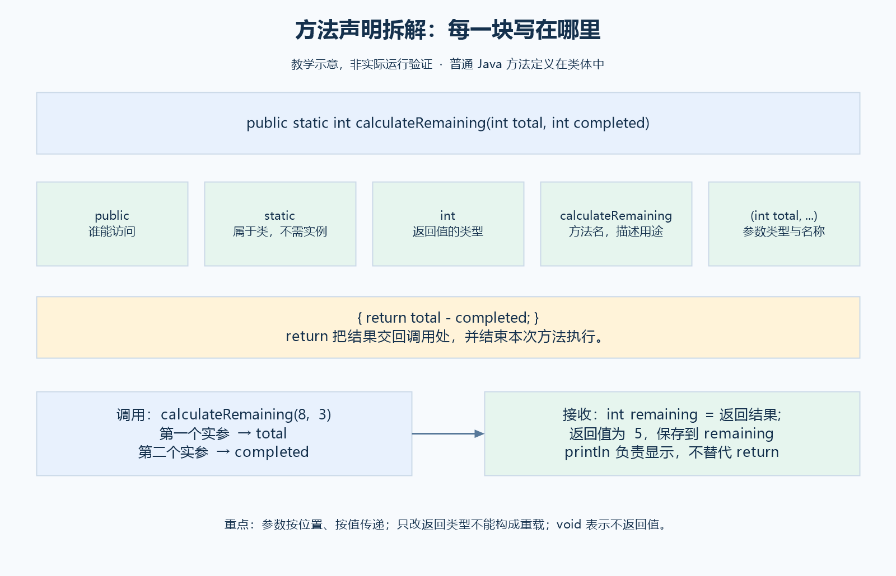

# 03 流程控制与方法

## 一页重点速记

| 【重点记住】 | 语法/规则 |
| --- | --- |
| 条件 | if条件必须为boolean，不支持数字/字符串的truthy判断 |
| 条件组合 | 判空放在可能访问对象的方法调用之前，利用短路 |
| 方法声明 | `public static int calculate(int total, int completed)` |
| 参数 | 按位置、按值传递；同类型参数传反也可能编译通过 |
| return | 结束当前方法；非void正常路径需返回兼容结果 |
| 循环 | 只读遍历用增强for；需要索引用普通for |
| 跳转 | break结束循环，continue跳过本轮，return结束方法 |
| 方法区别 | 重载靠不同参数列表，不能只改变返回类型 |

**最常用写法：**先拒绝非法输入，再写正常流程；方法名表达用途，参数名表达含义。

## 详细图文说明

## 1. 【重点记住】条件判断

```java
if (count < 0) {
    System.out.println("数量不能为负数");
} else if (count == 0) {
    System.out.println("没有任务");
} else {
    System.out.println("还有任务");
}
```

条件必须得到boolean；多个分支从上向下判断，只执行第一个满足条件的分支。独立写多个if则可能执行多次。建议即使只有一行也保留花括号，减少后续加代码时的错误。

```java
if (title == null || title.isBlank()) {
    throw new IllegalArgumentException("标题不能为空");
}
```

判空放左边，利用短路避免在null上调用方法。拒绝非法输入后，正常逻辑继续向下写，减少深层嵌套。

## 2. 【常用查阅】switch

传统形式要注意break，否则可能继续落入后面的分支：

```java
switch (status) {
    case "OPEN":
        System.out.println("进行中");
        break;
    case "DONE":
        System.out.println("已完成");
        break;
    default:
        System.out.println("未知状态");
}
```

JDK 21常用箭头形式无需靠break防止分支贯穿，也可以作为表达式返回值：

```java
String label = switch (status) {
    case "OPEN" -> "进行中";
    case "DONE" -> "已完成";
    default -> "未知状态";
};
```

表达式要覆盖所有可能情况；多行分支用块时可通过yield产出该分支的结果。基础项目的字符串/枚举switch不要默认传null；模式匹配和显式case null属于扩展参考。

## 3. 【重点记住】循环

```java
for (int i = 0; i < titles.size(); i++) {
    System.out.println(titles.get(i));
}

for (String title : titles) {
    System.out.println(title);
}

while (remaining > 0) {
    remaining--;
}

do {
    remaining--;
} while (remaining > 0);
```

| 写法 | 适用情况 |
| --- | --- |
| 普通for | 要索引、控制起止与步长 |
| 增强for | 依次读取数组/Iterable元素，不需要索引 |
| while | 次数不确定，先判断再执行，可能一次不执行 |
| do-while | 先执行再判断，至少执行一次 |

| 控制语句 | 结束什么 |
| --- | --- |
| break | 跳出当前循环，或结束传统switch分支 |
| continue | 跳过本轮剩余代码，继续下一轮循环 |
| return | 结束当前方法，把控制权交回调用处 |
| throw | 当前路径异常结束，向外寻找匹配的处理器 |

增强for遍历时不要直接对原ArrayList进行增删，安全修改方法见第05章。循环条件必须能向结束方向变化，避免死循环。

## 4. 【重点记住】方法的声明与调用

【图片 4：请在语雀此处上传 images/方法声明拆解图.png】



观察说明：教学示意。把一行方法声明拆成权限、static、返回类型、名称、参数五部分；底部把调用、参数对应、返回值接收连起来记忆。

语法模板：

```text
访问修饰符 [static] 返回类型 方法名(类型 参数名, 类型 参数名) {
    方法体
}
```

```java
public static int calculateRemaining(int total, int completed) {
    return total - completed;
}

int remaining = calculateRemaining(8, 3);
```

方法定义在类体中，不定义在另一个普通方法体内。返回类型写返回值的类型；无返回值写void。调用按参数位置匹配，不按变量名匹配。返回值可保存、继续参与表达式，也可被调用方忽略。

非void方法所有能正常结束的路径都必须返回兼容的结果；始终抛异常的路径不需要补return。void可用 `return;` 提前结束，但不能 `return 3;`。

`System.out.println`是输出，不是返回；打印不会自动把结果交给调用方。

## 5. 【重点记住】Java 一律按值传递

基本类型复制值；引用类型复制引用值。没有JavaScript式对象参数解构，也没有“对象本身按引用传递”的特殊规则。

```java
static void rename(Task task) {
    task.setTitle("新标题"); // 通过复制的引用修改同一个对象，调用方可看到
}

static void replace(Task task) {
    task = new Task("另一个任务"); // 只改当前参数变量，调用方变量不改指向
}
```

上例假设Task有相应构造器和setter。记住两个动作的区别：修改对象字段，与给局部变量重新赋值。

## 6. 【常用查阅】重载与可变参数

```java
int sum(int a, int b) { return a + b; }
long sum(long a, long b) { return a + b; }

int sumAll(int... values) {
    int total = 0;
    for (int value : values) {
        total += value;
    }
    return total;
}
```

重载是同名方法参数列表不同；只改返回类型不能构成重载。可变参数在方法里是数组，只能放参数列表最后，且至多一个。重载在编译期选择，重写是子类实现父类方法，两者不要混淆。

## 独立练习：先自己完成，再按标准检查

**练习1：计算方法。** 自行实现一个方法，接收总数量和完成数量；负数、完成数量超过总数时拒绝，合法时返回剩余数量。调用处负责输出。

验收：覆盖(0,0)、普通合法值、负数和超额完成；方法返回结果而非只打印；能说明return只结束哪一个方法。

**练习2：遍历与流程。** 给定一组整数，跳过负数，遇到第一个0停止遍历，累加此前的正数。先手算，再运行比较。

验收：能正确选择continue和break；列表第一个元素为0、全部为负数等边界也合理；不能为了退出循环错误地结束整个外层业务方法。

## 工作中先记这些

1. if条件是boolean；判空后再调用方法。
2. 先处理非法输入，正常流程尽量平铺。
3. 遍历优先增强for，需要索引再用普通for。
4. return结束方法，break结束循环，continue结束本轮。
5. 参数按位置、按值传递；方法签名要表达清楚用途。

参考：[Java 21 语句规范](https://docs.oracle.com/javase/specs/jls/se21/html/jls-14.html)、[方法声明规范](https://docs.oracle.com/javase/specs/jls/se21/html/jls-8.html#jls-8.4)。

## 本章图片清单

| 名称 | 相对路径 |
| --- | --- |
| 方法声明拆解图（教学示意） | images/方法声明拆解图.png |

按正文中的图片编号与上传提示在语雀上传，不依赖复制Markdown自动带图。
