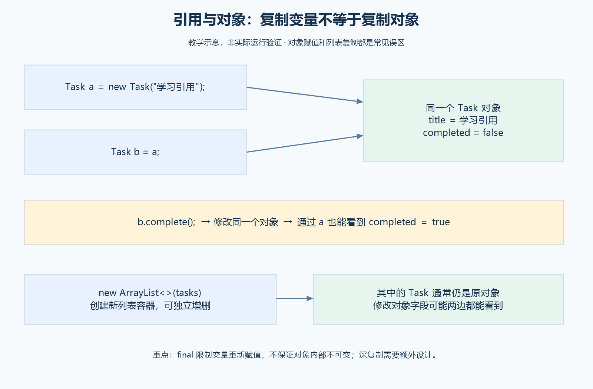

# 04 面向对象与接口

## 一页重点速记

| 【重点记住】 | 规则/用途 |
| --- | --- |
| 类与对象 | 类声明结构与行为，new创建具体对象 |
| 字段 | 通常private，通过有意义的方法控制修改 |
| 构造器 | 与类同名，无返回类型，用于必要初始化 |
| this | 当前对象；`this.title = title`区分字段与参数 |
| 引用赋值 | `Task b = a`共享对象，不是复制对象 |
| static / final | 前者属于类；后者限制重新赋值/重写/继承等相应行为 |
| 接口与实现 | interface声明能力，implements实现，重写加@Override |
| 组合 | Service持有Repository；不必为了复用就使用继承 |

**允许查阅：**protected跨包细节、record、抽象类等可按需展开；不要为所有字段机械生成setter。

## 详细图文说明

## 1. 【重点记住】类、对象、字段与方法

类声明对象的结构和行为，对象是类创建出来的具体实例，变量可以保存对象引用。

```java
public class Task {
    private String title;
    private boolean completed;

    public Task(String title) {
        if (title == null || title.isBlank()) {
            throw new IllegalArgumentException("标题不能为空");
        }
        this.title = title;
    }

    public String getTitle() {
        return title;
    }

    public boolean isCompleted() {
        return completed;
    }

    public void complete() {
        completed = true;
    }
}
```

```java
Task task = new Task("学习封装");
task.complete();
```

title、completed是实例字段，每个对象有自己的值；getTitle、complete是实例方法，通过对象调用。this表示当前实例，`this.title = title`左侧是字段，右侧是参数。

## 2. 【重点记住】构造器

```java
public Task(String title) {
    this.title = title;
}
```

- 名称与类名完全相同，不写返回类型，连void也不写。
- `new Task(...)`创建实例时调用对应构造器，可用于初始化和校验。
- 类完全没有声明构造器时，编译器才会提供默认无参构造器；写了有参构造器不会再自动附送无参构造器。
- 可以重载构造器；在JDK 21普通语法中，调用同类其他构造器的 `this(...)` 或父类构造器的 `super(...)` 必须放在构造器第一条语句，二者不能同时作为该构造器的直接首条调用。

```java
public Task() {
    this("未命名任务");
}
```

无参构造器不是所有类都必须有；框架对象创建方式需要它时再添加。

## 3. 【重点记住】封装与访问权限

封装是由类控制数据如何被读取和改变，避免任意外部代码把对象改成无效状态。字段通常private，公开有意义的方法，不必为每个字段机械生成setter。

| 修饰符 | 同类 | 同包其他类 | 不同包子类 | 任意其他类 |
| --- | --- | --- | --- | --- |
| private | 可 | 不可 | 不可 | 不可 |
| 不写，包访问 | 可 | 可 | 不可 | 不可 |
| protected | 可 | 可 | 可，有继承访问限制 | 不可 |
| public | 可 | 可 | 可 | 可 |

protected在跨包子类中不是“通过任何父类对象都能访问”，它有接收者类型限制；日常先记“同包或子类可按规则访问”。顶层普通类只能是public或包访问，不能声明成private/protected。

JavaBean常见命名：getTitle/setTitle、基本boolean可用isCompleted；包装Boolean常用getCompleted。DTO需满足具体JSON/绑定工具的访问要求，类上有字段不等于框架一定能随意读写。

## 4. 【重点记住】static、final 与引用复制

【图片 8：请在语雀此处上传 images/引用与浅复制示意图.png】



观察说明：教学示意。a和b箭头指向同一个对象，因此改字段两边都能观察到；列表新容器与元素新对象是两个不同层面的复制。

| 写法 | 意义 |
| --- | --- |
| static字段 | 类级别共享状态，不是每个实例一份 |
| static方法 | 属于类，没有当前实例this |
| final变量 | 不能再次赋值；对象内容仍可能改变 |
| final方法 | 子类不能重写 |
| final类 | 不能被继承 |
| static final常量 | 类共享且不能重新赋值，常用大写下划线命名 |

static方法不能直接访问实例字段，需先有实例。不建议把需要Spring注入的业务依赖做成static字段。

```java
Task first = new Task("原任务");
Task second = first;
second.complete(); // first与second指向同一对象，first也能观察到完成状态
```

复制引用不是复制对象。`new ArrayList<>(tasks)`只复制列表容器，通常不复制其中每个Task。

## 5. 【重点记住】接口、实现与多态

```java
public interface TaskService {
    int getTaskCount();
}

public class InMemoryTaskService implements TaskService {
    @Override
    public int getTaskCount() {
        return 0; // 语法示例，实际实现读取Repository
    }
}
```

```java
TaskService service = new InMemoryTaskService();
int count = service.getTaskCount();
```

接口声明能力，实现类提供行为。声明类型决定编译时能调用哪些方法，实际对象的重写方法决定运行时行为。不能new一个普通接口，必须有实现对象或框架生成的实现。

接口普通抽象方法默认public abstract，实现时不能降低为包访问。@Override让编译器核对重写关系，不负责Spring注入。接口还可以有default方法、static方法、private辅助方法；接口字段隐含public static final，不是每个对象的实例字段。

接口是工具，不是强制每个Service都拆接口。需要替换实现、明确能力约定时尤其有用。

## 6. 【常用查阅】继承与抽象类

```java
public abstract class BaseTask {
    public abstract void execute();
    public void printTitle() {
        System.out.println("任务");
    }
}

public class EmailTask extends BaseTask {
    @Override
    public void execute() {
        System.out.println("发送邮件");
    }
}
```

类只能extends一个直接父类，可implements多个接口；接口可extends多个接口。抽象类不能直接实例化，可包含字段、构造器、具体方法和抽象方法。重写需要兼容方法签名，不能只改成无关参数列表；构造器不被继承，private方法不参与通常意义上的子类重写。

组合是“持有另一个对象来使用它”，如Service持有Repository。分层代码大多采用组合，不需要为复用几行代码就建立继承关系。

## 7. 【扩展参考】枚举、record 与对象方法

```java
public enum TaskStatus {
    OPEN, DONE, CANCELLED
}

public record TaskView(int id, String title) {}
```

枚举限制状态集合，比散落字符串更明确。record自动提供组件访问器 `id()`、`title()`、规范构造器及equals/hashCode/toString；不是普通JavaBean的getId()。record是浅层不可变，若组件引用可变列表，列表内容仍可能变化。

普通类默认继承Object：toString用于描述对象，equals表达逻辑相等，hashCode用于哈希集合。重写equals时应同时正确重写hashCode；两个equals相等的对象必须有相同哈希码。不要用toString当作稳定的JSON协议。

## 独立练习：先自己完成，再按标准检查

**练习1：封装一个对象。** 新建ReadingTask类，构造时要求标题非空白，提供读取标题、查看是否完成及标记完成的方法。调用方不得直接改完成状态字段。

验收：构造器写法正确；字段不公开；创建两条任务，完成其中一条不会影响另一条。

**练习2：接口与引用。** 为“获取任务数量”声明一个接口，用内存实现它，并通过接口类型调用。另将同一任务赋给两个变量，通过其中一个标记完成，先预测再观察另一个。

验收：能解释声明类型与实际对象的区别；能解释两个独立new的对象和两个共享引用的变量有何区别。

## 工作中先记这些

字段private；构造器负责必要初始化；依赖用组合；接口声明能力、实现类实现能力；重写加@Override；static不是“到处都能调用”的万能开关；复制引用不等于复制对象。

参考：[Java 21 类与构造器](https://docs.oracle.com/javase/specs/jls/se21/html/jls-8.html)、[接口规范](https://docs.oracle.com/javase/specs/jls/se21/html/jls-9.html)、[Object API](https://docs.oracle.com/en/java/javase/21/docs/api/java.base/java/lang/Object.html)。

## 本章图片清单

| 名称 | 相对路径 |
| --- | --- |
| 引用与浅复制示意图（教学示意） | images/引用与浅复制示意图.png |

按正文中的图片编号与上传提示在语雀上传，不依赖复制Markdown自动带图。
