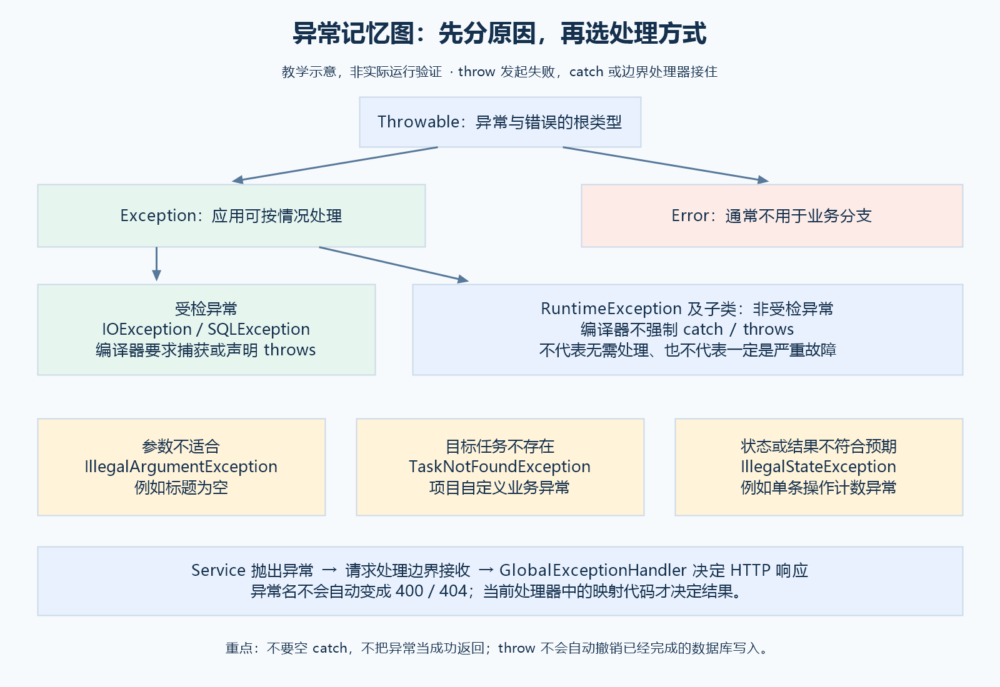

# 06 异常语法与处理

## 一页重点速记

| 【重点记住】 | 怎么理解/使用 |
| --- | --- |
| throw | `throw new IllegalArgumentException("原因");`，真正抛异常 |
| throws | 写在方法声明中，说明可能继续向外传播，不是执行抛出 |
| try / catch | 包住操作，并按异常类型接住能处理的失败 |
| finally | 通常都执行的收尾；不要在其中return覆盖原结果 |
| 参数问题 | IllegalArgumentException |
| 目标不存在 | 使用项目业务异常，例如TaskNotFoundException |
| 状态/结果异常 | IllegalStateException |
| HTTP映射 | 由Web边界处理规则决定，不是Java异常自动绑定 |

**底线：**不空catch、不伪装成功、不把数据库故障说成“任务不存在”；资源优先用try-with-resources。

## 详细图文说明

## 1. 【重点记住】异常表达什么

【图片 6：请在语雀此处上传 images/异常分类与处理图.png】



观察说明：教学示意。上部按Java继承体系分类，下部按业务失败原因选型；两种分类用途不同。最下方强调HTTP响应由请求处理边界决定。

异常表示当前操作无法按正常流程继续。它是一种程序内的失败表达机制，不等于控制台打印，也不自动等于HTTP500。

```text
Throwable
├─ Error：虚拟机/运行环境等严重问题，通常不作为业务分支捕获
└─ Exception
   ├─ RuntimeException及其子类：非受检异常
   └─ 其他Exception分支：受检异常，如IOException、SQLException
```

| 分类 | 编译器要求 | 常见例子 |
| --- | --- | --- |
| 受检异常，checked | 可能抛出时需捕获，或在方法签名声明继续抛出 | IOException、SQLException |
| 非受检异常，unchecked | 不强制写catch或throws | IllegalArgumentException、NullPointerException |
| Error | 也不受编译期捕获/声明检查 | OutOfMemoryError、StackOverflowError |

受检不表示轻微，非受检不表示严重。二者都会在运行时真正发生，只是编译期的处理要求不同。

## 2. 【重点记住】throw 与 throws

```java
public void rename(String title) {
    if (title == null || title.isBlank()) {
        throw new IllegalArgumentException("标题不能为空");
    }
    // 后续正常逻辑
}
```

`throw 异常对象;`真正抛出一个异常，当前路径中断，后面普通语句不再执行；不是返回false，也不是仅输出一条消息。

```java
public String readText(Path path) throws IOException {
    return Files.readString(path);
}
```

`throws 异常类型`出现在方法声明中，说明可能把异常交给调用方；它自己不创建、不抛出、不处理异常。需导入java.nio.file.Path、Files与java.io.IOException。

| 对比 | throw | throws |
| --- | --- | --- |
| 位置 | 方法体等执行代码中 | 方法参数列表后、方法体前 |
| 后面 | 一个异常对象表达式 | 一个或多个异常类型 |
| 作用 | 真的发起异常 | 声明可能向外传播 |

## 3. 【重点记住】try / catch / finally

```java
try {
    int id = Integer.parseInt(text);
    System.out.println(id);
} catch (NumberFormatException ex) {
    System.out.println("编号必须是整数");
} finally {
    System.out.println("本次解析结束");
}
```

try放可能失败的操作；catch按异常类型匹配处理；finally用于通常无论成功或异常都需要执行的收尾。try内抛异常后，不会回去接着执行异常行后面的代码。

- 多个catch从具体子类到一般父类排列，不能让父类catch挡住后面的子类catch。
- `catch (IOException | SQLException ex)`可合并处理互不继承的异常类型。
- 不需要恢复时让异常向外传播，不要每层都机械包try-catch。
- 不要空catch吞掉错误，也不要捕获后随意返回“成功”。
- 不要在finally里return或抛新异常覆盖原结果；正常方法return之前仍会执行finally。
- finally不保证在进程被强制终止、JVM退出等情况下执行，不能当作绝对保障。

## 4. 【重点记住】常用异常选型表

| 异常 | 含义/常见触发 | 编写业务代码时怎么办 |
| --- | --- | --- |
| IllegalArgumentException | 参数不适合当前方法，例如数量为负 | 明确规则后主动拒绝；Web层再决定响应 |
| IllegalStateException | 应用当前状态不适合操作，或内部结果违反预期 | 表达状态问题，不伪装成用户参数错 |
| NullPointerException | 在null上调用方法、null自动拆箱 | 修正数据与判空顺序，不靠捕获它做常规校验 |
| NumberFormatException | 数字文本解析失败 | 需要恢复时捕获，或交给边界层处理 |
| IndexOutOfBoundsException | 索引超出有效范围 | 检查范围、分页和循环边界 |
| ArithmeticException | 整数除0等算术问题 | 检查输入；BigDecimal运算也可能触发 |
| ClassCastException | 把对象强转为不兼容类型 | 使用正确声明类型和泛型 |
| UnsupportedOperationException | 对不支持修改的容器执行操作 | 核对List.of等容器特性 |
| ConcurrentModificationException | 遍历期间不合规则地修改集合 | 用Iterator.remove等正确方式，不仅指多线程 |
| IOException，受检 | 文件/流等I/O失败 | 捕获并处理，或声明传播 |
| SQLException，受检 | JDBC访问失败 | 阅读SQLState、错误码与原因链 |
| TaskNotFoundException，自定义 | 业务目标任务不存在 | 表达业务语义，由统一处理器转换HTTP404 |

不用背全表。工作中先问“参数有问题、目标不存在、状态不允许，还是技术执行失败”，再选项目中相应的异常。RuntimeException只是通用父类，随意new它会丢失业务分类。

## 5. 【重点记住】自定义业务异常

```java
public class TaskNotFoundException extends RuntimeException {
    public TaskNotFoundException(String message) {
        super(message);
    }
}
```

extends RuntimeException表示非受检业务异常；super(message)把描述交给父类，处理器可以用getMessage()读取。需要保留底层原因时提供带cause构造器：

```java
public TaskNotFoundException(String message, Throwable cause) {
    super(message, cause);
}
```

不要把数据库连接失败包装成“任务不存在”；不同原因对调用方和运维的处理不同。自定义异常名称表达失败原因，而不是把HTTP状态码塞进所有业务类名。

## 6. 【常用查阅】try-with-resources

```java
try (BufferedReader reader = Files.newBufferedReader(path)) {
    return reader.readLine();
}
```

资源实现AutoCloseable时可使用此语法，离开try会自动关闭，多个资源按声明的相反顺序关闭。JDBC的Connection、PreparedStatement、ResultSet也适用。关闭资源和回滚事务是不同概念，不能混为一谈。

## 7. 【重点记住】读异常与传播

```text
Controller调用Service
    Service调用Repository
        Repository调用Mapper
            底层抛异常
        未捕获就继续向外传
    找到匹配处理器才处理
```

阅读日志先看异常类型与消息，再定位第一处属于自己代码的调用栈，继续看Caused by原因链。不要只看最后的exit code或只复制最外层“启动失败”。

Spring统一HTTP处理示例在第08章。Java的catch与Spring的@ExceptionHandler不是同一种语法，后者由框架在请求处理过程中调用。

## 独立练习：先自己完成，再按标准检查

**练习1：区分失败原因。** 自行实现按编号读取内存任务的方法：编号小于1视为非法参数，合法编号查不到视为任务不存在。由调用方分别处理两种失败。

验收：异常类型表达不同原因；调用方能分别给出消息；没有用null返回冒充成功，也没有每层捕获后重新抛出同样错误。

**练习2：预测执行顺序。** 自己编写一段包含try、catch、finally和方法返回的短程序，分别让try正常完成、抛匹配异常、抛未匹配异常。先写出预期执行标记，再运行核对。

验收：能解释异常行后代码是否执行、finally何时执行、异常是否向调用方传播；不在finally中写return。

## 工作中先记这些

throw是抛出，throws是声明；catch选择可处理的异常；不吞异常、不假装成功；业务失败按原因分类；HTTP映射在Web边界；资源用try-with-resources；异常不会自动撤销已执行的数据库写入。

参考：[Java异常教程](https://docs.oracle.com/javase/tutorial/essential/exceptions/)、[Throwable API](https://docs.oracle.com/en/java/javase/21/docs/api/java.base/java/lang/Throwable.html)、[IllegalArgumentException](https://docs.oracle.com/en/java/javase/21/docs/api/java.base/java/lang/IllegalArgumentException.html)、[IllegalStateException](https://docs.oracle.com/en/java/javase/21/docs/api/java.base/java/lang/IllegalStateException.html)。

## 本章图片清单

| 名称 | 相对路径 |
| --- | --- |
| 异常分类与处理图（教学示意） | images/异常分类与处理图.png |

按正文中的图片编号与上传提示在语雀上传，不依赖复制Markdown自动带图。
