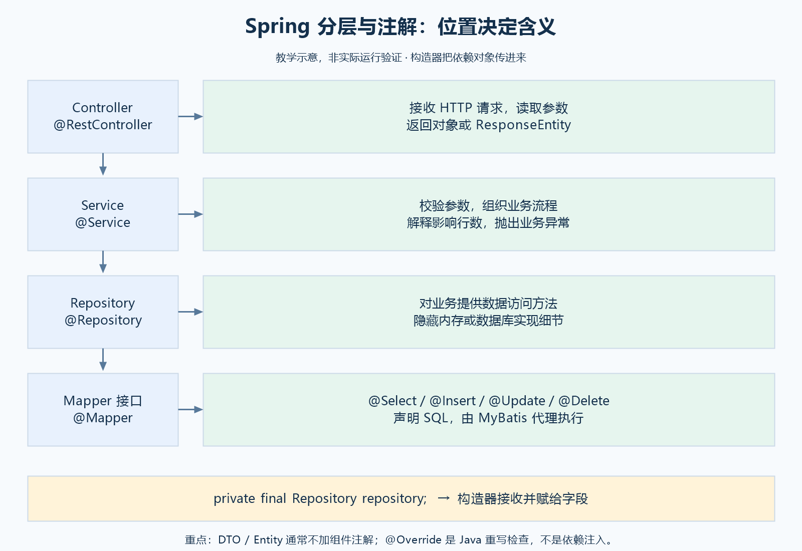

# 07 Maven、Spring 与分层注解

## 一页重点速记

| 【重点记住】 | 实际用途 |
| --- | --- |
| 工程入口 | 打开包含pom.xml的目录，源码在src/main/java |
| 常用构建 | compile编译，test测试，package打包，clean清产物 |
| Bean | Spring容器管理的对象，不是所有new对象都会被管理 |
| Controller | @RestController：HTTP参数与响应 |
| Service | @Service：校验、业务流程与业务判断 |
| Repository / Mapper | @Repository封装数据访问；@Mapper声明SQL映射 |
| 注入 | private final依赖字段 + 构造器接收；单构造器通常可不写@Autowired |
| 配置 | application.yaml缩进用空格；凭据来自环境配置 |

**常见误区：**加@Service不等于生成业务代码；DTO一般不注册共享Bean；不要手动new绕开受管理的依赖链。

## 详细图文说明

## 1. 【重点记住】Maven工程结构

```text
task_manager/
├─ pom.xml                  依赖、版本、构建配置
├─ src/main/java/           正式Java源码
├─ src/main/resources/      application.yaml等资源
├─ src/test/java/           测试源码
└─ target/                  编译与打包产物，自动生成
```

package声明与源码路径对应：`com.example.task`位于com/example/task目录。import引用其他包中的类型；import不是安装依赖，必须先让类在项目编译依赖中可用。java.lang常用类型隐式导入，同包类型无需额外import。

### Maven坐标与依赖

```xml
<dependency>
    <groupId>org.mybatis.spring.boot</groupId>
    <artifactId>mybatis-spring-boot-starter</artifactId>
    <version>4.0.0</version>
</dependency>
```

groupId识别组织/命名空间，artifactId识别构件，version指定版本。这里版本取自已有第32节工程，不是升级指令。父POM/dependencyManagement可统一管理版本；在受到管理时依赖项可省略version。dependencyManagement只管理规则，不自动把所有依赖加入工程。

| scope | 主要用途 |
| --- | --- |
| compile，默认 | 编译、测试、运行需要 |
| runtime | 运行/测试需要，正式编译通常无需其API，例如驱动 |
| test | 仅测试编译与运行 |
| provided，扩展 | 编译需要，但预期运行容器提供 |

依赖库提供代码，构建插件执行构建任务，二者不是同一概念。下载的依赖默认缓存在用户的.m2/repository，企业项目也可能配置私服和镜像。

### 【重点记住】常用命令

执行位置：包含pom.xml的工程根目录。若没有全局mvn但工程带Wrapper，可使用 `./mvnw.cmd` 替代mvn。

```powershell
mvn -v
mvn compile
mvn test
mvn package
mvn clean package
mvn spring-boot:run
mvn dependency:tree
```

| 命令 | 做什么 |
| --- | --- |
| compile | 编译正式源码 |
| test | 执行测试阶段，包含此前必要阶段 |
| package | 执行到打包阶段，通常包含测试 |
| clean | 清理target，是独立生命周期 |
| dependency:tree | 查看传递依赖和冲突线索 |
| spring-boot:run | 调用Boot插件启动应用 |

package不是“只打个包”，会执行此前阶段；install还会把产物装进本地仓库，deploy是上传远端制品仓库，不等于应用上线。`-DskipTests`通常跳过测试执行但仍编译测试，别把跳测试当作默认修复方式。

## 2. 【重点记住】Spring与Spring Boot

Spring容器负责创建、管理和连接对象；这些受管理对象称为Bean。Spring Boot利用自动配置和starter简化应用启动与常用组件配置，不是替你编写业务规则。

```java
@SpringBootApplication
public class TaskManagerApplication {
    public static void main(String[] args) {
        SpringApplication.run(TaskManagerApplication.class, args);
    }
}
```

@SpringBootApplication组合了配置类能力、自动配置和组件扫描。启动类通常放在业务根包，例如com.example.task，子包放controller/service/repository。扫描范围之外的类不会仅因“磁盘上存在”就自动成为Bean。

## 3. 【重点记住】注解是什么

注解是元数据，写作 `@注解名` 或 `@注解名(属性 = 值)`。它们由编译器或框架读取并产生相应行为，不能仅凭“有@”就认为会自动执行业务方法。

```java
@Service
public class TaskService {
    // ...
}
```

注解有允许的放置位置：类、方法、参数、字段等。@RequestParam属于方法参数上的绑定说明，不能当作方法体里的一条普通语句来执行。

## 4. 【重点记住】各层职责与常用注解

【图片 5：请在语雀此处上传 images/分层注解位置图.png】



观察说明：教学示意。左边是类或接口的角色注解，右边是自己需要实现的职责；构造器注入把这些对象连接起来，标注角色不等于自动生成业务。

| 层/对象 | 负责什么 | 常用注解 | 不负责什么 |
| --- | --- | --- | --- |
| Controller | 接请求、绑定参数、返回HTTP响应 | @RestController、各种Mapping | 不直接堆放SQL和全部业务规则 |
| Service | 业务校验、业务流程、协调数据访问 | @Service | 不把所有规则写成SQL细节 |
| Repository | 对外封装数据访问能力 | @Repository | 不决定HTTP状态码 |
| Mapper | 声明SQL及Java映射 | @Mapper、@Select等 | 不承担业务成功规则 |
| DTO | 表达请求/响应数据结构 | 通常无需组件注解 | 不必注册为共享Bean |
| Entity | 表达持久化数据/领域数据 | 依所用框架决定，MyBatis普通类可无注解 | 不是加个名字就自动建表 |

```text
Controller → Service → Repository → Mapper → 数据库
```

分层名称是职责约定，不是Java语法。@Service不会自动生成业务方法，@Repository不会自动把普通类变成MyBatis接口代理。

### 组件与注入注解速查

| 注解 | 放哪里 | 作用 |
| --- | --- | --- |
| @Component | 普通组件类 | 通用组件扫描标记 |
| @Service | 业务实现类 | 特化组件标记，表达业务职责 |
| @Repository | 数据访问实现类 | 特化组件标记；配套机制可用于持久化异常转换 |
| @Controller | MVC控制器类 | 标记控制器，返回String常被当作视图名 |
| @RestController | HTTP接口类 | @Controller与@ResponseBody的组合语义 |
| @Autowired | 构造器/字段/setter等 | 按依赖注入；推荐构造器形式 |
| @Qualifier("name") | 注入点等 | 多候选时进一步限定Bean |
| @Primary | 组件类或@Bean方法 | 多候选中提供主要选择 |
| @Configuration，常用查阅 | 配置类 | 声明Java配置 |
| @Bean，常用查阅 | 配置中的方法 | 将方法提供的对象注册进容器，常用于第三方类 |
| @Mapper | MyBatis接口 | 在相应扫描配置下注册Mapper代理 |
| @MapperScan | 配置/启动类 | 批量扫描Mapper包，可替代逐个标@Mapper的方式 |

@Service、@Repository等只有在相应扫描/注册机制生效时才有用。@Mapper来自MyBatis体系，和Spring的@Component不是可随意互换的别名。

### 【常用查阅】导包位置

| 类型/注解 | 所属包 |
| --- | --- |
| Component、Service、Repository、Controller | org.springframework.stereotype |
| RestController、RequestBody、PathVariable、各种Mapping、ExceptionHandler等 | org.springframework.web.bind.annotation |
| Autowired、Qualifier | org.springframework.beans.factory.annotation |
| Configuration、Bean、Primary | org.springframework.context.annotation |
| SpringBootApplication | org.springframework.boot.autoconfigure |
| HttpStatus、ResponseEntity | org.springframework.http |
| Mapper、Param、Select、Insert、Update、Delete、Options | org.apache.ibatis.annotations |
| MapperScan | org.mybatis.spring.annotation |
| Override | java.lang，通常无需手动导入 |

类名相同不保证用途相同。IDEA自动导入时也要看包名，特别是Param、RequestBody、Controller等易混名称。

## 5. 【重点记住】构造器注入

```java
@Service
public class TaskDeleteService {
    private final TaskDeleteRepository repository;

    public TaskDeleteService(TaskDeleteRepository repository) {
        this.repository = repository;
    }
}
```

启动时容器找到Repository，调用Service构造器传入依赖，再把Service提供给Controller。只有一个构造器时，Spring通常不要求在该构造器上显式写@Autowired。

`private final`让依赖明确且不能被意外改指向；字段不需要setter。不要在Controller里手动 `new TaskDeleteService(...)` 绕过容器，否则它的依赖和框架增强不会自动按预期生效。

注入接口时，实现类必须已注册为Bean；如果有多个候选，用Qualifier/Primary明确选择，不依赖碰巧的名称匹配。循环依赖通常先检查职责划分，不把“让框架强行启动”作为首选。

### 【常用查阅】明确候选与注册第三方对象

```java
public TaskService(@Qualifier("mysqlTaskRepository") TaskRepository repository) {
    this.repository = repository;
}
```

这是构造器片段，要求容器中存在匹配名称/限定条件的TaskRepository实现，例如通过 `@Repository("mysqlTaskRepository")`显式命名。

```java
@Configuration
public class TimeConfig {
    @Bean
    public Clock clock() {
        return Clock.systemUTC();
    }
}
```

这个扩展示例需要导入java.time.Clock。Clock来自JDK，无法在它的源码类上加@Component，就通过配置方法提供Bean；其他组件可在构造器接收Clock。@Bean放在提供对象的方法上，不是随便标在普通字段上。

## 6. 【重点记住】配置与共享状态

```yaml
server:
  port: 8080
spring:
  datasource:
    url: jdbc:mysql://localhost:3306/testspring
    username: ${DB_USERNAME}
    password: ${DB_PASSWORD}
```

放在src/main/resources/application.yaml，缩进用空格，同级字段对齐。`${...}`在此处是Spring配置占位符，和MyBatis的SQL文本替换不是一个用途。环境变量在启动进程之前配置，修改后通常需要重新启动应用。

Spring Bean默认作用域通常是singleton，多个请求共享同一个Bean实例。请求中的临时数据用局部变量，不把每次请求的page、title等存成Service的可变字段。内存ArrayList实现是学习用数据源，不自动具备多线程安全和持久化能力。

## 独立练习：先自己完成，再按标准检查

**练习1：构造器注入。** 在独立小工程或现有练习副本中写一个返回固定数量的Repository，由Service通过构造器使用它，再让Controller通过构造器使用Service。依赖字段均为private final。

验收：由Spring完成创建和连接，Controller不自行new依赖；能说清每个注解放在哪里、每层负责什么；不引入新依赖来完成这个练习。

**练习2：工程与配置。** 在含pom.xml的终端查看Maven使用的Java版本，执行compile。找到编译产物，并解释dependency、plugin、application.yaml各解决什么问题。

验收：能核对实际JDK与target位置；不会把import当作下载依赖；不通过删除原工程配置或升级依赖解决无关问题。

## 工作中先记这些

先导入pom再查代码；构建工具与JDK各司其职；Controller管HTTP、Service管业务、Repository管数据；依赖优先构造器注入；DTO不是共享组件；注解选对包并放对位置；不要把请求数据放入共享Bean字段。

参考：[Maven生命周期](https://maven.apache.org/guides/introduction/introduction-to-the-lifecycle.html)、[依赖机制](https://maven.apache.org/guides/introduction/introduction-to-dependency-mechanism.html)、[组件扫描](https://docs.spring.io/spring-framework/reference/core/beans/classpath-scanning.html)、[构造器注入](https://docs.spring.io/spring-framework/reference/core/beans/annotation-config/autowired.html)、[SpringBootApplication](https://docs.spring.io/spring-boot/reference/using/using-the-springbootapplication-annotation.html)。

## 本章图片清单

| 名称 | 相对路径 |
| --- | --- |
| 分层注解位置图（教学示意） | images/分层注解位置图.png |

按正文中的图片编号与上传提示在语雀上传，不依赖复制Markdown自动带图。
