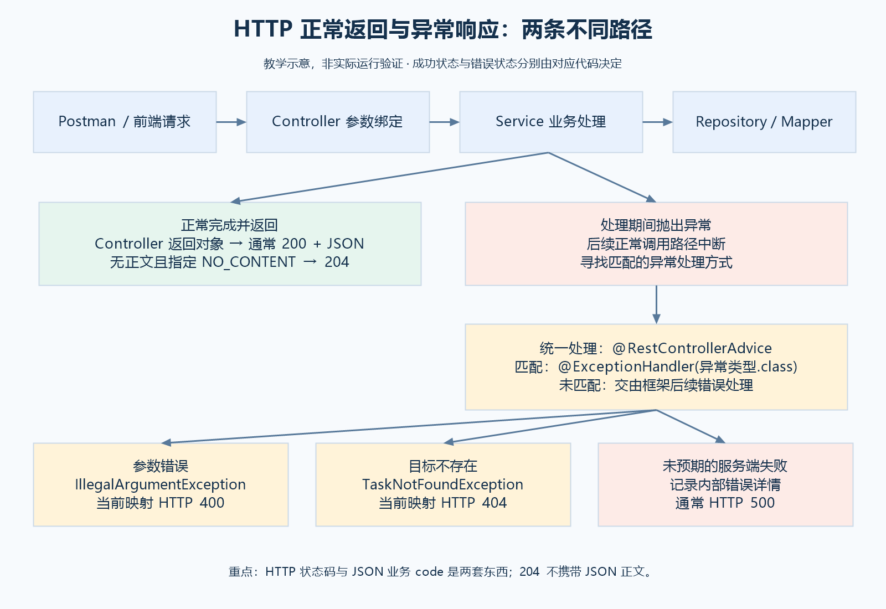

# 08 HTTP 与 Spring MVC 接口

## 一页重点速记

| 【重点记住】 | 高频写法/选择 |
| --- | --- |
| 接口类 | @RestController，方法按GET/POST/PATCH/DELETE映射 |
| 路径编号 | `@PathVariable("id") int id` |
| 查询条件 | @RequestParam；多个查询字段可用@ModelAttribute对象 |
| JSON正文 | @RequestBody + 请求DTO；Content-Type: application/json |
| 成功响应 | 200通常带结果；204无正文；void不自动等于204 |
| 失败响应 | 400请求问题，404找不到目标，500未预期服务问题 |
| 动态响应 | ResponseEntity控制状态、头和正文 |
| 统一异常 | @RestControllerAdvice + @ExceptionHandler建立HTTP映射 |

**先分清三件事：**Java异常类型、HTTP状态码、JSON业务code各有作用；遵循团队接口约定，但理解标准语义。

## 详细图文说明

## 1. 【重点记住】一次请求包含什么

```http
PATCH /database/tasks/6/completed HTTP/1.1
Content-Type: application/json

{"completed": true}
```

请求方法表达操作意图，路径定位资源，查询字符串表达筛选等条件，请求头描述元信息，请求体传递数据。响应则包含状态码、响应头和可选正文。端口和路径都必须指向实际启动的后端。

### 请求方法速查

| 方法 | 主要语义 | 常见任务接口 |
| --- | --- | --- |
| GET | 读取资源 | GET /tasks、GET /tasks/6 |
| POST | 提交数据，由目标资源按约定处理，常用于创建 | POST /tasks |
| PUT | 用提交的表示创建或替换目标资源 | PUT /tasks/6 |
| PATCH | 对资源应用部分修改 | PATCH /tasks/6/completed |
| DELETE | 删除目标资源关联 | DELETE /tasks/6 |
| HEAD，常用查阅 | 类似GET，但响应无正文 | 读取响应头 |
| OPTIONS，常用查阅 | 查询通信选项 | 浏览器跨域预检等 |

GET不应用于执行业务删除。只用GET/POST的项目也能提供业务能力，但需要明确URL、参数和错误约定。

### 【常用查阅】安全与幂等

安全指方法语义不要求改变资源状态；幂等指重复相同请求，对目标状态的预期效果与一次相同。GET通常既安全又幂等；PUT、DELETE语义幂等；POST不保证幂等；PATCH是否幂等取决于修改操作。

重复DELETE可以第一次204、第二次404，目标都保持“已删除”，仍可幂等。幂等不要求状态码相同，也不表示所有日志等附带行为完全不变。PATCH“设为true”通常幂等，“计数加1”则不是。

参考：[HTTP方法语义](https://www.rfc-editor.org/rfc/rfc9110.html#section-9)、[PATCH标准](https://www.rfc-editor.org/rfc/rfc5789.html)。

## 2. 【重点记住】映射与参数注解

| 注解 | 放置位置 | 用途 |
| --- | --- | --- |
| @RequestMapping | 类/方法 | 声明共同路径、方法、媒体类型等映射条件 |
| @GetMapping | 方法 | GET映射 |
| @PostMapping | 方法 | POST映射 |
| @PutMapping | 方法 | PUT映射 |
| @PatchMapping | 方法 | PATCH映射 |
| @DeleteMapping | 方法 | DELETE映射 |
| @PathVariable | 方法参数 | 从路径占位符取值 |
| @RequestParam | 方法参数 | 接收查询参数，或受支持的表单参数 |
| @RequestBody | 方法参数 | 用消息转换器读取请求体，例如JSON |
| @ModelAttribute | 方法参数等 | 将请求参数等绑定到对象；不是JSON解析器 |
| @ResponseBody | 类/方法 | 返回值经消息转换器写入响应体 |
| @ResponseStatus | 类/方法 | 声明响应状态；常用于固定成功码 |
| @RequestHeader，常用查阅 | 方法参数 | 读取请求头 |

```java
@RestController
@RequestMapping("/tasks")
public class TaskController {
    @GetMapping("/{id}")
    public TaskResponse getTask(@PathVariable("id") int taskId) {
        return service.getTaskById(taskId);
    }
}
```

示例省略service字段与构造器。最终路径是类路径与方法路径的组合。建议明确写 `@PathVariable("id")`，不依赖编译时保留参数名。相同路径可同时有GET和POST；相同请求条件被两个方法重复注册则会冲突。统一路径风格，不依赖末尾斜杠一定自动兼容。

### 查询参数

```java
@GetMapping
public PageResponse<TaskResponse> getTasks(
        @RequestParam(name = "completed", required = false) Boolean completed,
        @RequestParam(name = "page", defaultValue = "1") int page,
        @RequestParam(name = "size", defaultValue = "10") int size) {
    return service.getTasks(completed, null, page, size);
}
```

对应 `/tasks?completed=false&page=1&size=10`。不提供completed时可为null，表示不筛选；false也是有效值。defaultValue用于缺失或空字符串等相应绑定场景，不代表page=-1也能自动变成1；业务范围仍需校验。类型转换失败往往在进入Controller方法之前发生。

## 3. 【重点记住】JSON与DTO

```java
public class CreateTaskRequest {
    private String title;
    public String getTitle() { return title; }
    public void setTitle(String title) { this.title = title; }
}
```

```java
@PostMapping
public TaskResponse create(@RequestBody CreateTaskRequest request) {
    return service.createTask(request.getTitle());
}
```

```json
{"title": "学习请求体"}
```

JSON通过消息转换器变成Java对象，响应对象再转换成JSON。JSON不是Java对象本身，也不是把Java对象引用地址传给前端。

JSON键和字符串用双引号，布尔值true/false与null不加引号；不支持JavaScript的undefined、函数或普通注释。对象属性顺序不应作为业务含义。

请求DTO描述客户端能提交的字段，响应DTO描述对外返回的字段。不要为了省事直接把数据库对象的所有字段开放给客户端修改。

```java
public class UpdateTaskCompletedRequest {
    private Boolean completed;
    public Boolean getCompleted() { return completed; }
    public void setCompleted(Boolean completed) { this.completed = completed; }
}
```

Boolean可识别缺失/null，避免boolean默认false把“没传”和“明确设为false”混淆。使用前校验null。普通DTO默认无法区分“字段缺失”和“显式null”，更复杂PATCH语义需要另行设计。

参考：[Spring请求绑定](https://docs.spring.io/spring-framework/reference/web/webmvc/mvc-controller/ann-methods.html)、[请求体转换](https://docs.spring.io/spring-framework/reference/web/webmvc/mvc-controller/ann-methods/requestbody.html)。

## 4. 【重点记住】状态码选择

先记类别：2xx成功，4xx请求/资源/权限等问题，5xx服务端或上游处理问题。4xx不等于“前端程序员一定写错代码”。

| 级别 | 状态码 | 主要含义 | 典型用途 |
| --- | --- | --- | --- |
| 重点 | 200 OK | 成功 | 查询、返回结果的更新 |
| 常用 | 201 Created | 已创建资源 | 新增成功，可带Location |
| 重点 | 204 No Content | 成功且没有响应内容 | 删除成功，无JSON正文 |
| 重点 | 400 Bad Request | 请求不符合要求 | 参数非法、请求格式错误 |
| 常用 | 401 Unauthorized | 缺少有效认证凭据 | 未登录、凭据失效 |
| 常用 | 403 Forbidden | 拒绝执行请求 | 无权限 |
| 重点 | 404 Not Found | 找不到目标资源 | 路径不存在或任务不存在 |
| 常用 | 405 Method Not Allowed | 路径不支持该请求方法 | 对仅支持GET的地址发DELETE |
| 常用 | 409 Conflict | 与资源当前状态冲突 | 唯一业务键重复、状态冲突等约定场景 |
| 常用 | 415 Unsupported Media Type | 请求媒体类型不支持 | JSON接口却用不支持的Content-Type |
| 扩展 | 422 Unprocessable Content | 内容格式可理解但无法处理其指令 | 某些API用于语义校验失败 |
| 常用 | 429 Too Many Requests | 请求过于频繁 | 限流 |
| 重点 | 500 Internal Server Error | 服务端未预期问题 | 未处理的程序异常 |
| 常用 | 502 / 503 / 504 | 上游响应问题/服务不可用/上游超时 | 网关与服务故障排查 |

204不能同时设计成“返回true正文”；需要结果正文就选合适的200响应。删除成功不强制只能204，校验失败也有400/422等团队选择。遵循统一接口规范，并理解标准含义。

HTTP状态与JSON字段 `code` 是两套东西；`HTTP200 + {"code":1001}`中的1001是应用业务码。统一500会削弱调用方区分失败原因的能力。参考：[HTTP响应状态](https://www.rfc-editor.org/rfc/rfc9110.html#section-15)、[429](https://www.rfc-editor.org/rfc/rfc6585.html#section-4)。

## 5. 【重点记住】固定状态与动态响应

### 无正文成功：@ResponseStatus

```java
@DeleteMapping("/{id}")
@ResponseStatus(HttpStatus.NO_CONTENT)
public void delete(@PathVariable("id") int id) {
    service.deleteTask(id);
}
```

void不等于自动204；这里是注解指定204。如果service抛异常，会进入异常处理流程。

### 动态控制：ResponseEntity

```java
return ResponseEntity.ok(task);                 // 200与正文
return ResponseEntity.noContent().build();     // 204，无正文
return ResponseEntity.badRequest().body(error); // 400与错误正文
return ResponseEntity.status(HttpStatus.NOT_FOUND).body(error);
```

这些是不同返回类型方法中的独立示例，不应顺序放在同一个方法里。`ResponseEntity<T>`可控制状态、头与正文；泛型T是正文的Java类型。参考：[ResponseEntity](https://docs.spring.io/spring-framework/reference/web/webmvc/mvc-controller/ann-methods/responseentity.html)。

## 6. 【重点记住】统一异常处理

```java
@RestControllerAdvice
public class GlobalExceptionHandler {
    @ExceptionHandler(TaskNotFoundException.class)
    public ResponseEntity<ErrorResponse> handleNotFound(TaskNotFoundException ex) {
        return ResponseEntity.status(HttpStatus.NOT_FOUND)
                .body(new ErrorResponse(ex.getMessage()));
    }

    @ExceptionHandler(IllegalArgumentException.class)
    public ResponseEntity<ErrorResponse> handleBadInput(IllegalArgumentException ex) {
        return ResponseEntity.badRequest()
                .body(new ErrorResponse(ex.getMessage()));
    }
}
```

假设ErrorResponse有接收message的构造器和getMessage。@RestControllerAdvice提供跨Controller的统一异常处理，并把处理方法的返回值写入响应体；@ExceptionHandler声明要处理的异常类型。这里是Spring MVC用法，“响应体”不等于WebFlux的响应式编程。Service只表达失败原因，处理器决定对外HTTP结果。

这个示例覆盖已讲业务异常，不等于已覆盖全部绑定、转换与校验异常。实际项目应逐步补齐统一错误结构，意外异常在服务端记录详情，给客户端稳定且不泄露内部信息的消息。不要把所有Exception都映射400，也不要把所有异常消息原样公开。

【图片 2：请在语雀此处上传 images/请求与异常处理流程图.png】



观察说明：教学示意，不是运行验证。正常返回与异常传播是两条路径；业务异常类型与HTTP状态之间的箭头由处理器代码建立，不是Java自动绑定。

参考：[Spring异常处理](https://docs.spring.io/spring-framework/reference/web/webmvc/mvc-controller/ann-exceptionhandler.html)。

## 7. 【重点记住】Postman配置与检查顺序

| 请求 | 配置 |
| --- | --- |
| GET列表 | 方法GET，URL与Params填写查询条件，Body通常none |
| GET单条 | 编号直接进入路径 |
| POST新增 | Body → raw → JSON，Content-Type: application/json |
| PATCH状态 | 同上，正文 `{"completed":false}` |
| DELETE删除 | Body通常none，目标编号在路径 |

观察顺序：状态码 → 响应正文 → 必要的响应头 → 数据库持久状态。204正文为空是预期结果，不要强行JSON解析。400检查参数与JSON，404核对路径和记录，405核对方法，415核对Content-Type，500看后端日志。

连接拒绝可能根本没有HTTP状态码，先确认进程与端口。浏览器跨域限制与Postman是否成功是不同问题，Postman成功不等于浏览器CORS配置一定正确。

## 独立练习：先自己完成，再按标准检查

**练习1：参数放对位置。** 在练习工程设计“按编号查单条、按可选状态查列表、提交标题新增”三个接口，自行选择方法、路径、参数注解和DTO。用Postman分别发送请求。

验收：路径编号、查询参数和JSON正文不混用；可选false不会被当作未传；能定位参数转换发生在进入业务处理之前还是之后。

**练习2：建立错误映射。** 将一个项目业务异常统一转换为404及稳定的错误正文；再提供删除成功204的接口。验证成功、业务不存在和参数错误三个场景。

验收：204正文为空；异常不被错误转换成成功；能指出哪段代码决定400/404映射。使用专门练习数据，不删除要保留的记录。

## 工作中先记这些

路径参数PathVariable，查询参数RequestParam，对象查询ModelAttribute，JSON正文RequestBody；Controller返回对象需要响应体转换；固定状态用ResponseStatus，灵活响应用ResponseEntity；400参数、404资源、500意外服务问题；错误响应统一处理。

## 本章图片清单

| 名称 | 相对路径 |
| --- | --- |
| 请求与异常处理流程图（教学示意） | images/请求与异常处理流程图.png |

按正文中的图片编号与上传提示在语雀上传，不依赖复制Markdown自动带图。
