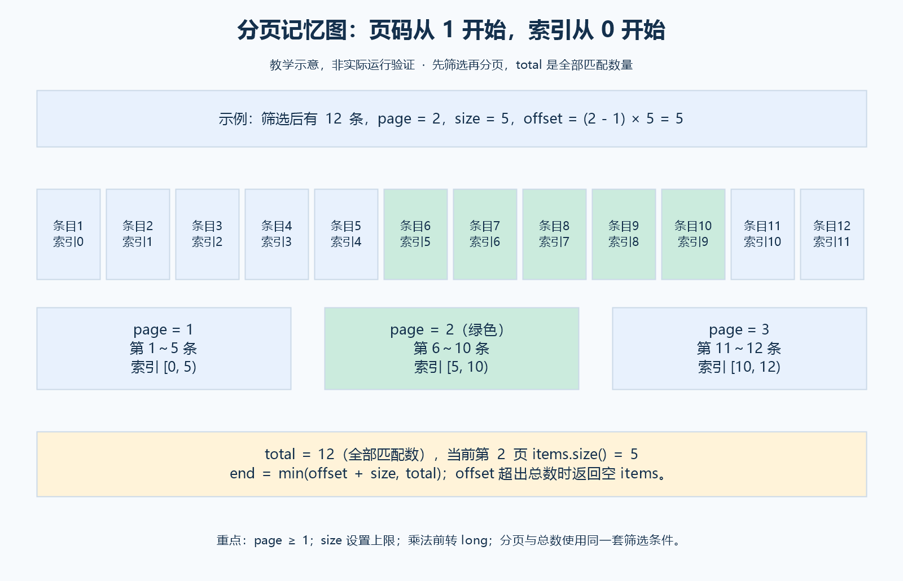

# 09 筛选、分页与数据对象

## 一页重点速记

| 【重点记住】 | 工作中如何使用 |
| --- | --- |
| 对象职责 | Request接收输入，Entity表达数据，Response控制输出 |
| 可选状态 | Boolean：null不筛选、true已完成、false未完成 |
| 条件组合 | 单条件内“不限制或匹配”，多条件之间“同时满足” |
| 分页顺序 | 校验 → 规范化 → 筛选/排序 → total → 分页 |
| 偏移公式 | `(long) (page - 1) * size`，page从1开始 |
| 索引区间 | subList(start, end)左闭右开；先判断再转换和截取 |
| 响应结构 | PageResponse<T>：items、total、page、size |
| 边界 | 非法参数拒绝；超末页通常空items；total不等于本页数量 |

**输入底线：**page至少1，size有合理上限，先判null再拆箱，排序要稳定。

## 详细图文说明

## 1. 【重点记住】请求、实体、响应分开表达

| 对象 | 用途 | 典型字段 |
| --- | --- | --- |
| CreateTaskRequest | 用户允许提交的新增参数 | title |
| UpdateTaskCompletedRequest | 部分更新参数 | Boolean completed |
| TaskQueryRequest | 可选筛选和分页条件 | completed、keyword、page、size |
| Task | 数据库任务实体 | id、title、completed |
| TaskResponse | 对外任务结果 | 当前需要公开的字段 |
| PageResponse<T> | 可复用分页响应 | items、total、page、size |

不要根据“字段目前一样”就认为职责永远一样。id通常由数据库生成，新增请求无需让用户随意控制；数据库新增内部字段时也不应自动暴露给前端。

## 2. 【重点记住】可选条件的三态含义

```text
completed = null  → 不限制完成状态
completed = true  → 只要已完成
completed = false → 只要未完成
```

```java
String normalized = keyword == null ? null : keyword.strip();
List<TaskResponse> filtered = new ArrayList<>();

for (TaskResponse task : tasks) {
    boolean matchesCompleted = completed == null
            || task.isCompleted() == completed;
    boolean matchesKeyword = normalized == null
            || normalized.isBlank()
            || task.getTitle().contains(normalized);

    if (matchesCompleted && matchesKeyword) {
        filtered.add(task);
    }
}
```

completed先判null再拆箱。条件内部用OR表达“不限制或匹配”，条件之间用AND表达“同时满足”。此示例假设数据保证title非null。

String.contains是Java字面子串匹配，区分大小写；SQL LIKE受通配符与排序规则影响，不能默认与contains完全相同。新建filtered容器不复制TaskResponse对象。

## 3. 【重点记住】查询对象绑定

```java
public class TaskQueryRequest {
    private Boolean completed;
    private String keyword;
    private Integer page = 1;
    private Integer size = 10;
    // 为四个字段提供对应getter/setter
}
```

```java
@GetMapping("/tasks")
public PageResponse<TaskResponse> getTasks(
        @ModelAttribute TaskQueryRequest query) {
    return service.getTasks(query.getCompleted(), query.getKeyword(),
            query.getPage(), query.getSize());
}
```

绑定 `/tasks?completed=false&keyword=Java&page=2&size=10`。这是查询参数绑定，不是从GET正文解析JSON。默认字段值、绑定结果、Service业务校验是不同步骤，不要因为字段初始化了就取消边界校验。

## 4. 【重点记住】分页公式与顺序

【图片 9：请在语雀此处上传 images/分页区间示意图.png】



观察说明：教学示意。绿色是第二页，页码2对应索引从5开始；条目序数从1算，索引从0算。total统计全部匹配项，不随当前页只有几条而变化。

采用页码从1开始的接口约定：

```text
offset = (page - 1) × size
start = offset
end = min(offset + size, 筛选后的数量)
```

示例：page=2、size=10，取第11～20条，对应Java索引[10,20)。

正确执行顺序：**校验参数 → 规范化条件 → 筛选 → 确定稳定顺序 → 统计total → 分页 → 返回。** 先分页再筛选会漏数据，分页后计数得到的是本页数量，不是total。

```java
if (page == null || page < 1 || size == null || size < 1 || size > 100) {
    throw new IllegalArgumentException("分页参数不合法");
}

long total = filtered.size();
long offset = (long) (page - 1) * size;
List<TaskResponse> items;
if (offset >= filtered.size()) {
    items = new ArrayList<>();
} else {
    int start = (int) offset;
    int end = (int) Math.min(offset + size, filtered.size());
    items = new ArrayList<>(filtered.subList(start, end));
}
return new PageResponse<>(items, total, page, size);
```

乘法前转换为long，避免int乘法先溢出。只有确认offset落在列表有效范围后才转int。分页区间左闭右开，end可等于size。总页数可按 `total / size + (total % size == 0 ? 0 : 1)` 计算，避免简单total/size向下截断。

超出末页通常返回空items并保留total，不等于请求参数非法。列表没有匹配项通常返回200和空集合，按编号查询不存在则可返回404；两者资源语义不同。

## 5. 【重点记住】通用分页响应

```java
public class PageResponse<T> {
    private final List<T> items;
    private final long total;
    private final int page;
    private final int size;

    public PageResponse(List<T> items, long total, int page, int size) {
        this.items = items;
        this.total = total;
        this.page = page;
        this.size = size;
    }

    public List<T> getItems() { return items; }
    public long getTotal() { return total; }
    public int getPage() { return page; }
    public int getSize() { return size; }
}
```

```json
{
  "items": [{"id": 6, "title": "学习分页", "completed": false}],
  "total": 21,
  "page": 1,
  "size": 10
}
```

JSON为结构示例，不是课程实际返回截图。items是当前页，total是相同筛选条件下全部匹配数量，page/size是本次分页条件；items.length可能小于size。

## 6. 【扩展参考】数据库分页

```sql
SELECT id, title, completed
FROM task
WHERE completed = FALSE
ORDER BY id
LIMIT 10 OFFSET 10;

SELECT COUNT(*)
FROM task
WHERE completed = FALSE;
```

列表查询与COUNT必须使用相同筛选条件。排序应稳定，业务排序字段可能重复时再以id作为最终排序键。两次查询之间数据可能变化，不能简单宣称它们天然具有同一快照一致性。大数据场景还涉及索引、深分页与游标分页，后续深入。

这部分补齐分页知识，不表示第32节已完成数据库筛选/分页实现；第32节的原/tasks仍是内存链路。

## 独立练习：先自己完成，再按标准检查

**练习1：组合筛选。** 自行准备8条内存任务，包含不同标题和完成状态。实现可选状态、可选关键词两个条件；分别验证不传、false、空白关键词及两个条件组合。

验收：先列出每组条件应该匹配的任务，再与程序结果比较；无匹配返回空集合；筛选不意外修改原列表内容。

**练习2：边界分页。** 在筛选结果上实现分页，返回通用分页对象。测试首、中、末页、超末页、非法page/size及大页码。

验收：total始终是同一条件下的总数量；无索引越界或int乘法溢出；每页条目由稳定顺序决定，而不是每次随机变化。

## 工作中先记这些

Boolean表达可选条件；先筛选后分页；total不是items.size；page至少1、size设合理上限；分页乘法前转long；查询对象与JSON请求体分清；返回空列表不等于找不到某个具体任务。

参考：[Spring ModelAttribute绑定](https://docs.spring.io/spring-framework/reference/web/webmvc/mvc-controller/ann-methods/modelattrib-method-args.html)、[MySQL SELECT语法](https://dev.mysql.com/doc/refman/8.0/en/select.html)。

## 本章图片清单

| 名称 | 相对路径 |
| --- | --- |
| 分页区间示意图（教学示意） | images/分页区间示意图.png |

按正文中的图片编号与上传提示在语雀上传，不依赖复制Markdown自动带图。
