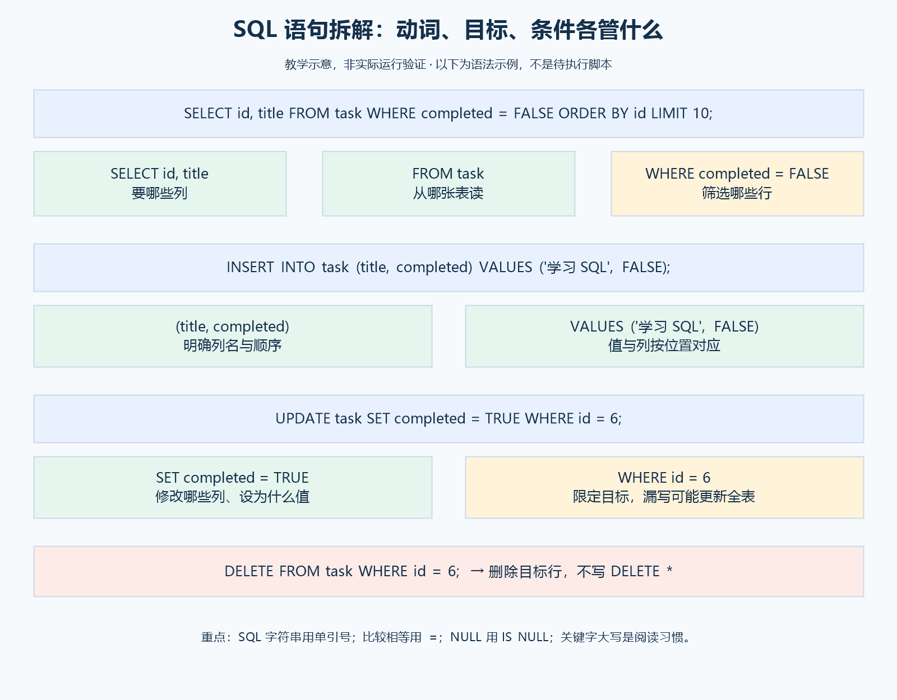

# 10 MySQL 语法与表设计

## 一页重点速记

| 【重点记住】 | 高频语法/规范 |
| --- | --- |
| 列定义 | `title VARCHAR(100) NOT NULL`：列名在类型前 |
| 插入 | `INSERT INTO 表 (列...) VALUES (值...);`，列值按位置对应 |
| 查询 | `SELECT 列 FROM 表 WHERE 条件 ORDER BY 列;` |
| 修改 | `UPDATE 表 SET 列 = 值 WHERE 条件;` |
| 删除 | `DELETE FROM 表 WHERE 条件;`，不写DELETE * |
| 字面值 | 文本单引号；NULL无引号，用IS NULL判断 |
| 约束 | 主键唯一非空；NOT NULL不拒绝空字符串；BOOLEAN本身不限制0/1 |
| 数据范围 | UPDATE/DELETE先确认WHERE，按主键定位；列表顺序需ORDER BY |

**不要混淆：**id不是行号，MAX(id)不是总数，关键字大写是风格习惯，抛Java异常不自动回滚SQL。

## 详细图文说明

## 1. 【重点记住】数据库基础与SQL书写习惯

【图片 7：请在语雀此处上传 images/SQL语法拆解图.png】



观察说明：教学示意。不同色块分别解释取哪些列、从哪张表、筛选哪些行、修改哪些值；UPDATE/DELETE的条件决定影响范围。

MySQL是数据库服务，Navicat是连接它的客户端。数据库包含表，表包含列定义与行记录。Java对象和表记录只是可映射的两种数据形式，不是自动同步的同一份内存。

| 内容 | 推荐写法 | 性质 |
| --- | --- | --- |
| SQL关键字 | SELECT、FROM、WHERE大写 | 便于阅读的风格约定，不强制大写 |
| 表/列名 | task、created_at | 建议统一小写下划线，减少跨平台大小写差异 |
| 语句结束 | 分号; | 客户端分隔SQL常用，Mapper注解通常省略末尾分号 |
| 字符串值 | '学习SQL' | 用单引号，兼容SQL模式 |
| 标识符引用 | `task`、`order` | MySQL反引号，不是字符串值 |
| 注释 | `-- 说明`、`/* 说明 */` | MySQL的双横线后需空白等分隔 |
| NULL | NULL、不带引号 | 缺失/未知值，'NULL'只是四个字符 |
| 比较相等 | = | SQL不是Java，比较不写== |

SQL表名大小写行为受系统和lower_case_table_names等配置影响，别记成“SQL一律不区分大小写”。字符串匹配是否区分大小写与排序规则有关。

在Navicat学习数据库查询窗口执行基础查询：

```sql
SELECT VERSION();
SELECT DATABASE();
SHOW TABLES;
SHOW CREATE TABLE task;
SHOW FULL COLUMNS FROM task;
```

## 2. 【重点记住】常用数据库类型

| 类别 | 常用类型 | 用途/注意 |
| --- | --- | --- |
| 整数 | TINYINT、SMALLINT、MEDIUMINT、INT、BIGINT | 根据范围选型；BIGINT常用于大编号 |
| 精确小数 | DECIMAL(p,s) | p为总位数，s为小数位数；金额常用 |
| 近似小数 | FLOAT、DOUBLE | 近似计算，不保证十进制精确 |
| 固定/变长字符串 | CHAR(n)、VARCHAR(n) | n按字符表达，但实际字节限制还与字符集等有关 |
| 长文本 | TEXT系列 | 长正文；索引与默认值等能力需看版本/规则 |
| 二进制 | BINARY、VARBINARY、BLOB系列 | 原始字节数据 |
| 日期时间 | DATE、TIME、DATETIME、TIMESTAMP、YEAR | DATE仅日期；DATETIME不自动做会话时区转换 |
| 布尔别名 | BOOLEAN / BOOL | MySQL中是TINYINT(1)同义写法，不限制只有0/1 |
| JSON，扩展 | JSON | 有效JSON文档，不替代所有结构化列设计 |
| 枚举，扩展 | ENUM、SET | 数据库特有类型，变更与跨库迁移需权衡 |

TIMESTAMP的写入/读取涉及会话时区转换，DATETIME与TIMESTAMP范围、语义不同；跨系统时间设计需先统一时区规则。Java布尔、数字包装类和数据库NULL也要明确映射。

常见对应：INT→int/Integer，BIGINT→long/Long，DECIMAL→BigDecimal，VARCHAR→String，DATE→LocalDate，DATETIME→LocalDateTime；最终还取决于驱动与类型处理器。不要盲目选择UNSIGNED后仍假设Java相应有符号类型能覆盖全部范围。

参考：[MySQL 8.0数据类型](https://dev.mysql.com/doc/refman/8.0/en/data-types.html)。

## 3. 【重点记住】建表语法与约束

以下是语法参考，已有同名表不要重复创建：

```sql
CREATE TABLE task (
    id INT NOT NULL AUTO_INCREMENT,
    title VARCHAR(100) NOT NULL,
    completed BOOLEAN NOT NULL DEFAULT FALSE,
    PRIMARY KEY (id),
    CONSTRAINT chk_task_completed CHECK (completed IN (0, 1))
) ENGINE = InnoDB DEFAULT CHARSET = utf8mb4;
```

字段定义顺序为 **列名 → 类型 → 约束/默认值**，和Java的“类型在变量名前”不同。列/表级约束之间用逗号，最后一项后不留多余逗号。

| 约束/属性 | 用途 | 常见误解 |
| --- | --- | --- |
| PRIMARY KEY | 唯一标识一行，非空且唯一 | 主键值不等于当前行号 |
| AUTO_INCREMENT | 自动生成递增编号 | 不保证连续，删除后不用重排 |
| NOT NULL | 拒绝NULL | 不拒绝空字符串或全空格 |
| DEFAULT | 省略该字段时使用默认值等规则 | 显式传NULL不等于省略字段 |
| UNIQUE | 限制非NULL键值重复 | MySQL唯一索引通常允许多个NULL |
| CHECK | 检查值满足条件 | 条件为UNKNOWN（例如NULL相关）可能仍通过，需配合NOT NULL |
| FOREIGN KEY，扩展 | 约束关联引用 | 索引、关联规则、级联策略要单独设计 |

MySQL从8.0.16起执行CHECK约束；课程记录数据库为8.0.45。BOOLEAN本身能存2，限制0/1需要CHECK等约束。Java校验方便提供业务提示，数据库约束守住最终数据边界，二者不能简单互相替代。

```sql
ALTER TABLE task
ADD CONSTRAINT chk_task_completed CHECK (completed IN (0, 1));
```

这是给尚未存在该约束的表补约束的语法示例，执行前核对SHOW CREATE TABLE与现有数据；不要对已存在约束重复添加。

参考：[CREATE TABLE](https://dev.mysql.com/doc/refman/8.0/en/create-table.html)、[CHECK约束](https://dev.mysql.com/doc/refman/8.0/en/create-table-check-constraints.html)。

## 4. 【重点记住】INSERT插入

```sql
INSERT INTO task (title, completed)
VALUES ('学习数据库', FALSE);

INSERT INTO task (title)
VALUES ('使用默认状态');

INSERT INTO task (title, completed)
VALUES ('任务A', FALSE), ('任务B', TRUE);
```

显式列名与值按位置对应，数量要匹配。自增id通常不在插入列中。不要依赖表中所有字段的物理顺序写不带列名的INSERT。受影响行数不是生成的主键值。

参考：[INSERT](https://dev.mysql.com/doc/refman/8.0/en/insert.html)。

## 5. 【重点记住】SELECT查询与条件

基础书写结构：

```sql
SELECT id, title, completed
FROM task
WHERE completed = FALSE
ORDER BY id ASC
LIMIT 10 OFFSET 0;
```

| 子句 | 用途 |
| --- | --- |
| SELECT | 要返回哪些列或表达式 |
| FROM | 从哪张表读取 |
| WHERE | 按行筛选 |
| GROUP BY | 按列分组，扩展 |
| HAVING | 筛选分组聚合结果，扩展 |
| ORDER BY | 排序，ASC升序、DESC降序 |
| LIMIT / OFFSET | 限制条数/跳过条数，偏移从0开始 |

没有ORDER BY就不保证结果顺序。常用格式 `LIMIT 10 OFFSET 20` 表示跳过20条取10条；MySQL的 `LIMIT 20, 10` 是偏移在前、条数在后，注意区别。

```sql
SELECT id, title FROM task WHERE id = 6;
SELECT id, title FROM task WHERE id IN (1, 2, 6);
SELECT id, title FROM task WHERE id BETWEEN 1 AND 10;
SELECT id, title FROM task WHERE title LIKE '%Java%';
SELECT id, title FROM task WHERE completed = FALSE AND title LIKE '%Java%';
SELECT id, title FROM task WHERE (completed = FALSE OR id = 6) AND title <> '';
SELECT id, title FROM task WHERE title IS NULL;
SELECT id, title FROM task WHERE title IS NOT NULL;
```

条件速记：=等于，<>或!=不等于，AND同时满足，OR任一满足，NOT取反，IN属于集合，BETWEEN包含两端。AND优先级高于OR，复杂条件主动加括号。

NULL不用 `= NULL` 比较，用IS NULL。LIKE中的%匹配任意长度，_匹配一个字符；要搜索字面的%/_需按既定转义规则处理，不等同于String.contains。VARCHAR(100)字符长度与Java String.length的UTF-16单位也不一定完全一致。

### 【常用查阅】聚合与关联

```sql
SELECT COUNT(*) AS total FROM task WHERE completed = FALSE;

SELECT completed, COUNT(*) AS total
FROM task
GROUP BY completed
HAVING COUNT(*) >= 2
ORDER BY total DESC;
```

COUNT(*)统计行数，COUNT(column)忽略该列NULL；SUM/AVG/MAX/MIN分别求和、平均、最大、最小。不要把MAX(id)当总数。聚合查询不要随意SELECT未分组也未聚合的普通列。

扩展关联示例，假设额外存在app_user表及task.user_id：

```sql
SELECT t.id, t.title, u.username
FROM task AS t
LEFT JOIN app_user AS u ON u.id = t.user_id;
```

INNER JOIN保留双方匹配行，LEFT JOIN保留左表行，右侧无匹配时列为NULL。把右表过滤条件从ON挪到WHERE可能改变保留行的效果。此示例不是现有任务表可直接运行的语句。

参考：[SELECT语法](https://dev.mysql.com/doc/refman/8.0/en/select.html)。

## 6. 【重点记住】UPDATE与DELETE

```sql
UPDATE task
SET completed = TRUE
WHERE id = 6;

UPDATE task
SET title = '新标题', completed = FALSE
WHERE id = 6;

DELETE FROM task
WHERE id = 6;
```

UPDATE用SET表达修改，DELETE删除整行，不写 `DELETE * FROM task`。两者漏WHERE通常作用于全表；工作中先用相同WHERE做SELECT确认目标，再核对写入结果。按主键定位单条，不用可能重复的标题冒充唯一编号。

更新计数可能是匹配行数或实际改变行数，受客户端/驱动配置影响。重复设相同值时不能无条件用0判断不存在；DELETE没有“行仍在但值没变”的情况。

参考：[UPDATE](https://dev.mysql.com/doc/refman/8.0/en/update.html)、[DELETE](https://dev.mysql.com/doc/refman/8.0/en/delete.html)。

## 7. 【扩展参考】结构修改、索引与事务

| 写法 | 含义 |
| --- | --- |
| ALTER TABLE task ADD COLUMN ... | 修改表结构，例如加列 |
| CREATE INDEX idx_name ON task(column_name) | 创建普通索引，具体字段需按查询设计 |
| DROP TABLE table_name | 删除表结构与数据 |
| TRUNCATE TABLE table_name | 清空表，具有DDL等行为，不能当普通DELETE使用 |
| START TRANSACTION / COMMIT / ROLLBACK | 开始/提交/回滚事务 |

```sql
START TRANSACTION;
UPDATE task SET completed = TRUE WHERE id = 6;
ROLLBACK;
```

事务示例要求同一连接、使用支持事务的引擎；autocommit、DDL隐式提交等会影响回滚，不能说“所有SQL都能撤销”。索引加快某些读取但增加写入维护成本，不是每列都建。事务、索引原理和部署属于后续深入内容。

## 独立练习：先自己完成，再按标准检查

**练习1：独立表设计。** 在专门的练习数据库中新建一张阅读任务表，自行选择编号、标题、完成状态的类型和约束，并插入几条数据。不要复用现有task表做破坏性试验。

验收：主键与自增含义明确；拒绝NULL标题及非法完成状态；能说明空字符串是否还需要业务校验。

**练习2：独立增删改查。** 在该练习表上写出“筛选未完成并按编号排序、查总数、只修改一条、只删除一条”四类语句。修改和删除前，先用同一条件SELECT核对。

验收：列和值位置正确；条件只匹配目标；其他记录不变；能区分WHERE、SET、ORDER BY、COUNT的职责。仅写语句未执行时，明确记录为未验证。

## 工作中先记这些

列名在类型前；字符串单引号；NULL用IS NULL；增删改写明字段/条件；列表查询明确列与ORDER BY；主键不是序号；BOOLEAN需要额外约束才限制0/1；应用校验和数据库约束都要有。

## 本章图片清单

| 名称 | 相对路径 |
| --- | --- |
| SQL语法拆解图（教学示意） | images/SQL语法拆解图.png |

按正文中的图片编号与上传提示在语雀上传，不依赖复制Markdown自动带图。
