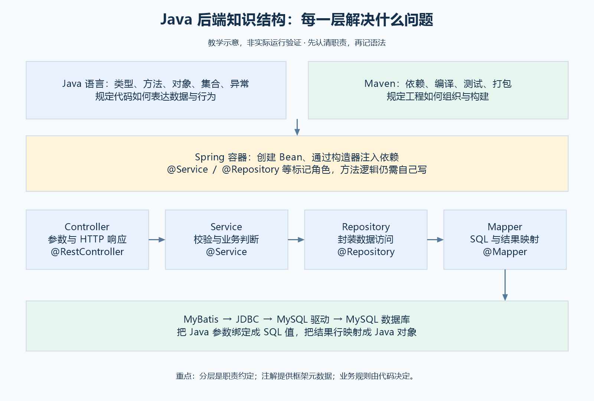

# Java 后端知识手册：第 1～32 节

本册为基础篇。[返回知识手册总目录](../README.md)。后续主题册统一放在上一级“Java后端知识手册”目录，与本册并列。

这是一份按知识主题组织的语法与用法手册。目标是读完知道为什么这样写，使用时能快速找到格式、规则和例子。适用基础：JDK 21、Windows、IntelliJ IDEA、Spring MVC、MySQL 8.0、MyBatis。

**阅读入口：**复习按下表顺序阅读；写代码时按问题跳转。正文中的“扩展参考”补充相关知识，并不表示已经完成对应练习。所有示例用于说明语法，需放入相应类、方法或工程；代码片段没有被当作独立工程逐个编译运行。

**每章结构：一页重点速记 → 详细图文说明 → 2个独立练习与验收标准。** 先用速记恢复记忆，遇到不熟的写法再展开正文，最后通过少量练习检查是否能自己使用。暂不附完整练习答案，练习未提交不算已经验证。

**为什么32节只有12章？** 原32篇课程笔记仍在各自课程目录，本册另外按知识主题合并为12章。后续仍是一课一篇课程笔记，相关多课再整合成主题/阶段手册。具体安排见[笔记整理规划.md](../笔记整理规划.md)。

## 阅读标记：先找重点，再按需展开

| 标记 | 阅读要求 |
| --- | --- |
| 【重点记住】 | 工作中反复使用的语法、规则和规范，优先理解并熟练使用 |
| 【常用查阅】 | 经常会遇到，但可以使用时查表，不必逐字背诵 |
| 【扩展参考】 | 补齐相关知识范围，当前未全部练习，不要求立即熟练 |

每章末尾有“工作中先记这些”。正文补充范围比原练习更完整，重点标记表示常用程度，不代表其他语法不重要。

## 一、主题目录

| 想解决的问题 | 打开文档 |
| --- | --- |
| Java 怎么运行？IDEA 常用快捷键和调试怎么用？ | [01_运行环境与IDEA速查.md](01_运行环境与IDEA速查.md) |
| Java 到底有哪些类型？如何转换？字符串怎么操作？ | [02_类型变量运算符与字符串.md](02_类型变量运算符与字符串.md) |
| 分支、循环、方法、参数和返回值怎么写？ | [03_流程控制与方法.md](03_流程控制与方法.md) |
| 类、对象、构造器、接口、继承、修饰符有什么区别？ | [04_面向对象与接口.md](04_面向对象与接口.md) |
| 数组、List、Set、Map 如何选择？泛型怎么写？ | [05_数组集合与泛型.md](05_数组集合与泛型.md) |
| 异常怎么抛、怎么接？选什么类型？ | [06_异常语法与处理.md](06_异常语法与处理.md) |
| Maven、Spring Boot、依赖注入和各层注解如何使用？ | [07_Maven与Spring分层注解.md](07_Maven与Spring分层注解.md) |
| 接口参数、JSON、状态码、统一异常、Postman 怎么用？ | [08_HTTP与SpringMVC接口.md](08_HTTP与SpringMVC接口.md) |
| 条件筛选、分页、DTO 和通用响应怎么组织？ | [09_筛选分页与数据对象.md](09_筛选分页与数据对象.md) |
| 数据库类型、建表、约束、增删改查语法怎么写？ | [10_MySQL语法与表设计.md](10_MySQL语法与表设计.md) |
| Java 如何连接数据库？MyBatis 如何绑定参数、回填主键？ | [11_JDBC与MyBatis.md](11_JDBC与MyBatis.md) |
| 常见错误怎样定位？核心知识怎样自查？ | [12_排错与复习清单.md](12_排错与复习清单.md) |

## 二、整体结构

【图片 1：请在语雀此处上传 images/Java后端知识结构图.png】

观察说明：教学示意，不是运行截图。Java 提供语言规则，Maven 管理构建，Spring 组织对象及 HTTP 接口，MyBatis/JDBC 访问 MySQL。Controller、Service、Repository 是代码职责；它们不是三种新的 Java 语法。

## 三、原课程对照

| 原课序 | 主题 | 本手册章节 |
| --- | --- | --- |
| 01 | 程序运行、断点、报错 | 01、06、12 |
| 02～03 | 变量、方法、条件与输入校验 | 02、03、06 |
| 04～05 | 类、对象、构造器、封装 | 04 |
| 06 | 集合与遍历 | 05 |
| 07 | 异常与参数校验 | 06 |
| 08 | 接口与实现 | 04 |
| 09 | Maven | 07 |
| 10～11 | Spring Boot、依赖注入与分层 | 07 |
| 12～13 | 参数、JSON、POST 与 DTO | 08、09 |
| 14～15 | 错误响应、统一异常、404 | 06、08 |
| 16～17 | PATCH、DELETE、204、幂等 | 08、11 |
| 18～20 | 可选条件、关键词、查询对象 | 09 |
| 21～23 | 分页、总数、泛型响应 | 05、09 |
| 24～25 | Service 接口、Repository 分层 | 04、07 |
| 26 | MySQL、表设计、约束与 SQL | 10 |
| 27 | JDBC、连接与资源关闭 | 06、11 |
| 28～29 | MyBatis 查询、参数绑定、映射 | 11 |
| 30～32 | 插入回填、更新行数、删除不存在处理 | 08、11 |

## 四、使用约定

- “语法规则”表示语言或框架的要求；“建议”表示便于维护的写法；“接口约定”表示可以由团队设计的行为。不要把三者混在一起背。
- Java 示例遵循 JDK 21 普通语法，不启用预览功能。版本敏感内容列官方参考，不要求升级现有依赖。
- 第 32 节工程声明的版本为 Spring Boot 4.1.1、MyBatis starter 4.0.0、Connector/J 9.7.0；这是工程文件记录，不代表“最新版”推荐。
- SQL 示例在 Navicat 的学习数据库查询窗口使用；写入、建表和删除示例用于查语法，不是要整篇顺序执行的初始化脚本。
- 教学过程、掌握情况、运行反馈和课程交接保存在根目录学习进度中，不作为本手册正文。

## 五、语雀图片清单

| 编号 | 图片 | 相对路径 |
| --- | --- | --- |
| 1 | Java 后端知识结构图，教学示意 | images/Java后端知识结构图.png |
| 2 | 请求与异常处理流程图，教学示意，见第 08 章 | images/请求与异常处理流程图.png |
| 3 | Java 类型分类图，见第 02 章 | images/Java类型分类图.png |
| 4 | 方法声明拆解图，见第 03 章 | images/方法声明拆解图.png |
| 5 | 分层注解位置图，见第 07 章 | images/分层注解位置图.png |
| 6 | 异常分类与处理图，见第 06 章 | images/异常分类与处理图.png |
| 7 | SQL 语法拆解图，见第 10 章 | images/SQL语法拆解图.png |
| 8 | 引用与浅复制示意图，见第 04 章 | images/引用与浅复制示意图.png |
| 9 | 分页区间示意图，见第 09 章 | images/分页区间示意图.png |

复制 Markdown 不保证上传本地图片。保留整个目录，在语雀对应标记处上传图片；各 Markdown 可分别作为一篇文档。绘图脚本在 images/绘制示意图.ps1。
